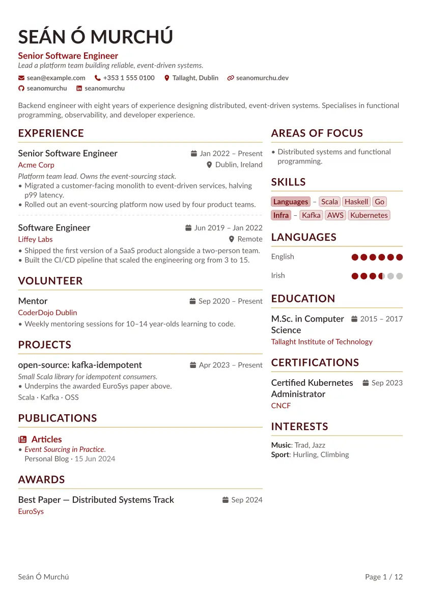
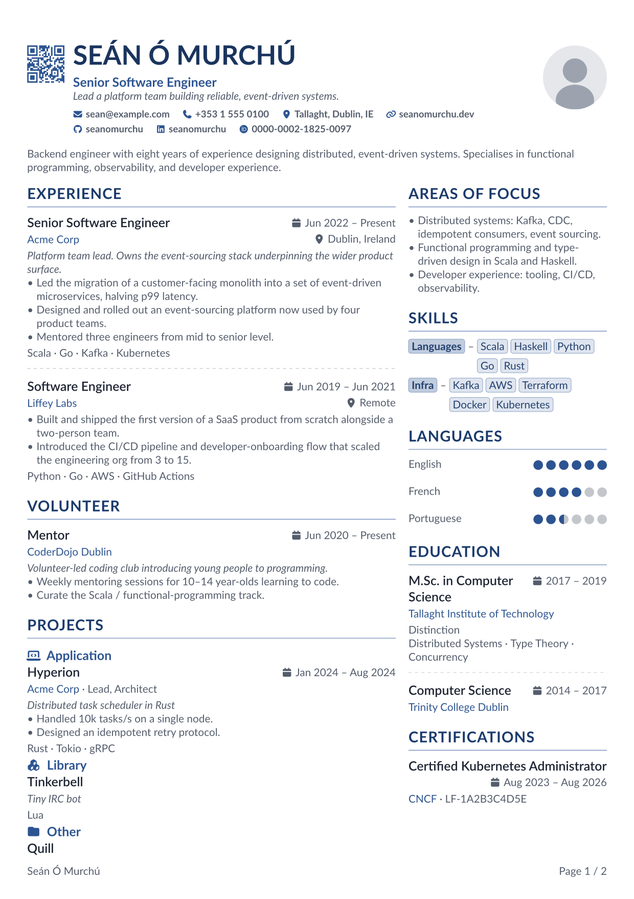
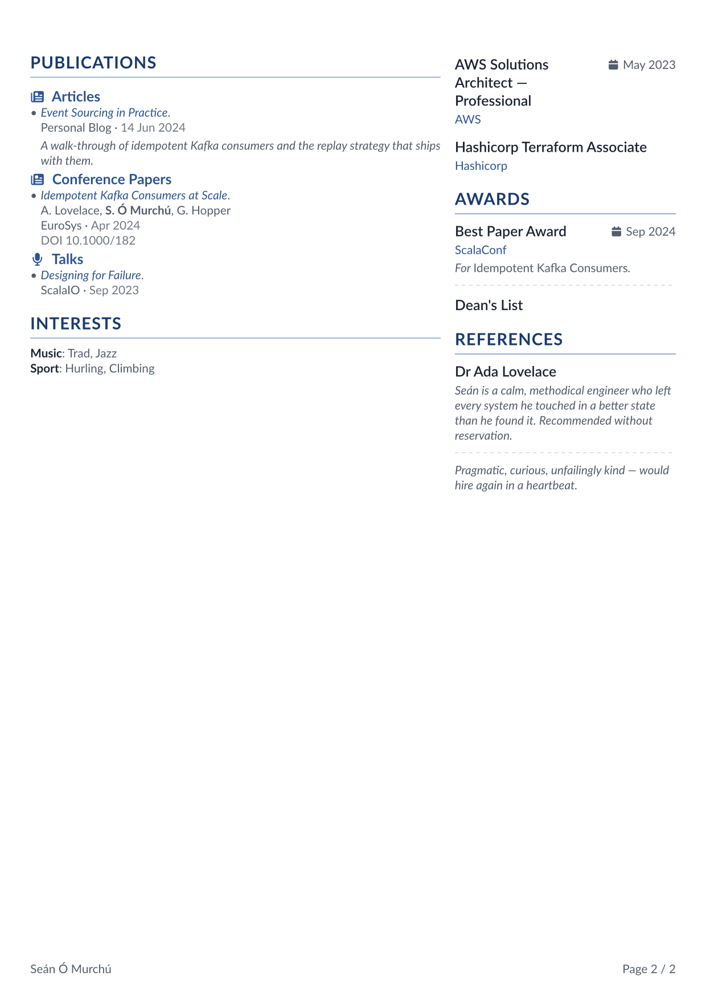

<h1 align="center">Alta CV</h1>

<p align="center">
  <a href="https://typst.app/universe/package/altacv"></a>
  <a href="https://github.com/smur89/alta-typst/releases"></a>
  <a href="https://github.com/smur89/alta-typst/actions/workflows/build.yml"></a>
  <a href="LICENSE"></a>
  <a href="https://github.com/smur89/alta-typst/stargazers"></a>
</p>

<p align="center">A two-column CV template for Typst.<br>Write your CV once as <a href="https://jsonresume.org/">JSON Resume</a> data; pick a theme, a layout and a language.</p>

<!-- Relative path so the preview tracks the codebase: GitHub renders the README from main, Universe from the package version's snapshot. examples/ ships in the typst/packages submission but is `exclude`d from the compiler bundle (see typst.toml). -->
<p align="center">
  
</p>
<p align="center"><sub>One CV in every built-in theme, each frame with a different layout: columns, photo position and shape, header alignment, date format, QR code, justified text, single column, a CV in Irish, and show rules restyling the ratings and keywords.</sub></p>

## Highlights

- **Data, not layout.** Your CV is a [JSON Resume](https://jsonresume.org/schema/) dict, inline in Typst or loaded from a `resume.json`. Empty sections disappear, and a misspelt key or a wrong type stops the build with a message naming it.
- **A Typst template.** Themes for the look, Typst's own `set` and `show` rules for the rest: the page, the font, the language, any part of the CV.
- **Any layout.** Two columns at any ratio, any section in either column, or a single column for applicant-tracking systems (ATS).
- **A rich header.** A photo, a contact bar with icons for common networks, and an optional QR code to your homepage for printed copies.
- **Every string translatable**, month names included. The labels follow `set text(lang: ..)`, with English and [Irish](internal/data/labels-ga.toml) built in.
- **Print- and archive-ready.** PDF metadata comes from your data, and the output compiles as PDF/A and PDF/UA-1.

The full example, every section in use, over two pages ([source](https://github.com/smur89/alta-typst/blob/v1.9.0/examples/example-full.typ) <!-- x-release-please-version -->, [PDF](examples/example_full.pdf)):

| Page 1 | Page 2 |
| :---: | :---: |
|  |  |

## Contents

- [Quick start](#quick-start): [your data in Typst](#your-data-in-typst), [a `resume.json`](#a-resumejson)
- [Customising](#customising): [themes](#themes-and-colours), [fonts](#fonts), [layout](#layout), [photo and contacts](#photo-contact-bar-and-qr-code), [labels and language](#labels-and-language), [restyling](#restyling-parts), [page and footers](#page-footers-and-pdf)
- [Beyond the data](#beyond-the-data): [the CV in markup](#writing-the-cv-in-markup), [your own mapping](#your-own-mapping)
- [Reference](docs/reference.md) · [Upgrading](#upgrading) · [Contributing](#contributing) · [Credits](#credits)

## Quick start

**Requirements:** Typst 0.15.0 or later, and two fonts: [Lato](https://fonts.google.com/specimen/Lato) (the default) and the **FontAwesome 7 desktop** fonts (for icons). The Typst web app has both. Locally, on macOS, `brew install --cask font-lato font-fontawesome`; elsewhere, install Lato from Google Fonts and the FontAwesome 7 desktop OTFs from [fontawesome.com/download](https://fontawesome.com/download) (Debian/Ubuntu's `fonts-font-awesome` is v6, which isn't read). Run `typst fonts` to check: without FontAwesome, icons render as empty boxes. Package dependencies download automatically.

```bash
typst init @preview/altacv
```

This copies [`template/cv.typ`](template/cv.typ), a complete example CV, and [`template/resume.json`](template/resume.json), the same CV as a JSON Resume file, into a new project. Edit the data in `cv.typ` and compile.

### Your data in Typst

<!-- x-release-please-start-version -->
```typst
#import "@preview/altacv:1.9.0": alta, altacv

#let cv = (
  basics: (
    name: "Jane Doe",
    label: "Senior Software Engineer",
    summary: [Backend engineer with eight years' experience…],
    email: "jane@example.com",
    profiles: ((network: "GitHub", username: "janedoe", url: "https://github.com/janedoe"),),
  ),
  work: ((
    position: "Senior Software Engineer",
    name: "Acme Corp",
    url: "https://acme.example.com", // links the company name
    startDate: "2022-01",            // no endDate: "Present"
    highlights: ([Led the migration…], [Designed the platform…]),
  ),),
  skills: ((name: "Languages", level: "Expert", keywords: ("Scala", "Python")),),
  // education, languages, projects, publications, certificates, awards, …
)

#show: altacv.with()

#alta(cv)
```
<!-- x-release-please-end -->

`#show: altacv.with(..)` is the template; your own `set` and `show` rules go after it and win. `alta(cv)` draws the CV. Only `basics.name` is required. Fields that take a string also take Typst markup (`[Led the *platform* team]`); keep to plain strings if the data also lives in a `resume.json`. Dates are ISO 8601 (`2024`, `2024-06`, `2024-06-15`). The [data schema](docs/reference.md#data-schema) lists every section and field.

### A `resume.json`

Load a JSON Resume file with [gairm-import](https://typst.app/universe/package/gairm-import)'s `parse`, which checks it against the [schema](https://jsonresume.org/schema/) first, so a vanilla `resume.json` works without edits:

<!-- x-release-please-start-version -->
```typst
#import "@preview/altacv:1.9.0": alta, altacv
#import "@preview/gairm-import:1.9.0": parse

#show: altacv.with()

#alta(parse(path("resume.json")))
```
<!-- x-release-please-end -->

Both routes take the same data: anything the dict holds, altacv's [extensions](docs/reference.md#extensions) included, a `resume.json` can too. Typst can't load a photo from a JSON string (a bare path resolves inside the package), so set it from your own file:

```typst
#let cv = parse(path("resume.json"))
#alta(cv + (basics: cv.basics + (image: path("photo.jpg"))))
```

## Customising

Settings layer in order: the template's theme, then your `set` and `show` rules after the show line, then show rules on a [part](#restyling-parts). `alta()` takes the layout and data options as `preferences`, each merged over its default, so set only the keys you change: `#alta(cv, preferences: (date-format: "short", photo-position: left))`. Option names are kebab-case. An unknown key or a wrong type panics, naming it. Every option is in the [reference](docs/reference.md#preferences). The snippets below use the `cv` dict from [Quick start](#your-data-in-typst).

### Themes and colours

The template's `theme` picks the look. The built-in themes are `themes.teal` (the default), `navy`, `crimson`, `forest`, `plum`, `charcoal`, `altacv`, `rust`, `bauhaus`, `riso`, `phosphor` and `catppuccin`. A theme is a dict of [tokens](docs/reference.md#theme-tokens): colour roles, the font, the type sizes and weights, the spacing and the separators. A theme of your own sets only what it changes; the rest is the default theme's:

```typst
#show: altacv.with(theme: (
  font: "Libertinus Serif",
  type: (headline: (size: 1.2)),  // section titles
  separator: (facts: " | "),
))
```

To adjust a built-in theme, add to it: `themes.navy + (font: "Libertinus Serif")`. Typst's `+` merges only the top level, so to change a few [colour roles](docs/reference.md#colour-roles), spread the theme's own: `themes.navy + (colours: (..themes.navy.colours, accent: rgb("#b5179e")))`.

### Fonts

The font is Typst's: `#set text(font: "Inter")` after the show line, over the theme's. Any installed font works. The name is Typst's `title` element and section titles are level-1 headings, so a show rule sets them in another face:

```typst
#set text(font: "Source Sans 3")
#show selector(title).or(heading.where(level: 1)): set text(font: "Roboto Slab")
```

Groups are level-2 headings and entry titles one level below their section or group, so a plain `show heading: ..` reaches them too.

### Layout

`column-ratio` is the left column's share of the width. `left-column-sections` and `right-column-sections` pick which sections go where, in order; a section in neither isn't drawn. By default the long-form sections (experience, volunteering, projects, publications) take the wide left column. To put the side panel on the narrow left:

```typst
#alta(cv, preferences: (
  column-ratio: 0.35,
  // a section in neither list isn't drawn
  left-column-sections: ("focus-areas", "skills", "languages", "education"),
  right-column-sections: ("work", "projects"),
))
```

`column-ratio: 1` stacks every section in one column, the left list first, for applicant-tracking systems that misread columns. `#set par(justify: true)` justifies the prose (the summaries, highlights and publications); rows of facts, keywords and tags stay ragged.

### Photo, contact bar and QR code

Set `basics.image` to add a photo, as a `path("photo.jpg")`, which resolves from your own file, or as bytes; a string resolves inside the package. `photo-position` (`left`, `right`, `top` or `bottom`), `photo-size` and `photo-shape` (`"circle"`, `"rounded"`, `"square"`) place it; `header-text-align` aligns the header's text. `avatar-placeholder` is a generic silhouette to start with.

The contact bar shows `basics.email`, `phone`, `location`, `url` and `profiles`, each linked. `link-contact-info` turns linking off, entirely or per channel; for paper, add `print-full-urls: true` to print profile URLs in place of usernames. A network with no built-in icon panics unless you give it one in `profile-icons` ([networks](docs/reference.md#profile-networks)).

`qr-code: auto` adds a QR code to `basics.url`, opposite the photo, for printed copies; a URL string encodes that instead.

### Labels and language

Every string the template prints is a label, and the labels follow the document's language, set with Typst's own rule after the show line: `#set text(lang: "ga")`. The language also drives hyphenation, smart quotes and the PDF's language tag. English and Irish are built in ([a CV in Irish](https://github.com/smur89/alta-typst/blob/v1.9.0/examples/example-ga.typ) <!-- x-release-please-version -->); any other language keeps the English labels. Override any of them for the whole document with the template's `labels`:

```typst
#show: altacv.with(labels: (
  work: "Berufserfahrung",
  present: "Heute",
  months: ("Jan", "Feb", "Mär", "Apr", "Mai", "Jun", "Jul", "Aug", "Sep", "Okt", "Nov", "Dez"),
))
#set text(lang: "de")
```

These go over the language's own wherever they're read: in `alta()`'s CVs, in the [markup blocks](#writing-the-cv-in-markup) and in the footers. `alta(cv, labels: ..)` overrides them for one CV. For a full translation, copy [`internal/data/labels-en.toml`](internal/data/labels-en.toml), translate it, drop its `lang` line and its `[publication-icons]` table, and load it: `altacv.with(labels: toml("labels-de.toml"))`. To have it built in, open a pull request adding it as `internal/data/labels-de.toml`. Every key is in the [reference](docs/reference.md#labels).

### Restyling parts

Parts of the CV carry labels (`<alta-…>`) that show rules can target, to restyle one part and leave the rest. Put the rules after the show line:

```typst
#show <alta-contact>: set text(font: "IBM Plex Mono")
#show <alta-date>: set text(style: "italic")
#show divider: set line(stroke: (paint: gray))  // the line between entries
#show <alta-rating-full>: [★]                   // stars for dots
#show <alta-rating-empty>: [☆]
#show list: set list(marker: [–])
```

A text part takes `set text(..)`, a line part `set line(..)`, a paragraph part `set par(..)`; a marker (an icon, a rating dot) can be recoloured or replaced. The line between entries is Typst's `divider` and the bullets Typst's `list`, so restyle them as such. A replacement rule's `it` is the part as content: use it whole (`tag(it)`), not `it.text`. Every part and its kind is in the [reference](docs/reference.md#part-labels), with a recipe that draws an entry's keywords as tags.

### Page, footers and PDF

The page is Typst's: `#set page(paper: "us-letter", margin: (x: 1cm))` after the show line. Two footers come with the template: `#set page(footer: cv-footer())` puts your name and the page number on a CV of more than one page, and `cv-updated-footer()` the last-modified date from `meta.lastModified` (`version: true` adds `meta.version`; in a CV written in markup, pass the `date:`). Any content of your own works too.

The PDF's title, author, subject, keywords and date come from your data ([which fields](docs/reference.md#pdf-metadata)). For an archival (PDF/A) or accessible (PDF/UA-1) PDF, ask the compiler; the output is tagged, with alt text for the photo and meaningful icons:

```sh
typst compile --pdf-standard a-2b,ua-1 cv.typ
```

## Beyond the data

### Writing the CV in markup

The blocks `alta()` draws with are public, so a CV can be written as a Typst document, with sections of your own:

<!-- x-release-please-start-version -->
```typst
#import "@preview/altacv:1.9.0": altacv, contact, cv-columns, cv-header, entry, skill-row

#set document(title: "Jane Doe", author: "Jane Doe")
#show: altacv.with()

#cv-header(tagline: "Senior Software Engineer", contacts: (contact("email", "jane@example.com"),))

#cv-columns(
  ratio: 2 / 3,
  [
    = Experience

    #entry(title: "Senior Software Engineer", org: "Acme Corp", date: ("2022", none))[
      - Led the migration…
    ]
  ],
  [
    = Skills

    #skill-row("Languages", ("Scala", "Python"), level: "Expert")
  ],
)
```
<!-- x-release-please-end -->

The structure is Typst's own: the name is the document's `title`, `=` headings are sections, `==` headings are groups, and entries sit below them. `cv-columns` lays out the columns with the theme's gutter; a plain `grid` works too. The blocks are `cv-header`, `contact`, `entry`, `publication`, `skill-row`, `rating`, `label-row`, `tag` and `cv-columns`, each with a doc comment your editor shows on hover, and listed with their arguments in the [reference](docs/reference.md#blocks). [`tests/markup.typ`](https://github.com/smur89/alta-typst/blob/v1.9.0/tests/markup.typ) <!-- x-release-please-version --> is a complete CV written this way. A few things to know:

- An `entry` needs a `=` or `==` heading before it; one right after `#alta(cv)` continues its last section. It doesn't break across pages, so split long prose over several entries.
- Group headings carry no icon unless you add one: `== #icon("microphone") Talks`.
- A `===` heading isn't styled as a group, and an `entry` under one panics.
- Numbering headings (`set heading(numbering: ..)`) numbers the outline, not the title as drawn.
- Use `outline(depth: 1)` to list only sections, as entries are headings too.

### Your own mapping

Inside the template, `alta(cv)` draws the CV with [`adapter/json-resume.typ`](https://github.com/smur89/alta-typst/blob/v1.9.0/adapter/json-resume.typ) <!-- x-release-please-version -->, a mapping from JSON Resume onto the public blocks, written to be copied. To change how a section is drawn beyond what the preferences and show rules reach, copy it into your project as `json-resume.typ`, replace its `#import` lines with one, edit it, and render your copy under the template:

<!-- x-release-please-start-version -->
```typst
// json-resume.typ, your copy: its imports become
#import "@preview/altacv:1.9.0": adapter, cv-columns, cv-header, divider, entry, icon, label-row, publication, rating, skill-row

// cv.typ
#import "@preview/altacv:1.9.0": altacv
#import "@preview/gairm-import:1.9.0": parse
#import "json-resume.typ": resume

#show: altacv
#set document(title: "Jane Doe", author: "Jane Doe")
#resume(parse(path("resume.json")))
```
<!-- x-release-please-end -->

`resume(cv, preferences: (:))` takes validated JSON Resume: `parse`'s output, or a CV `alta()` has checked. It doesn't check the fields again, so a wrong-typed field fails inside the mapping rather than naming itself. Its preferences are `alta()`'s, merged and checked the same way, and its labels are the template's. The `set document` fills the PDF's metadata, which `alta()` does for you. A bare `basics.image` path resolves from your copy's folder. Each section is a function of its own, `work(cv, ctx)` and so on, where `ctx` holds the resolved `labels` and `prefs` and the `owners` set apart among publication authors, and `sections` maps each column key to one. The mapping reads the CV with the [`adapter`](docs/reference.md#adapter) helpers, the readers `alta()` uses, so your copy reads the data as `alta()` does.

## Upgrading

Deprecated forms keep working until the next major release, which removes them ([#239](https://github.com/smur89/alta-typst/issues/239)).

**Standalone `alta()`.** `alta(cv)` without `#show: altacv` still renders a CV in the default theme, but is deprecated: add the show line above it. Inside the template, the document-level preferences panic, naming their replacement:

| Standalone | In the template |
|---|---|
| `alta(cv, ..)` on its own | `#show: altacv.with(..)`, then `alta(cv, ..)` |
| `font`, `body-size` | `set text(font: .., size: ..)` |
| `paper`, `margin` | `set page(paper: .., margin: ..)` |
| `page-footer: auto` | `set page(footer: cv-footer())`; your own content: `set page(footer: [..])` |
| `last-modified-footer`, `footer-version` | `set page(footer: cv-updated-footer(version: ..))` |
| `accent` | `altacv.with(theme: ..)`, a theme or a colour role over one |
| `labels.lang` | `set text(lang: ..)` |
| `labels` for every CV | `altacv.with(labels: ..)` |

In the template the name is Typst's `title` and sections are level-1 headings, where standalone has the name at level 1 and sections at level 2, so retarget heading show rules. Your `set text` and `set list` rules after the show line reach inside the CV, where standalone `alta()` set its own.

**Other deprecations:**

| Deprecated | Use instead |
|---|---|
| `alta-from-json(path("resume.json"), ..)` | `alta(parse(path("resume.json")), ..)`, with gairm-import's `parse` ([A `resume.json`](#a-resumejson)) |
| `from-json-resume(data)` | gairm-import's `parse(data)` |
| `name(body)` | `entry(org: ..)` |
| `term(period, location: ..)` | `entry(date: .., location: ..)` |
| `styled-link(content, dest: ..)` | `entry(title: .., url: ..)` |
| `tag(.., label: true)` | `tag(.., category: true)` |
| camelCase option names (`columnRatio`, `labels.pageNumber`) | kebab-case (`column-ratio`, `labels.page-number`); the data keeps JSON Resume's camelCase (`startDate`) |
| `palettes` | `themes` |

The reference lists [every deprecated option and data form](docs/reference.md#deprecated).

## Contributing

Bug reports and pull requests are welcome; see [CONTRIBUTING.md](CONTRIBUTING.md).

## Credits

- **[LianTze Lim — AltaCV](https://github.com/liantze/AltaCV)** (LPPL). The visual ancestor: the two-column layout, accent palette, and section structure originate in LianTze's LaTeX class.
- **[Catppuccin](https://github.com/catppuccin/catppuccin)** (MIT). `themes.catppuccin` uses the Latte flavour's colours.
- **[George Honeywood — alta-typst](https://github.com/GeorgeHoneywood/alta-typst)** (MIT, © 2023). Prior Typst implementation; the grid layout, pill tags, and half-fill skill dots originate there.

## License

[MIT](LICENSE). Copyright © 2023 George Honeywood, © 2026 Shane Murphy.
