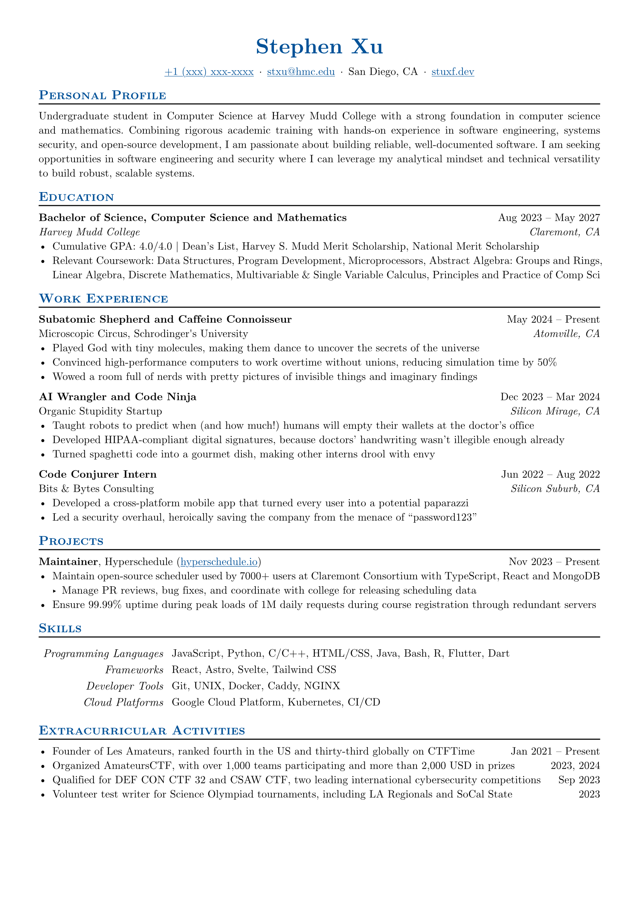

# Basic Resume Plus

> **Note:** This is a fork of the popular [basic resume](https://typst.app/universe/package/basic-resume) template.

<div align="center">Version 0.3.0</div>

A simple, ATS-conscious resume layout with composable sections. The layout is inspired by [Jake's Resume](https://github.com/jakegut/resume) and [guided-resume-starter-cgc](https://typst.app/universe/package/guided-resume-starter-cgc/).

Create a new project from the template with:

```sh
typst init @preview/basic-resume-plus:0.3.0
```



[Download the example PDF](example-resume.pdf)

## Quick start

The template starts with personal details, global styling, and a separate contact section. Replace the sample values, then add resume sections below. Contact details are optional; remove unused values or the entire contact section.

```typst
#import "@preview/basic-resume-plus:0.3.0": *

// Replace these sample values with your own.
#let name = "Stephen Xu"
#let phone = "+1 (xxx) xxx-xxxx"
#let email = "stxu@hmc.edu"
#let location = "San Diego, CA"
#let personal-site = "stuxf.dev"

#show: resume.with(
  author: name,
  accent-color: blue.darken(30%), // #005197
  font: "New Computer Modern",
  paper: "a4",
  author-position: center,
)

#contact-section(
  // Contact details are optional; remove any items or rows you don't need.
  values: (
    (
      tel-link(phone),
      mail-link(email),
      location,
      web-link(personal-site),
    ),
    (), // Add optional social links here.
  ),
  position: center,
)

== Personal Profile
#lorem(50)

== Education
#edu()
- ...

// ...


```

For a fuller starting document, see [`template/main.typ`](template/main.typ).

## Components

- `resume(...)` applies document-wide styling. It accepts `author`, `author-position`, `section-position`, `accent-color`, `font`, `paper`, `author-font-size`, `font-size`, and `lang`.
- `empty(value)` checks whether a value is `none`, an empty string, or an empty array. `web-link(...)`, `tel-link(...)`, and `mail-link(...)` create linked contact content; `web-link` expects a host/path without a URL scheme and adds `https://`.
- `contact-section(values:, separator:, position:)` displays one or more rows of contact details. Pass a flat array for one row or an array of arrays for multiple rows. Each item can be any Typst content, including the built-in link helpers or content from icon packages. Compared with the older built-in contact fields, composing these rows takes more manual work but gives you control over the content, order, separators, and alignment.
- `dates-helper(start, end)` formats one date or a start/end range with an en dash.
- `edu(...)` formats education entries; `institution-top` and `location-top` control which details are shown on the top row.
- `work(...)`, `project(...)`, and `certificate(...)` format the corresponding entries. Projects require a non-empty `name`; certificates require non-empty `name` and `issuer` values.
- `extracurricular(...)` formats a single activity. `extracurricular-list(data:)` renders an array of `(description, dates)` pairs as a bulleted list.
- `skills-table(data:, key-decorator:)` renders a non-empty dictionary of categories and content as a two-column table. `key-decorator` controls the styling of category labels.
- `generic-two-by-two(...)` and `generic-one-by-two(...)` provide unstyled two-column layouts for custom sections.

### Optional contact icons

`contact-section` accepts arbitrary Typst content, so icon-based links from another package can be used alongside the built-in link helpers. For example, [`iconic-salmon-svg`](https://typst.app/universe/package/iconic-salmon-svg) provides ready-made social links; it is an optional dependency and is not needed by the resume template itself:

```typst
#import "@preview/basic-resume-plus:0.3.0": *
#import "@preview/iconic-salmon-svg:3.0.0" as iss

#contact-section(
  values: (
    iss.github-info("your-handle"),
    iss.linkedin-info("your-handle"),
  ),
  position: center,
)
```
Alternatively there are quite a few typst packages that wrap the fontawesome font and they also provide you with such symbols and emojis.

## Upgrading from 0.2.x

Version 0.3.0 includes API changes. Contact details are now passed to `contact-section(...)` rather than to `resume.with(...)`; contact alignment is set with `contact-section(position:)`. `dates-helper` takes one or two positional date arguments, for example `dates-helper("Aug 2023", "May 2027")`. The `edu(...)` layout now uses `institution-top` and `location-top` instead of `consistent`, and no longer accepts `gpa`. Pass a Typst color value such as `rgb("#26428b")` to `accent-color`. The component names are now `certificate(...)` and `extracurricular(...)` (singular). See the [changelog](CHANGELOG.md) for the full list.

## License

This project is released under the [Unlicense](LICENSE).
