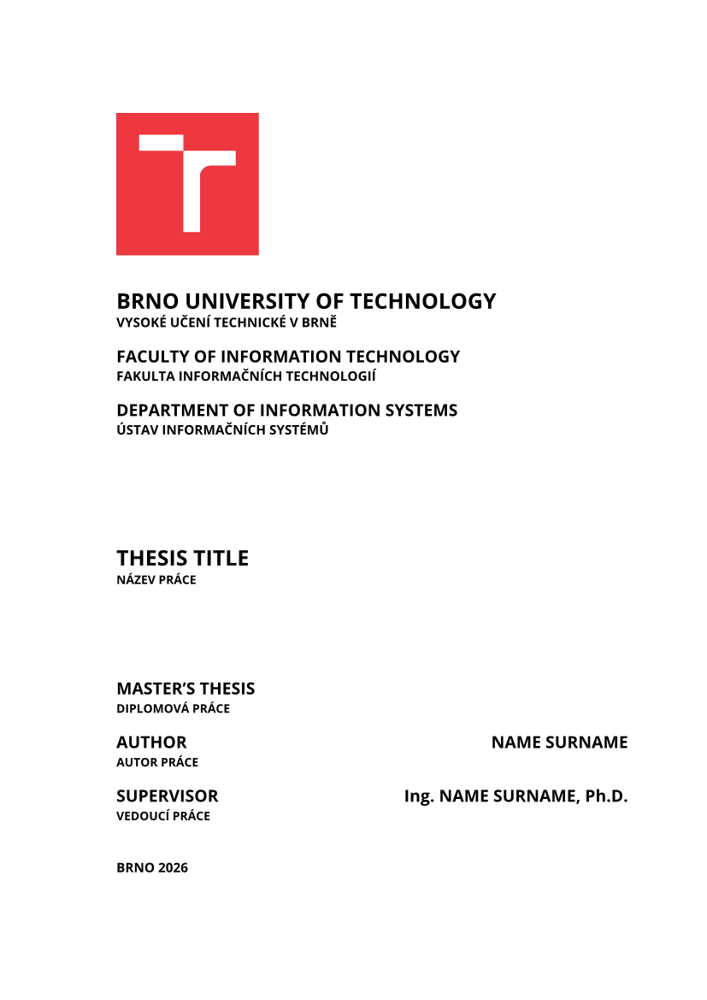
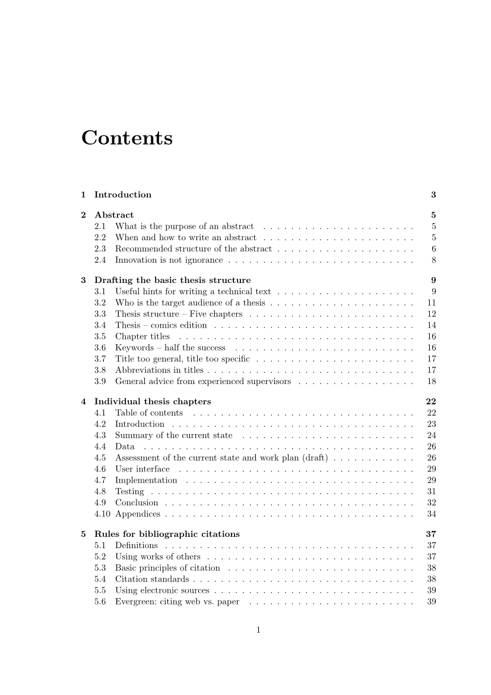
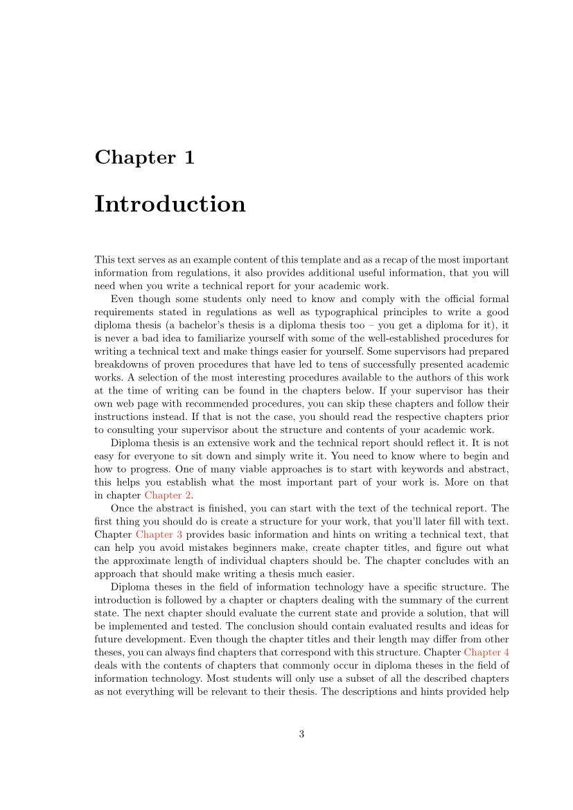

# but-fit-thesis

Official thesis template of the [Faculty of Information Technology, Brno
University of Technology](https://www.fit.vut.cz/) (FIT BUT, FIT VUT v Brně) for
term projects and bachelor's, master's, PhD and habilitation theses. It
reproduces the look of the faculty's LaTeX template (`fitthesis.cls`, 2025
edition): A4 page layout, title page with the university logo, abstract and
keywords in Czech and English, declaration, LaTeX-style contents, chapter
headings, captions and link colours.

<p align="center">
  
  
  
</p>

## Getting started

In the [Typst web app](https://typst.app/), choose *Start from template* and
search for `but-fit-thesis`. On the command line, run:

```bash
typst init @preview/but-fit-thesis:0.1.0 my-thesis
cd my-thesis
typst watch thesis.typ
```

The new project contains `thesis.typ` (settings, chapter list, bibliography),
sample chapters in `chapters/` that summarise the faculty's thesis guidelines,
and the bibliography in `bib/`. Replace the sample chapters with your own and
remove `bib/template.bib` once nothing cites it.

To use the template in an existing project:

```typ
#import "@preview/but-fit-thesis:0.1.0": appendix, fit-thesis

#show: fit-thesis.with(
  type: "master",
  lang: "en",
  title: (en: [Thesis Title], cs: [Název práce]),
  author: (name: "Name", surname: "Surname"),
  supervisor: (name: "Name", surname: "Surname", before: "Ing.", after: "Ph.D."),
  department: "UIFS",
  abstract: (en: [The abstract in English.], cs: [Abstrakt v češtině.]),
  keywords: (en: [keyword, keyword], cs: [klíčové slovo, klíčové slovo]),
)

= Introduction
…

#bibliography("bib/bibliography.yaml")

// Chapters after this line are "Appendix A", "Appendix B", …
#show: appendix
= Contents of the Included Storage Media
…
```

## Options

| Option | Meaning |
|---|---|
| `type` | `"bachelor"`, `"master"`, `"phd"`, `"habilitation"` or `"term"` |
| `lang` | `"en"` or `"cs"`: main language; the other one is used for the secondary lines on the title page and the second abstract |
| `title`, `abstract`, `keywords` | `(en: [...], cs: [...])` |
| `author`, `supervisor` | `(name: "…", surname: "…", before: "Ing.", after: "Ph.D.")`; degrees are optional, `supervisor` defaults to `none` |
| `faculty`, `department` | `"FIT"`; `"UIFS"`, `"UPSY"`, `"UITS"`, `"UPGM"`, or `(en: [...], cs: [...])`; `none` omits the line |
| `year`, `date` | year on the title page; date under the declaration (default: today) |
| `declaration`, `acknowledgement` | content; leave out to skip them |
| `list-of-figures`, `list-of-tables` | add these lists after the contents (default `false`) |
| `outline-depth` | heading levels in the contents (default `2`) |
| `print` | black links and the black-and-white logo, for the printed copy |
| `twoside` | alternating margins and front matter on odd pages, for duplex printing |

Chapters (`=`) start on a new page as "Chapter 1"; `==` and `===` are numbered.
Figures, tables, listings and equations are numbered per chapter, and tables
are drawn in booktabs style.

## Fonts

Body text and math use New Computer Modern, which is built into Typst. The
title page uses **Open Sans** (bold) and code and URLs use **New Computer Modern
Mono**. Typst packages cannot contain fonts, so:

- **Web app:** if the fonts are not offered, upload the font files into the
  project; Typst finds them anywhere in it.
- **Command line:** install the fonts, or put them in a folder and pass it with
  `typst compile --font-path fonts thesis.typ`.

Download: [Open Sans](https://fonts.google.com/specimen/Open+Sans),
[New Computer Modern](https://ctan.org/pkg/newcomputermodern) (the
`NewCMMono10-*.otf` files).

Without these fonts the document still compiles to a PDF, but Typst reports
warnings like these:

```
warning: unknown font family: open sans
    ┌─ @preview/but-fit-thesis:0.1.0/src/fit-thesis.typ:148:19

warning: unknown font family: new computer modern mono
    ┌─ @preview/but-fit-thesis:0.1.0/src/fit-thesis.typ:338:27
```

These are not errors and your text is fine, but the output does not match the
faculty's layout: the title page is set in the serif body font instead of Open
Sans, and code and URLs use a different monospace font. Install the fonts
before you submit the final version. To check, run `typst fonts` (add
`--font-path fonts` if you use a font folder) and look for `Open Sans` and
`New Computer Modern Mono` in the list.

## Documentation

The [guide](GUIDE.md)
covers Typst for LaTeX users, figures, tables, listings, notes, the
bibliography (Hayagriva, BibTeX, Zotero) and common pitfalls. The faculty's
thesis rules are at <https://www.fit.vut.cz/study/theses/>.

## License

This package is licensed under [MIT-0](https://opensource.org/license/mit-0),
so you can use it for your thesis without any conditions. See
[LICENSE](LICENSE).

Not covered by this license:

- `src/assets/vut-logo-*.svg`: the logo of Brno University of Technology, a
  trademark of the university, included for the title page of theses written
  at the university.
- `template/bib/iso-690-2022-numeric-ntk.csl`: the ČSN ISO 690:2022 citation
  style by Kristina Millerová, licensed under
  [CC BY-SA 3.0](https://creativecommons.org/licenses/by-sa/3.0/).

The sample chapters are an English version of the example text of the
faculty's LaTeX thesis template, by Zdeněk Vašíček, Michal Bidlo, Jaroslav
Dytrych, Bohuslav Křena, Adam Herout, Aneta Helešicová, Petr Veigend and
Kristýna Zaklová.
