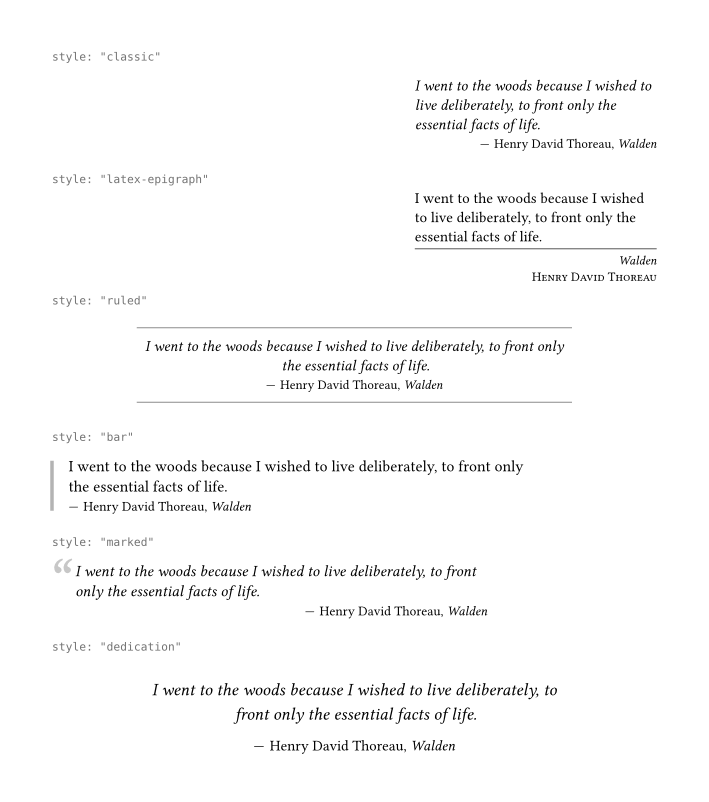
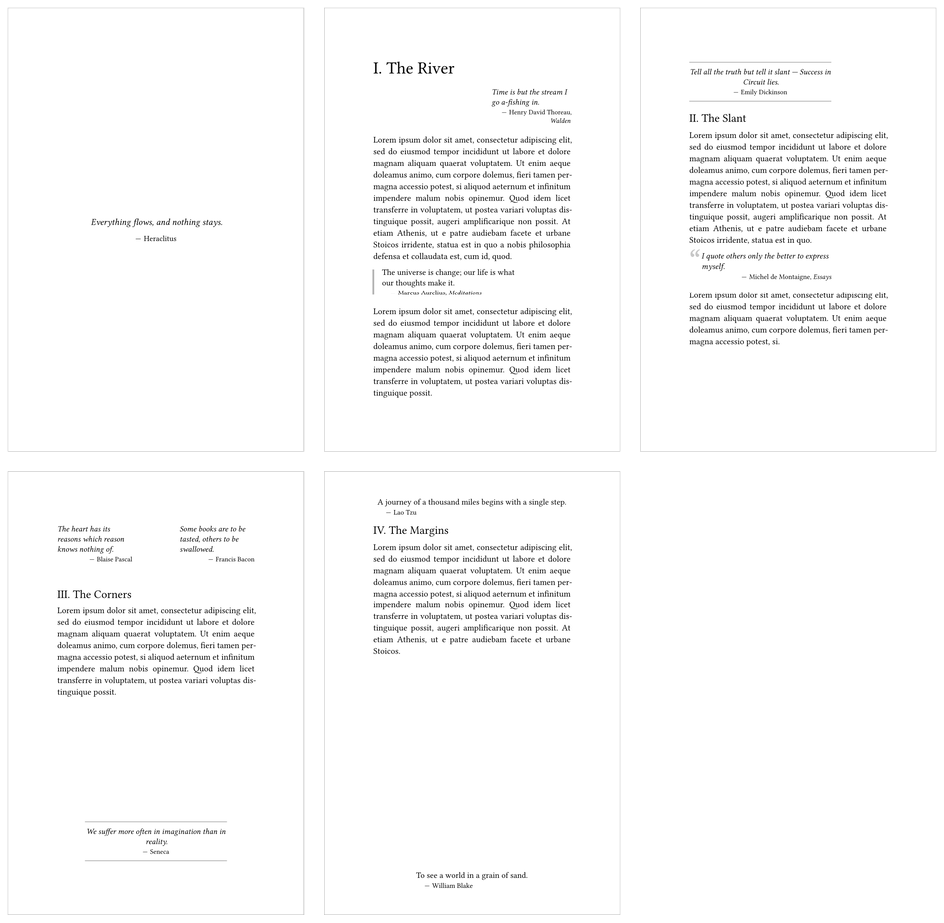
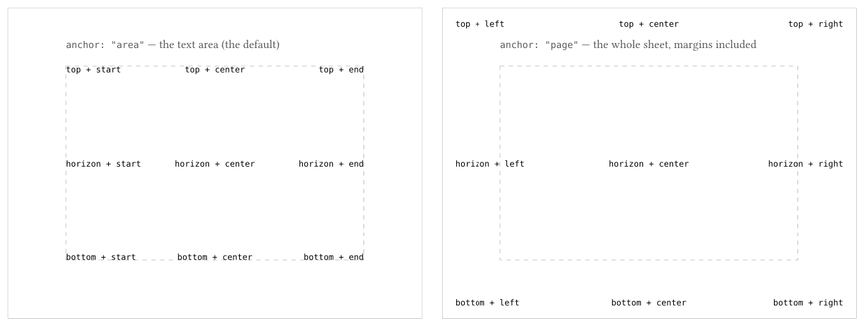

# cartouche

A cartouche is the round of parchment a cook lays over a simmering pot.

This package typesets epigraphs. The short quotation commonly at the head of a chapter or under a heading.

<picture>
  <source media="(prefers-color-scheme: dark)" srcset="docs/gallery-dark.png">
  
</picture>

## Usage

```typ
#import "@preview/cartouche:0.1.0": epigraph

#epigraph(by: "Henry David Thoreau", from: "Walden")[
  I went to the woods because I wished to live deliberately, to front only
  the essential facts of life.
]
```

Both `by` and `from` are optional:

```typ
#epigraph(by: [Anon.])[Attributed to no one in particular.]
#epigraph[No attribution at all.]
```

## Styles

| Style | Looks like |
| --- | --- |
| `"classic"` | Italic block at the outer edge, attribution flush right. |
| `"latex-epigraph"` | LaTeX's `epigraph` package |
| `"plain"` | A smaller block of text |
| `"ruled"` | Centred between two hairlines |
| `"bar"` | An accent rule along the inner edge |
| `"marked"` | An oversized quotation mark hanging into the margin. |
| `"dedication"` | Centred |

Any detail can be overridden on the same call:

```typ
#epigraph(style: "bar", accent: blue, quotes: true, by: "Ada Lovelace")[
  The Analytical Engine weaves algebraic patterns.
]
```

## An example

[`docs/example.typ`](docs/example.typ) is a short document example:



## Positioning

An epigraph sits in the text until you give it a `position`. Then it is
pinned to an edge or a corner of the text area, or of the sheet itself if
you add `anchor: "page"`.



```typ
#epigraph(position: top + end, by: "Anon.")[Up in the corner of the text.]
#epigraph(position: bottom, anchor: "page", dy: -1cm, style: "dedication")[
  Down in the bottom margin.
]
```

Pinning overlaps whatever is already there, which is what makes margin notes
possible. When you would rather the text moved aside, `float` does that at the
top or bottom of the page. Pass a length to say how much space it keeps:

```typ
#epigraph(position: top, float: 2em, style: "ruled", by: "Anon.")[
  Riding above the body text.
]
```

## Options

| Option | Default | Meaning |
| --- | --- | --- |
| `text` | `(size: 0.92em, style: "italic")` | Arguments for `text`, applied to the quote. |
| `par` | `(leading: 0.62em, justify: false)` | Arguments for `par`, applied to the quote. |
| `quotes` | `false` | Wrap the quote in language-aware quotation marks. |
| `attribution-format` | `auto` | A `(by, from) => content` function, replacing the default "— Author, _Work_". |
| `attribution-prefix` | `[— ]` | Content before the attribution. |
| `attribution-text` | `(size: 0.85em, style: "normal")` | Arguments for `text`, applied to the attribution. |
| `attribution-align` | `auto` | Alignment of the attribution; `auto` follows `text-align`. |
| `width` | `40%` | Width of the epigraph. `auto` shrinks it to the quote. |
| `text-align` | `start` | Alignment of the lines inside the epigraph. |
| `align` | `end` | Alignment of the epigraph itself. |
| `gap` | `0.65em` | Space between quote and attribution. |
| `divider` | `false` | A rule between quote and attribution. `true` draws it from `thickness` and `accent`; your own stroke overrides both. |
| `above`, `below` | `1.2em`, `1.6em` | Space around an epigraph in the flow. |
| `frame` | `epigraph-frames.plain` | The decoration, see below. |
| `accent` | `luma(55%)` | Colour of rules, bars, dividers and quotation marks. `auto` follows the text. |
| `inset` | `0.8em` | Space between the decoration and the text. |
| `thickness` | `0.6pt` | Thickness of every drawn line. |

## Styles of your own

Create your own style by starting from `epigraph-presets` and add your changes:

```typ
#import "@preview/cartouche:0.1.0": epigraph, epigraph-presets

#let house = epigraph-presets.ruled + (accent: rgb("#8a1538"), width: 80%)
#let motto = epigraph.with(style: house, from: "Collected Fragments")

#motto(by: "Heraclitus")[Everything flows.]
```

The decoration is a function of the laid-out quote and the resolved style, so
you can write your own:

```typ
#import "@preview/cartouche:0.1.0": epigraph

#let boxed(body, sty) = box(
  stroke: sty.thickness + sty.accent,
  inset: sty.inset,
  width: 100%,
  body,
)

#epigraph(style: "plain", frame: boxed, accent: olive, by: "Anon.")[Framed to taste.]
```

The four that ship with the package — `plain`, `rules`, `bar` and `marked` —
live in `epigraph-frames` and go with any style.

## Coming from LaTeX

`style: "latex-epigraph"` is the [`epigraph`](https://ctan.org/pkg/epigraph)
package's default look, and its handles map onto options:

| `epigraph.sty` | cartouche |
| --- | --- |
| `\epigraph{text}{source}` | `epigraph(by: …, from: …)[text]` |
| `\epigraphwidth` | `width` |
| `\epigraphflush` | `align` |
| `\textflush` | `text-align` |
| `\sourceflush` | `attribution-align` |
| `\epigraphsize` | `text: (size: …)` |
| `\epigraphrule` | `divider` and `thickness` |
| `\beforeepigraphskip`, `\afterepigraphskip` | `above`, `below` |
| `\epigraphhead[d]{…}` | `position: top` with `dy`, or `float: true` |
| `\epigraphnoindent` | not needed; Typst doesn't indent a paragraph after a block |
| `epigraphs` / `\qitem` | several `epigraph` calls with `above` and `below` reduced |

```typ
#epigraph(style: "latex-epigraph", by: "Edmund Burke", from: "Letters on a Regicide Peace")[
  Example is the school of mankind, and they will learn at no other.
]
```

## Compatibility

Tested on 0.12.0 and 0.15.1.

## License

MIT, see [LICENSE](LICENSE).
