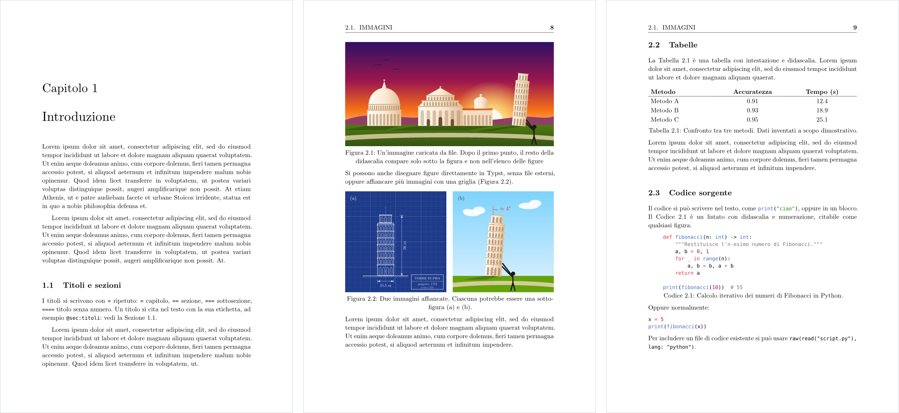

# classic-unipi-thesis

Unofficial template for bachelor's and master's theses at the
[University of Pisa](https://www.unipi.it) (Università di Pisa). It follows the
layout of the University's LaTeX thesis template: A4 paper, New Computer Modern
at 13 pt, 3 cm margins, `report`-style chapter openings and running headers with
the current section.



## In breve (italiano)

Template non ufficiale per tesi di laurea triennale e magistrale all'Università
di Pisa. Crea un nuovo progetto con *Start from template* nella web app di Typst
oppure da terminale con `typst init @preview/classic-unipi-thesis:0.1.0`, inserisci
i dati del frontespizio in `main.typ` e scrivi i capitoli nella cartella
`chapters/`. I capitoli d'esempio mostrano come inserire figure, tabelle, codice,
grafici, formule e citazioni. La lingua predefinita è l'italiano (`lang: "it"`),
ma il template supporta anche l'inglese (`lang: "en"`). Il frontespizio usa il
logo dell'Università (il Cherubino), che non rientra nella licenza del pacchetto:
vedi la sezione [Logo](#logo).

## Getting started

In the [Typst web app](https://typst.app), click *Start from template* and search
for `classic-unipi-thesis`. On the command line, run:

```bash
typst init @preview/classic-unipi-thesis:0.1.0 my-thesis
cd my-thesis
typst watch main.typ
```

The new project contains:

```
main.typ                 cover page data, options and list of chapters
chapters/                one file per chapter, plus the acknowledgements
utils/AppendiceA.typ     an example appendix
utils/Bibliografia.bib   the bibliography (BibTeX)
assets/images/           images used in the chapters
```

The example chapters (in Italian) show how to write text, lists, citations,
figures, tables, code listings, plots and equations. Replace their content with
your own. The template uses New Computer Modern, which ships with Typst, so there
is no font to install.

## Usage

```typ
#import "@preview/classic-unipi-thesis:0.1.0": *

#show: thesis.with(
  title: "Titolo della tesi",
  author: "Nome Cognome",
  department: "Dipartimento di Informatica",
  degree: "Laurea in Informatica",
  supervisors: ("Prof. Nome Cognome", "Dott. Nome Cognome"),
  academic-year: "2025/2026",
  lang: "it",
  tableofcontents: true,
  lof: true,
)

#include "chapters/01-introduzione.typ"
#include "chapters/Ringraziamenti.typ"

#show: appendix
#include "utils/AppendiceA.typ"

#bibliography("utils/Bibliografia.bib", style: "ieee")
```

### `thesis`

Applies the page layout and typography, then generates the cover page and,
optionally, the dedication, the table of contents and the list of figures.

| Parameter | Description | Default |
| --- | --- | --- |
| `title` | Thesis title. A `\n` in the string breaks the line. | placeholder |
| `author` | Candidate. An array of names for more than one candidate. | placeholder |
| `department` | Department, printed in upper case. | placeholder |
| `degree` | Degree programme, e.g. `"Laurea Magistrale in Informatica"`. | placeholder |
| `supervisors` | A supervisor or an array of supervisors. | placeholder |
| `academic-year` | Academic year, printed as `ANNO ACCADEMICO 2025/2026`. | `"202X/202Y"` |
| `lang` | `"it"` or `"en"`: language of the text and of the generated titles (*Capitolo*/*Chapter*, *Indice*/*Table of Contents*, …). | `"it"` |
| `logo` | Logo at the top of the cover page: `auto` for the University's logo, other content (e.g. `image("logo.svg")`) for a different one, `none` for no logo. See [Logo](#logo). | `auto` |
| `dedication` | Content of a dedication page placed after the cover page. | `none` |
| `tableofcontents` | Whether to print the table of contents. | `false` |
| `lof` | Whether to print the list of figures. | `false` |
| `toc-depth` | Deepest heading level shown in the table of contents. | `3` |
| `frontespizio-margin` | Margins of the cover page, independent of the rest of the thesis. | `(top: 3cm, bottom: 3cm, left: 3.5cm, right: 3.5cm)` |

The cover page parameters also accept Italian names, which take precedence over
the English ones: `titolo`, `autore` or `candidato`, `dipartimento`,
`tipo-laurea` or `corso-di-laurea`, `relatori` and `anno-accademico`. The cover
page labels (*Relatori*, *Candidato*, *Anno accademico*) are always in Italian.

### `appendix`

`#show: appendix` turns the following chapters into appendices: they are
numbered with letters (*Appendice A*, sections A.1, figures A.1) and have no
running header.

### `acknowledgements`

`#acknowledgements[...]` adds an unnumbered *Ringraziamenti* (or
*Acknowledgements*) chapter that is not listed in the table of contents.

### `frontespizio`

The cover page on its own. It takes the same cover page parameters as `thesis`
(`title`, `author`, …, `logo`). `thesis` already calls it, so you only need it to
build a custom document.

### Figures, tables and code listings

Figures, tables and listings are numbered by chapter (*Figura 2.1*) with
[i-figured](https://typst.app/universe/package/i-figured). Give a figure a label
such as `<risultati>` and reference it with the prefix for its kind:
`@fig:risultati` for images, `@tbl:risultati` for tables, `@lst:risultati` for
code. The list of figures includes images only and uses the first sentence of
each caption, shortened to 50 characters, so the full caption appears only below
the figure.

## Logo

The cover page shows the logo of the University of Pisa, the *Cherubino*, stored
in `src/cherubino.svg`. **This file is not covered by the MIT-0 license of the
package**: the logo belongs to the University of Pisa, whose
[logo usage rules](https://www.unipi.it/logo-delluniversita-di-pisa/) allow its
students to use it on the cover of their thesis. Use it only for that purpose and
according to those rules.

To use a different logo, or no logo at all:

```typ
#show: thesis.with(
  logo: image("assets/images/my-logo.svg"), // or `none` to remove it
  // ...
)
```

The logo is 35% of the text width unless you set a `width` in `image`.

## License

The package is released under the [MIT-0 license](LICENSE), except for the
University of Pisa logo (`src/cherubino.svg`, see [Logo](#logo)): you can use,
modify and distribute the template, including the files copied into your
project, without attribution. This template is not affiliated with or endorsed
by the University of Pisa.
