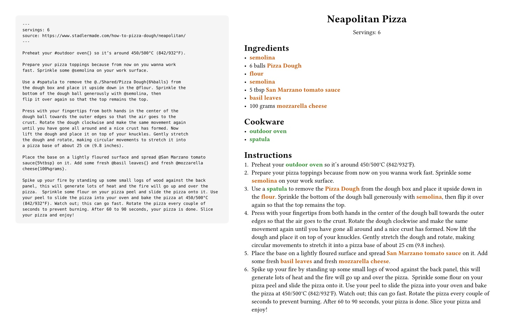

<picture>
  <source media="(prefers-color-scheme: dark)" srcset="images/logo-dark.svg">
  
</picture>

# Cooklang for Typst

Read [Cooklang](https://cooklang.org) recipes (`.cook` files) into Typst and
lay them out however you like.



The parsing is done by the official Rust parser
([cooklang-rs](https://github.com/cooklang/cooklang-rs)), compiled to a
WebAssembly plugin. You get the parsed recipe as a dictionary, and the layout
is up to you.

## Usage

```typ
#import "@preview/cooklang:0.1.0": parse

#let recipe = parse(read("Neapolitan Pizza.cook"))

= Ingredients
#for ing in recipe.ingredients [
  - #ing.name
]
```

`parse` accepts the recipe source as a `str` or `bytes`.

A complete example lives in [`examples/neapolitan-pizza.typ`](examples/neapolitan-pizza.typ).

## Returned data

The dictionary has the same shape as the JSON serialization of
`cooklang::Recipe`. The main keys are:

| Key           | Contents                                                                 |
| ------------- | ------------------------------------------------------------------------ |
| `metadata`    | Frontmatter. Values are under `metadata.map`, e.g. `metadata.map.servings`. |
| `sections`    | List of sections. Each has a `name` (or `none`) and a `content` list.     |
| `ingredients` | List of ingredients with `name`, `alias`, `quantity`, `note`, ...         |
| `cookware`    | List of cookware with `name`, `quantity`, ...                             |
| `timers`      | List of timers with `name` and `quantity`.                                |
| `inline_quantities` | Quantities found in step text.                                    |

Each item in a section's `content` is either `(type: "step", value: ...)` or
`(type: "text", value: ...)`. A step's `value.items` is a list of
`(type: "text", value: str)` or a reference such as
`(type: "ingredient", index: int)`. The index points into the top-level
`ingredients`, `cookware` or `timers` list.

A quantity looks like `(value: (type: "number", value: (type: "regular", value: 6)), unit: "balls")`.

The parser runs without Cooklang extensions, so you get the standard Cooklang syntax.

## Errors

If a recipe can't be parsed, compilation fails with the parser's diagnostic,
for example:

```
error: plugin errored with: Error: Empty quantity value
  ╭─[recipe]
1 │ Add @flour{1%kg} and ~{%}.
  ┆                        ┬
  ┆                        ╰─── add value here
```

Warnings are ignored.

## Building from source

The published package ships `cooklang.wasm`. In the source repository it isn't checked in;
build it with:

```sh
rustup target add wasm32-unknown-unknown
./build.sh
```

Then try the example from this directory:

```sh
typst compile --root . examples/neapolitan-pizza.typ
```

## License

MIT
