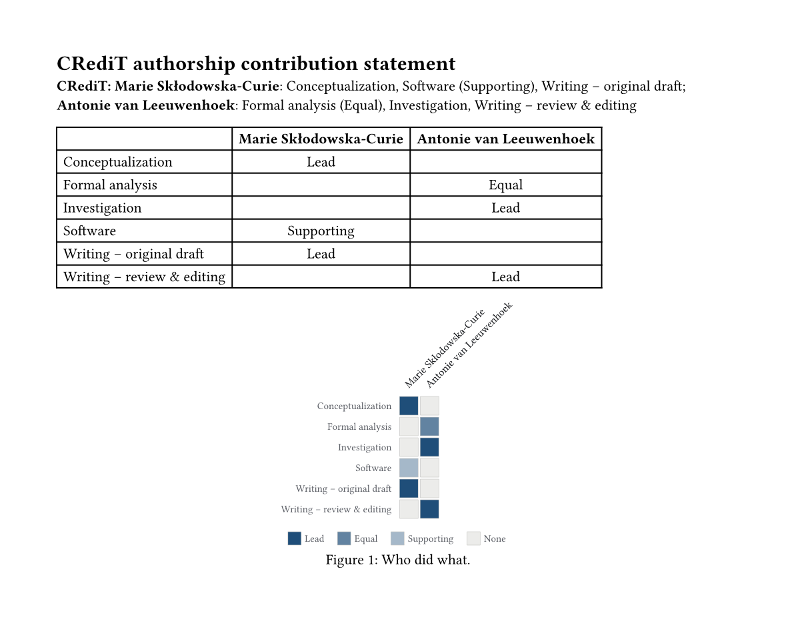

# credit-matrix

Write a [CRediT](https://credit.niso.org/) authorship statement in Typst, with a role-by-contributor
table and a contribution heatmap. The wording, levels and translations match the
[CRediT matrix app](https://github.com/simonvanlierde/credit-matrix).
Use a contributor JSON file to print both in your paper.

## Install

Import it from [Typst Universe](https://typst.app/universe/package/credit-matrix):

```typ
#import "@preview/credit-matrix:0.13.0": *
```

This needs Typst 0.14 or later.

## Use

Save your JSON export as `contributors.json` beside `paper.typ`, or use this sample.
If the download is named `credit_result.json`, rename it to `contributors.json`.
The export keeps contribution levels and non-author contributors.

<!-- live: typst -->

```json
{
  "version": 1,
  "authors": [
    {
      "id": "marie", "name": "Marie Curie",
      "firstName": "Marie", "middleName": "", "surname": "Curie", "initials": "MC", "contributorType": "author",
      "contributions": [
        {"role": "Conceptualization", "score": 100},
        {"role": "Software", "score": 33}
      ]
    },
    {
      "id": "albert", "name": "Albert Einstein",
      "firstName": "Albert", "middleName": "", "surname": "Einstein", "initials": "AE", "contributorType": "author",
      "contributions": [
        {"role": "Formal analysis", "score": 66},
        {"role": "Investigation", "score": 100}
      ]
    }
  ]
}
```

After the import, add this to `paper.typ`:

```typ
#credit-statement(json("contributors.json"), levels: true)
```

Build the PDF:

```sh
typst compile paper.typ
```

With the sample data, the statement lists Marie Curie's Conceptualization and Software (Supporting),
then Albert Einstein's Formal analysis (Equal) and Investigation.



## Contribution heatmap options

Add this after the statement, then run `typst compile paper.typ` again:

```typ
#credit-heatmap(json("contributors.json"))
```

The PDF now includes a contribution heatmap from the same file.

See [figure options and examples](https://github.com/simonvanlierde/credit-matrix/blob/v0.13.0/integrations/heatmap.md) for palettes, shapes, sizing, labels and orientation.
The figures use the document's fonts. `font: "sans"` and `"serif"` set the built-in stacks, any other
string is a family name, and an array is a list of them, as in `text(font: ...)`. Add font folders
with `typst compile --font-path fonts` (or `TYPST_FONT_PATHS`). The other font options are in
[Your own font](https://github.com/simonvanlierde/credit-matrix/blob/v0.13.0/integrations/heatmap.md#your-own-font). For how these figures differ from app and CLI
exports, see [font portability and PDF export](https://github.com/simonvanlierde/credit-matrix/blob/v0.13.0/integrations/figures/README.md).

## Define contributors in Typst

You can also write the contributor data directly in your document:

```typ
#let team = (
  (name: "Marie Skłodowska-Curie", roles: (conceptualization: "lead", software: "supporting", writing-original-draft: true)),
  (name: "Antonie van Leeuwenhoek", roles: (investigation: true, formal-analysis: "equal", writing-review-editing: true)),
)

#credit-statement(team, levels: true)
```

The output has the same form as the sample above: each person's roles, with levels in brackets.

### Contributors

An array of dictionaries, one per person:

- `name`: the name as printed.
- `roles`: a dictionary from role to level, or an array of roles (each one `"lead"`). A level is
  `"lead"`, `"equal"`, `"supporting"`, `true` (lead), `false` or `"none"` (left out), or a whole
  score from 0 to 100 (1 to 33 is supporting, 34 to 66 equal, 67 and up lead).
- `non-author: true` credits the person on an Acknowledgements line instead.
- `equal-contribution: true` and `corresponding: true` add the notes the app adds: "A and B
  contributed equally to this work." and "Correspondence: A."

Roles are the slugs of the [CRediT role pages](https://credit.niso.org/): `conceptualization`,
`data-curation`, `formal-analysis`, `funding-acquisition`, `investigation`, `methodology`,
`project-administration`, `resources`, `software`, `supervision`, `validation`, `visualization`,
`writing-original-draft`, `writing-review-editing`. An unknown role stops the build and the message
names it.

### Functions

- `credit-statement(contributors, format: "by-author", levels: false, lang: auto)`: the statement,
  one paragraph for the authors, one for the acknowledged contributors and one per note. `format`
  is `"by-author"` (Marie: Software, Validation) or `"by-role"` (Software: Marie, Antonie). With
  `levels: true`, Equal and Supporting are shown after each role or name; Lead is not.
- `credit-statement-text(..)`: the same statement as a plain string, with the same arguments. Call
  it inside `context` when `lang` is `auto`.
- `credit-table(contributors, levels: true, lang: auto, marks: auto)`: a table with a row per role
  and a column per person. A cell shows the level, or a check mark with `levels: false`. Pass
  `marks: (lead: [L], equal: [E], supporting: [S])` for marks of your own.
- `credit-heatmap(contributors, levels: true, lang: auto, color: auto, cell: 14pt,
  gap: 1.5pt, ..)`: the app's contribution heatmap, as a figure. Other named arguments, such as
  `caption`, go to `figure`. Its alt text is the statement, so a screen reader in a tagged PDF reads
  who did what.

Only roles someone holds are shown, in the CRediT order.

### Languages

`lang: auto` follows the document's `#set text(lang: ..)`. Role names come from the
[community CRediT translations](https://github.com/contributorshipcollaboration/credit-translation)
in English, French, German, Spanish, Italian, Portuguese (`pt`, Portugal), Dutch, Chinese (`zh`,
simplified) and Japanese. Traditional Chinese (`zh-Hant`, or `region: "TW"`, `"HK"`, `"MO"`) has no
catalog and uses English. So does any other document language. An explicit `lang` the package lacks
stops the build. The "CRediT:" prefix stays English, as in the app.

Examples: [a document with inline roles](examples/basic.typ) and
[one that reads a JSON export in French](examples/team.typ).

### Accessible PDFs

Give the document a title (`#set document(title: [..])`) so `--pdf-standard ua-1` passes. Typst 0.15
cannot mark row headers, so for a tagged PDF put the table in a figure with a caption:

```typ
#figure(credit-table(team), caption: [Contributions by role.])
```

## License

The code is [MIT](LICENSE). The role names in `translations.json` come from the community
[credit-translation](https://github.com/contributorshipcollaboration/credit-translation) project
under [CC BY 4.0](https://creativecommons.org/licenses/by/4.0/); the translators are listed in
[CREDITS.md](https://github.com/simonvanlierde/credit-matrix/blob/v0.13.0/src/core/credit-i18n/translations/CREDITS.md).

## Install from source

To work from the repository, copy this folder (`lib.typ`, `translations.json`,
`typst.toml`) into your project and import `lib.typ`:

```typ
#import "credit-matrix/lib.typ": *
```
