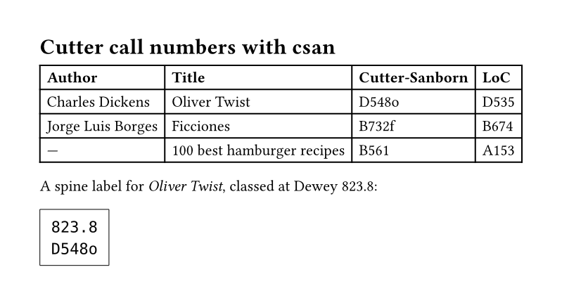

# csan

Generate Cutter-Sanborn and Library of Congress cutter numbers for library
cataloging, from author names and titles, directly in Typst. The numbers
come from the [`csan-core`](https://crates.io/crates/csan-core) Rust library,
compiled to a WebAssembly plugin, so they match the
[`csan`](https://github.com/veralvx/csan) command-line tool and its Python and
JavaScript packages.



## Usage

```typ
#import "@preview/csan:0.7.1": cutter-loc, cutter-sanborn

#cutter-sanborn(forename: "Charles", surname: "Dickens", title: "Oliver Twist")
// -> "D548o"

#cutter-loc(surname: "Carter")
// -> "C378"

#cutter-loc(title: "100 best recipes") // a work without an author
// -> "A153"
```

Both functions return a string (unless `detailed: true`), so the result can
go anywhere text can, for example on a spine label under a class number:

```typ
#import "@preview/csan:0.7.1": cutter-sanborn

#box(stroke: 0.5pt, inset: 8pt)[
  823.8 \
  #cutter-sanborn(forename: "Charles", surname: "Dickens", title: "Oliver Twist")
]
```

[`examples/example.typ`](examples/example.typ) is the document shown above.

## Methods

- **Cutter-Sanborn three-figure** (`cutter-sanborn`): looks the name up in the
  Cutter-Sanborn table (12,000+ entries) and returns its initial letter(s) and
  number, followed by a lowercase work mark from the title when an author is
  given.
- **Library of Congress** (`cutter-loc`): applies the LoC
  [Cutter table](https://www.loc.gov/aba/pcc/053/table.html) rules
  ([CSM G 63](https://www.loc.gov/aba/publications/FreeCSM/G063.pdf)) and
  returns an initial plus a digit sequence.

Names are normalized first: whitespace and punctuation are stripped,
diacritics and ligatures are folded to ASCII (`Strauß` → `Strauss`),
`Mc`/`M'` prefixes expand to `Mac`, and a surname of `St`/`Ste` expands to
`Saint`/`Sainte`. A work without an author is cuttered by its title, and the
Library of Congress method follows its rule for titles that begin with a
numeral (`100 best recipes` → `A153`).

## Reference

### `cutter-sanborn`

```text
cutter-sanborn(
  forename: str | none,
  surname: str | none,
  title: str | none,
  prefix-len: int | none,
  suffix-len: int | none,
  detailed: bool,
) -> str | dictionary
```

| Parameter    | Default | Description                                                                   |
| ------------ | ------- | ----------------------------------------------------------------------------- |
| `forename`   | `none`  | The author's given name.                                                      |
| `surname`    | `none`  | The author's family name.                                                     |
| `title`      | `none`  | The work's title: the work mark, or the whole number when there is no author. |
| `prefix-len` | `1`     | Letters of the name kept before the number (`prefix-len: 2` gives `Di548o`).  |
| `suffix-len` | `1`     | Letters of the title in the work mark (`suffix-len: 2` gives `D548ol`).       |
| `detailed`   | `false` | Return the parts as a dictionary instead of the formatted string.             |

With `detailed: true`, the result has the keys `alpha_prefix`, `numeric`,
`alpha_suffix` (`none` without a work mark), `entry` (the table entry that
matched), and `formatted`:

```typ
#import "@preview/csan:0.7.1": cutter-sanborn

#cutter-sanborn(surname: "Borges", detailed: true)
// -> (alpha_prefix: "B", alpha_suffix: none, entry: "Borg",
//     numeric: 732, formatted: "B732")
```

### `cutter-loc`

```text
cutter-loc(
  forename: str | none,
  surname: str | none,
  title: str | none,
  max-len: int | none,
  detailed: bool,
) -> str | dictionary
```

| Parameter  | Default | Description                                                       |
| ---------- | ------- | ----------------------------------------------------------------- |
| `forename` | `none`  | The author's given name.                                          |
| `surname`  | `none`  | The author's family name.                                         |
| `title`    | `none`  | The work's title, cuttered when there is no author.               |
| `max-len`  | `3`     | Number of digits, at most 4 (`max-len: 4` gives `D5354`).         |
| `detailed` | `false` | Return the parts as a dictionary instead of the formatted string. |

With `detailed: true`, the result has the keys `alpha_prefix`, `numeric`,
and `formatted`, e.g. `(alpha_prefix: "C", numeric: 378, formatted: "C378")`.

### Errors

At least one of `surname`, `forename`, or `title` must be given and not
blank (blank strings count as missing). Otherwise compilation stops with:

```text
error: plugin errored with: at least one of `author` or `title` must be provided and non-blank
```

## Compatibility

Requires Typst 0.14.2 or later. The package has no dependencies; the plugin
(`csan_typst.wasm`) is included.

## License

Licensed under either of [Apache License, Version 2.0](LICENSE-APACHE) or
[MIT license](LICENSE-MIT), at your option.
