# ctz-interval

Draw intervals on a number line, after Cédric Pierquet's LaTeX package
[ProfLycee](https://ctan.org/pkg/proflycee) (`RepIntervalles`): open or closed
bounds, infinite bounds, fill, zigzag or hatching decoration. It is built on
[CeTZ](https://typst.app/universe/package/cetz) (version 0.5.2, see
[src/deps.typ](src/deps.typ)).

```typ
#import "@preview/ctz-interval:0.1.0": *
```

## Documentation

There is no separate documentation: the examples and the tables of keys below
cover everything.

## Examples

Click the small triangle on the left to see the code of a drawing.

<!-- exemples : partie refaite par exemples/readme.sh, ne pas modifier à la main -->
### 1. The simplest: no ticks

<details>
<summary></summary>

```typ
#rpz-interval(
  xmin: 0, xmax: 6,
  values: (3,),
  ctz-interval(
    3, "*", type: "CO",
  ),
)
```

</details>

<details>
<summary></summary>

```typ
#rpz-interval(
  xmin: -3, xmax: 6,
  values: (-1, 4),
  ctz-interval(
    -1, 4,
  ),
)
```

</details>

<details>
<summary></summary>

```typ
#rpz-interval(
  xmin: -3, xmax: 5,
  ctz-interval(
    "*", 2, type: "OO",
    show-values: true,
  ),
)
```

</details>

<details>
<summary>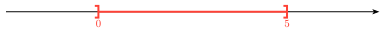</summary>

```typ
#rpz-interval(
  xmin: -2, xmax: 7,
  ctz-interval(
    0, 5, type: "OC",
    show-values: true, pos-values: "below",
  ),
)
```

</details>

### 2. The four bracket types

<details>
<summary></summary>

```typ
#rpz-interval(
  xmin: -4, xmax: 5,
  values: (-2, 3),
  ctz-interval(
    -2, 3, type: "CC",
  ),
)
```

</details>

<details>
<summary></summary>

```typ
#rpz-interval(
  xmin: -4, xmax: 5,
  values: (-2, 3),
  ctz-interval(
    -2, 3, type: "CO",
  ),
)
```

</details>

<details>
<summary>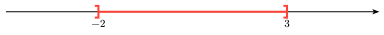</summary>

```typ
#rpz-interval(
  xmin: -4, xmax: 5,
  values: (-2, 3),
  ctz-interval(
    -2, 3, type: "OC",
  ),
)
```

</details>

<details>
<summary></summary>

```typ
#rpz-interval(
  xmin: -4, xmax: 5,
  values: (-2, 3),
  ctz-interval(
    -2, 3, type: "OO",
  ),
)
```

</details>

### 3. Infinite bounds

<details>
<summary></summary>

```typ
#rpz-interval(
  xmin: -5, xmax: 4,
  ticks: range(-5, 5),
  values: (1,),
  ctz-interval(
    "*", 1, type: "OC",
    color: blue, decor: "fill",
  ),
)
```

</details>

<details>
<summary></summary>

```typ
#rpz-interval(
  xmin: -5, xmax: 4,
  ticks: range(-5, 5),
  values: (-2,),
  ctz-interval(
    -2, "*", type: "CO",
    color: blue, decor: "fill",
  ),
)
```

</details>

<details>
<summary></summary>

```typ
#rpz-interval(
  xmin: -5, xmax: 4,
  ticks: range(-5, 5),
  values: (0,),
  ctz-interval(
    "*", "*", type: "OO",
    color: blue, decor: "fill",
  ),
)
```

</details>

<details>
<summary></summary>

```typ
#rpz-interval(
  xmin: -10, xmax: 10,
  ticks: range(-10, 11),
  values: (0,),
  width: 12,
  ctz-interval(
    "*", 0, type: "OO",
    color: gray, decor: "hatch/135",
  ),
)
```

</details>

### 4. Decorations

<details>
<summary>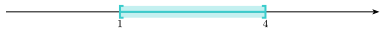</summary>

```typ
#rpz-interval(
  xmin: -1, xmax: 6,
  values: (1, 4),
  ctz-interval(
    1, 4,
    color: teal, decor: "fill",
  ),
)
```

</details>

<details>
<summary>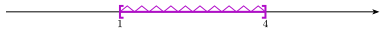</summary>

```typ
#rpz-interval(
  xmin: -1, xmax: 6,
  values: (1, 4),
  ctz-interval(
    1, 4,
    color: purple, decor: "zigzag",
  ),
)
```

</details>

<details>
<summary></summary>

```typ
#rpz-interval(
  xmin: -1, xmax: 6,
  values: (1, 4),
  ctz-interval(
    1, 4,
    color: orange, decor: "hatch",
  ),
)
```

</details>

<details>
<summary></summary>

```typ
#rpz-interval(
  xmin: -1, xmax: 11,
  values: (0, 3, 4, 7, 8, 10),
  ctz-interval(
    0, 3,
    color: orange, decor: "hatch/30",
  ),
  ctz-interval(
    4, 7,
    color: orange, decor: "hatch/90",
  ),
  ctz-interval(
    8, 10,
    color: orange, decor: "hatch/150",
  ),
)
```

</details>

### 5. Ticks

<details>
<summary>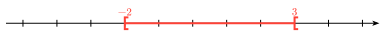</summary>

```typ
#rpz-interval(
  xmin: -5, xmax: 5,
  ticks: range(-5, 6),
  ctz-interval(
    -2, 3, type: "CO",
    show-values: true,
  ),
)
```

</details>

<details>
<summary>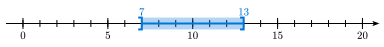</summary>

```typ
#rpz-interval(
  xmin: 0, xmax: 20,
  ticks: range(0, 21),
  major-ticks: range(0,5).map(k => k*5),
  values: (0, 5, 10, 15, 20),
  ctz-interval(
    7, 13, type: "OC",
    color: blue, decor: "fill", show-values: true,
  ),
)
```

</details>

### 6. Values

<details>
<summary>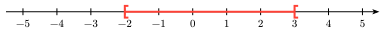</summary>

```typ
#rpz-interval(
  xmin: -5, xmax: 5,
  ticks: range(-5, 6),
  values: range(-5, 6),
  ctz-interval(
    -2, 3, type: "CO",
  ),
)
```

</details>

<details>
<summary>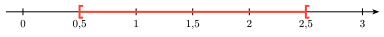</summary>

```typ
#rpz-interval(
  xmin: 0, xmax: 3,
  ticks: range(0, 7).map(k => k / 2),
  values: range(0, 7).map(k => k / 2),
  ctz-interval(
    0.5, 2.5, type: "CO",
  ),
)
```

</details>

<details>
<summary></summary>

```typ
#rpz-interval(
  xmin: -3, xmax: 4,
  ticks: range(-3, 5), 
  values: range(-3,5),
  ctz-interval(
    -calc.sqrt(2), 10/3, type: "OO",
    color: blue, decor: "fill",
    show-values: true, label-inf: $sqrt(2)$, label-sup: $10/3$
  ),
)
```

</details>

<details>
<summary>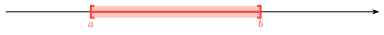</summary>

```typ
#rpz-interval(
  xmin: 0, xmax: 10,
  ctz-interval(
    2, 7,
    decor: "fill", show-values: true, pos-values: "below",
    label-inf: $a$, label-sup: $b$,
  ),
)
```

</details>

<details>
<summary></summary>

```typ
#rpz-interval(
  xmin: -2, xmax: 3,
  ticks: range(-6, 10).map(k => k / 3),
  major-ticks: range(-2, 4),
  values: range(-2, 4),
  ctz-interval(
    -2/3, 5/3, type: "CO",
    color: blue, decor: "fill",
    show-values: true, 
  ),
)
```

</details>

<details>
<summary></summary>

```typ
#rpz-interval(
  xmin: -2, xmax: 3,
  ticks: range(-6, 10).map(k => k / 3),
  major-ticks: range(-2, 4),
  values: range(-2, 4),
  ctz-interval(
    -2/3, 5/3, type: "CO",
    color: blue, decor: "fill",
    show-values: true, label-inf: $-2/3$, label-sup: $5/3$,
  ),
)
```

</details>

### 7. Several intervals

<details>
<summary>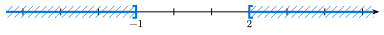</summary>

```typ
#rpz-interval(
  xmin: -4, xmax: 5,
  ticks: range(-4, 6),
  values: (-1, 2),
  ctz-interval(
    "*", -1, type: "OC",
    color: blue, decor: "hatch",
  ),
  ctz-interval(
    2, "*", type: "CO",
    color: blue, decor: "hatch",
  ),
)
```

</details>

<details>
<summary></summary>

```typ
#rpz-interval(
  xmin: -5, xmax: 5,
  ticks: range(-5, 6),
  values: range(-5, 6),
  ctz-interval(
    -3, 2, type: "OC",
    color: blue, decor: "hatch/60",
    show-values: true,
  ),
  ctz-interval(
    0, 4, type: "CO",
    color: red, level: 1.25, decor: "hatch/120",
  ),
  ctz-interval(
    -1, 1, type: "OC",
    color: green, decor: "fill",
  ),
)
```

</details>

<details>
<summary></summary>

```typ
#rpz-interval(
  xmin: -6, xmax: 6,
  ticks: range(-6, 7),
  values: (-4, -1, 2, 5),
  ctz-interval(
    -4, 2,
    color: red, decor: "fill",
  ),
  ctz-interval(
    -1, 5, type: "OO",
    color: blue, decor: "fill",
  ),
)
```

</details>

### 8. The examples from ProfLycee's documentation (§13, p. 55–58)

<details>
<summary></summary>

```typ
#rpz-interval(
  xmin: -8, xmax: 20,
  ctz-interval(
    "*", 13,
  ),
)
```

</details>

<details>
<summary>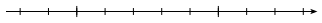</summary>

```typ
#rpz-interval(
  xmin: -2, xmax: 8,
  unit: 1cm,
  ticks: range(-2, 9),
  major-ticks: (0, 5),
)
```

</details>

<details>
<summary>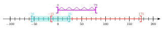</summary>

```typ
#rpz-interval(
  xmin: -100, xmax: 200,
  width: 10, text-style: (size: 7pt), thickness: 0.6pt,
  ticks: range(-100, 201, step: 10),
  major-ticks: range(-100, 201, step: 50),
  values: range(-100, 201, step: 50),
  ctz-interval(
    -15, 175,
    show-values: true,
  ),
  ctz-interval(
    -56, 25,
    color: teal, decor: "fill",
    show-values: true,
  ),
  ctz-interval(
    0, 79, type: "OO",
    color: purple, decor: "zigzag", level: 1.5,
    show-values: true,
  ),
)
```

</details>

<details>
<summary></summary>

```typ
#rpz-interval(
  xmin: -8, xmax: 8,
  ticks: range(-8, 9),
  ctz-interval(
    -2, 5,
    decor: "fill",
    show-values: true, pos-values: "below",
  ),
  ctz-interval(
    -7, -1, type: "OO",
    color: blue, decor: "zigzag",
    show-values: true, pos-values: "below",
  ),
  ctz-interval(
    "*", 6, type: "CO",
    color: orange, decor: "hatch", level: 1.25,
    show-values: true,
  ),
)
```

</details>

<details>
<summary></summary>

```typ
#rpz-interval(
  xmin: -8, xmax: 8,
  ticks: range(-8, 9),
  ctz-interval(
    -2, 5,
    decor: "fill",
    show-values: true, pos-values: "below",
    label-inf: $a$, label-sup: $b$,
  ),
  ctz-interval(
    -calc.sqrt(5), 2 / 3, type: "OO",
    color: blue, decor: "fill",
    show-values: true,
    label-inf: $-sqrt(5)$, label-sup: $2/3$,
  ),
)
```

</details>
<!-- fin des exemples -->

## Keys

`rpz-interval(keys, …)` draws the axis and the `ctz-interval(…)` given to it.
`rpz-interval-draw` takes the same keys but returns the CeTZ elements only, to
be put in your own `cetz.canvas` (then import CeTZ yourself:
`#import "@preview/cetz:0.5.2"`).

### Keys of `rpz-interval`

| Key | Default | Meaning |
|---|---|---|
| `xmin`, `xmax` | `-8`, `8` | ends of the axis |
| `width` | `12` | length of the axis from `xmin` to `xmax`, in cm |
| `unit` | `auto` | length of one unit (`1cm`); `auto`: computed from `width` |
| `ticks` | `()` | positions of the ticks |
| `major-ticks` | `()` | positions of the major (longer) ticks |
| `values` | `()` | numbers written below the axis |
| `tick-height` | `7pt` | height of a tick |
| `height` | `12pt` | height of the intervals (brackets, decoration) |
| `thickness` | `1pt` | line thickness |
| `text-style` | `(:)` | text settings, such as `(size: 8pt)` (not `fill`) |

### Keys of `ctz-interval`

`ctz-interval(inf, sup, keys)`: an infinite bound is written `"*"` (or
`none`); the other bounds are Typst numbers (`0`, `2 / 3`, `calc.sqrt(5)`),
not strings (`"0"`) nor math (`$sqrt(5)$`).

| Key | Default | Meaning |
|---|---|---|
| `type` | `"CC"` | brackets: `"CC"`, `"CO"`, `"OC"` or `"OO"` (C closed, O open) |
| `color` | `red` | color |
| `decor` | `none` | `"fill"`, `"zigzag"`, `"hatch"` or `"hatch/<angle>"` (not horizontal; `"hatch"`: 45°) |
| `level` | `0` | vertical position, in interval heights (`1.25`: above the axis) |
| `show-values` | `false` | write the bounds |
| `pos-values` | `"above"` | above (`"above"`) or below (`"below"`) the interval |
| `label-inf`, `label-sup` | `auto` | labels of the bounds, such as `$-sqrt(5)$` |

Numbers (bounds and `values`) are written with a decimal comma and at most
4 decimals, as in French: `1.5` gives 1,5.

## License

MIT. Independent rewrite based on ProfLycee's documentation (rendering, key
names), without reusing its code (LPPL).
