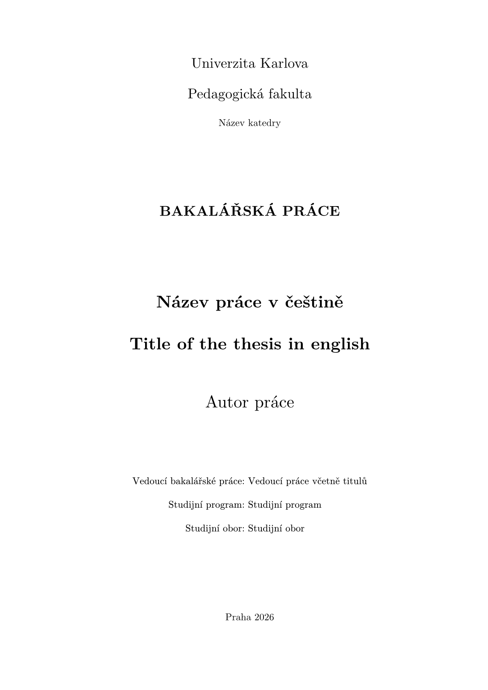

<h1 align="center">thesis-template-typst</h1>

<div align="center">
  
</div>
<p align="center">
Unofficial bachelors thesis template for Faculty of Education, Charles University (Pedagogická fakulta Univerzita Karlova)
</p>

<p align="center">
  
</p>

This template for the Typst typesetting system for a bachelor's thesis at the Faculty of Education, Charles University is meant as an alternative for the already existing LaTeX template.

## Requirements

- [Typst compiler][typstrepo]
- Text editor (recommended VSCode or [VSCodium][VSCodiumwww] along with Tinymist Typst extension)

## Quick start

In the Typst web app, click Start from template and search for cuni-thesis.
Or initialize a fresh project locally with the Typst CLI:

```bash
typst init @preview/cuni-thesis:0.1.0 my-thesis
cd my-thesis
typst watch main.typ
```

Typst will copy the starter project (from the template folder) and keep recompiling the PDF whenever you make changes.
The new project contains main.typ (main file, for linking everything together), `assets/` - folder for your images, graphs, ..., `bib/` - here is located and managed bibliography, `chapters/` - folder contains sample chapter files remove them and create your own.

## Usage

To use the template in an existing project:

```typst
#import "@preview/cuni-thesis:0.1.0": template_conf, datetime_today_translated

#show: template_conf.with(
  vars: (
    Title: "Název práce v češtině",
    TitleEN: "Title of the thesis in english",
    Author: "Autor práce",
    StudyPrograme: "Studijní program",
    StudyField: "Studijní obor",
    Department: "Název katedry",
    Supervisor: "Vedoucí práce včetně titulů",
    Year: datetime.today().display("[year]"),
    Date: datetime_today_translated(),
    Keywords: "Klíčová, slova, oddělená, čárkou",
    KeywordsEN: "Key, words, separated, by, commas",
    Acknowledgements: ([Poděkování_1],[Poděkování_2], [...]),
  ),
  list_include_settings: (
    list_images_show: true,
    list_images_title: "Seznam obrázků",
    list_code_show: true,
    list_code_title: "Seznam kódů",
    list_code_identifier: "code",
  ),
)

= Introduction
// Start writing here
...

#bibliography("bib/bibliography.bib")
```

## Configuration

| vars: (Options)                       | Meaning                                                           |
|---------------------------------------|-------------------------------------------------------------------|
| `Title`, `TitleEN`                    | Title of thesis CZ, EN                                            |
|`Author`                               | Name and surname of the author                                    |
|`StudyPrograme`                        | Name of the authors study program                                 |
|`StudyField`                           | Code of study program in SIS                                      |
|`Department`                           | Name of the department                                            |
|`Supervisor`                           | Name of the supervisor with all titles before and after the name  |
|`Year`, `Date`                         | year on the title page; date under the declaration                |
|`Keywords`, `KeywordsEN`               | 3-5 keywords CZ, EN                                               |
|`Acknowledgements`                     | Acknowledgments content                                           |
|#######################################|###################################################################|
| **list_include_settings: (Options)**  | **Meaning**                                                       |
|`list_images_show`                     | Whether to show listing of image figures                          |
|`list_images_title`                    | What should the title of the image listing be                     |
|`list_code_show`                       | Whether to show listing of image figures                          |
|`list_code_title`                      | What should the title of the code listing be                      |
|`list_code_identifier`                 | What should the identifier for the code figures be                |
<!--- |---------------------------------------|-------------------------------------------------------------------| --->

## Template Structure

|Folder               | Description                                                                                                                                   |
|---------------------|-----------------------------------------------------------------------------------------------------------------------------------------------|
| `template`          | Root folder with main file (main.typ). This file is used as compilation target and all other Typst files are imported/included here           |
| `assets`            | This is reserved for media files or other non-Typst files that will be included in thesis                                                     |
| `bib`               | Folder that contains BibLaTeX .bib file for managing bibliography and citation style .csl file                                                |
| `chapters`          | This folder is for dividing each chapter into individual files and writing text without much stylization as this is done by template files    |

## Compiling into PDF

**Ensure you are in a project root directory(where main.typ is) and then run the typst compile command:**

> ***NOTE:** In this example command we are forcing pdf/a-2 format as per faculty regulations*

```bash
typst compile -f pdf --pretty --pdf-standard a-2u main.typ thesis.pdf
# Output: thesis.pdf
```

## Project structure

```text
thesis-template-typst/
├─ lib.typ                                        # public exports
├─ typst.toml                                     # typst package manifest
├─ src/
│  ├─ conf.typ                                    # shared CTU layout configs
│  ├─ helpers.typ                                 # helper functions
│  └─ pages/                                
│     ├─ 0_title.typ                              # title page
│     ├─ 1_declaration_of_originality.typ         # page declaring authors originality of the work
│     ├─ 2_acknowledgements.typ                   # page with thanks and acknowledgements
│     ├─ 3_abstract.typ                           # page with abstract
│     └─ last_ai.typ                              # declaration of ai use OPAD 28/2024, AI
└─ template/
   ├─ main.typ                                    # main file/starter for the thesis   
   ├─ chapters/                                  
   ├─ bib/
   │  ├─ bibliography.bib                         # biblatex bibliography example
   │  └─ iso-690-2022-ciselne-odkazy-ntk.csl
   └─ assets/
      └─ bank-svgrepo-com.svg
```

## Resources

- [ISO 690 biblatex style](https://ftp.cvut.cz/tex-archive/macros/latex/contrib/biblatex-contrib/biblatex-iso690/biblatex-iso690.pdf)
- [ISO 690 biblatex examples](https://github.com/michal-h21/biblatex-iso690/blob/master/biblatex-iso690-examples.bib)
- [LaTeX template used as inspiration](https://github.com/pedf-uk/thesis-template-latex/)
- [Citation Styles according to ČSN ISO 690:2022 by Kristina Millerová](https://www.techlib.cz/en/85389-csn-iso-690-2022-citation-styles-for-zotero-and-mendeley)[^1]
- [Example bank svg icon](https://www.svgrepo.com/svg/530586/bank)
  
  ---

[^1]: Changed entry-spacing from 0.5 to 1 because of Typst compatibility

### Faculty regulations and template

- [Dean's Regulations](https://wwwmod.pedf.cuni.cz/udeska/files/opatreni_dekana/opad_28_2024_prace_opr.pdf)
- [Template](https://wwwmod.pedf.cuni.cz/udeska/files/opatreni_dekana/opad_28_2024_priloha_1_bakalarska_prace.docx)

[typstrepo]: https://github.com/typst/typst
[VSCodiumwww]: https://vscodium.com/

## License

Everything in template/ is licensed under [MIT-0](https://github.com/Need44/thesis-template-typst/blob/main/LICENSE) License except:

- `template/src/bank-svgrepo-com.svg` ([source](https://www.svgrepo.com/svg/530586/bank)) - [CC0 license](https://www.svgrepo.com/page/licensing/#CC0)
- `template/bib/iso-690-2022-numeric-ntk.csl` ([source](https://www.techlib.cz/en/85389-csn-iso-690-2022-citation-styles-for-zotero-and-mendeley)) - citation style by Kristina Millerová, licensed under [CC BY-SA 3.0](https://creativecommons.org/licenses/by-sa/3.0/)
