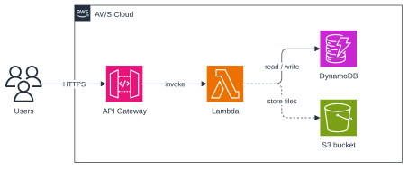
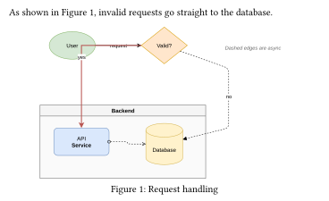

*An independent project, not affiliated with, endorsed by or sponsored by draw.io or JGraph Ltd.*
# dio

Render [draw.io](https://www.drawio.com) / diagrams.net files in Typst, with draw.io's own renderer.

```typ
#import "@preview/dio:0.1.0": drawio, drawio-pages

#drawio(path("architecture.drawio"), width: 100%)
```



## Examples

**In a figure.** `drawio` is used like `image`: wrap it in a `figure` for a caption and a number you can reference.



```typ
As shown in @fig:flow, invalid requests go straight to the database.

#figure(
  drawio(path("flowchart.drawio"), width: 80%),
  caption: [Request handling],
) <fig:flow>
```

**Pages.** Choose a page of a multi-page file by index (from 0) or by name, and list the pages:

```typ
#drawio(path("system.drawio"), page: "Backend")
#drawio-pages(path("system.drawio"))  // ("Overview", "Backend", ...)
```

**Size.** Set a `width` or a `height` like for `image`, both to fit inside a box, or a `scale` of the natural size:

```typ
#drawio(path("architecture.drawio"), height: 40%)
#drawio(path("architecture.drawio"), width: 8cm, height: 5cm)
#drawio(path("architecture.drawio"), scale: 0.8)
```

**Fonts.** By default labels are drawn as outlines with fonts bundled in the package: free fonts with the metrics of Helvetica/Arial (draw.io's default), Times New Roman and Courier New. They look like draw.io on every machine and in the web app, with nothing to install.

To typeset labels as native Typst text in fonts you have instead, use `text: "native"`. Labels then use the fonts chosen in draw.io; map missing ones to fonts you have:

```typ
#drawio(path("architecture.drawio"), text: "native", font: (
  "Helvetica": "Nimbus Sans",       // draw.io's default font
  "Courier New": "Liberation Mono",
))
#drawio(path("architecture.drawio"), text: "native", font: auto)  // your document's font
```

**A frame.** Use Typst's own `box` or `block`:

```typ
#box(stroke: 0.5pt + gray, inset: 6pt, drawio(path("architecture.drawio"), width: 10cm))
```

## Usage

Pass the file as a `path(...)` (Typst 0.15 or newer) with Bytes from `read(..., encoding: none)`.

`.drawio` and `.xml` files work, compressed or not, and so do `.drawio.svg` exports (the diagram embedded in them is used).

| Parameter | Default    | Meaning |
|-----------|------------|---------|
| `source`  | —          | The file contents as bytes, or `path("x.drawio")` |
| `page`    | `0`        | Page index (from 0) or page name |
| `width`   | `auto`     | Width (length or ratio, e.g. `100%`); the height follows |
| `height`  | `auto`     | Height (length or ratio); the width follows. With `width` too, the diagram fits inside both |
| `scale`   | `1.0`      | With no `width`/`height`: multiplier on the natural size (1 draw.io px = 0.75pt) |
| `padding` | `0`        | Margin around the diagram, in draw.io px |
| `text`    | `"outline"` | `"outline"`: labels drawn with the bundled draw.io-like fonts (selectable through an invisible text layer); `"native"`: labels typeset by Typst |
| `font`    | `"drawio"` | Font for native text: `"drawio"` for the diagram's own fonts, a substitution map for them (see above), `auto` for the document's font, or a font name |
| `theme`   | `"light"`  | `"light"` or `"dark"`: draw.io's light or dark appearance |
| `background` | `none`  | Fill behind the diagram: transparent by default; `auto` uses the diagram's own background colour (draw.io's dark page colour with `theme: "dark"`), or give any colour |
| `engine`  | `"plugin"` | `"plugin"` (draw.io's renderer) or `"native"` (a small pure-Typst renderer) |

`drawio-pages(source)` returns the names of the pages in a file.

## Limitations

- **Text:** labels are laid out by the package, not a browser, so a wrapped label can occasionally break a line differently from draw.io. The bundled fonts cover Latin and Greek; other scripts and right-to-left text are drawn as native Typst text. Selecting outline text highlights whole lines accurately, single words approximately.
- **Images:** images must be embedded in the file or come from draw.io's built-in icon library. Images that draw.io loads from the web (e.g. `https://icons.diagrams.net/...`) are skipped, since Typst packages have no network access.
- **HTML labels:** formatting, lists, headings, block backgrounds and tables (as in ER diagrams) are supported. Complex CSS beyond that isn't.
- **Dark theme:** `theme: "dark"` switches the colours draw.io defines in light/dark pairs, including its defaults. Fixed colours are kept as they are; draw.io's automatic darkening of them isn't reproduced.
- **Shadows:** blurred shadows are approximated by a few offset copies.
- **Not yet rendered:** math labels, fill patterns (hatch, dots…), gradients on rotated shapes.
- **Speed and size:** the first diagram in a compile takes about half a second more while draw.io loads, and large diagrams take a few seconds. Typst caches results, so unchanged diagrams aren't redrawn. Outline text makes the PDF a little larger than native text (tens of KB per diagram). The plugin is about 8.7 MB.

## How it works

The package contains a WebAssembly plugin with a small JavaScript engine ([QuickJS](https://github.com/quickjs-ng/quickjs)) and draw.io's viewer, shapes, stencils and icon library. draw.io paints the diagram onto a recording canvas, and the package redraws the recorded paths, text and images with Typst's own elements. A test suite compares the output with draw.io's own exports of its 156 templates: shapes and edges match on almost all of them. Details, the build and the tests are in [CONTRIBUTING.md](https://github.com/I-Azy-I/typst-dio/blob/v0.1.0/CONTRIBUTING.md).

## Licence

MIT for this package. The plugin contains:

- **draw.io's source code:** Apache-2.0.
- **draw.io's icon sets and stencil libraries:** draw.io's terms. They may not be used in or distributed for Atlassian products or the Atlassian Marketplace without JGraph's permission; diagrams you create are not restricted.
- **QuickJS and rquickjs, and libraries bundled by draw.io:** MIT, Apache-2.0 and Zlib.

See [NOTICE](NOTICE) and [licenses/](licenses/).
