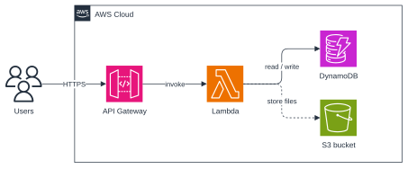
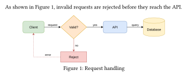
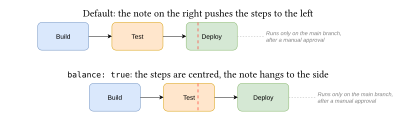

*An independent project, not affiliated with, endorsed by or sponsored by draw.io or JGraph Ltd.*
# dio

Render [draw.io](https://www.drawio.com) / diagrams.net files in Typst, with draw.io's own renderer.

```typ
#import "@preview/dio:0.2.0": drawio, drawio-pages

#drawio(path("architecture.drawio"), width: 100%)
```



## Examples

**In a figure.** `drawio` is used like `image`: wrap it in a `figure` for a caption and a number you can reference.



```typ
As shown in @fig:flow, invalid requests are rejected before they reach the API.

#figure(
  drawio(path("flowchart.drawio"), width: 80%),
  caption: [Request handling],
) <fig:flow>
```

**Pages.** Choose a page of a multi-page file by index (from 0) or by name, and list the pages:

```typ
#drawio(path("system.drawio"), page: "Backend")
#drawio-pages(path("system.drawio"))  // ("Overview", "Backend", ...)
```

**Size.** Set a `width` or a `height` like for `image`, both to fit inside a box, or a `scale` of the natural size:

```typ
#drawio(path("architecture.drawio"), height: 40%)
#drawio(path("architecture.drawio"), width: 8cm, height: 5cm)
#drawio(path("architecture.drawio"), scale: 0.8)
```

**Visual centring.** `balance: true` centres a diagram horizontally on its visual weight, the mean of its drawn pixels, instead of its bounding box. This looks more natural when a diagram has something light on one side, like a note.

```typ
#align(center, drawio(path("pipeline.drawio"), balance: true))
```



## Fonts like in draw.io

The images in this README are made this way.

draw.io's default font is Helvetica, and Typst doesn't come with it. The free [Liberation fonts](https://github.com/liberationfonts/liberation-fonts/releases) have the same letter widths as Helvetica/Arial, Times New Roman and Courier New, so labels wrap exactly as in draw.io.

1. **Get the fonts.**
   - *Typst web app:* download `liberation-fonts-ttf-*.tar.gz` from the [releases page](https://github.com/liberationfonts/liberation-fonts/releases), unpack it, and drag the `.ttf` files into your project's file panel.
   - *Linux:* they are often installed already (`fc-list | grep Liberation`). Otherwise install the package `fonts-liberation` (Debian/Ubuntu), `liberation-fonts` (Fedora) or `ttf-liberation` (Arch).
   - *Windows and macOS:* install the `.ttf` files from the releases page (double-click, then "Install"), or put them in a folder and compile with `typst compile --font-path <folder>`.
2. **Map draw.io's fonts to them** once, at the top of your document, and pass the map to each diagram:

   ```typ
   #import "@preview/dio:0.2.0": drawio

   #let drawio-fonts = (
     "Helvetica": "Liberation Sans",        // draw.io's default
     "Arial": "Liberation Sans",
     "Times New Roman": "Liberation Serif",
     "Courier New": "Liberation Mono",
   )

   #drawio(path("architecture.drawio"), font: drawio-fonts)
   ```

Fonts the map doesn't list are used by their own names. Typst warns if it can't find one and falls back to your document's font, so add the missing ones to the map. `font: "drawio"` uses the diagram's fonts with no map.

## Usage

Pass the file as a `path(...)` (Typst 0.15 or newer) with Bytes from `read(..., encoding: none)`.

`.drawio` and `.xml` files work, compressed or not, and so do `.drawio.svg` exports (the diagram embedded in them is used).

| Parameter | Default    | Meaning |
|-----------|------------|---------|
| `source`  | —          | The file contents as bytes, or `path("x.drawio")` |
| `page`    | `0`        | Page index (from 0) or page name |
| `width`   | `auto`     | Width (length or ratio, e.g. `100%`); the height follows |
| `height`  | `auto`     | Height (length or ratio); the width follows. With `width` too, the diagram fits inside both |
| `scale`   | `1.0`      | With no `width`/`height`: multiplier on the natural size (1 draw.io px = 0.75pt) |
| `padding` | `0`        | Margin around the diagram, in draw.io px |
| `font`    | `auto`     | Font of the labels: `auto` for the document's font, `"drawio"` for the diagram's own fonts, a substitution map for them (see above), or a font name |
| `theme`   | `"light"`  | `"light"` or `"dark"`: draw.io's light or dark appearance |
| `background` | `none`  | Fill behind the diagram: transparent by default; `auto` uses the diagram's own background colour (draw.io's dark page colour with `theme: "dark"`), or give any colour |
| `math`    | `true`     | Typeset LaTeX labels; `false` shows them as written |
| `balance` | `false`    | Centre horizontally on the visual weight (see above) |
| `engine`  | `"plugin"` | `"plugin"` (draw.io's renderer) or `"native"` (a small pure-Typst renderer) |

`drawio-pages(source)` returns the names of the pages in a file.

## Limitations

- **Text:** labels are laid out by Typst, not a browser, and usually in a different font from draw.io's, so a wrapped label can break a line differently and text can be a little wider or narrower than in draw.io.
- **Images:** images must be embedded in the file or come from draw.io's built-in icon library. Images that draw.io loads from the web (e.g. `https://icons.diagrams.net/...`) are skipped, since Typst packages have no network access.
- **HTML labels:** formatting, lists, headings, block backgrounds and tables (as in ER diagrams) are supported. Complex CSS beyond that isn't.
- **Dark theme:** `theme: "dark"` switches the colours draw.io defines in light/dark pairs, including its defaults. Fixed colours are kept as they are; draw.io's automatic darkening of them isn't reproduced.
- **Shadows:** blurred shadows are approximated by a few offset copies.
- **Not yet rendered:** fill patterns (hatch, dots…), gradients on rotated shapes.
- **Speed and size:** the first diagram in a compile takes about half a second more while draw.io loads, and large diagrams take a few seconds. Typst caches results, so unchanged diagrams aren't redrawn. The plugin is about 7.2 MB.

## How it works

The package contains a WebAssembly plugin with a small JavaScript engine ([QuickJS](https://github.com/quickjs-ng/quickjs)) and draw.io's viewer, shapes, stencils and icon library. draw.io paints the diagram onto a recording canvas, and the package redraws the recorded paths, text and images with Typst's own elements. A test suite compares the output with draw.io's own exports of its 156 templates: shapes and edges match on almost all of them. Details, the build and the tests are in [CONTRIBUTING.md](https://github.com/I-Azy-I/typst-dio/blob/v0.2.0/CONTRIBUTING.md).

## Licence

MIT for this package. The plugin contains:

- **draw.io's source code:** Apache-2.0.
- **draw.io's icon sets and stencil libraries:** draw.io's terms. They may not be used in or distributed for Atlassian products or the Atlassian Marketplace without JGraph's permission; diagrams you create are not restricted.
- **QuickJS and rquickjs, and libraries bundled by draw.io:** MIT, Apache-2.0 and Zlib.

See [NOTICE](NOTICE) and [licenses/](licenses/).
