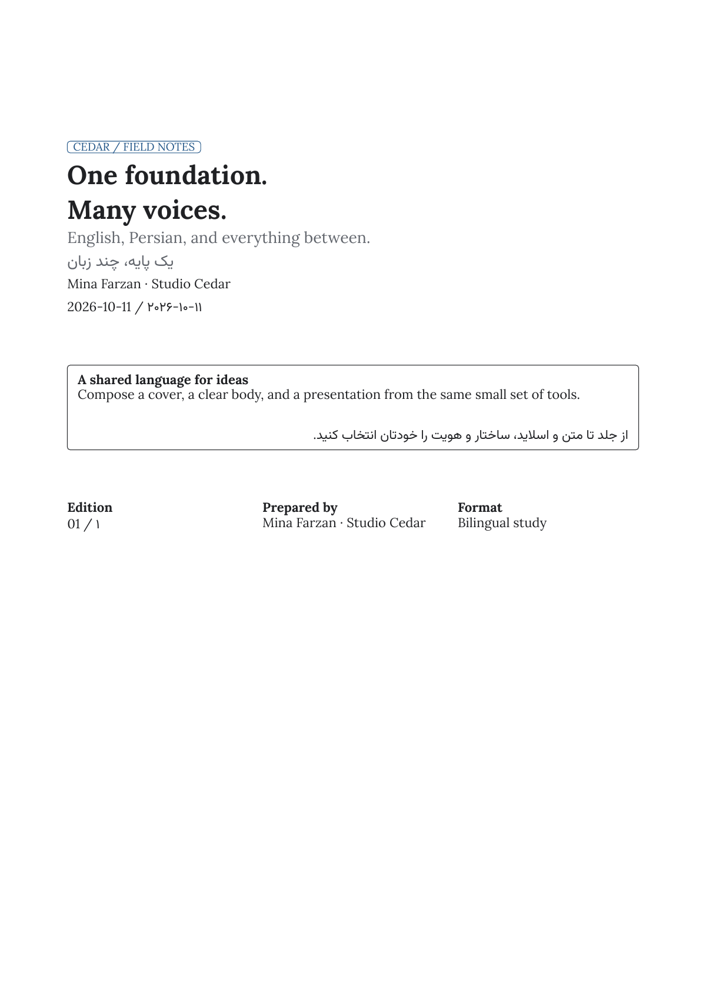
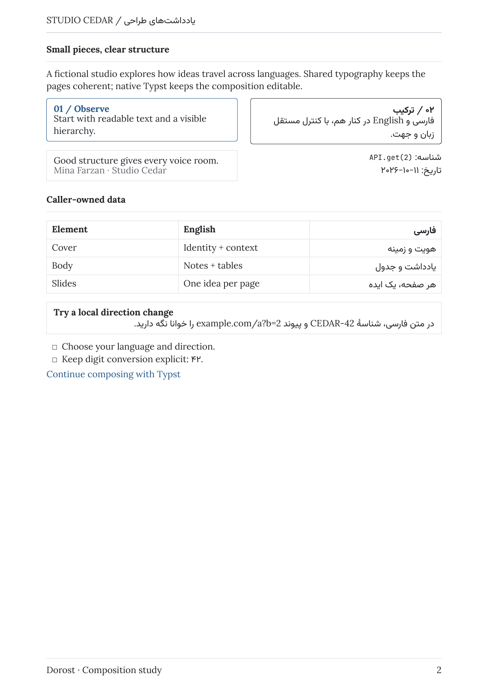
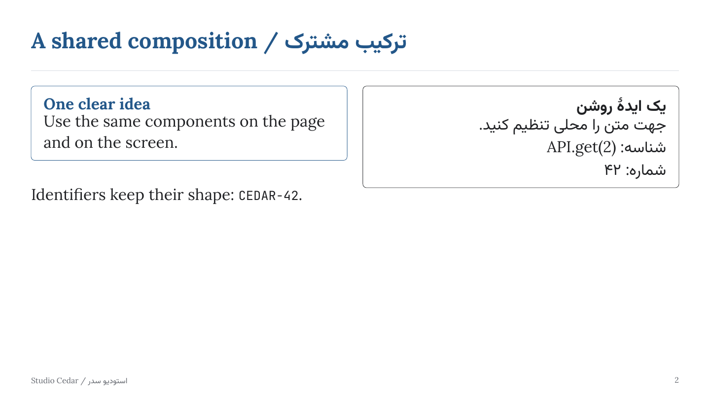

# Dorost

**Dorost** (`درست`) is a use-case-neutral Typst package for English, Persian, and mixed-script documents. It provides shared page and typography defaults while leaving content, structure, and visual identity to each author.

| Cover | Bilingual body | Slides |
| --- | --- | --- |
|  |  |  |

Explore the [editable showcase](examples/showcase.typ), or download the [document PDF](https://github.com/alirezaopmc/dorost/releases/latest/download/showcase-document.pdf) and [slide PDF](https://github.com/alirezaopmc/dorost/releases/latest/download/showcase-slides.pdf) attached to the latest GitHub release. The fictional Studio Cedar identity demonstrates caller-owned content.

> Pre-release: the package is not yet available in Typst Universe. Its package name is `@preview/dorost`; the API may change before 1.0.0.

## Quick start

After publication, create an editable starter with:

```sh
typst init @preview/dorost:0.2.0
```

Or use the package in an existing `.typ` file:

```typ
#import "@preview/dorost:0.2.0": document
#show: document.with(lang: "en", direction: "ltr")

= Your title

Write with native Typst headings, paragraphs, lists, tables, links, code, and math.
```

The package is not tied to a university, course, proposal, thesis, report, or other document type. Consumers compose their own content and identity around the small core API.

## Fonts

The package names the Lora, Vazirmatn, and JetBrains Mono families, but does not distribute font files. Typst packages cannot make bundled fonts available to the compiler. Install those families on your system, or put their `.ttf` files in a project-local `fonts/` directory and compile with:

```sh
typst compile --font-path fonts main.typ
```

Get the fonts from the upstream [Lora](https://github.com/cyrealtype/Lora-Cyrillic/releases/tag/v3.021), [Vazirmatn](https://github.com/rastikerdar/vazirmatn/releases/tag/v33.003), and [JetBrains Mono](https://github.com/JetBrains/JetBrainsMono/releases/tag/v2.304) releases. The automated checks fetch checksum-pinned test fonts from those releases; see [tests/fonts/README.md](tests/fonts/README.md).

## Configuration

`document` sets page geometry, text language/direction/font/size/color, paragraph leading/spacing, list indentation/spacing, and LTR code styling. It does not add titles, headers, metadata, or sections.

```typ
#show: document.with(
  lang: "fa",
  direction: "rtl",
  page: (paper: "a4", margin: (x: 24mm, y: 22mm)),
  fonts: (body: ("Lora", "Vazirmatn"), code: "JetBrains Mono"),
  text: (size: 11pt, paragraph-spacing: 0.8em),
  colors: (accent: rgb("235789")),
)
```

Language, direction, font roles, and digit formatting are independent. `lang` is a non-empty language tag; `direction` accepts the string `"ltr"` or `"rtl"`. Partial option dictionaries override only supplied fields. Unknown keys and invalid language/direction values produce clear errors.

| Export | Default |
| --- | --- |
| `default-fonts` | Body: Lora with Vazirmatn fallback; code: JetBrains Mono |
| `default-page` | A4 with 2 cm horizontal and vertical margins |
| `default-text` | 11 pt; 0.65 em leading; 1 em paragraph spacing; 0.6 em list indent and spacing |
| `default-colors` | Body text; muted footnotes; accent headings and links; rule lines |

Override either font role with a string or a Typst font fallback array. Lora covers Latin; Vazirmatn supplies Persian glyphs. Vazirmatn includes regular and bold faces; Typst may synthesize other faces. Math uses Typst's embedded math font. If the named fonts are unavailable, Typst warns and substitutes available fonts; Persian glyph coverage and layout can differ.

## Mixed direction and Persian digits

`ltr[content]` and `rtl[content]` apply only local text direction. Use them around Latin identifiers, URLs, or RTL phrases when needed. They do not select language or font. Raw code is automatically LTR and uses the code font role.

`persian-digits(value)` explicitly maps ASCII digits `0`–`9` to Persian digits in strings and integers. For Typst numbering, use its native Persian counting symbol (`"۱"`, or `"۱.۱"` for nested levels) in the relevant numbering parameter. Page numbering remains unchanged unless configured. The helper does not inspect or modify arbitrary Typst content, code, URLs, or math.

```typ
#import "@preview/dorost:0.2.0": document, ltr, persian-digits
#show: document.with(lang: "fa", direction: "rtl")
#set footnote(numbering: "۱")

شناسه #ltr[API.get(2)] و تاریخ #ltr[#persian-digits("2026-10-11")]

شماره‌گذاری چندسطحی بومی Typst: #ltr[#numbering("۱.۱", 1, 2, 3)].

این جمله یک پانوشت دارد#footnote[نمونهٔ پانوشت فارسی.]
```

See [`examples/`](examples/) for English, Persian, mixed-direction, and custom-theme sources.

## Inline and content components

The inline helpers make direction explicit where needed: `code-inline(value)`
renders code with the code font in LTR order, while `math-inline(body)` keeps
math LTR and leaves the surrounding text direction unchanged. `badge(body,
tone: "accent")` accepts the tones `"neutral"`, `"accent"`, or `"muted"`.

The block helpers accept native Typst content, so paragraphs and mixed English
and Persian text inherit the surrounding language, direction, and fonts.
Optional titles, attributions, and details disappear when omitted.

| Function | Inputs and behavior |
| --- | --- |
| `note(body, title: none, tone: "neutral")` | Framed note with optional title; tone accepts `"neutral"`, `"accent"`, or `"muted"`. |
| `quote-frame(body, attribution: none)` | Quotation with an optional caller-owned attribution. |
| `prompt-example(label, body)` | Bold caller label followed by example content. |
| `checklist(items)` | Native Typst list with checkbox markers; items must be an array of content. |
| `resource-link(url, label, detail: none)` | Clickable URL label with optional muted detail text. |
| `resource-links(..items)` | Vertical stack of positional resource-link content; named arguments are rejected. |

```typ
#import "@preview/dorost:0.2.0": code-inline, math-inline, badge, note, quote-frame, prompt-example, checklist, resource-link, resource-links, ltr, rtl

API call: #code-inline("API.get(2)"); inline math: #math-inline[$x + 2$].
#badge(tone: "muted")[Draft]
#note(title: [A bilingual note])[
  #ltr[Reference: DOROST-42]. #rtl[یادداشت فارسی]
]
#quote-frame(attribution: [A. Writer])[Give every voice room.]
#prompt-example([Question])[
  #rtl[چطور این بخش را ویرایش کنم؟]
]
#checklist(([Read the guide.], [Run the examples.]))
#resource-links(
  resource-link("https://typst.app", [Typst], detail: [Typesetting system]),
)
```

## Forms, tables, and frames

These helpers accept caller-owned content and inherit the surrounding document's
language, direction, and fonts. They do not read data files or impose a schema.

| Function | Inputs and behavior |
| --- | --- |
| `labeled-field(label, value, label-style: "strong", row-gutter: 0em)` | Label above value; style accepts `"strong"` or `"muted"`. Gutter separates the rows. |
| `choice-group(items, selected: none, columns: 1)` | Array of content in a grid; columns is a positive integer. Optional selected index is zero-based and must identify an item. Markers are `(x)` and `( )`. Empty arrays are supported. |
| `data-table(columns, rows, header: true, align: auto)` | Positive integer column count and an array of row arrays, each with exactly that many cells. Boolean header styles and repeats the first row. Empty row collections are supported. |
| `border-frame(body, style: "single", title: none)` | Single or double border around content, with an optional caller-provided title. |
| `section-title(title, rule: true)` | Bold visual title and optional rule; rule is boolean. Choose native heading levels separately. |

Table alignment accepts native `auto` or the strings `"auto"`, `"start"`,
`"center"`, and `"end"`. Start/end follow the surrounding text direction, as do
column ordering and choice marker placement. Unsupported options and malformed table or
choice inputs produce `dorost:` diagnostics.

```typ
#import "@preview/dorost:0.2.0": labeled-field, choice-group, data-table, border-frame, section-title

#section-title[Your section]
#labeled-field([Your label], [Your value])
#choice-group(([First option], [Second option]), selected: 1, columns: 2)
#data-table(2, (([Your heading], [Another heading]), ([Your cell], [Another cell])))
#border-frame(style: "double", title: [Your title])[Your content]
```

## Optional covers and page chrome

`cover-page(title, subtitle: none, author: none, date: none, logo: none, details: none)`
composes caller-provided content in a vertical block. Optional slots disappear when
omitted. Supply any labels and logo yourself; content helpers can be used in slots.
It inserts no page breaks. Callers choose cover placement and page boundaries.

`page-chrome(body, header: none, footer: none, numbering: true, rule: true)`
sets native Typst page settings locally for its body. Headers and footers follow
the surrounding text direction. `numbering` and `rule` accept booleans only;
numbering uses the native, continuous page counter with Arabic decimal digits.
Rules appear below a supplied header and above a footer or page number. Native
page settings create page boundaries when entering/leaving the wrapper; use it
around page content rather than inside a block, grid, or other container.

```typ
#import "@preview/dorost:0.2.0": document, cover-page, page-chrome
#show: document.with(lang: "en", direction: "ltr")

#cover-page([Your title], subtitle: [Your subtitle], author: [Your name])
#pagebreak()
#page-chrome(header: [Your header], footer: [Your footer])[
  = Your content
  Write your document here.
]
```

## Slides

`slides(body, ratio: "16:9", show-counter: true, footer: none)` applies local
native page settings: 320 × 180 mm for `"16:9"`, 320 × 240 mm for `"4:3"`,
14 mm margins, and 20 pt text. It inherits the surrounding language, direction,
fonts, and text color. Shared default paragraph spacing and leading apply inside
slides. After the wrapper, the surrounding document settings resume.
`show-counter` is boolean; counters use the native continuous page number with
Arabic decimal digits. The optional caller-owned footer and counter align to
start/end in the current direction. Slide pages suppress an enclosing header
and native numbering; the wrapper's footer contains the optional counter.

Each layout starts a new slide and fills its available page body. An initial
weak page break avoids a blank first slide. Place layouts directly inside
`slides`, and place the wrapper at page level, as with `page-chrome`.
Authors keep content within the available slide area; oversized content follows
native Typst layout behavior rather than being automatically scaled.

| Function | Inputs and behavior |
| --- | --- |
| `slide-cover(title, subtitle: none, author: none, date: none)` | Vertically centered cover with caller-owned optional metadata; omitted slots disappear. |
| `slide-section(title, subtitle: none)` | Vertically centered section title and optional subtitle. |
| `slide-content(body, title: none)` | Body with an optional accent title and rule. |
| `slide-columns(left, right, title: none, ratio: (1fr, 1fr))` | Two content columns in start/end order with native Typst column sizes. |
| `slide-image(path, fit: "contain", background: none)` | Image fills the page body within margins; optional background behind the image. |
| `slide-image-text(path, body, title: none, fit: "contain", image-side: "end")` | Equal image/text columns; image side accepts `"start"` or `"end"` relative to text direction. |
| `slide-statement(body, attribution: none)` | Vertically centered framed statement with optional attribution. |

Both image helpers accept native `"contain"` or `"cover"` fitting. Supply a
Typst `path("...")` value constructed in your project so external assets resolve
relative to your file across the package boundary. No image assets are bundled
or fetched by these helpers. Invalid ratios, image fitting, image sides, and
counter flags produce `dorost:` diagnostics.

```typ
#import "@preview/dorost:0.2.0": document, slides, slide-cover, slide-content, slide-image-text
#show: document.with(lang: "en", direction: "ltr")

#slides(footer: [Your footer])[
  #slide-cover([Your title], author: [Your name])
  #slide-content(title: [Your section])[Your content]
  #slide-image-text(path("your-image.png"), [Your description], title: [Your image])
]
An ordinary document page follows with the surrounding page settings.
```

## Development and verification

Requires Typst 0.15.0 or later, `pdftotext`, Python 3.11+, and internet access on the first test run to fetch checksum-pinned upstream test fonts. CI checks the minimum supported Typst version (0.15.0) and current stable version (0.15.1).

```sh
./scripts/check.sh
./scripts/render-showcase.sh build/showcase
```

The renderer produces two PDFs and three PNG previews using the same checksum-pinned fonts and isolated package path as CI. It needs Poppler’s `pdftoppm`; generated PDFs stay outside git and the package.

The check compiles all fixtures and examples with system fonts disabled, tests configuration failures, checks PDF text extraction, validates the template thumbnail path, checks manifest rejection, and initializes and compiles the starter in a temporary directory with project-local fonts. Test font binaries are downloaded from their upstream releases, checksum-verified, cached outside the repository, and removed from the build directory afterward. Poppler's `pdftotext` can reorder characters and punctuation inside right-to-left spans, including words with ZWNJ; exact authored Persian words are checked in the fixture source, while rendered Persian layout should be visually inspected. Generated PDFs are removed after the run. GitHub Actions runs the same command on both supported compiler versions.

## License

Package code is MIT licensed. The copied starter in `template/` is MIT-0. Tests fetch font fixtures from upstream releases under the SIL Open Font License 1.1; no font binaries are stored in this repository or included in the package. The package manifest's SPDX expression is `MIT AND MIT-0`. See [LICENSE](LICENSE), [LICENSE-MIT-0](LICENSE-MIT-0), and the upstream font releases linked in [tests/fonts/README.md](tests/fonts/README.md).

## Contributing and releases

See [CONTRIBUTING.md](CONTRIBUTING.md) for pull-request checks, scope, and the release process. Use [GitHub Issues](https://github.com/alirezaopmc/dorost/issues) for support and bug reports; see [SUPPORT.md](SUPPORT.md). Report security issues privately as described in [SECURITY.md](SECURITY.md).
