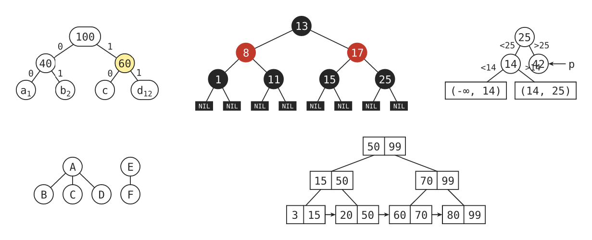
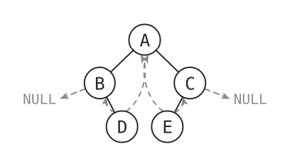
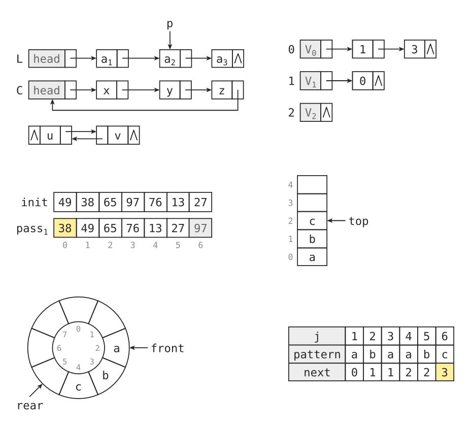
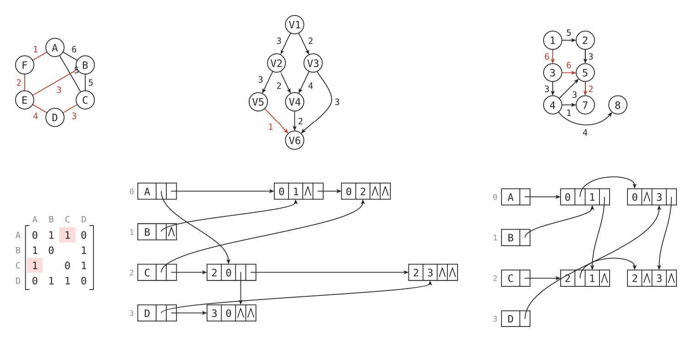

# dsviz

Draw data-structure diagrams from a compact text DSL: trees, binary trees,
red-black trees, B/B+ trees, linked lists, arrays, stacks, ring buffers,
matrices, tables, graphs and adjacency structures.

Layout runs in a small Rust/WASM plugin, while every label is typeset and
measured by Typst itself, so diagrams line up with any font, support
subscripts and match your document's text size.



## Quick start

````typ
#import "@preview/dsviz:0.1.0": ds

// Every ```ds block becomes a diagram.
#show raw.where(lang: "ds"): ds

```ds
bintree thread=in
A
  B
    _
    D
  C
    E
```
````



You can also call the function directly, with a raw block or a string:

````typ
#ds(width: 5cm, spacing: 1.2)[```
digraph
A -> B 3
B -> C 4
A -> C 9 [red]
```]

#ds("array index=0\n3 1[hl] 4 1 5")
````

## The `ds` function

```typ
#ds(width: auto, font: auto, size: auto, spacing: 1.0, stroke: auto, body)
```

| Parameter | Type | Default | Meaning |
|---|---|---|---|
| `body` | `str`, `content` | — | The DSL source: a string, a raw block, or content holding one raw block. |
| `size` | `auto`, `length` | `auto` | Label size. `auto` uses the current text size. |
| `font` | `auto`, `str`, `array` | `auto` | Label font. `auto` uses the current text font. |
| `width` | `auto`, `length`, `relative` | `auto` | Scale the whole diagram (labels and strokes included) to this width. The diagram is redrawn, not scaled as an image. |
| `spacing` | `float` | `1.0` | Node spacing factor. Does not change the text size. |
| `stroke` | `auto`, `length` | `auto` | Line width. `auto` is 8% of the text size. |

When used through `show raw.where(lang: "ds"): ds`, the diagram inherits the
style of raw text, which is a monospace font at 0.8× size by default. To use
your body font instead, pass it explicitly:

```typ
#show raw.where(lang: "ds"): ds.with(font: "Libertinus Serif", size: 10pt)
```

## Syntax

The first line names the **kind** followed by optional `key=value` options.
The following lines describe the structure. `//` starts a comment and blank
lines are ignored. Errors report the line number, counted from the first line
of the block.

**Elements** are written as `label[attr, ...]`:

- Colors: `hl` (highlight), `red`, `green`, `blue`, `gray`
- `dashed` draws a dashed outline or edge; `box` draws a rectangular node
- `^name` attaches a named pointer arrow, e.g. `^p`, `^top`, `^front`
- Quote labels with spaces: `"a b"`
- `a_1` and `a_{12}` render subscripts; `\_` is a literal underscore
- A lone `_` is an empty slot

## Kinds

| Kind | How to write it | Options |
|---|---|---|
| `tree`, `forest` | Indentation gives parent/child; several unindented lines make a forest. Prefix a line with `label:` to label the edge to its parent. | |
| `bintree` | Indented (a single child is the left child; use `_` as a placeholder), or one line in level order: `A B C _ D`. | `thread=in\|pre\|post`, `bits=on` (0/1 edge labels), `ext=on` (external nodes), `layout=tidy` (compact; default places nodes by in-order index) |
| `rbtree` | Like `bintree`; nodes are black by default, `[red]` makes them red. | `nil=on`, plus `thread`, `bits` |
| `btree`, `bplus` | Indented, one node per line, keys separated by spaces. With keys + 1 children the edges attach between keys. | btree: `ext=on` (failure nodes); bplus: `link=off` (no leaf chain) |
| `list` | `L: head[gray] -> a_1 -> a_2[^p] -> ^`. `<->` for doubly linked; a leading `^ <->` means a null prev; a trailing `@k` links back to node *k*. Several lines are aligned by column (adjacency lists, hash chaining). | |
| `array` | One array per line, optionally prefixed with `name:`. `_` is an empty cell. | `index=0\|1` |
| `stack` | Bottom to top, drawn vertically; several lines side by side. Two pointers make a shared stack. | `index=`, `size=` (pad with empty slots) |
| `ring` | Circular queue, slots in index order; `_[^rear]` puts a pointer on an empty slot. | `size=`, `index=off` |
| `matrix` | Bracketed matrix; `.` leaves a cell blank; colors mark regions. | `rows=`, `cols=`, `labels=` (comma separated) |
| `table` | Grid of cells. | `head=row\|col\|both` |
| `graph`, `digraph` | Edges `A - B 5`, `A -> B 5 [red]`, `A <-> B`; chains like `A - B - C`. Nodes `A[hl]`, `A @1,0` (if every node has coordinates they are used as-is; y points down). Straight edges that would cross another node are drawn as arcs. | `layout=circle\|layer`, `dir=tb\|lr` |
| `orthlist` | Orthogonal list of a digraph: write edges `A -> B`; an optional first line `A B C D` fixes the vertex order. | |
| `multilist` | Adjacency multilist of an undirected graph: write edges `A - B`. | |

## Gallery

Sources for all images are in [`examples/`](https://github.com/wesleyel/dsviz/tree/v0.1.0/examples).

**Lists, arrays, stacks, queues and tables**



**Graphs, matrices and adjacency structures**



## How it works

`ds` calls the plugin twice. The first call returns every label in the
diagram; Typst measures each one with the real font. The second call receives
those widths and returns the shapes as SVG plus the positions of the labels,
which Typst then places as normal text. Changing `width` re-runs the layout at
a proportionally larger text size, so strokes and text stay crisp.

## Development

The plugin source is in [`plugin/`](https://github.com/wesleyel/dsviz/tree/v0.1.0/plugin).
You need Rust with the `wasm32-unknown-unknown` target; `wasm-opt` (from
Binaryen) is optional.

```sh
make wasm      # build the plugin into src/dsviz.wasm
make test      # Rust unit tests, compile tests/gallery.typ and examples/
make images    # regenerate docs/images/
scripts/bump.sh 0.2.0   # bump the version in every file
```

See [CHANGELOG.md](https://github.com/wesleyel/dsviz/blob/v0.1.0/CHANGELOG.md) for release notes.

## License

[MIT](LICENSE)

## 中文说明

dsviz 用一段简短的文本描述来画数据结构示意图，适合写数据结构、算法课程笔记和讲义。支持树、森林、二叉树（含线索二叉树、哈夫曼树、判定树）、红黑树、B 树 / B+ 树、单链表 / 双链表 / 循环链表、数组、栈（含共享栈）、循环队列、矩阵、表格、无向图 / 有向图、十字链表和邻接多重表。

- 首行写种类和选项，例如 `bintree thread=in`，后面逐行写结构；`//` 开始注释。
- 元素写成 `标签[属性]`。属性包括颜色 `hl` `red` `green` `blue` `gray`、`dashed` 虚线、`box` 方框结点，以及 `^p` 这样的指针。
- `a_1` 渲染成下标，`_` 表示空位，标签中有空格时加引号。
- 图中文字由 Typst 排版，中文标签可以直接写，例如 `list` 里的 `头[gray]`。只要当前字体包含中文字形，就能正确对齐。
- 用 `show raw` 写法时，默认继承代码块的等宽字体，字号为 0.8 倍。如果想和正文一致，可以写 `ds.with(font: ..., size: ...)`。
- 出错时会提示行号，行号从代码块第一行算起。
