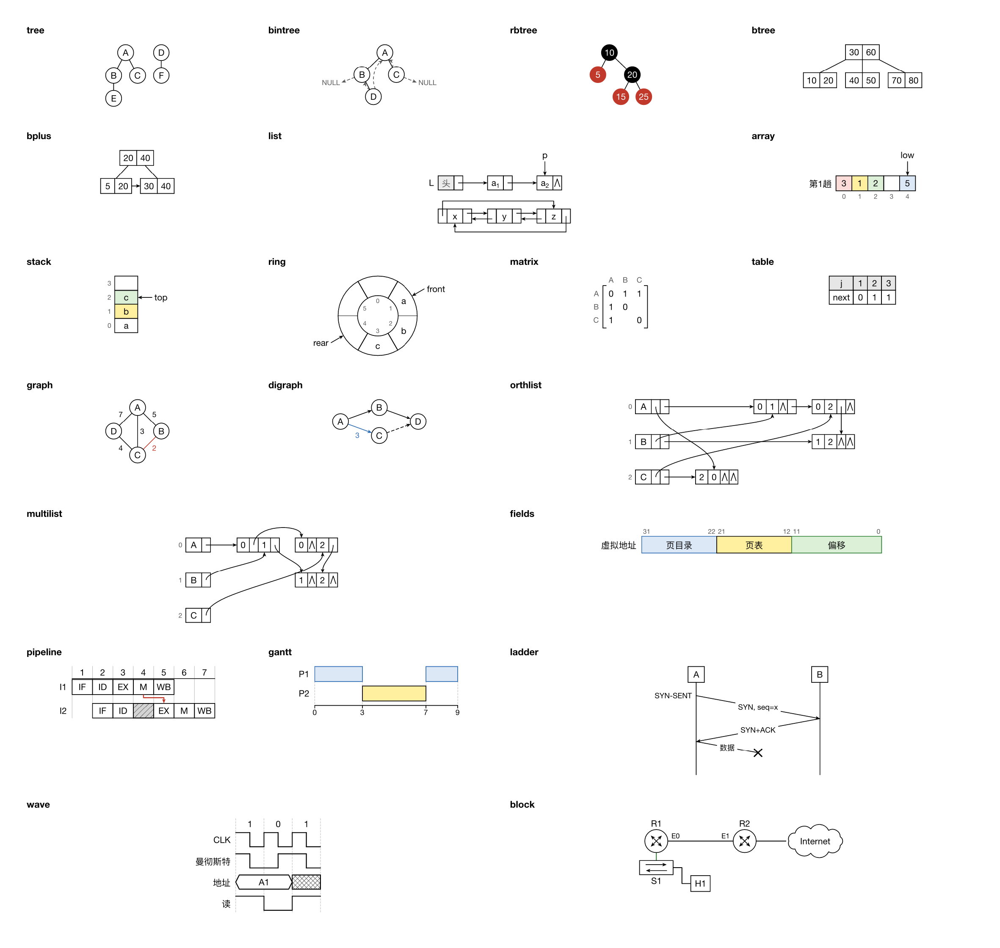
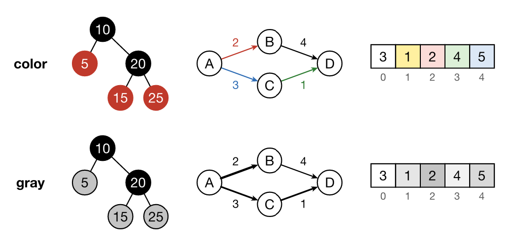
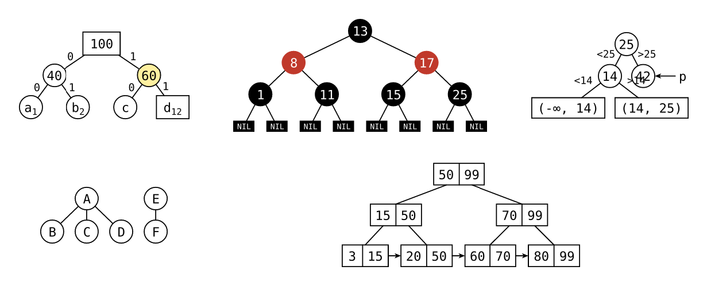
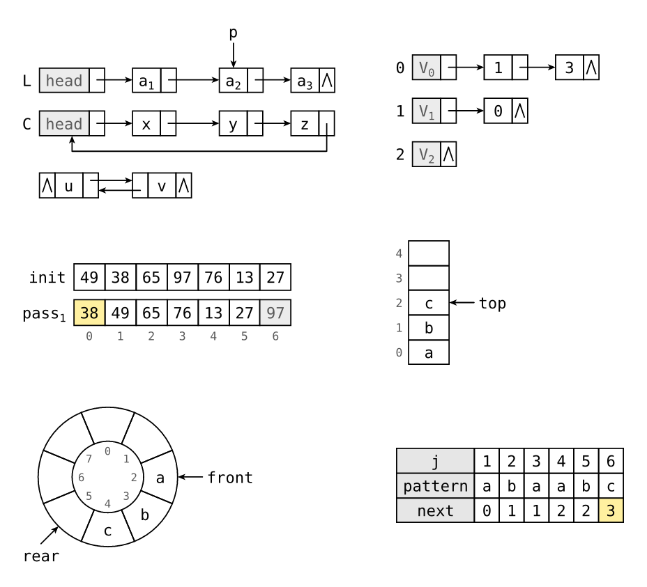
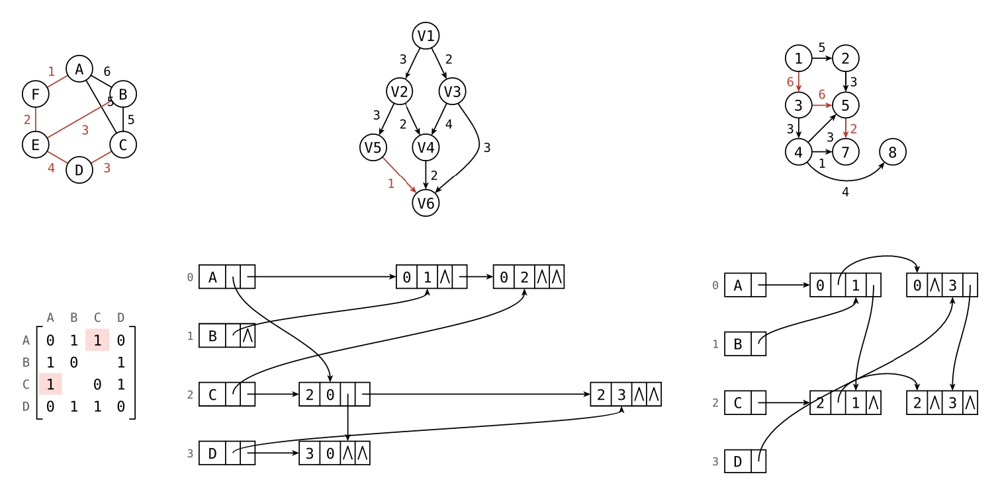

# dsviz

[](https://github.com/wesleyel/dsviz/actions/workflows/ci.yml)
[](https://typst.app/universe/package/dsviz)
[](https://typst.app)
[](https://github.com/wesleyel/dsviz/tree/v0.2.0/plugin)
[](LICENSE)

[English](README.md) · **中文**

用几行文本在 [Typst](https://typst.app) 里画数据结构和计算机系统示意图。风格简洁传统：直角、细黑线、克制的配色，适合讲义、笔记和习题；灰度配色保证黑白印刷也清楚。

图中文字由 Typst 排版，中文可以直接写，任何字体都能对齐，字号与正文一致。



## 用法

````typ
#import "@preview/dsviz:0.2.0": ds

// 之后每个 ```ds 代码块都会变成图
#show raw.where(lang: "ds"): ds

```ds
bintree thread=in
A
  B
    _
    D
  C
```
````

首行写种类和选项，后面逐行写结构。也可以直接调用函数：

````typ
#ds(width: 5cm, spacing: 1.2)[```
wave grid=on bits=1 0 1
CLK: c c c
曼彻斯特: 10 01 10
```]
````

用代码块写法时，图默认继承等宽字体；想和正文一致，写 `ds.with(font: ..., size: ...)`。

### 配色

默认彩色。黑白印刷时传 `palette: "gray"`，可以单张图设置，也可以全文设置：

```typ
#show raw.where(lang: "ds"): ds.with(palette: "gray")
```



| 分类 | 种类 |
|---|---|
| 树 | `tree` `forest` `bintree` `rbtree` `btree` `bplus` |
| 线性结构 | `list` `array` `stack` `ring` `matrix` `table` |
| 图 | `graph` `digraph` `orthlist` `multilist` |
| 计算机系统 | `fields` 位段、`pipeline` 时空图、`gantt` 甘特图、`ladder` 时序图、`wave` 波形、`block` 方框图 |

完整语法和 `ds` 参数见 [docs/syntax.md](https://github.com/wesleyel/dsviz/blob/v0.2.0/docs/syntax.md)（英文）。

## 图例







源码在 [`examples/`](https://github.com/wesleyel/dsviz/tree/v0.2.0/examples)。

## 开发

需要 Rust 和 `wasm32-unknown-unknown` 目标。

```sh
make wasm    # 构建插件到 src/dsviz.wasm
make test    # 单元测试、gallery 和 examples
make images  # 重新生成 docs/images/
```

更新记录见 [CHANGELOG.md](https://github.com/wesleyel/dsviz/blob/v0.2.0/CHANGELOG.md)，许可证为 [MIT](LICENSE)。
