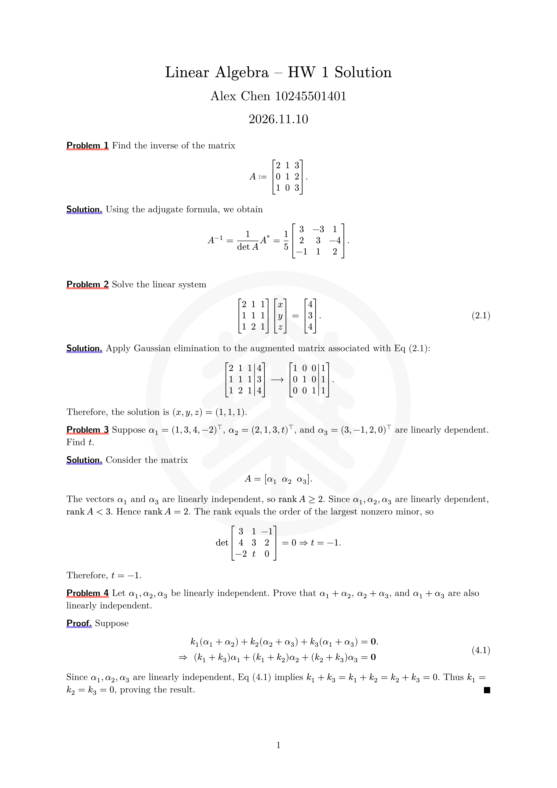
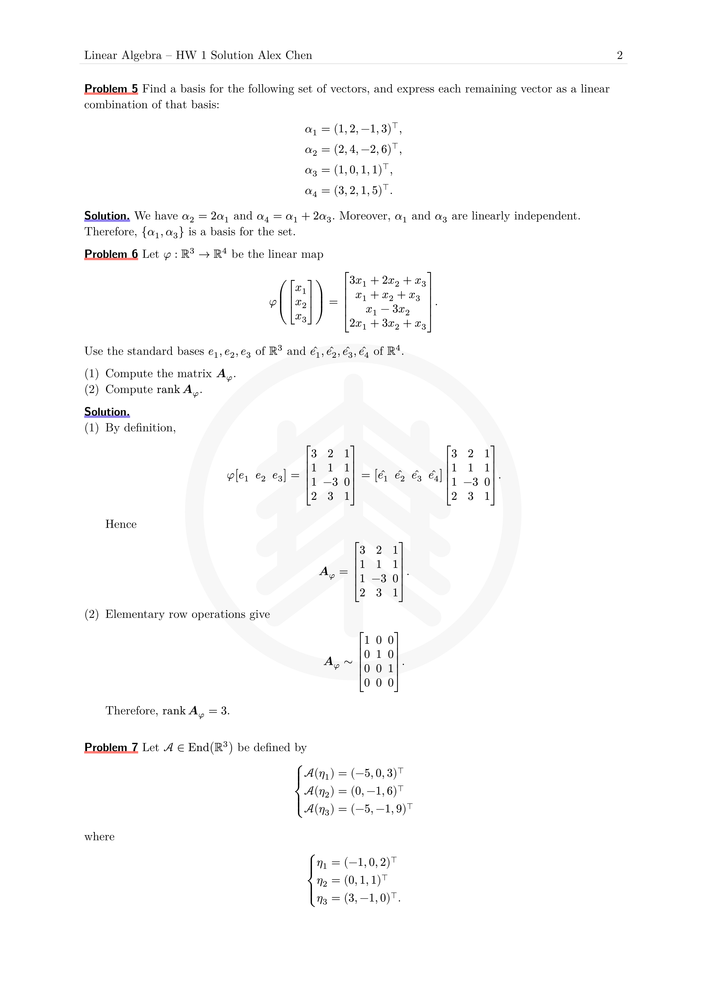
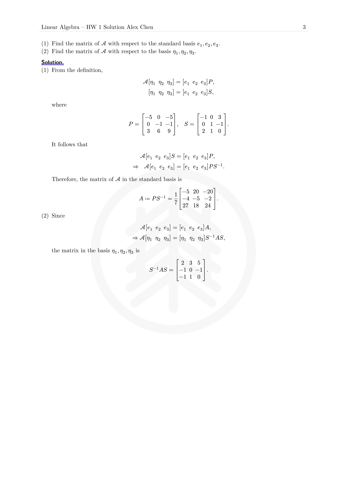

# ECNU Math Homework

**English** | [中文](README.zh-CN.md)

A clean [Typst](https://typst.app/) template for East China Normal University mathematics homework. It is designed for assignments organized as problems followed by solutions or proofs.

## Preview

| Page 1 | Page 2 | Page 3 |
| --- | --- | --- |
|  |  |  |

The source used to generate these images is available at [`template/hw.typ`](template/hw.typ).

## Features

- Problem, solution, and proof blocks with automatic numbering
- Equation numbers scoped to each problem
- Direct references to numbered equations
- English and Chinese labels
- A4 page layout with a title area, running header, and page numbers
- Optional ECNU logo watermark or a user-defined page background
- Styled enumerations and nested lists

## Requirements

- Typst 0.15.1 or later
- The fonts listed in [Fonts](#fonts) for the intended appearance

## Quick start

Import the published package from Typst Universe:

```typst
#import "@preview/ecnu-math-hwk:0.1.1": *
```

To work from a local clone instead:

```typst
#import "ecnu-math-hwk/lib.typ": *
```

Create a document by setting its language before applying the template:

```typst
#import "@preview/ecnu-math-hwk:0.1.1": *

#set text(lang: "en")

#show: hwk.with(
  author: "Alex Chen",
  stu-id: 10245501401,
  course: [Linear Algebra],
  hwk-id: 1,
)

#problem[
  Prove that the sum of two even integers is even.
]

#proof[
  Write the integers as $2m$ and $2n$. Their sum is
  $2m + 2n = 2(m+n)$, which is even.
]
```

> The language must be set before `#show: hwk.with(...)` so that generated labels use the correct language.

## Template options

Pass these named arguments to `hwk.with(...)`:

| Option | Default | Description |
| --- | --- | --- |
| `title` | `none` | Document title. When omitted, the template builds one from the course and homework number. |
| `course` | `"course"` | Course name displayed in the generated title. Strings and content are accepted. |
| `hwk-id` | `0` | Homework or assignment number. |
| `author` | `"author"` | Student name. |
| `stu-id` | `1234567890` | Student ID. |
| `watermark` | `"default"` | Page background. See [Watermarks](#watermarks). |

For example, a custom title can be supplied as content:

```typst
#show: hwk.with(
  title: [Linear Algebra — Problem Set 3],
  author: "Alex Chen",
  stu-id: 10245501401,
)
```

### Watermarks

The `watermark` option has three modes:

```typst
// Use the built-in ECNU logo.
#show: hwk.with(watermark: "default")

// Disable the page background.
#show: hwk.with(watermark: none)

// Use arbitrary Typst content as the page background.
#show: hwk.with(
  watermark: align(
    center + horizon,
    text(size: 52pt, fill: rgb("#dddddd"))[DRAFT],
  ),
)
```

An image can also be used as a custom watermark:

```typst
#show: hwk.with(
  watermark: image("assets/my-watermark.svg", width: 65%),
)
```

## Writing homework

### Problems, solutions, and proofs

Use the three exported block functions directly:

```typst
#problem[
  Evaluate $integral_0^1 x^2 dif x$.
]

#solution[
  $integral_0^1 x^2 dif x = [x^3/3]_0^1 = 1/3$.
]

#problem[
  Prove that $sqrt(2)$ is irrational.
]

#proof[
  Assume the contrary and derive a contradiction from a fraction in lowest terms.
]
```

Each `problem` advances the problem counter and resets the equation counter. A `proof` automatically places a filled square at its end.

### Numbered equations and references

Attach a label to a display equation to number it:

```typst
#problem[
  Consider
  $
    A x = b.
  $<linear-system>
]

#solution[
  Equation @linear-system can be solved by Gaussian elimination.
]
```

The equation number includes the current problem number. Equation-reference prefixes are localized for English and Chinese documents.

### Lists

Typst's normal list syntax works inside all blocks:

```typst
#problem[
  Complete both tasks:

  + Compute the determinant.
  + Find the rank.
]
```

## Language

Set `text.lang` to `"en"` or `"zh"` before applying `hwk`:

```typst
// English
#set text(lang: "en")
#show: hwk.with(author: "Alex Chen")
```

```typst
// Chinese
#set text(lang: "zh")
#show: hwk.with(author: "张同学")
```

This controls the generated problem, solution, proof, and equation-reference labels.

## Fonts

Fonts are not bundled with the package. For the intended appearance, install:

- Source Han Serif SC
- Source Han Sans SC
- New Computer Modern
- New Computer Modern Sans
- Consolas Nerd Font (used for raw/code text; Typst falls back if unavailable)

You can inspect the fonts visible to Typst with:

```sh
typst fonts
```

## Compile the example

From the repository root:

```sh
typst compile template/hw.typ
```

The complete English example demonstrates equations, references, proofs, lists, multi-page headers, and the default watermark.

## Repository layout

```text
.
├── assets/logo.svg      # Default ECNU watermark
├── lib.typ              # Public template entry point
├── utils.typ            # Block styles and numbering helpers
├── template/hw.typ      # Full English example
└── pic/                 # README preview images
```

## ECNU logo

When using the university emblem, prefer official electronic artwork supplied by ECNU. Redrawing the emblem may introduce inaccuracies and should be avoided.

## License

This project is released under the [MIT License](LICENSE).
