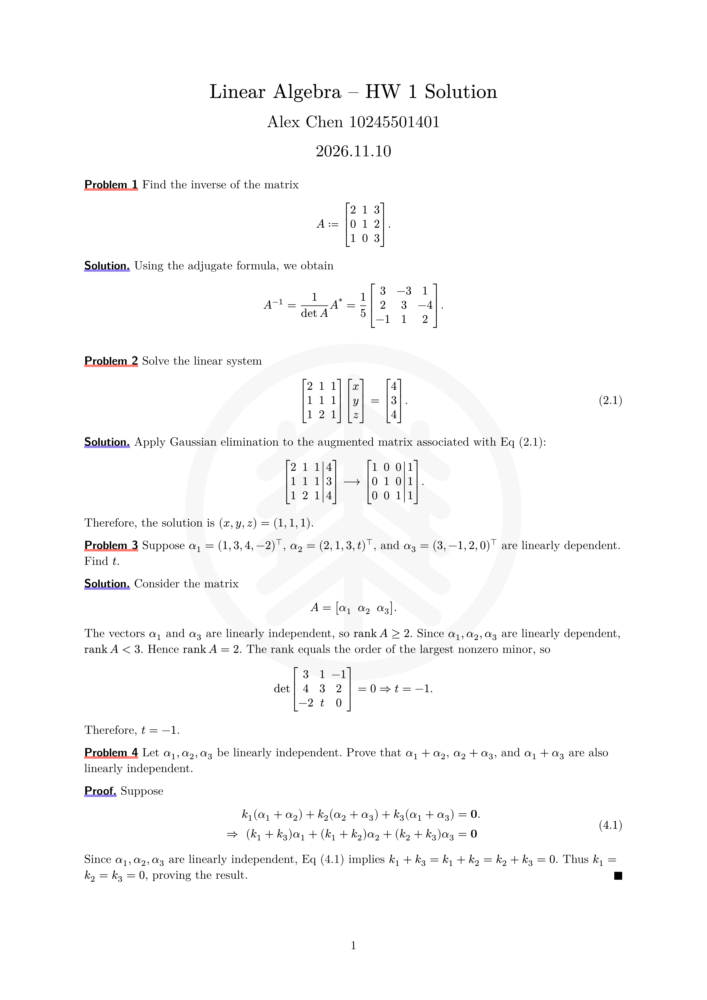
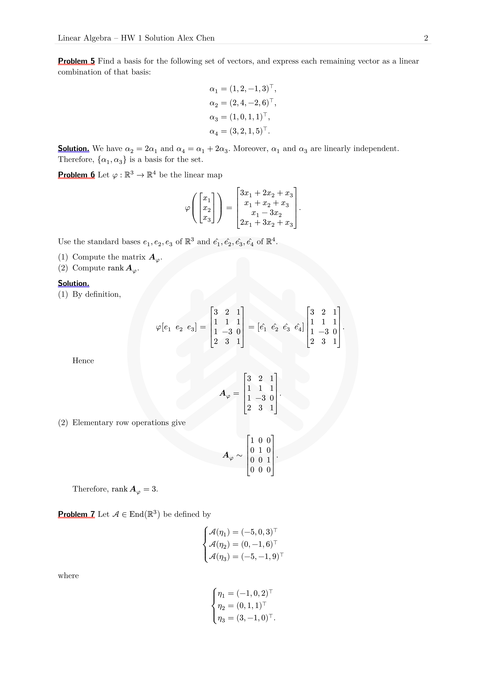
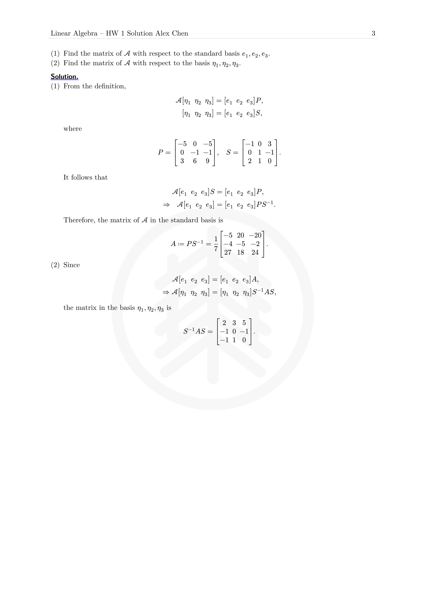

# 华东师范大学数学作业模板

[English](README.md) | **简体中文**

一款简洁的华东师范大学数学作业 [Typst](https://typst.app/) 模板，适用于按照“问题—解答”或“问题—证明”形式组织的作业。

## 预览

| 第 1 页 | 第 2 页 | 第 3 页 |
| --- | --- | --- |
|  |  |  |

生成预览图的源文件位于 [`template/hw.typ`](template/hw.typ)。

## 功能

- 自动编号的问题、解答和证明区块
- 在每道问题内独立编号行间公式
- 直接引用已编号公式
- 支持中英文标签
- 带标题区、页眉和页码的 A4 页面布局
- 可选用默认华东师大校徽水印、自定义页面背景或关闭水印
- 美化有序列表和嵌套列表

## 环境要求

- Typst 0.15.1 或更高版本
- 如需获得预期排版效果，请安装[字体](#字体)一节列出的字体

## 快速开始

从 Typst Universe 导入已发布的模板：

```typst
#import "@preview/ecnu-math-hwk:0.1.1": *
```

也可以克隆本仓库并从本地导入：

```typst
#import "ecnu-math-hwk/lib.typ": *
```

在应用模板之前设置文档语言：

```typst
#import "@preview/ecnu-math-hwk:0.1.1": *

#set text(lang: "zh")

#show: hwk.with(
  author: "张同学",
  stu-id: 10245501401,
  course: [线性代数],
  hwk-id: 1,
)

#problem[
  证明两个偶数之和仍为偶数。
]

#proof[
  将这两个整数分别写成 $2m$ 和 $2n$，则它们的和为
  $2m + 2n = 2(m+n)$，因此仍为偶数。
]
```

> 必须在 `#show: hwk.with(...)` 之前设置语言，模板生成的标签才能使用正确的语言。

## 模板参数

可向 `hwk.with(...)` 传入以下命名参数：

| 参数 | 默认值 | 说明 |
| --- | --- | --- |
| `title` | `none` | 文档标题。省略时，模板会根据课程名和作业编号自动生成标题。 |
| `course` | `"course"` | 自动生成标题时使用的课程名，可以传入字符串或内容。 |
| `hwk-id` | `0` | 作业编号。 |
| `author` | `"author"` | 学生姓名。 |
| `stu-id` | `1234567890` | 学号。 |
| `watermark` | `"default"` | 页面背景，详见[水印](#水印)。 |

例如，可以传入自定义标题：

```typst
#show: hwk.with(
  title: [线性代数——第三次作业],
  author: "张同学",
  stu-id: 10245501401,
)
```

### 水印

`watermark` 参数有三种用法：

```typst
// 使用内置的华东师大校徽。
#show: hwk.with(watermark: "default")

// 不显示任何页面背景。
#show: hwk.with(watermark: none)

// 使用任意 Typst 内容作为页面背景。
#show: hwk.with(
  watermark: align(
    center + horizon,
    text(size: 52pt, fill: rgb("#dddddd"))[草稿],
  ),
)
```

也可以使用图片作为自定义水印：

```typst
#show: hwk.with(
  watermark: image("assets/my-watermark.svg", width: 65%),
)
```

## 编写作业

### 问题、解答和证明

模板导出了三个可直接使用的区块函数：

```typst
#problem[
  计算 $integral_0^1 x^2 dif x$。
]

#solution[
  $integral_0^1 x^2 dif x = [x^3/3]_0^1 = 1/3$。
]

#problem[
  证明 $sqrt(2)$ 是无理数。
]

#proof[
  反设 $sqrt(2)$ 可以写成最简分数，并由此导出矛盾。
]
```

每个 `problem` 都会推进问题计数器，并重置公式计数器。`proof` 会在末尾自动添加实心方块。

### 公式编号和引用

为行间公式添加标签后，模板会自动显示编号：

```typst
#problem[
  考虑方程
  $
    A x = b.
  $<linear-system>
]

#solution[
  可以使用高斯消元法求解 @linear-system。
]
```

公式编号包含当前问题编号。引用标签会随语言本地化：英文文档使用“Eq”，中文文档使用“式”。

### 列表

所有区块内都可以直接使用 Typst 的标准列表语法：

```typst
#problem[
  完成以下两项任务：

  + 计算行列式。
  + 求矩阵的秩。
]
```

## 语言设置

应用 `hwk` 前，将 `text.lang` 设置为 `"en"` 或 `"zh"`：

```typst
// 英文
#set text(lang: "en")
#show: hwk.with(author: "Alex Chen")
```

```typst
// 中文
#set text(lang: "zh")
#show: hwk.with(author: "张同学")
```

该设置会控制 Problem/问题、Solution/解答、Proof/证明以及公式引用标签所使用的语言。

## 字体

模板不内置字体。为获得预期效果，请安装：

- Source Han Serif SC
- Source Han Sans SC
- New Computer Modern
- New Computer Modern Sans
- Consolas Nerd Font

可以使用以下命令查看 Typst 能识别的字体：

```sh
typst fonts
```

## 编译示例

在仓库根目录运行：

```sh
typst compile template/hw.typ
```

完整英文示例展示了公式、交叉引用、证明、列表、多页页眉和默认水印。

## 仓库结构

```text
.
├── assets/logo.svg      # 默认华东师大水印
├── lib.typ              # 模板公共入口
├── utils.typ            # 区块样式与编号工具
├── template/hw.typ      # 完整英文示例
└── pic/                 # README 预览图
```

## 校徽使用说明

使用学校标志时，应优先采用华东师大提供的官方电子文件。请尽量避免自行重绘，以免产生误差。

## 许可证

本项目使用 [MIT License](LICENSE)。
