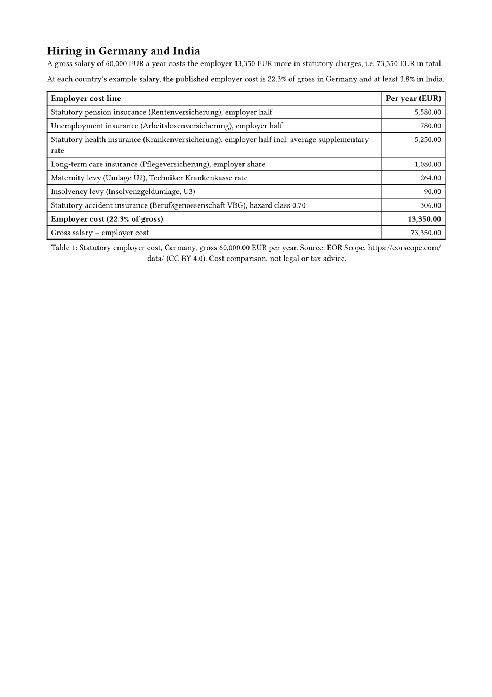

# eorscope

Statutory employer cost of an employee in 76 countries, in your Typst
documents: employer contribution rates, the cost at any gross salary, and
ready-made tables, each figure traceable to the official source listed in the
dataset.

The data is the [EOR Scope open dataset of employer charges by country](https://eorscope.com/data/)
(CC BY 4.0), export of 2026-11-14: 76 countries, 544 employer contribution and
statutory extra lines with rate, base, floor and ceiling, source URL and check
date. EOR provider fees are not included.

## Usage

```typ
#import "@preview/eorscope:0.1.1": *

// Published employer cost at the country's example salary
#employer-rate("DE")          // 0.2225
#employer-rate-text("DE")     // "22.3%"
#employer-rate-text("IN")     // "at least 3.8%"
#employer-rate-text("FR", salary: 44755) // "at most ..." under 3 x SMIC

// Cost at a gross annual salary in local currency
#let r = employer-cost("DE", 60000)
#r.cost     // 13350, employer charges per year (EUR)
#r.total    // 73350, salary + employer charges
#r.rate     // 0.2225

// Tables
#employer-cost-table("DE", 60000)       // line-by-line ledger
#employer-rates-table(region: "Europe") // one row per country
```



A complete example is in [`examples/example.typ`](examples/example.typ).

## Functions

| Function | Returns |
|---|---|
| `employer-rate(iso, salary: none)` | Employer cost over gross salary (0.2225 = 22.25 %). Without `salary`, the rate published on eorscope.com at the example salary; with a gross annual salary in local currency, the rate at that salary. |
| `employer-cost(iso, salary)` | Dictionary: `salary`, `cost`, `total`, `rate`, `currency`, `rate-is-floor`, `rate-is-ceiling`, `base-is-ceiling`, `lines` (one entry per contribution and statutory extra, with `amount`, `skipped`, `capped`, `source-url`, `source-checked-at`). Annual amounts, local currency. |
| `employer-rate-text(iso, salary: none, digits: 1)` | Rate as text, "at least" included for declared floors, "at least" or "at most" where the salary falls in a salary-dependent bound. |
| `rate-is-floor(iso)` | `true` when the country publishes an "at least" figure. |
| `employer-cost-table(iso, salary, digits: 2)` | Ledger table with the total and the attribution. |
| `employer-rates-table(isos: none, region: none)` | Published rate, example salary and review date by country. |
| `country(iso)`, `countries(region: none)`, `regions()` | Raw records of the dataset. |
| `format-percent(rate, digits: 1)`, `format-amount(v, digits: 2)` | Numbers rounded half away from zero, as eorscope.com prints them. |
| `attribution` | The attribution line the data licence requires. |

ISO codes are ISO 3166-1 alpha-2, case-insensitive. An unknown code stops the
compilation with an error.

## How the figures are computed

`employer-cost` runs the same operations, in the same order, as the cost engine
of eorscope.com: each contribution applies its rate to its base (gross, basic
pay or a flat amount, times the statutory base factor) between its floor and
its ceiling; lines that only apply above or below a salary are skipped outside
that range; statutory extras counted in the country total (13th month, leave
pay and the like) are added. The test suite checks that, at each country's
example salary, the result equals the figure published in the dataset for all
76 countries.

Countries flagged as a declared floor publish an "at least" figure, not a
total: `rate-is-floor` is `true`, and `employer-rate-text` and the tables print
"at least". Under a declared ceiling (`base-is-ceiling`), the modelled
contribution base is the highest the law allows and the costs listed outside
the total come on top.

Two countries have a bound that depends on the salary, as eorscope.com prints
it: in Spain the total is "at least" for a gross annual salary above the
maximum contribution base (EUR 61,214.40; the solidarity contribution on pay
above it is not modelled), and in France "at most" below 3 x SMIC (EUR 65,629;
the RGDU relief is not modelled). At the threshold itself and on the other
side, the figure is a total. `rate-is-floor` / `rate-is-ceiling` and
`employer-rate-text` follow it; without `salary`, the bound is read at the
example salary.

Each total holds for the case described in the dataset's
assumptions; the full case, with every source, is on each country's page at
[eorscope.com](https://eorscope.com/employer-of-record/) and in the
[methodology](https://eorscope.com/methodology/).

Cost comparison, not legal or tax advice.

## Changes

- 0.1.1: salary-dependent bounds (Spain "at least" above EUR 61,214.40, France
  "at most" below EUR 65,629) read from the dataset's new
  `total_bound_salary_threshold_local` and `total_bound_salary_rule` columns;
  `rate-is-ceiling` added to `employer-cost`; data from the export of
  2026-11-14 (November 2026 exchange rates, source URLs moved to https).
- 0.1.0: first release, export of 2026-10-13.

## Licence

- Code (`lib.typ`, `examples/`, and the generator and tests kept in the
  [source repository](https://github.com/eorscope/eorscope-typst)): MIT, see [LICENSE](LICENSE).
- Data (`data/employer-costs.json`): CC BY 4.0, see [data/LICENSE](data/LICENSE).
  Attribution: EOR Scope, published by Trésor Kaya EI (Les Créavores), France,
  https://eorscope.com/methodology/. Tables printed by this package carry the
  attribution line; when you use the numbers elsewhere, credit
  "EOR Scope, https://eorscope.com/data/ (CC BY 4.0)".

## Updating the data

`data/employer-costs.json` is generated, never edited by hand. The generator and
the tests live in the [source repository](https://github.com/eorscope/eorscope-typst):

```sh
git clone https://github.com/eorscope/eorscope-typst && cd eorscope-typst
git clone https://github.com/eorscope/employer-costs
python scripts/generate.py employer-costs
typst compile --root . tests/test.typ
```
