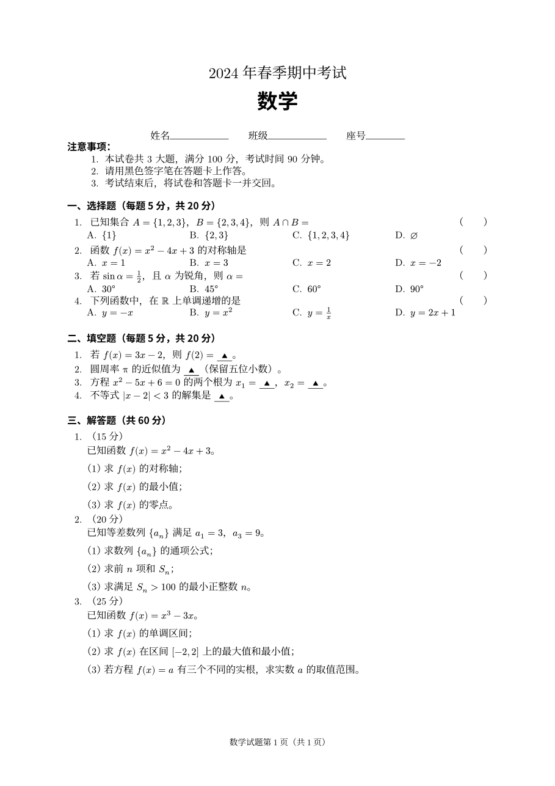
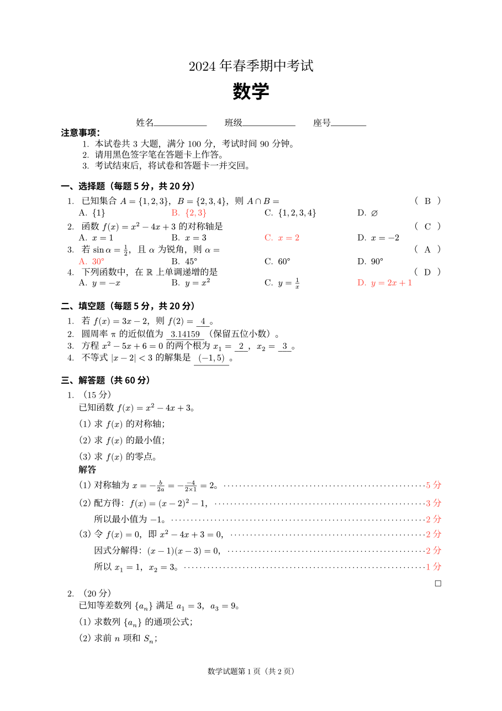
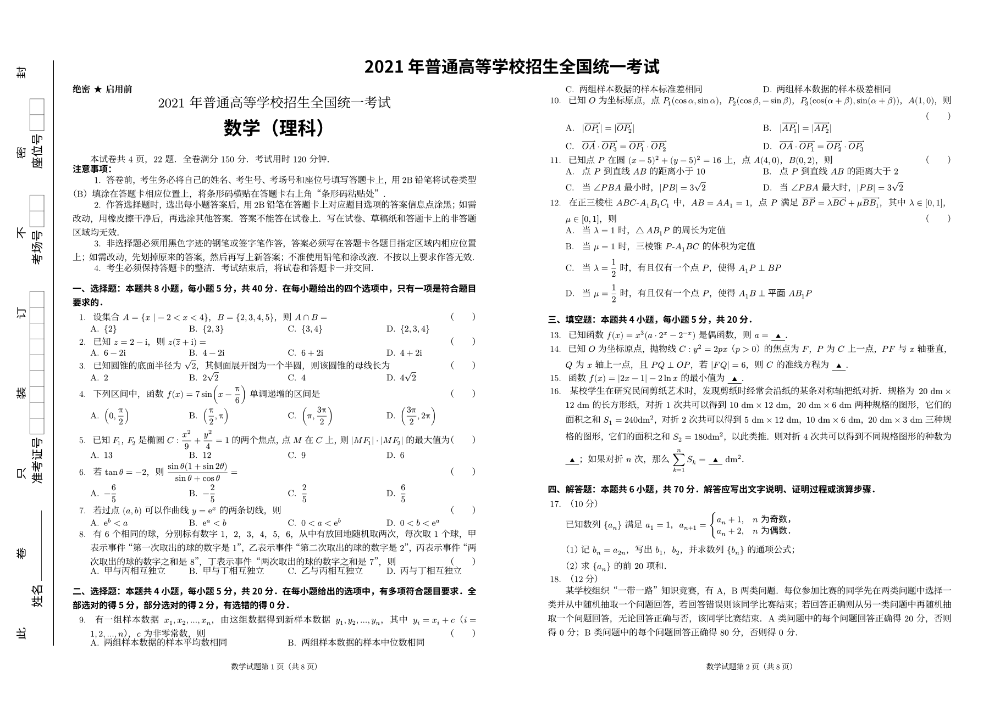

# exam-zh-next: Chinese exam papers in Typst

**English** | [简体中文](README.zh-CN.md)

Typeset Chinese exam papers (试卷) in Typst, with student and teacher versions
from one source. A port of the LaTeX class [exam-zh](https://github.com/xkwxdyy/exam-zh)
that keeps its option names. It is independent and not affiliated with the exam-zh authors.

| Student version | Teacher version | Seal line, A3 two-up |
|:-:|:-:|:-:|
|  |  |  |

- **One source, two versions.** The student version hides answers. The teacher version shows answers, correct options and scoring points. One command-line flag switches between them.
- **Choices lay themselves out** in 4, 2 or 1 columns by width. Answer parentheses go to the end of the line.
- **Blanks:** underline, parentheses, circle, box or blank, with ▲, a number or nothing in the student version. Long answers wrap.
- **Solutions:** score leaders reach the margin. Answers can be hidden, shown in place, or collected at the end.
- **Whole-paper layout:** seal lines, A3 landscape two-up, scoring boxes, draft paper, and collections of papers with a table of contents.
- **Subjects:** Chinese passages, poems with notes, matching lines and composition grids. English writing boxes. Math calculation grids and textbook-style symbols.
- **Familiar options:** the same names as exam-zh, and a mistyped option is an error. One compile, no `-shell-escape`.

## Quick start

```typ
#import "@preview/exam-zh-next:0.1.0": *

#show: exam.with(title: [2021 年普通高等学校招生全国统一考试], subject: [数学])

#secret()
#make-title()

= 选择题：本题共 8 小题，每小题 5 分，共 40 分。

#question[
  设集合 $A = {x | -1 < x < 4}$，$B = {2, 3, 4, 5}$，则 $A inter B = $ #paren[B]
  #choices(answer: "B")[${2}$][${2, 3}$][${3, 4}$][${2, 3, 4}$]
]

= 填空题：本题共 4 小题，每小题 5 分，共 20 分。

#question[
  已知函数 $f(x) = x^3 (a dot 2^x - 2^(-x))$ 是偶函数，则 $a = $ #fillin[$1$]。
]

= 解答题：本题共 6 小题，共 70 分。

#problem(points: 12)[
  已知函数 $f(x) = x (1 - ln x)$，讨论 $f(x)$ 的单调性。
  #solution[
    $f'(x) = -ln x$，#score(2) 故 $f(x)$ 在 $(0, 1)$ 上递增，在 $(1, +infinity)$ 上递减。#score(4)
  ]
]
```

```sh
typst compile exam.typ                                              # student version
typst compile --input exam-mode=teacher exam.typ exam-teacher.pdf   # teacher version
```

Or start from a complete paper with `typst init @preview/exam-zh-next`, or create a project from
the template on [typst.app](https://typst.app). To compile locally, install the Noto CJK fonts or
pick another font preset (see below).

## Documentation and examples

The docs are in Chinese and are typeset with this package.

| | |
|---|---|
| [Guide](https://github.com/pku-lemonade/exam-zh-next/releases/download/v0.1.0/guide.pdf) ([source](https://github.com/pku-lemonade/exam-zh-next/blob/v0.1.0/docs/guide.typ)) | Getting started, question types, common scenarios, FAQ. Chapter by chapter parallel to exam-zh's beginner guide. |
| [API dictionary](https://github.com/pku-lemonade/exam-zh-next/releases/download/v0.1.0/reference.pdf) ([source](https://github.com/pku-lemonade/exam-zh-next/blob/v0.1.0/docs/reference.typ)) | Every exam-zh command and option with its Typst equivalent and a rendered example. Section numbers match exam-zh's manual. |
| [examples/](https://github.com/pku-lemonade/exam-zh-next/tree/v0.1.0/examples) | All of exam-zh's examples in Typst: the 2021 national math paper, an A3 collection, and Chinese, English and real-exam scenarios. |

## Settings

Options are grouped by module, and the same keys work at three levels:

```typ
#show: exam.with(choices: (max-columns: 2))  // the whole paper
#exam-setup(fillin: (type: "paren"))         // from here on
#choices(columns: 2)[A][B][C][D]              // this call only
```

A mistyped key is a compile error, such as ``unknown option `choices.colums` ``. All options and
their defaults are in [`src/config.typ`](src/config.typ) and in chapter 4 of the API dictionary.

What the teacher version shows is set by `teacher`, which defaults to `teacher-defaults`. You can extend it:

```typ
#show: exam.with(teacher: teacher-defaults + (solution: (show-solution: "show-move")))
#teacher-only[本题考查函数的单调性。]
```

### Fonts

`font: (preset: ..)` picks a set of Chinese fonts. You can also set a single role, such as `font: (kai: "LXGW WenKai")`:

| preset | Song (serif) | Hei (sans) | Kai | Fangsong |
|---|---|---|---|---|
| `noto` (default) | Noto Serif CJK SC | Noto Sans CJK SC | (Song) | (Song) |
| `source-han` | Source Han Serif SC | Source Han Sans SC | (Song) | (Song) |
| `fandol` | FandolSong | FandolHei | FandolKai | FandolFang |
| `windows` | SimSun | SimHei | KaiTi | FangSong |
| `mac` | Songti SC | Heiti SC | Kaiti SC | STFangsong |
| `founder` | FZShuSong-Z01 | FZHei-B01 | FZKai-Z03 | FZFangSong-Z02 |

Latin text and math use Typst's bundled New Computer Modern. Typst doesn't fake bold, so choose
Chinese fonts that have a bold weight.

## Coming from exam-zh

Most commands map one to one. The [API dictionary](https://github.com/pku-lemonade/exam-zh-next/releases/download/v0.1.0/reference.pdf) has the full list:

| exam-zh (LaTeX) | Typst |
|---|---|
| `\documentclass{exam-zh}`, `\examsetup{..}` | `#show: exam.with(..)`, `#exam-setup(..)` |
| `\section{..}` | `= ..` |
| `question`, `problem[points = 12]` | `question[..]`, `problem(points: 12)[..]` |
| `choices` with `\item` | `choices[..][..]`, with `answer: "B"` marking the correct option |
| `\paren[B]`, `\fillin[答案]` | `paren[B]`, `fillin[答案]` |
| `solution`, `\score{2}` | `solution[..]`, `score(2)` |
| `\draftpaper`, `\scoringbox`, `\tableofcontents` | `draftpaper()`, `scoringbox()`, `exam-outline()` |
| `\ExamPrintAnswerSet` with `-shell-escape` | `--input exam-mode=teacher` with `exam(teacher: ..)` |

[ROADMAP.md](ROADMAP.md) lists what differs from exam-zh, what is not supported yet (text wrapping,
moving choice and blank answers to the end), and what comes next.

## Development

```sh
scripts/check.sh [--font-path DIR]       # compile all examples (both versions), tests and docs; fail on any warning
scripts/doc-images.sh [--font-path DIR]  # re-render the page images in the docs and README, and the thumbnail
scripts/package.sh [--font-path DIR]     # build the Typst Universe submission and test it the way users get it
```

## License and credits

This is an unofficial Typst port of [exam-zh](https://github.com/xkwxdyy/exam-zh). The design,
option names and examples come from exam-zh (author Zeping Lee, maintainers Kangwei Xia and
Lijun Guo), and we thank them for their work. The Typst code is an independent implementation.

The code is under the [MIT](LICENSE) license. The starter paper in `template/` is under
[MIT-0](LICENSE-MIT-0), so papers written from it need no notice. The exam-zh text and LaTeX code
quoted in the docs belong to the exam-zh authors (LPPL 1.3c); see [NOTICE.md](NOTICE.md).
