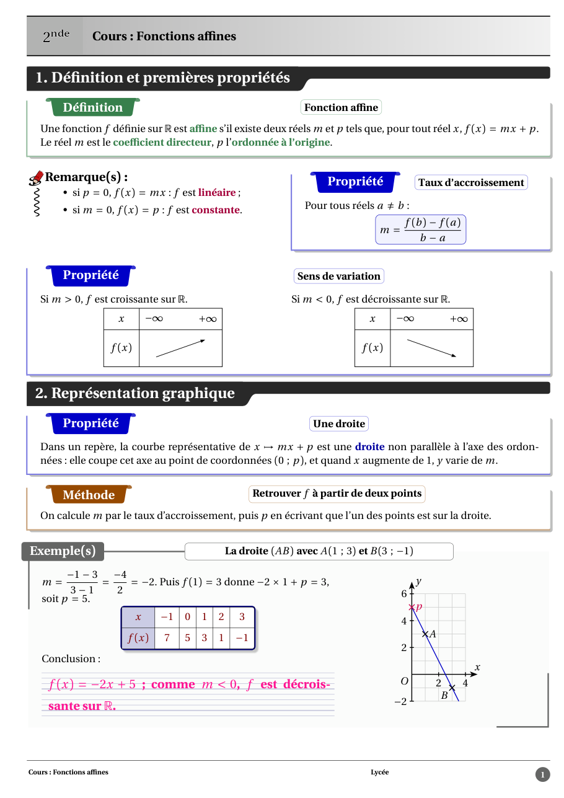
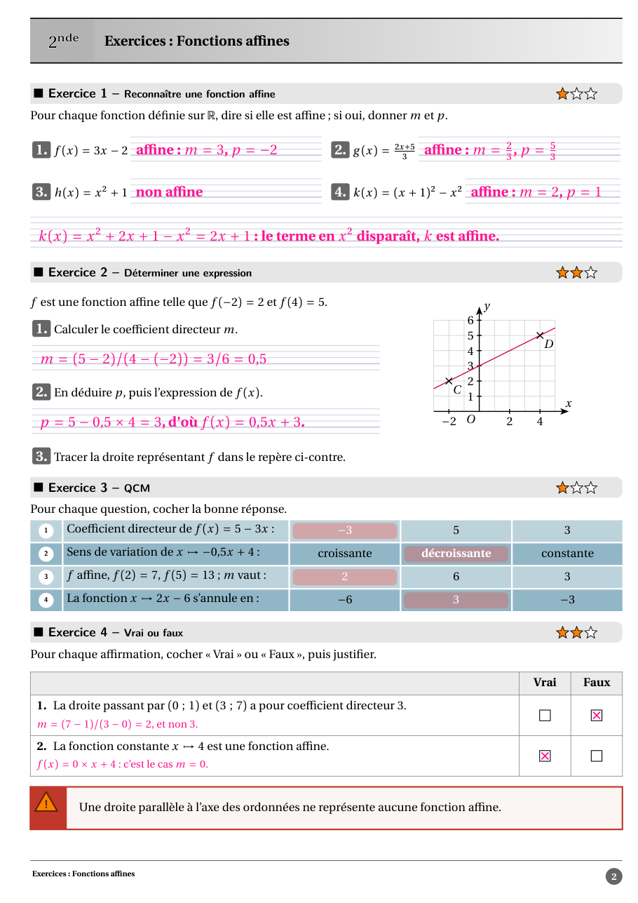
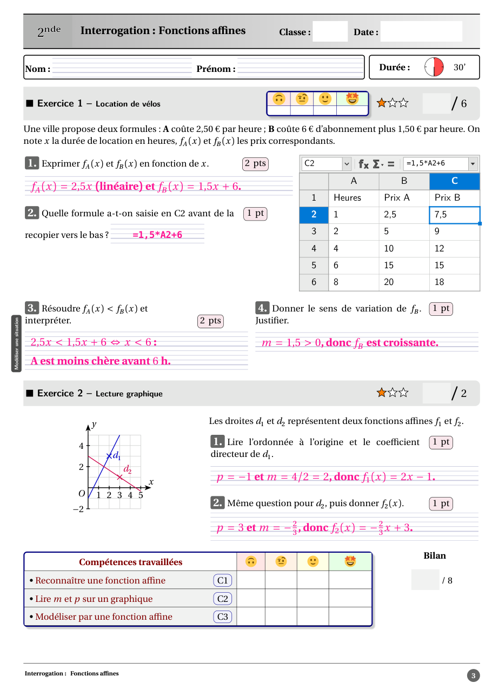

# farfadet

Lay out **French maths lessons, exercises and tests** for secondary teaching: lesson environments
(definition, property, example, method, proof), exercises with corrections and marking schemes, answer
boxes and French ruled paper, multiple-choice questions, tables, columns, plane geometry figures, sign and
variation tables. **One source file gives a teacher version and a student version.**

*En français : farfadet met en page des documents de mathématiques pour l'enseignement français (cours,
fiches d'exercices, évaluations), avec une version professeur et une version élève du même fichier.*

## Quick start

```typ
#import "@preview/farfadet:0.2.0": *

#show: modele("cours", niveau: "2nde", theme: [Les équations], type-document: "cours",
  cycle: [Lycée], etablissement: [Établissement], sommaire: false)

= Résoudre une équation

#definition[Équation][Une équation est une égalité qui contient une inconnue, souvent notée $x$.]

#exemple[Un premier calcul][Pour $2 x + 1 = 7$, on obtient $x = 3$.]

#exo(level: 1)[Une équation][
  Résoudre dans $RR$ l'équation $3 x + 5 = 17$.

  #crep(extra-lines: 2)[$3 x = 12$, donc $x = 4$.]
]
```

Compile the student version with `typst compile --input correction=false cours.typ`
(the teacher version, with corrections, is the default).
Or start from the template: `typst init @preview/farfadet:0.2.0`.

## Showcase





## Two ways to import

Everything at once:

```typ
#import "@preview/farfadet:0.2.0": *
```

Or one part at a time. Each part of the suite is also a module (`socle`, `didactique`, `exercices`, `qcm`, `maths`,
`modeles`, `geom`…), so that only the names you need are brought into scope:

```typ
#import "@preview/farfadet:0.2.0": modeles, exercices, zones-reponse
#import modeles: modele
#import exercices: exo
#import zones-reponse: crep

#show: modele("cours", niveau: "2nde", theme: [Essai], type-document: "cours", sommaire: false)

#exo(level: 1)[Une équation][
  Résoudre $3 x + 5 = 17$.

  #crep[$x = 4$]
]
```

| Module | Content |
|---|---|
| `socle` | Fondations des paquets farfadet-* : version prof/élève, couleurs courantes, mesures, police, français, points, mécanisme générique de réglages |
| `didactique` | Environnements didactiques de bfcours (Définition, Théorème, Propriété…), couleurs, sectionnement, sommaire, vocabulaire, Anki |
| `enumerations` | Énumérations et colonnage de bfcours : tcbenumerate, multi-colonnes, Colonnes, listes |
| `tableaux` | Tableaux de bfcours : tcbtab (tableau encadré), aides de filets et de cellules, tableau de bilan de séquence, setbftableaux |
| `zones-reponse` | Zones de réponse : crep, tccrep, tcfillcrep, lignes et tableaux Seyès, cases à cocher |
| `exercices` | Exercices de bfcours (exo, rdexo) : corrections différées, points, barème, compétences, évaluation |
| `qcm` | QCM de bfcours (rdmcq) et vrai/faux |
| `maths` | Commandes de maths et de texte de bfcours : ensembles, intervalles, coordonnées, mise en valeur, connecteurs, nombres et unités |
| `modeles` | Modèle de document bfcours (farfadet, modele, chapitre, chapEval, SequenceItem, pied de page, jeux de titres, variante dys) avec réglages globaux, par type et styles nommés |
| `extras` | Compléments de bfcours : pellicule de film, code Python mis en forme, habillage de figures, icônes |
| `extraits-latex` | Extraits LaTeX compilés au Ctrl+S (latex-avec) et démon rendus_tex |
| `variations` | Tableaux de signes et de variations (équivalent de tkz-tab) : valeurs interdites, images intermédiaires, version élève à compléter |
| `geom` | Figures de géométrie plane aux couleurs de bfcours : couche légère sur cetz (repère, points, segments, vecteurs, cercles, polygones, codages, constructions usuelles, courbe) |
| `rd-boites` | Boîtes de cours et d'activités (définitions, méthodes, tâches complexes, encarts, éléments à relier, Scratch, GeoGebra) réunies sous le module `rd`, avec réglages globaux, par boîte et styles nommés |
| `rd-time` | Durées posées : additions et soustractions d'heures, minutes et secondes en colonnes, avec retenues et cases barrées |
| `rd-ratio` | Barres de proportion : parts colorées, accolades et légendes, rapport écrit et somme d'une liste |
| `rd-grid` | Grilles de triangles équilatéraux, d'hexagones, d'hexagones tournés et isométriques, avec points nommés pour dessiner par-dessus |
| `rd-arithm` | Arithmétique : décompositions en facteurs premiers, diviseurs, PGCD et PPCM, fractions irréductibles, en écriture courante ou en figures |
| `rd-conv` | Tableaux de conversion d'unités (longueur, masse, capacité, aire, volume) : placement des chiffres, zéros ajoutés, virgule et ratures |
| `rd-opp` | Opérations posées à la française : additions, soustractions, multiplications et divisions en colonnes, avec retenues, grille, corrections |
| `rd-sheet` | Captures de feuilles de calcul (style LibreOffice Calc ou Excel) : en-têtes A, B, C et 1, 2, 3, sélection active, barre de formule, mode noir et blanc |
| `rd-tabnum` | Tableaux de numération : nombres placés ou convertis par puissances de dix, virgule, flèches d'opération, version professeur et élève |

## Fonts

Fonts are optional, since a Typst package cannot ship fonts. The layout is designed for the Erewhon text font
and its maths companion; without them, Typst falls back on its built-in fonts (Libertinus Serif, New Computer
Modern Math) and everything still compiles. The fonts and installation notes are in the
[repository of the suite](https://forge.apps.education.fr/romaindeschamps/farfadet), folder `polices/`.

## Vendored dependency

`chalks` 0.1.1 (Jinguo Liu, MIT licence, https://github.com/GiggleLiu/chalks) is bundled in
`modules/didactique/vendor/chalks/` instead of being loaded from Typst Universe. The copy carries a local
patch that merges the cubic segments of the chalk outlines: a chalk frame of a "Démonstration" box weighs
54 KB in the PDF instead of 105 KB. See `modules/didactique/vendor/chalks/PROVENANCE.md`. The package will
go back to `@preview/chalks` once upstream offers an equivalent option (request opened on the chalks
repository).

## Documentation

The complete documentation (installation, one guide per part, with rendered examples) is a PDF in the
[repository of the suite](https://forge.apps.education.fr/romaindeschamps/farfadet):
[farfadet-documentation.pdf](https://forge.apps.education.fr/romaindeschamps/farfadet/-/blob/main/farfadet-documentation.pdf) (in French).
The `latex[…]` helper for LaTeX excerpts needs the tools of that repository to render them.

## Licence and credits

Licensed under the EUPL 1.2 (see `LICENSE`; French text in `LICENSE-FR.txt`).
The template directory (`template/`) is licensed under MIT-0, so documents created with `typst init` carry
no licence obligation.
Author: Romain Deschamps. The answer boxes, exercise, multiple-choice and `rd*` modules continue, with the
author's agreement, the LaTeX packages of Régis Deleuze.

Third-party code is loaded from Typst Universe (`cetz`, `zero`, `codly`, `wrap-it`, `ficons`, `ankify`),
except `chalks`, which is bundled (see "Vendored dependency" above). The emoji of `modules/exercices/src/moteur/emoji/` are Twemoji graphics, licensed
CC BY 4.0.
