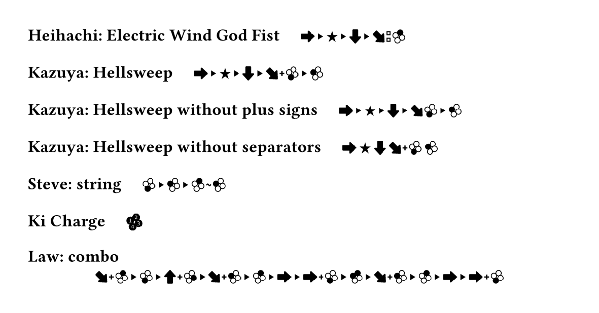

# fight-club

**Put the fight on the page.** Render Tekken notation as compact symbols in Typst, inline with your writing or as a standalone diagram.


## Quick start

Import the package in your document. The Typst CLI downloads it automatically on first use:

```typst
#import "@preview/fight-club:0.1.0": tekken

*Heihachi: Electric Wind God Fist* #h(1em) #tekken("f,n,d,df:2")

*Kazuya: Hellsweep* #h(1em) #tekken("f,n,d,df+4,1")

*Kazuya: Hellsweep without plus signs* #h(1em) #tekken("f,n,d,df+4,1", plus: false)

*Kazuya: Hellsweep without separators* #h(1em) #tekken("f,n,d,df+4,1", separator: false)

*Steve: string* #h(1em) #tekken("4,1,2~1")

*Ki Charge* #h(1em) #tekken("1+2+3+4", numbers: true)

*Law: combo*

#tekken("df+2, 4, u+3, df+1, 2, f, f+4, 1+2, df+1, 2, f, f+4", display: true)
```



Alternatively, clone the repository and import its entrypoint directly:

```sh
git clone https://github.com/a-ws-m/fight-club.git
```

```typst
#import "path/to/fight-club/lib.typ": tekken
```

See the [full example PDF](example.pdf), including inline wrapping.

## Notation

| Input | Rendered meaning |
| --- | --- |
| `f`, `b`, `u`, `d` | Direction arrows; diagonals such as `df` and `d/f` are equivalent |
| `F`, `DF`, `D/F` | Held directions, drawn as hollow arrows |
| `n` or `*` | Neutral, drawn as a star |
| `1`–`4` | Four-button diagram with the pressed button filled |
| `1+2` | Simultaneous buttons, combined in one diagram |
| `df+1` | Simultaneous direction and button |
| `,` or space | Sequence separator, drawn as a right-pointing triangle |
| `[df+2]` | Bracketed input |
| `1:2`, `f~3` | Timing symbols: two hollow squares and a tilde |
| `"Side Step"` | A named state in a rounded rectangle |

Buttons are arranged with `1` left, `2` upper, `3` right and `4` lower. Set `numbers: true` to label them. Set `plus: false` to hide plus signs between simultaneous directions and buttons. Set `separator: false` to hide the triangles between sequence steps. Set `display: true` to center notation on its own line. Long inline sequences can wrap between steps, with the separator at the start of the next line.

## AI disclosure

This package’s implementation and documentation were created with AI assistance.

## License

[MIT](LICENSE). This package is not affiliated with Bandai Namco Entertainment.
