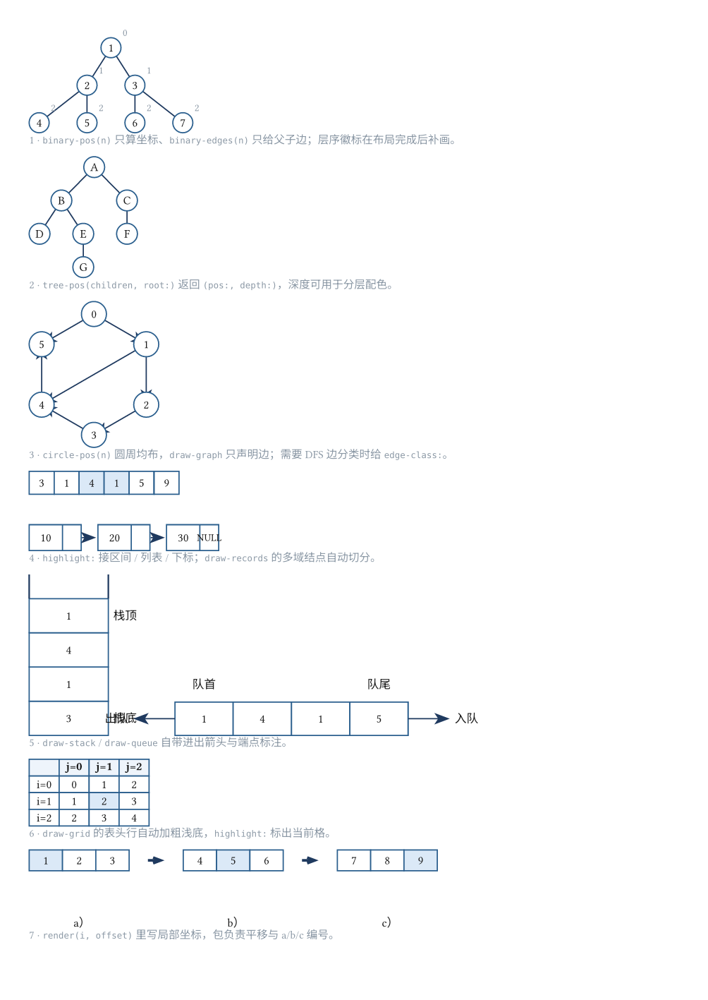
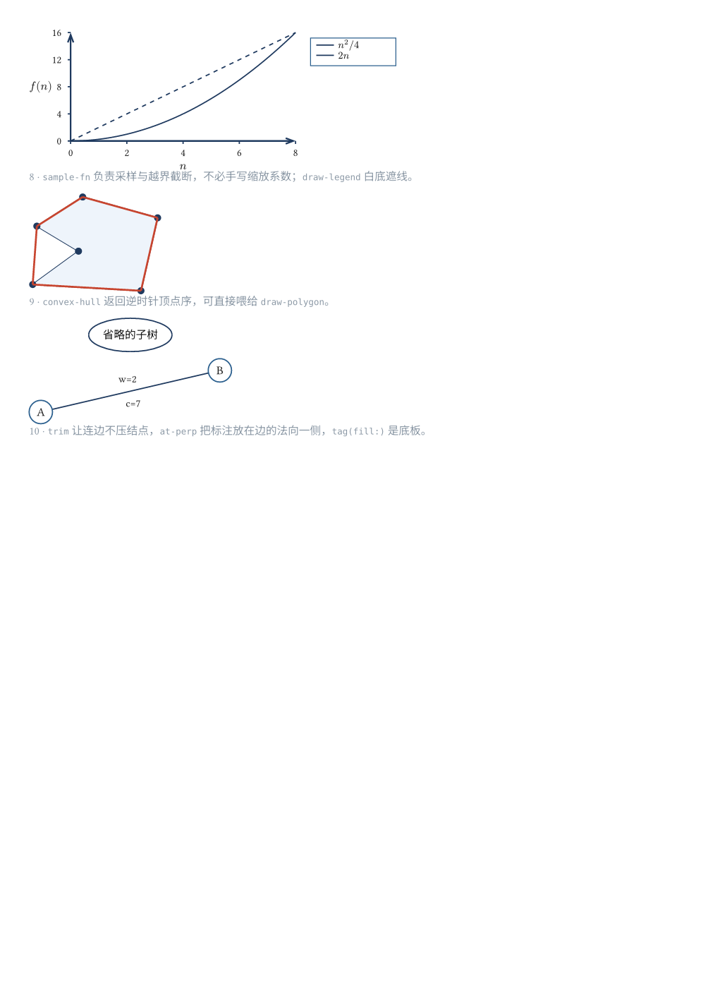

# figment

Data-driven figure toolkit for algorithm and data-structure diagrams, built on
[CeTZ](https://github.com/cetz-package/cetz) 0.5.3.

Originally written to re-typeset the 121 figures of a Chinese competitive-programming
reference book, so every primitive here corresponds to a diagram that actually appears
in algorithm textbooks: trees, graphs, arrays, linked lists, stacks and queues,
multi-stage process sequences, complexity curves, and computational geometry.

```typst
#import "@preview/cetz:0.5.3": canvas
#import "@preview/figment:0.1.0": *

#canvas({
  let pos = binary-pos(7)          // layout: returns coordinates
  draw-tree(pos, binary-edges(7))  // render: returns nothing
  badge(pos.at("1"), [1])          // keep using pos afterwards
})
```

## Why

Hand-writing coordinates collapses as soon as the data grows. A 19-node segment tree
in the book once had all 19 node positions and 18 edges typed out by hand; a pair of
mirrored rotation diagrams had every x coordinate flipped manually. Declaring only the
*structure* and letting the package place it cuts those figures to a dozen lines each.

## Installation

### As a local package

Put the directory under `packages/local/` in your project and compile with
`--package-path packages`:

```bash
typst compile --package-path packages --root . main.typ output/main.pdf
```

```typst
#import "@local/figment:0.1.0": *
```

### From the preview namespace

Once published to Typst Universe, no `--package-path` is needed:

```typst
#import "@preview/figment:0.1.0": *
```

## Preview

`examples/showcase.typ`
renders every capability on two pages:

<p align="center">
  
  
</p>

```bash
gh repo clone wylovecat/figment && cd figment
typst compile --root . examples/showcase.typ "docs/preview-{p}.png"
```

## Requirements

- Typst 0.15.0 or newer (the minimum required by its CeTZ 0.5.3 dependency).
- No other dependencies.

## Naming convention

Two rules keep the API predictable:

- **Layout functions return, render functions don't.** See the next section.
- **Nothing shadows a Typst builtin.** `line` / `rect` / `circle` / `content` / `ellipse`
  are builtin names. The package exports the `draw` namespace instead, and its own
  ellipse is called `draw-ellipse`. Importing with `*` therefore never breaks
  `type(x) == content` or similar checks.

## The one rule you must know

**Layout functions return values; render functions return nothing. Never mix the two.**

`#canvas({...})` collects drawing elements. Any function that has called `rect()` / `line()`
is treated as part of that element stream, so returning a dictionary from it fails with
`cannot join array with dictionary`. The package therefore splits every module into:

```typst
#canvas({
  let pos = binary-pos(11)        // 纯计算：可以返回值
  draw-tree(pos, binary-edges(11)) // 绘制：不返回值
  badge(pos.at("1"), [1])          // 还能继续用 pos 补标注
})
```

Keeping the coordinates in hand is what makes post-layout annotation possible — level
numbers, visit order, subtree highlights. It is also why this package does not use
CeTZ's own `tree.tree`: its node anchors cannot be looked up by name afterwards, which
makes such annotation impossible.

## API reference

### theme — colors and sizes

```typst
theme.line / .node / .fill / .fill2 / .accent / .gray / .text
theme.visited / .current / .answer        // 语义色
theme.lw / .lw-thin / .r / .fs / .fs-sm   // 尺寸
theme.cw / .ch / .dx / .dy                // 默认格宽高、层间距
```

Override individual keys: `let t = with-theme(theme, (accent: red))`, then pass it as the `t:` argument.

### tree — layout and render trees

```typst
binary-pos(n, dx:, dy:, cx:)        // 层序二叉堆布局 → ("1": (x,y), …)
binary-edges(n)                     // 完全二叉树的父子边
tree-pos(children, root:, dx:, dy:) // 通用树布局 → (pos: …, depth: …)
tree-edges(children)                // 展开全部父子边

draw-tree(pos, edges, labels:, fills:, badges:, edge-labels:, badge-dir:)
draw-tree-numbered(pos, edges, numbered, values:)
```

`children` looks like `("A": ("B", "C"), "B": ("D",), …)`. Leaves are laid out left to right; each parent is centred over its subtree span.

### graph — graphs

```typst
circle-pos(n, r:, start:)      // 环形布局
grid-pos(cols, rows, dx:, dy:) // 网格布局
layered-pos(layers, dx:, dy:)  // 分层布局

draw-graph(pos, edges, directed:, labels:, fills:, edge-class:, weights:, dashed-edges:)
draw-vertices(pos, labels:, fills:)
draw-arc(pos, a, b, r-a:, r-b:)  // 从结点边缘出发，箭头不扎进圆里
```

`edge-class` classifies DFS edges: `"T"` tree / `"B"` back / `"F"` forward / `"C"` cross. It colours and labels them automatically:

```typst
draw-graph(V, E, directed: true, edge-class: (
  pair-key("1","2"): "T", pair-key("4","2"): "B", …
))
```

### array — arrays, linked lists, stacks, queues

```typst
array-pos(n, x:, y:, cw:, ch:)           // 格位表
array-pos-centered(n, cx:, y:)           // 居中版

draw-array(pos, values, highlight:, pivot:, index:, …)
draw-records(pos, records, fields:, widths:, highlight:)   // data|next 多域结点
draw-stack(pos, items, w:, h:, label-top:, label-bottom:)
draw-queue(pos, items, cw:, ch:, out-label:, in-label:)
draw-deque-stack(pos, n, left-used:, right-used:)          // 双端栈
```

`pivot` circles a cell (quicksort pivot), `index` adds an index row, `highlight` accepts `int` / `array` / `range`.

### table — 2-D grids (DP tables, boards)

```typst
grid-cells(rows, cols, x:, y:, cw:, ch:)
draw-grid(pos, rows, highlight:, header:, marks:)
draw-neighborhood(pos, dirs, s:)   // 四/八邻域
draw-board-row(pos, states, highlight:)  // 棋盘行状态
```

Intended for DP tables, simplex tableau, neighbourhood diagrams and board-state rows.

### process — multi-stage sequences

```typst
panel-offsets(n, pw, ph, gap:, cols:)

stages-h(n, render, pw:, ph:, gap:, labels:)   // 横排 N 面板
stages-v(n, render, pw:, ph:, gap:, labels:)   // 纵排 N 面板
panel-frame(pos, pw, ph, dashed:)
```

`render(i, (x, y))` is supplied by the caller and draws in local coordinates plus an offset, so each stage only changes its annotations:

```typst
stages-h(4, (i, off) => {
  // 同一套 V / E，只换 stages-flow.at(i) 的流量标注
}, pw: 4.6, ph: 3.4)
```

### plot — axes and curves

```typst
axes-map(domain-x, domain-y, span-x, span-y)   // 数据 → 画布映射
sample-fn(fn, domain-x, domain-y, span-x, span-y)  // 采样（超界自动截断）

draw-axes(pos, w, h, x-max:, y-max:, x-label:, y-label:)
draw-curve(pts, color, dashed:)
draw-legend(pos, items)
draw-plot-point(p, label:, off:)
draw-line-through(a, b, extend:, dashed:)   // 切线 / 可行域边界
```

### geo — computational geometry

```typst
cross2(o, a, b)                      // 叉积
signed-area2(poly)                   // 有向面积 ×2
convex-hull(pts)                     // 凸包（Andrew 单调链）
clip-line-convex(poly, o, d)         // 凸多边形裁剪直线 → 线段 | none
hatch-segments(poly, angle:, gap:)   // 裁剪到多边形内的斜线族

draw-polygon(pts, fill:, dashed-edges:)
draw-hatch(segs)
draw-infinite-line(a, b, extend:)
draw-halfplane-arrow(a, b, at:)      // 半平面的保留侧箭头
draw-points(pts, labels:)
```

### prim — low-level primitives

```typst
node(pos, label, r:, fill:)   cell(pos, w, h, label:, fill:)
cell-mid(pos, w, h, dir)      // 格子四边中点；dir 接受 "n"/"s"/"e"/"w" 与 "u"/"d"/"l"/"r"
ellipse(center, rx, ry)       // CeTZ 没有 ellipse，这里补上（四段 bezier）
arrow(a, b)   edge(a, b)   poly(..pts)   ortho-link(a, b)
tag(pos, body, anchor:, fill:, color:, stroke:)
badge(pos, body, dir:)   edge-label(a, b, body, off:)
subtree(pos, label, dashed:)   brace(a, b, label:)
rotate-arc(center, radius:, from:, to:, label:)   stage-arrow(from, to, label:)
```

**`tag()`: `fill` is a plate, not a text colour.** To put a label on top of a line,
write `tag(p, [c=10], fill: white)` — the plate hides the line while the text keeps the
body colour. Use `color:` for the text. Before 0.1.0 `fill` *was* the text colour, so
`tag(fill: white)` produced white-on-white and the line still ran through the label.

**Raw drawing** uses the exported `draw` namespace: `draw.line`, `draw.rect`,
`draw.circle`, `draw.bezier`, `draw.content`. These are deliberately **not** re-exported
under their bare names, because `line` / `rect` / `circle` / `content` are Typst builtins
and `content` in particular is a *type* — shadowing it breaks `type(x) == content`.

### util — pure arithmetic

```typst
lowbit(i)  lowbit-level(i)  depth-of(i)
seq-starts(x, widths)  even-starts(x, n, w)  row-center(...)  span-center(...)
as-indices(hl)  mapper(domain, span)  ints(from, to)  accumulate(...)
pair-key(a, b)  nkey(k)

lerp(a, b, t)              // 线段上参数 t 处的点
seg-len(a, b)  seg-dir(a, b)   // 长度、单位方向
at-perp(a, b, k, t: 0.5)   // 边上一点沿左法线偏移 k —— 给弧标权重
trim(a, b, r:)             // 两端各缩进 r，结点连边不压圆
```

`pair-key` builds dictionary keys for edge annotations — Typst dict keys must be strings, tuples do not work.

`at-perp` + `trim` replace the `dx/len`, `dy/len` trigonometry that six figures in the source book each re-derived:

```typst
let (p, q) = trim(a, b, r: theme.r)
edge(p, q)
tag(at-perp(p, q, 0.42), [c=10], fill: white)   // 一侧
tag(at-perp(p, q, -0.42), [w=2], fill: white)   // 另一侧
```

## Tests

The test suite lives in the [repository](https://github.com/wylovecat/figment),
not in the distributed package:

```bash
git clone https://github.com/wylovecat/figment && cd figment
sh tests/run.sh
```

`tests/pure-functions.typ` is an assertion sheet: 20 checks over the pure functions
(`cross2`, `signed-area2`, `convex-hull`, `seg-len`, `at-perp`, `trim`, `lowbit`, …),
each comparing against a hand-computed value. `examples/showcase.typ` renders every
capability on two pages and doubles as a compile smoke test.

Pure functions deserve special attention: when a module is only *available* but not
*used* by a given document, its bugs stay invisible. `convex-hull` once carried three
stacked defects — a multi-line expression silently split into two statements, a `let`
bound function referenced recursively (not allowed in Typst), and `pop()` whose return
value leaked into the outer expression. All three surfaced only when the assertion
sheet first called it.

## Known limitations

- Requires the `draw` namespace of CeTZ 0.5.3; upgrading CeTZ needs a regression pass.
- Layout covers common shapes only (binary-heap level order, generic tree, circular /
  grid / layered graphs). Arbitrary graphs still need explicit coordinates.
- `stages-h/v` assume all panels share one size. When they don't, write coordinates directly —
  that is what the sequence figures in the source book do.
- `convex-hull` sorts with `key:`, which is fine at textbook scale but not for 10⁴+ points.
- `tag(fill:)` puts a **plate** behind the text (to hide a line crossing it); use `color:`
  to change the text colour. These were the same parameter before 0.1.0 and that was a bug.

