> This is the version of the readme adapted for Markdown renderers.
> This adaption is less than ideal.
  If you want to copy text and have a faithful render, go to [this link](https://html-preview.github.io/?url=https://github.com/marc-thieme/frame-it/blob/2.1.0/assets/README.html).
## Introduction

[Frame-It](https://github.com/marc-thieme/frame-it) offers a
straightforward way to define and use custom environments in your
documents. Its syntax is designed to integrate seamlessly with your
source code.

Two predefined styles are included by default. You can also create
custom styling functions that use the same user-facing API while giving
you complete control over the Typst elements in your document.

 <picture> <source media="(prefers-color-scheme: dark)" srcset="assets/README-svg-dark-0.svg"> 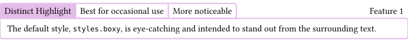 </picture> 

In contrast:

 <picture> <source media="(prefers-color-scheme: dark)" srcset="assets/README-svg-dark-1.svg">  </picture> 

 <picture> <source media="(prefers-color-scheme: dark)" srcset="assets/README-svg-dark-2.svg">  </picture> 

The default styles are merely functions with the correct signature. If
they don’t appeal to you, you have complete freedom to define custom
styling functions yourself. For reference, this is that signature:

``` typst
let your-custom-styling-function(title, tags, body, supplement, number, accent-color) = […]
```

 <picture> <source media="(prefers-color-scheme: dark)" srcset="assets/README-svg-dark-3.svg">  </picture> 

## Quick Start

Import and define your desired frames:

``` typst
#import "@preview/frame-it:2.1.0": *

#let (example, feature, variant) = frames(
  feature: ("Feature",),
  // For each frame kind, you have to provide its supplement title to be displayed
  variant: ("Variant",),
  // You can provide a color or leave it out and it will be generated
  example: ("Example", gray),
)
// This syntax works as well, but colors are not generated automatically
#let syntax = frame("Syntax", green)
// This is necessary. Don't forget this!
#show: frame-style(styles.boxy)
```

How to use it is explained below. Here is a quick example:

``` typst
#example[Title][Optional Tag][
  Body, i.e. large content block for the frame.
]
```

which yields

 <picture> <source media="(prefers-color-scheme: dark)" srcset="assets/README-svg-dark-4.svg">  </picture> 

## Feature List

The following features are demonstrated in all predefined styles.

### Seamlessly highlight parts of your document

 <picture> <source media="(prefers-color-scheme: dark)" srcset="assets/README-svg-dark-5.svg">  </picture> 

 <picture> <source media="(prefers-color-scheme: dark)" srcset="assets/README-svg-dark-6.svg">  </picture> 

 <picture> <source media="(prefers-color-scheme: dark)" srcset="assets/README-svg-dark-7.svg">  </picture> 

 <picture> <source media="(prefers-color-scheme: dark)" srcset="assets/README-svg-dark-8.svg">  </picture> 

 <picture> <source media="(prefers-color-scheme: dark)" srcset="assets/README-svg-dark-9.svg">  </picture> 

 <picture> <source media="(prefers-color-scheme: dark)" srcset="assets/README-svg-dark-10.svg">  </picture> 

For brief elements, use \[\] as the body to omit the content.

 <picture> <source media="(prefers-color-scheme: dark)" srcset="assets/README-svg-dark-11.svg"> 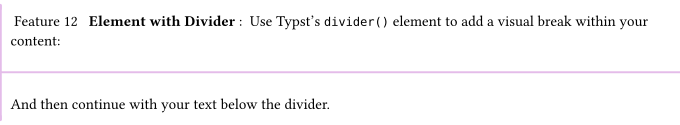 </picture> 

### Highlight parts distinctively

 <picture> <source media="(prefers-color-scheme: dark)" srcset="assets/README-svg-dark-12.svg"> 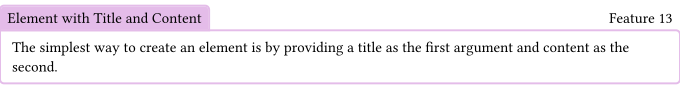 </picture> 

 <picture> <source media="(prefers-color-scheme: dark)" srcset="assets/README-svg-dark-13.svg"> 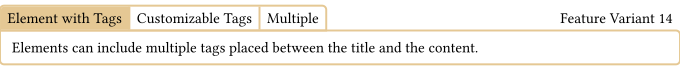 </picture> 

 <picture> <source media="(prefers-color-scheme: dark)" srcset="assets/README-svg-dark-14.svg">  </picture> 

 <picture> <source media="(prefers-color-scheme: dark)" srcset="assets/README-svg-dark-15.svg">  </picture> 

 <picture> <source media="(prefers-color-scheme: dark)" srcset="assets/README-svg-dark-16.svg">  </picture> 

 <picture> <source media="(prefers-color-scheme: dark)" srcset="assets/README-svg-dark-17.svg"> 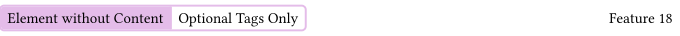 </picture> 

For brief elements, use \[\] as the body to omit the content.

 <picture> <source media="(prefers-color-scheme: dark)" srcset="assets/README-svg-dark-18.svg"> 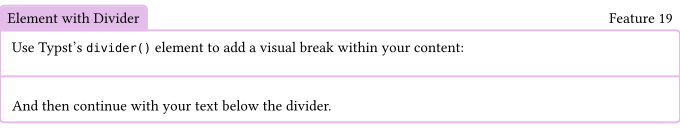 </picture> 

### A third Alternative

We recently added third style, namely `styles.thmbox`:

 <picture> <source media="(prefers-color-scheme: dark)" srcset="assets/README-svg-dark-19.svg">  </picture> 

 <picture> <source media="(prefers-color-scheme: dark)" srcset="assets/README-svg-dark-20.svg">  </picture> 

 <picture> <source media="(prefers-color-scheme: dark)" srcset="assets/README-svg-dark-21.svg">  </picture> 

 <picture> <source media="(prefers-color-scheme: dark)" srcset="assets/README-svg-dark-22.svg">  </picture> 

 <picture> <source media="(prefers-color-scheme: dark)" srcset="assets/README-svg-dark-23.svg">  </picture> 

 <picture> <source media="(prefers-color-scheme: dark)" srcset="assets/README-svg-dark-24.svg">  </picture> 

For brief elements, use \[\] as the body to omit the content.

 <picture> <source media="(prefers-color-scheme: dark)" srcset="assets/README-svg-dark-25.svg"> 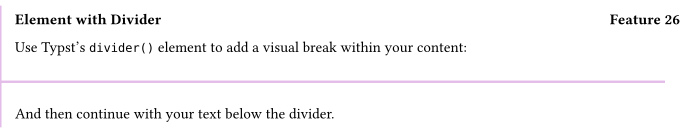 </picture> 

### Miscellaneous

#### Syntax to create single frames

 <picture> <source media="(prefers-color-scheme: dark)" srcset="assets/README-svg-dark-26.svg"> 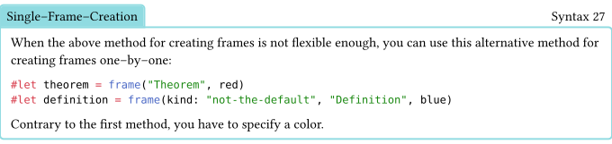 </picture> 

#### HTML

We were one of the first packages to add support for html!  
This means you can use our frames if you’re writing an html wiki or blog
in typst.

 <picture> <source media="(prefers-color-scheme: dark)" srcset="assets/README-svg-dark-27.svg"> 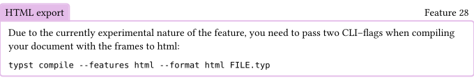 </picture> 

#### General

Internally, every frame is just a `figure` where the `kind` is set to
`"frame"` (or a different custom value). As such, most things that can
be done to a figure can be done with a frame as well. Whenever you would
like to do something custom but don’t know if it is supported, try
achieving it with a normal figure first and then apply the same show
rule to your frames. Here is a list of examples:

 <picture> <source media="(prefers-color-scheme: dark)" srcset="assets/README-svg-dark-28.svg"> 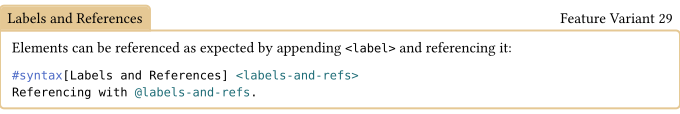 </picture> 

 <picture> <source media="(prefers-color-scheme: dark)" srcset="assets/README-svg-dark-29.svg"> 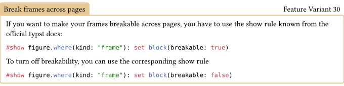 </picture> 

 <picture> <source media="(prefers-color-scheme: dark)" srcset="assets/README-svg-dark-30.svg"> 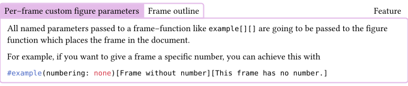 </picture> 

For example, you can create an outline which only contains some
intentional of your frames like so. The `figure` function includes a
parameter for including a figure in the outline.

``` typst
// By default, don't include frames in outlines by default
#show figure.where(kind: "frame"): set figure(outlined: false)
// Create the outline
#outline(target: figure.where(kind: "frame"))
// Explicitly include a frame in the outline with the `outlined` parameter.
#example(outlined: true)[Important frame][For the outline]
```

 <picture> <source media="(prefers-color-scheme: dark)" srcset="assets/README-svg-dark-31.svg"> 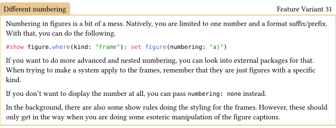 </picture> 

 <picture> <source media="(prefers-color-scheme: dark)" srcset="assets/README-svg-dark-32.svg"> 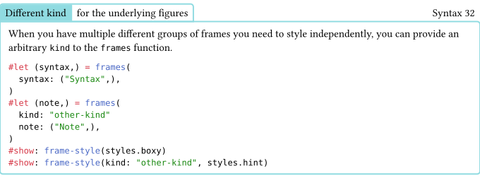 </picture> 

 <picture> <source media="(prefers-color-scheme: dark)" srcset="assets/README-svg-dark-33.svg"> 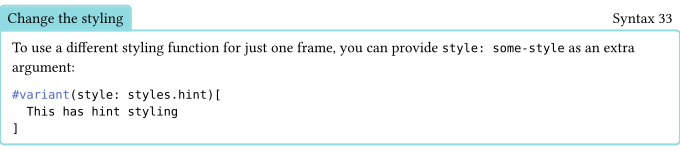 </picture> 

When you want to change the styling used for a passage of your document,
you can just add more `show: frame-style()` rules:

``` typst
#show: frame-style(styles.boxy)
#example[In boxy style][]
#show: frame-style(styles.hint)
#example[In hint Style][]
```

I usually define the abbreviations for the show rule:

``` typst
// Define once
#let boxy(document) = {show: frame-style(styles.boxy); document}
#let hint(document) = {show: frame-style(styles.hint); document}

// Use it for changing the style used
#show: boxy
#example[In boxy style]
#example[Also in boxy style]
#show: hint
#example[In hint style]
```

## Custom Styling

Internally, there is nothing special about the predefined styles. The
only requirement for any styling function is to adhere to the following
function signature interface:

 <picture> <source media="(prefers-color-scheme: dark)" srcset="assets/README-svg-dark-34.svg"> 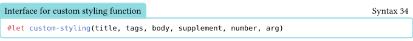 </picture> 

where `arg` is the value passed behind the supplement for each frame
variant in the `frames` function. For the predefined styles, this is the
color of the frames. The content returned will be placed as–is in the
document.

 <picture> <source media="(prefers-color-scheme: dark)" srcset="assets/README-svg-dark-35.svg"> 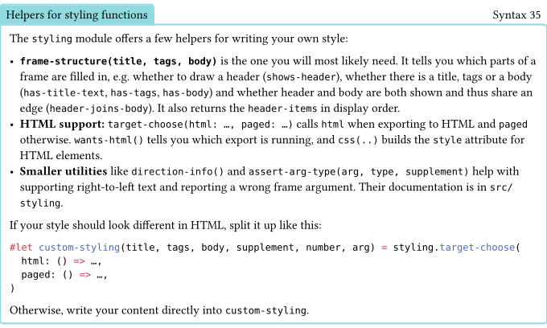 </picture> 

 <picture> <source media="(prefers-color-scheme: dark)" srcset="assets/README-svg-dark-36.svg"> 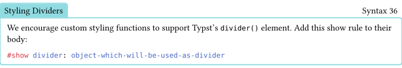 </picture> 

The older `styling.divide()` and `styling.dividers-as()` are deprecated.
Use `divider()` and `show divider: ...` instead.

`frame-it` combines very well with
\[showybox\](<https://typst.app/universe/package/showybox/>) in order to
create beautiful styles easily!

## Experimental APIs

These APIs are still experimental and subject to change. Use sparingly.

 <picture> <source media="(prefers-color-scheme: dark)" srcset="assets/README-svg-dark-37.svg"> 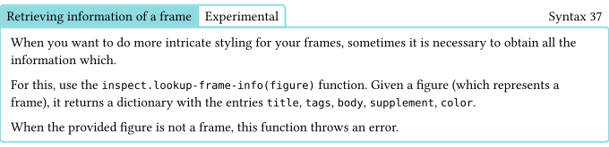 </picture> 

For example, you can use this to color the entries in a outline
according to the color of the frame:

``` typst
#show outline.entry: it => {
  let color = inspect.lookup-frame-info(it.element).color
  text(fill: color.saturate(70%), it)
}
#outline(target: figure.where(kind: "frame"))
```

 <picture> <source media="(prefers-color-scheme: dark)" srcset="assets/README-svg-dark-38.svg">  </picture> 

Whenever possible, try to discern it using the figures kind instead of
this function.

This can be useful, for example, when you want to format references in
your document differently. For example, you can do something like this
in order to display just title if the referenced element and link to it:

``` typst
#show ref: it => {
  if inspect.is-frame(it.element) {
    link(it.element.location(), inspect.lookup-frame-info(it.element).title)
  } else {
    it
  }
}
```

## Edge Cases

Here are a few edge cases.

 <picture> <source media="(prefers-color-scheme: dark)" srcset="assets/README-svg-dark-39.svg">  </picture> 

 <picture> <source media="(prefers-color-scheme: dark)" srcset="assets/README-svg-dark-40.svg">  </picture> 

 <picture> <source media="(prefers-color-scheme: dark)" srcset="assets/README-svg-dark-41.svg">  </picture> 

 <picture> <source media="(prefers-color-scheme: dark)" srcset="assets/README-svg-dark-42.svg">  </picture> 

<strong>Should be thmbox</strong>
<strong>Other Frame 1</strong>
thmbox

 <picture> <source media="(prefers-color-scheme: dark)" srcset="assets/README-svg-dark-43.svg">  </picture> 

 <picture> <source media="(prefers-color-scheme: dark)" srcset="assets/README-svg-dark-44.svg">  </picture> 

 <picture> <source media="(prefers-color-scheme: dark)" srcset="assets/README-svg-dark-45.svg">  </picture> 

 <picture> <source media="(prefers-color-scheme: dark)" srcset="assets/README-svg-dark-46.svg">  </picture> 

A reference to the frame above: [Example 47](#edge-case-label).

 <picture> <source media="(prefers-color-scheme: dark)" srcset="assets/README-svg-dark-47.svg">  </picture> 

 Some Additional Frame
1 <strong>  Individual </strong><em></em>: Individual

 <picture> <source media="(prefers-color-scheme: dark)" srcset="assets/README-svg-dark-48.svg">  </picture> 

 <picture> <source media="(prefers-color-scheme: dark)" srcset="assets/README-svg-dark-49.svg">  </picture> 

 <picture> <source media="(prefers-color-scheme: dark)" srcset="assets/README-svg-dark-50.svg">  </picture> 

 <picture> <source media="(prefers-color-scheme: dark)" srcset="assets/README-svg-dark-51.svg">  </picture> 

 <picture> <source media="(prefers-color-scheme: dark)" srcset="assets/README-svg-dark-52.svg">  </picture> 
