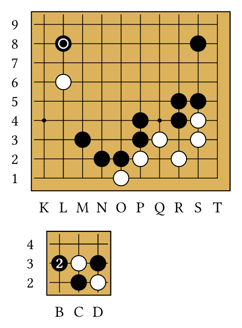
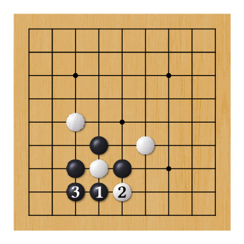

# gobanist

Boards, positions, game diagrams and tsumego problems of the board game Go (baduk, weiqi, igo) for Typst,
read from SGF files or written by hand. It is a port of
[pgf-go](https://ctan.org/pkg/pgf-go), the LaTeX package by the same author.

```typ
#import "@preview/gobanist:0.1.0": *

#gobanist-set(background: (fill: (color: rgb("#dcb35c"))), label: (at: (bottom, left)))

#goban(size: 19, partial: "K1:T9",
  stones(black: "L8, S8, R5, S5, P4, R4, M3, P3, N2, O2",
         white: "L6, S4, S3, Q3, O1, P2, R2"),
  marks(circle: "L8"),
)

#let base = board(size: 5, stones(black: "C2, D3", white: "C3"), moves(white: "D2"))
#goban(resume: base, partial: "B2:D4", moves("B3"))
```



```typ
#goban(size: 9, profile: "shell",
  stones(black: "C3, D4, E3", white: "D3, C5, F4"),
  moves("D2, E2, C2"),
)
```



```typ
#let game = sgf-read(path("game.sgf"))
#sgf-diagrams(game, step: 50, goban: (scale: 0.6))
```

- Games in SGF: a game on one board, series of diagrams as in books, and problems with their solutions.
- The rules of the game, in a WebAssembly kernel: captures, "N at M" notes, territory and score.
- Profiles for the board and the players, which can use images: wood, slate and shell stones.
- Boards as values, to follow a variation from a position or to show part of a board in a paragraph.
- Marks, arrows, lines and mark shapes of your own.
- The texts of the package in ten languages, and Western, Japanese or Chinese coordinates.

It needs Typst 0.15 or later.

## Manual

The full manual, with tutorials and the reference of every function and option:
[English](doc/en/manual.pdf) · [Español](doc/es/manual.pdf).

## Functions

- `goban(..options, ..elements)`: draws a board.
- `board(..options, ..elements)`: a board as a value. It can start with another board: `board(base, moves("C3"))`
  is `base` with one more move, and `goban(base)` draws it. With `resume`, another board goes on from it.
- `gobanist-set(..options)`: options for the boards that follow.
- `stones(...)`, `prisoners(...)`: stones. Without a player, neutral; `stones(black: "C3", white: "D4")`.
- `moves(...)`: numbered moves, alternating. Without a player they follow the turn; `moves(white: "D2")` starts
  with White. Options: `from`, `numbers`, `label`, `mark` and those of the stone.
- `marks(...)`: marks, with the shape as the key: `marks(triangle: "C3", circle: "E5")`. Without a shape, a
  cross. Options: `player`, `from`, `content`, `line`, `fill`, `label`, `scale`.
- `arrows(...)`, `lines(...)`: arrows and lines, each a pair of intersections:
  `arrows(("B3", "F3"), ("C7", "G9"), color: red)`. Options: `color`, `width`, `opacity`, `dash`
  (`"solid"`, `"dashed"`, `"dotted"`), `shorten`, `bend` (an angle), `halo`; arrows also have `tip`
  (`"stealth"`, `"triangle"`, `"circle"`) and `tips` (`"end"`, `"both"`).
- `territory(...)`: territory. The key is the player and the value, the vertices of a polygon or `auto`:
  `territory(black: "A1, A5, B5, B1")`, `territory(auto)`. Without a player, a polygon is neutral and `auto`
  marks that of both colors. Options: `draw` (`"marks"`, `"fill"`, `"region"`), `dame`, `forget` and the
  style of the player's territory (`mark`, `fill`, `line`, `vertices`).
- `sgf-read(source, game: 1, charset: auto)`: reads an SGF game. `source` is a file (`path("game.sgf")`),
  `bytes` or the SGF text; `game`, the game of a collection; `charset`, the encoding of a file that is not UTF-8
  (with `auto`, that of `CA` or, without it, Latin-1). What it returns goes in a board, as an element: it draws
  the main line, and the board takes the size of `SZ`.
- `sgf(game, ...)`: the game with other options (those of the `sgf` branch, plus `forget`).
- `sgf-info(game, property, move: 0, variation: none)`: the value of a property (`"PB"`, `"RE"`...), as text;
  with `move`, that of that move.
- `sgf-comment(game, move, variation: none, annotations: true, chat: true)`: the comment of a move (`0`: the one
  before the first move): its name (`N`) in bold, its annotations (`TE`, `BM`, `DO`, `IT`, `GB`, `GW`, `DM`,
  `UC`) and its comment (`C`). `annotations: false` leaves only the comment; `chat: false` removes the KGS and
  OGS chat.
- `sgf-diagrams(game, ...)`: the game in diagrams of `step` moves (or, if the file marks figures with `FG`, one
  per figure, with its name in the caption), each with its caption, its "N at M" notes, the comments of its
  moves and, in the last one, the result. Each diagram starts from the real position; the stones captured by
  the moves of the diagram are not removed. A move on an occupied point removes the stone that was there,
  without prisoners (also in `sgf-problem`). The options are those of the `diagrams` branch. Those of
  `sgf(game, ...)` apply to each board, except those that the diagram sets (`from`, `to`, `variation`,
  `numbers`, `marks`, `last-mark`, `step`, `restart`), which are an error. With `variations`, each variation
  goes in its own diagram after the diagram where it starts ("Diagram 2a (variation at 3)"), whole and with its
  moves numbered from 1; the variations are those that leave the line of `variation`. A path of `paths` that
  the game does not have, or that does not leave that line, is an error. If the file has a view (`VW`), each
  diagram shows the part that covers the views of its moves; a `partial` in `goban` wins.
- `sgf-problem(problem, ...)`: a problem: the statement (the initial position with its marks, who plays and
  the comment of the root) and a diagram for each line of the tree, numbered from 1, with its notes and the
  comments of its moves. With several games (`sgf-problem(..problems)`), first all the statements, with the
  number of each game in its file, and then the solutions. All the diagrams of a problem show the view of the
  file (`VW`) or, without a view, with `partial: auto`, the part that the problem uses. The options are those
  of the `problems` branch. Those of `sgf(problem, ...)` apply to each board, except those that the diagram
  sets (`from`, `to`, `variation`, `numbers`, `last-mark`, `step`, `restart`), which are an error.
- `goban-layout(..boards, ...)`: arranges boards (`board(...)` or games) and the diagrams of
  `sgf-diagrams(...)` and `sgf-problem(...)`, in the order in which they come. The options are those of the
  `layout` branch; the `layout` options of `sgf-diagrams` and `sgf-problem` are not used. With `fit`, each
  single board fills its column, and the diagrams of an `sgf-diagrams` or an `sgf-problem` use the scale of the
  first one. A `goban(...)` is an error.
- `goban-view(board, part, ...)`: the intersection (`"C3"`) or the rectangle (`"B2:E4"`) of a board
  (`board(...)` or a game) as it was at the end, with the captures resolved, in the middle of the text, with
  its center at `raise` above the baseline. It is resolved with the global options of the place of the view;
  the options of `view.goban` go on top of those of the board, and cannot be `size`, `use-i`, `partial`,
  `captures`, `captured-marks`, `territory` or `sgf`. The options are those of the `view` branch. It does not
  change what `goban-prisoners`, `goban-score`, `goban-notes` or `goban-region` say.

After a `goban`, about what it drew:

- `goban-prisoners(player)`: the prisoners of the player (with `captures`).
- `goban-score(player, komi: auto)`: the Japanese score; with `"neutral"`, the neutral points.
- `goban-notes(at: auto, separator: auto)`: the "N at M" and "N: pass" notes (with `notes: true`).
- `goban-region(player, property, n: none)`: `"polygons"`, `"outlines"`, `"holes"`, `"vertices"`,
  `"area"`, `"perimeter"` or `"polygon"` (with `n`) of the region of `draw: "region"`.

Stones, moves, marks, arrows, lines and territories accept `forget: true`: `resume` does not bring them and
`goban-view` draws them only with `forgotten`. With `forget: "number"`, a move comes without its number.

The shapes are `circle`, `triangle`, `square`, `cross`, `filled-square`, `filled-circle`, `t-circle`,
`t-square`, `hatched-lines`, `dim`, `sequence` and `custom`, plus those of the `shapes` option.

`shapes: (name: shape, ...)` defines mark shapes, which are used like those of the package (in `marks`, in the
`mark` option of the stones, in `territory` and in `last-mark`); one with the name of another replaces it. None
can have the name of an option of `marks`. A shape is:

- a function: it receives `(radius, stroke, fill, color)` (the radius of the player's stone, with `scale`; the
  stroke and the fill of the mark, `fill` being `none` if it is off; the color of the lines) and what it returns
  is drawn with its origin at the point: `m => line(start: (-m.radius, 0pt), end: (m.radius, 0pt), stroke: m.stroke)`;
- content, centered on the point;
- an image, `(image: file)` or `(image: (file: ..., width: ...))`, centered on the point, without the colors of
  the mark. `width`: its width (auto: 1.2 stone radii), which changes with `scale`. With several files, each
  point uses one, always the same.

On an empty point, a shape of your own covers the grid like the others.

## Coordinates

The syntax of pgf-go: `C3`, `A:C 3`, `C 1:3`, `A1:C3`; the operators `-|`, `|-`, `--`, `-|-`, `|-|` and
`r`; `*`, `C`, `3`, `A:C`, `3:5`, `A:B 1:2`; the brackets `A[1, 3:4]`, `[A, C]5`, `[A, B][1, 2]`; commas
add and `;` alternate between adding and subtracting.

## Options

A tree of dictionaries, like that of pgf-go:

```typ
(
  size: 9,                      // or (columns, rows): from 2 to 25 columns and from 2 to 99 rows
  use-i: false,
  partial: none,                // "A1:E5" or auto
  partial-margin: 1,
  scale: 1,
  scale-line-width: false,      // with true, scale also multiplies the widths
  profile: ...,                 // a profile: its name or a dictionary of options
  background: (
    on: true,
    fill: (
      on: true, color: white, opacity: 1,
      pattern: none,            // a tiling, above the color and the image
      image: (
        file: none,             // a path or bytes, or an array of them
        fit: "cover",           // "stretch" or "tile"
        anchor: bottom + left,  // with tile, where the tiles start from
        width: auto,            // with tile, the width of each tile; auto: the natural one
        tiles: auto,            // with tile, a mesh: n or (columns, rows)
        rotate: 0deg,           // in quarter turns; "random" or (min, max): each tile with its own
      ),
    ),
    line: (on: true, color: black, width: 0.75pt, opacity: 1),
    sep: 8.25pt,
    rounded-corners: (outer: 0pt, inner: 0pt),
    shadow: (on: false, angle: -45deg, offset: 1.5pt, opacity: 0.5, color: black),
  ),
  grid: (
    on: true,
    line: (on: true, color: black, width: 0.55pt, opacity: 1),
    sep: (x: 12.5pt, y: 12.5pt),
    image: (file: none, fit: "stretch", tiles: auto, rotate: 0deg), // fit: "tile", one per square or per cell
  ),
  hoshi: (on: true, radius: 1.5pt, color: auto, opacity: auto, at: auto,
    image: (file: none, width: auto, rotate: 0deg)), // width: auto, the diameter
  label: (
    at: (),                     // sides: top, bottom, left, right
    sep: 0.35cm,
    text: (size: 10pt),          // what text() receives
    columns: "A",               // "A": the go letters; otherwise a numbering pattern ("1", "一")
    rows: "1",
    columns-direction: ltr,     // or rtl
    rows-direction: btt,        // or ttb
  ),                            // style: "western", "japanese" or "chinese" sets the four above
  players: (neutral: ..., black: ..., white: ...),
  arrow: (color: black, width: 1.2pt, opacity: 1, dash: "solid", shorten: 0pt, bend: 0deg,
    halo: (on: true, color: auto, width: 0.8pt), tip: "stealth", tips: "end"),
  line: (...),                  // the same, without tip or tips
  captures: none,               // "remove" or "fade"; with captures, a move on an occupied point is an error
  captured-marks: "keep",       // or "remove"
  notes: (on: false, at: auto, separator: ", "),
  territory: (draw: "marks", dame: false),
  score: (komi: 0),
  sgf: (
    from: 1,                    // the first numbered move
    to: auto,                   // the last move played
    variation: none,            // (2, 1): the variation of each branch; or the moves, "C5, C3, pass"
    marks: true,                // the marks, arrows, lines and territory of the last move
    numbers: auto,              // auto: what PM says
    step: 100,                  // the size of the stretches of restart (or an array)
    restart: (on: auto, from: 1), // number each stretch from from; auto: what PM says
    last-mark: none,            // the mark of the last move: a shape or (shape: ..., ...)
    letters: none,              // the letters of the variations: "children", "siblings" or auto (ST)
    view: false,                // with VW, true: the view of the moves from to to; a number: that of that move
  ),
  diagrams: (
    step: 50,                   // the moves of each diagram (or an array; the last one repeats)
    figures: true,              // with FG in the file, one diagram per figure instead of step
    view: true,                 // with VW in the file, each diagram shows the view of its moves
    partial: none,              // auto: without a view, all show the part used by the lines drawn
    from: 1,                    // the first move: the diagrams that reach it, with the same number
    to: auto,                   // the last move
    variation: none,            // the line, as in sgf
    variations: (
      on: false,                // true: the variations chosen by select, each in its own diagram
      select: "commented",      // those with comments; "all": all of them
      depth: 1,                 // how deep: 1, those that leave the line; 2, also those that leave those
      from: 1,                  // those that start at that move or later
      paths: (),                // those always drawn: ((2,), (2, 2), "E5, C7, G7")
    ),
    variation-title: auto,      // what goes in parentheses in its caption: a function of the move, n => ...
    numbers: true,
    marks: true,                // the marks, arrows and lines of the last move of each diagram
    last-mark: none,            // the mark of the last move of each diagram
    restart: (on: auto, from: 1), // true: from the second diagram on, each one numbers from from
    notes: true,                // the "N at M" notes below each diagram
    title: auto,                // the word of the caption: "Diagram 2 (51–100)"
    caption: (text: (size: 0.9em), min-width: 8em), // what text() receives; the minimum width when breaking it
    comments: (
      on: false,
      text: (:),                // what text() receives, on top of caption.text
      align: left,
      justify: false,
      root: false,              // also the comment of the root, before those of the diagram of move 1
      number: n => [#strong(str(n)): ], // what goes before each comment
      separator: parbreak(),
      position: bottom,         // left or right: beside the board; "after": all after the diagrams
      width: auto,              // the width of the comments beside the board
      sep: 1em,                 // the space between the board and the comments beside it
      height: none,             // the maximum height below or beside; what does not fit goes after the diagrams
    ),
    annotations: true,          // the name and the annotations of each move in the comments
    chat: true,                 // false: the comments without the KGS and OGS chat
    result: (on: true, title: auto, format: "text", black: auto, white: auto), // "raw": as in RE
    goban: (:),                 // the options of each board (they start with captures: "remove", notes: true)
    layout: (:),                // the layout of these diagrams, on top of layout
  ),
  problems: (
    statement: true,            // the statement; "alone": alone in its row
    solutions: true,            // a diagram per line of the tree
    title: auto,                // the start of the caption of the statement; auto: nothing, or "Problem" with several games
    to-play: auto,              // who plays: PL or the color of the first move; "black", "white" or none
    variation-title: auto,      // the caption of each solution: a function of its number, n => ...
    verdict: false,             // the caption of each solution says whether it is correct (GB/GW, TE/BM or RIGHT)
    view: true,                 // with VW in the file, all the diagrams show that view
    partial: auto,              // without a view, the part that the problem uses; none: the whole board
    notes: true,
    caption: (text: (size: 0.9em), min-width: 8em),
    comments: (on: true, ...),  // like those of diagrams, without root
    annotations: true,
    chat: true,
    goban: (:),
    layout: (:),
  ),
  layout: (
    columns: auto,              // auto: in the paragraph, side by side; a number: in a grid
    width: 100%,                // the width of the grid, centered; auto: columns as wide as the widest diagram
    column-sep: 1em,
    row-sep: 1em,
    fit: false,                 // in the grid, the boards are scaled to fill their column (not with width: auto)
    align: center,              // where each diagram goes in its column
    per-page: none,             // every how many diagrams a page starts (with several columns, the next column)
  ),
  view: (
    marks: true,                // the marks
    arrows: true,               // the arrows
    lines: true,                // the lines
    numbers: true,              // the numbers of the moves
    territory: true,            // the territory
    forgotten: false,           // also what has forget
    raise: auto,                // the height of the center above the baseline; auto: half the height of the x
    goban: (scale: 0.8),        // the options of the board, on top of its own
  ),
  texts: (en: (...), es: (...), ...), // the texts of each language
  shapes: (:),                  // the mark shapes of your own, by name
)
```

Each player has `stone` (`fill`, `line`, `radius`, `scale`, `shadow`, `shine`, `image`), `prisoner`, `move`
(`numbers`, `label`), `mark` (`line`, `fill`, `label`, `scale`) and `territory` (`mark`, `fill`, `line`,
`vertices`). `stone`, `prisoner`, `move` and `mark` at the first level, or `players: (all: ...)`, go to the
three players. The `fill` branches of `stone`, `mark` and `territory` have `pattern` (a `tiling`, above the
color).

```typ
stone: (
  image: (file: none, width: auto, rotate: 0deg, opacity: 1), // the stone is the image: no fill or border
  shadow: (..., image: (file: none, width: auto, rotate: 0deg, silhouette: false)),
  shine: (..., image: (file: none, width: auto, rotate: 0deg, silhouette: false)),
)
```

- `stone.image`: the stone is the image, centered on the point. `width`: its width (auto: the diameter of the
  stone); the height keeps the proportion. `rotate`: an angle (counterclockwise), `"random"` or `(min, max)`:
  each point with its rotation, always the same. With several files, each point uses one, always the same.
  `opacity` is multiplied by that of `fill`: a prisoner with an image is translucent.
- `stone.shadow`: with an image stone, the silhouette of the image, rotated like it. `shadow.image`: an image of
  your own, as it is, with the opacity of the shadow; with `silhouette`, its shape painted with `shadow.color`.
  It does not rotate with the stone.
- `stone.shine.image`: a shine of your own, above the stone, with the opacity of the shine; with `silhouette`,
  its shape painted with `shine.color`. It does not rotate with the stone.
- `background.fill.image`: above the color, with the opacity of the fill, placed according to the whole board
  (with `partial` a part of it is seen) and clipped by the border. `"stretch"` stretches it to the background;
  `"cover"` scales it, keeping its proportion, until it covers it; `"tile"` repeats it from `anchor` (a corner,
  a side or `center`), or in the mesh `tiles`, each tile stretched to its cell. With several files, each tile
  uses one. Marks on empty points and `dim` show the background they cover.
- `grid.image`: instead of the lines, with the opacity of `grid.line`. `"stretch"` stretches it from A1 to the
  opposite corner of the whole board; `"tile"` puts one in each square, or in the mesh `tiles`.
- `hoshi.image`: instead of each point, with the opacity of the points.

In an image branch, what is not a dictionary is the file: `stone: (image: path("stone.png"))`; `image: none`
removes it. A file is a `path` (relative to the document that names it) or its `bytes`; PNG, JPEG, GIF, WebP,
SVG or PDF. Opacity and silhouettes only work with PNG and JPEG (the kernel makes them).

## Profiles

`profile` sets the style of the board and of the players back to the initial one and applies that of the
profile; what comes after is added. What is not style stays: `size`, `use-i`, `partial`, `partial-margin`,
`scale`, `scale-line-width`, `label.at`, `label.columns`, `label.rows` and their directions, `hoshi.at`,
`move.numbers`, the arrows, the lines, the game and the branches of the games and the diagrams.

A profile is a dictionary of options: `gobanist-set(profile: (background: ..., players: ...))`. A `profile` inside
a profile is the one it starts from. Those of the package are named: `"default"`, `"wain"`, `"pgfgo"`,
`"pgfgosmooth"`, `"simple"`, `"draft"`, `"shell"`, `"yunzi"` and `"baduktv"` (the last three, with the images
of `images/`).

`texts` has the texts of each language (`en`, `es`, `fr`, `de`, `pt`, `it`, `eo`, `ja`, `zh`, `ko`), chosen
with `text.lang`; a new language takes from English what it does not have. Those with variable parts are
functions.

Options are merged branch by branch. In a branch with `on`, `true` and `false` turn it on and off, and a
dictionary adjusts it without turning it on: `fill: (on: true, color: red)`. A length on `sep` or
`rounded-corners` goes to all its branches.

## Kernel

Captures, territory, regions, score, reading SGF and the opacity and silhouettes of images are done by a
WebAssembly plugin, `src/kernel.wasm`, compiled from the Rust code in the [`kernel/`](https://github.com/gxono/gobanist/tree/v0.1.0/kernel) folder of
the repository.
To change it you need Rust with the `wasm32-unknown-unknown` target:

```sh
python kernel/build.py          # builds and copies src/kernel.wasm
cargo test --manifest-path kernel/Cargo.toml
```

The tests are in [`tests/`](https://github.com/gxono/gobanist/tree/v0.1.0/tests):

```sh
python tests/run.py
python tests/run.py --update
```

`tests/run.py` builds the kernel again if its code is newer than `src/kernel.wasm` and runs its Rust tests
(`cargo test`).

## License

gobanist is distributed under the [LaTeX Project Public License](https://www.latex-project.org/lppl/), version
1.3c or later (see [LICENSE](LICENSE)). The images in `images/` come from pgf-go, by the same author, under the
same license.

`src/kernel.wasm` includes code from these Rust crates, under their own licenses: adler2, bitflags, cfg-if,
crc32fast, fdeflate, flate2, itoa, miniz_oxide, png, scopeguard, serde, serde_core, serde_json, zune-core and zune-jpeg
(MIT or Apache-2.0), simd-adler32 and zmij (MIT), memchr (MIT or Unlicense) and encoding_rs ((MIT or
Apache-2.0) and BSD-3-Clause). Their license texts are in their sources on [crates.io](https://crates.io).
