# gobanist

Boards, positions, game diagrams and tsumego problems of the board game Go (baduk, weiqi, igo) for Typst,
read from SGF files or written by hand. It is a port of
[pgf-go](https://ctan.org/pkg/pgf-go), the LaTeX package by the same author.

**Manual**, with tutorials and the reference of every function and option:
[English (PDF)](doc/en/manual.pdf) · [Español (PDF)](doc/es/manual.pdf).

**Examples**, each one with its drawing and its code:
[English (PDF)](examples/examples.pdf) · [Español (PDF)](examples/ejemplos.pdf).

It needs Typst 0.15 or later.

## A position

Stones go by player, marks by shape, and the coordinates are those of Go (no I).

```typ
#import "@preview/gobanist:0.2.0": *

#goban(size: 19, partial: "K1:T9", label: (at: (bottom, right)),
  stones(black: "L8, S8, R5, S5, P4, R4, M3, P3, N2, O2",
         white: "L6, S4, S3, Q3, O1, P2, R2"),
  marks(circle: "L8", triangle: "S4"),
)
```

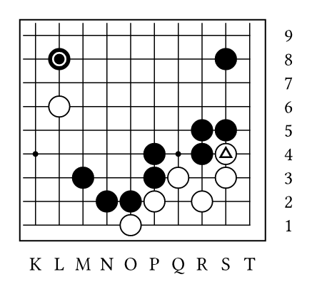

## Moves, captures and notes

Moves are numbered and alternate. With `captures`, the captured stones are removed; with `notes`, a move played
where another one was goes below the board.

```typ
#goban(size: 7, captures: "remove", notes: true,
  stones(black: "B3, C2, C4", white: "C3, D2, D4, E3"),
  moves("D3, G6, G5, C3, A6, A5, D3"))

#goban-notes(). Black captured #goban-prisoners("black").
```

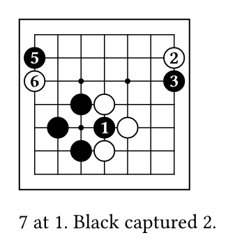

## Marks, arrows and lines

Marks go by shape, and new shapes can be defined; arrows and lines join two intersections.

```typ
#let diamond(m) = polygon(fill: m.fill, stroke: m.stroke,
  ..((0, -1), (1, 0), (0, 1), (-1, 0)).map(((x, y)) => (0.7 * x * m.radius, 0.7 * y * m.radius)))

#goban(partial: "A1:G7", label: (at: (top, left)), shapes: (diamond: diamond),
  stones(black: "C3, D3, E4, C5", white: "D4, D5, E5, F3"),
  marks(triangle: "D5", diamond: "C4", custom: "E3", content: [A]),
  arrows(("E4", "G5"), color: red.darken(20%), bend: 30deg, shorten: 4pt),
  lines(("A6", "G6"), dash: "dashed"))
```

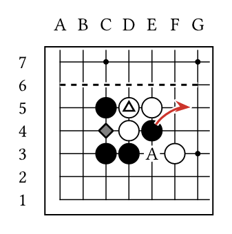

## Boards as values

A `board` is a position kept in a variable: `goban` draws it, with more moves if they are given, and
`goban-view` shows a point or a part of it in the text.

```typ
#let base = board(size: 5, partial: "A1:E4",
  stones(black: "B2, C3, D2", white: "B3, C4, D3"))

#goban(base)
#goban(base, moves(black: "C2, E3"))
#goban(base, moves(black: "E3, C2"))

The black stone #goban-view(base, "C3") is in atari: #goban-view(base, "B2:D4").
```

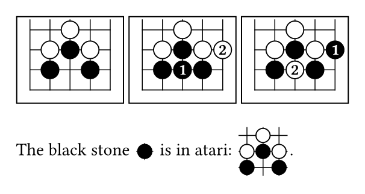

## Territory and score

Coordinates can be abbreviated: `C:G5` is row 5 from C to G, and `A6|-B5|-D1` is a path.

```typ
#goban(label: (at: (top, left)),
  stones(
    black: "A6|-B5|-D1|-E2, C4, E9-|F4, D5-|G7--D7, H6, H8, J7",
    white: "E8-|C5, B:E6, A7, B8, D9, J6|-H5, H2:3, F1|-C3, C2, D:E4, G4"),
  prisoners(black: "H1-|J2", white: "A1"),
  territory(auto, dame: true))

Black: #goban-score("black"). White: #goban-score("white", komi: 6.5).
```

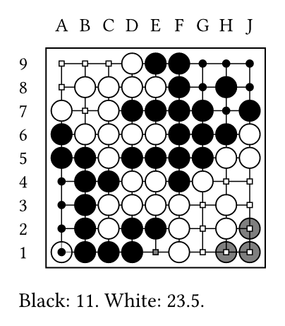

## A game from an SGF file

`sgf-diagrams` draws a game in diagrams, as in books: each one with its caption, its notes and the comments of
its moves, and the result at the end.

```typ
#let game = sgf-read(path("game.sgf"))

#sgf-diagrams(game, step: 5, comments: true,
  layout: (columns: 2, width: 12cm))
```

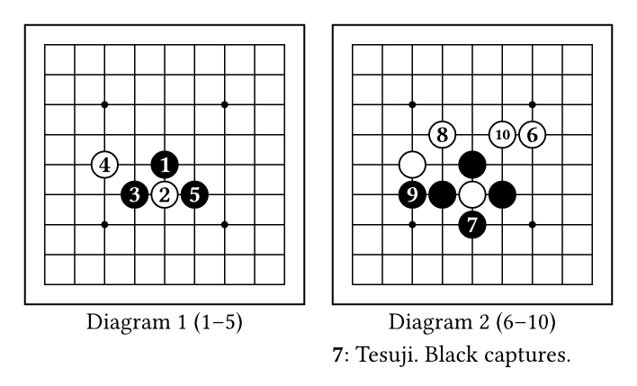

## Diagrams from Sensei's Library

Diagrams written as text, as in Sensei's Library and L19 (lines that start with `$$`), are read like an SGF file,
and every function works with them: `X` and `O` are stones, the numbers are moves, `C`, `S`, `T` and `M` are
marks, the lowercase letters are letters on the board, and `{AR ...}` is an arrow. The edges say which corner is
drawn.

```typ
#let nadare = sgf-read("$$B Nadare joseki
$$  --------------
$$ | . . . . . . .
$$ | . . . . . . .
$$ | . . . 1 6 . .
$$ | . . 5 4 . . .
$$ | . . 3 2 a . .
$$ | . . . . . . .
$$ | . . . . . . .
$$ | . . . . . . .
$$ | . . . . . . .
$$ {AR 3:6 3:9}")

#sgf-diagrams(nadare)
```

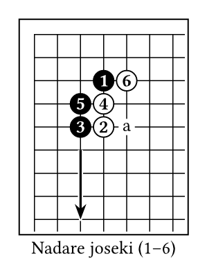

## Other languages

The texts of the package (captions, notes, results) follow the language of the text, in ten languages, and the
coordinates can be written as in Japanese or Chinese books. The comments are those of the file.

```typ
// MS Gothic comes with Windows; any font with the kanji will do.
#set text(lang: "ja", font: ("Libertinus Serif", "MS Gothic"))

#sgf-diagrams(sgf-read(path("game.sgf")), comments: true,
  goban: (label: (at: (top, right), style: "japanese")))
```

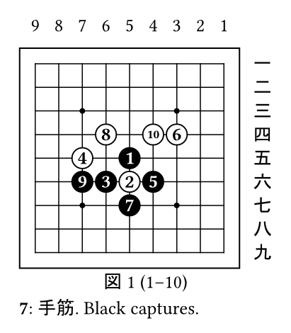

## Problems

`sgf-problem` draws the statement and a diagram for each line of the solution.

```typ
#let problem = sgf-read(path("problem.sgf"))

#sgf-problem(problem, title: "Problem 1",
  layout: (columns: 5, width: 18cm, fit: true))
```

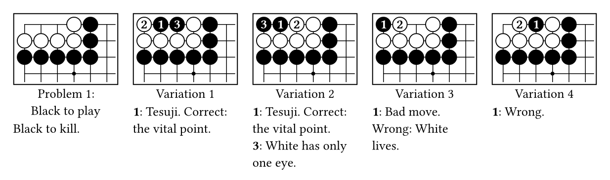

## Styles

Nine profiles come with the package, some with images of wood and stones; the options of every object can be
changed, for one board or for the whole document with `gobanist-set`, and a profile of your own is a dictionary
of options.

```typ
#let position = board(size: 7,
  stones(black: "C3, D3, E4, C5, D6", white: "D4, D5, E5, F3, E6"),
  marks(circle: "D5", triangle: "E4"))

#goban-layout(columns: 3, width: 12cm, fit: true,
  ..("default", "pgfgo", "pgfgosmooth", "wain", "shell", "yunzi", "baduktv", "simple", "draft")
    .map(p => board(position, profile: p)))
```

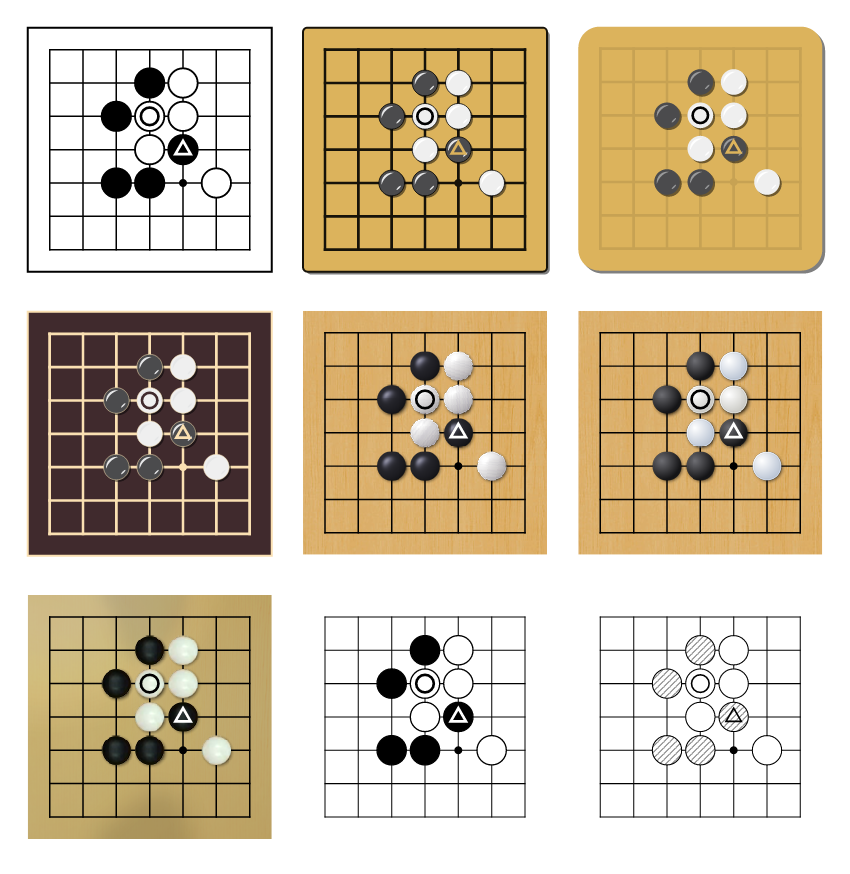

## A joseki dictionary

A variation is chosen by its moves; `variations` draws the commented answers that leave it, each one in its own
diagram, and `partial: auto` shows the part of the board that all of them use.

```typ
#let joseki = sgf-read(path("joseki.sgf"))

#sgf-diagrams(joseki, variation: "Q16, R14",
  variations: (on: true, from: 3), partial: auto, comments: true,
  layout: (columns: 3, width: 14cm, fit: true))
```

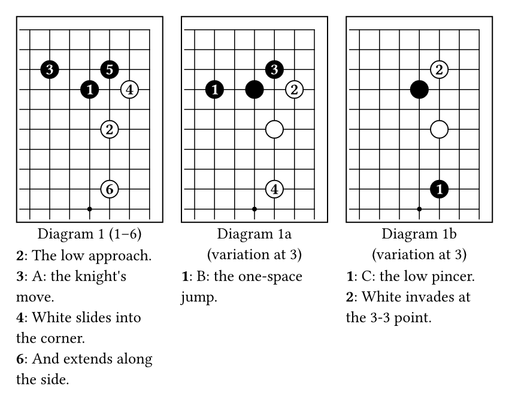

## Features

- Games in SGF: a game on one board, a game in diagrams as in books, with variations, and problems with their
  solutions. Also the text diagrams of Sensei's Library.
- The rules, in a WebAssembly kernel: captures, "N at M" notes, territory and score.
- Profiles for the board and the players, with images: wood, slate and shell stones.
- Boards as values, to follow a variation from a position or to show part of a board in a paragraph.
- Marks, arrows, lines and mark shapes of your own.
- The texts in ten languages, and Western, Japanese or Chinese coordinates.

## Kernel and tests

Captures, territory, score, reading SGF and the opacity of images are done by a WebAssembly plugin,
`src/kernel.wasm`, compiled from the Rust code in [`kernel/`](https://github.com/gxono/gobanist/tree/v0.2.0/kernel)
(`python kernel/build.py`, with the `wasm32-unknown-unknown` target). The tests are in
[`tests/`](https://github.com/gxono/gobanist/tree/v0.2.0/tests) (`python tests/run.py`).

## License

gobanist is distributed under the [LaTeX Project Public License](https://www.latex-project.org/lppl/), version
1.3c or later (see [LICENSE](LICENSE)). The images in `images/` come from pgf-go, by the same author, under the
same license.

`src/kernel.wasm` includes code from these Rust crates, under their own licenses: adler2, bitflags, cfg-if,
crc32fast, fdeflate, flate2, itoa, miniz_oxide, png, scopeguard, serde, serde_core, serde_json, zune-core and zune-jpeg
(MIT or Apache-2.0), simd-adler32 and zmij (MIT), memchr (MIT or Unlicense) and encoding_rs ((MIT or
Apache-2.0) and BSD-3-Clause). Their license texts are in their sources on [crates.io](https://crates.io).
