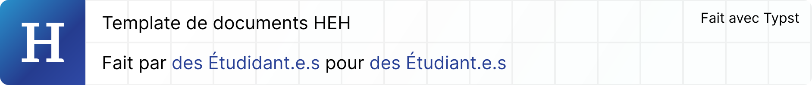
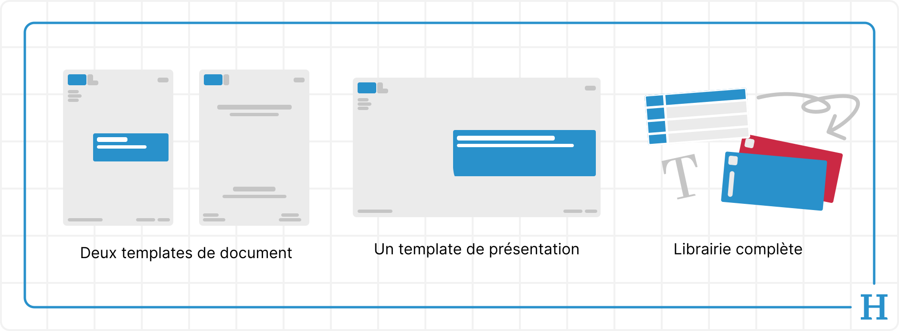
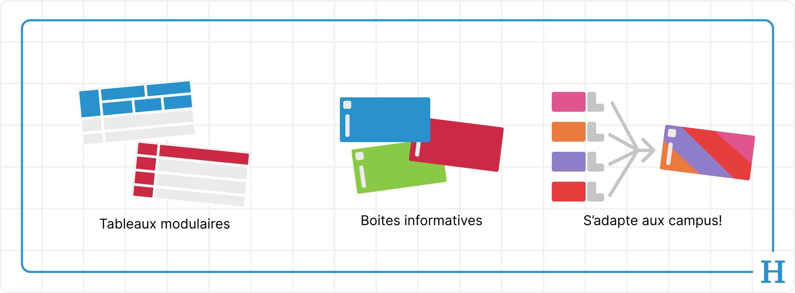

Le projet HEH typst a pour objectif de simplifier la rédaction de rapports, document et cours aux sein de la HEH que ce soit pour les étudiants ou les élèves.

Le projet prend la forme d'un package [typst](https://typst.app/) multi-fonction.

### Table des matières
1. [Contenus](#contenus)
2. [Utilisation](#utilisation)
3. [Contribution](#contribution)
4. [License](#license)

## Contenus

Le package heh-template comprend les éléments suivants :
- Deux templates de document (rapport et tfe)
- Un template de présentation
- Une librarie de composants complète (font, boite, tableaux, mise ne page)



Les templates gèrent automatiquement la mise en forme et la coloration des différents éléments selon le campus, le tout étant modulaire et s'adaptant automatiquement aux paramètres du template.

La librairie de composants dispose des éléments suivants:
- Des tableaux modulaires
- Des boites informatives
- Contextes d'environnement spécifique au campus
- Dites-nous ce qu'ont pourrait ajouter! (ou [contribuez](#contribution)!)



## Utilisation

Pour commencer, vous devez avoir Typst `v0.15.x` ou une version supérieur afin d'être sur que la librairie puisse fonctionner. Il est également vivement conseilé de comprendre au moins le base de la rédaction de document en [typst](https://typst.app/).

Pour utiliser le package, vous n'avez qu'a ajouter la ligne `#import "@preview/heh-template:1.0.0"` en haut de n'importe quel fichier .typ

Pour créer un document simple il suffit d'instancier le template de document avec les paramètres suivants:
```typst
#import "@preview/heh-template:1.0.0": heh-document, campus, config

// Appel du template en utilisant le style du département technique (DST)
#show: heh-document.with(
  campus-config-fn: campus.dst-config,
  document-config-fn: config.default-document-config
)

= Premier titre
```

Vous pouvez choisir votre campus an changent la valeur de `campus.dst-config` par les valeurs suivantes:
- `campus.dss-ms-config` Pour le Département des Sciences Sociales de Mons.
- `campus.dss-to-config` Pour le Département des Sciences Sociales de Tournai.
- `campus.dsee-to-config` Pour le Département des Sciences de l'Éducation et de l'Enseignement de Tournai.
- `campus.dsee-ms-config` Pour le Département des Sciences de l'Éducation et de l'Enseignement de Mons.
- `campus.deco-config` Pour le Département des Sciences Juridiques, Éconnomique et gestion.
- `campus.dst-config` Pour le Département des Sciences et Technologies.

Avec ceci, vous devriez avoir ce qu'il vous faut pour commencer, mais il est important de noter que le template regorge de bien plus de fonctionnalités que ça! Si vous voulez en savoir plus sur comment personnaliser votre documents, comment utiliser les tableaux, boites, le template de TFE et de présentation, jetez un coup d'œil au [manuel d'utilisation](manuel.pdf)!

## Contribution
Toutes contribution est la bienvenue afin de souvetenir le projet HEH template!
Cepandant avant de vous lancer dans le bain, jetez un œil au [règles de contribution](CONTRIBUTING.md) et au [code de conduite](CODE_OF_CONDUCT.md) de notre communauté.

Également, ce répertoire est soumis au règlement d'ordre intérieur de la Haute École en Hainaut et tout manquement a celui-ci peut avoir des répercution au sein de l'établissement.

## License
Le projet HEH Typst est sous la license [MIT](LICENSE.md) à l'exception des différents logos de la HEH qui eux sont la propriété de la [Haute École en Hainaut](https://HEH.be).
