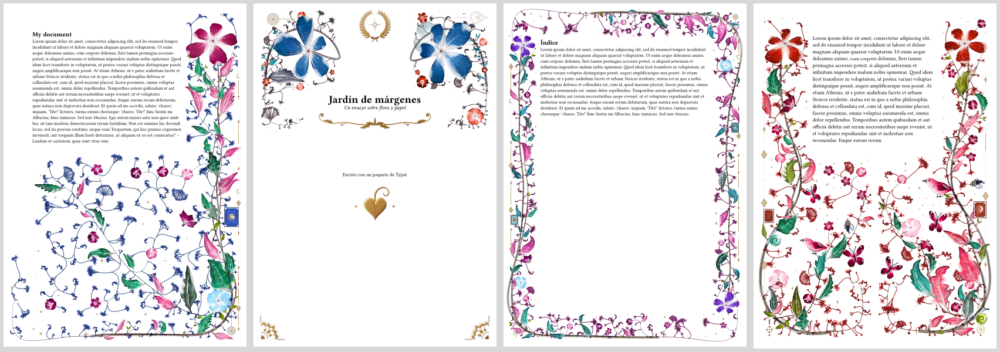
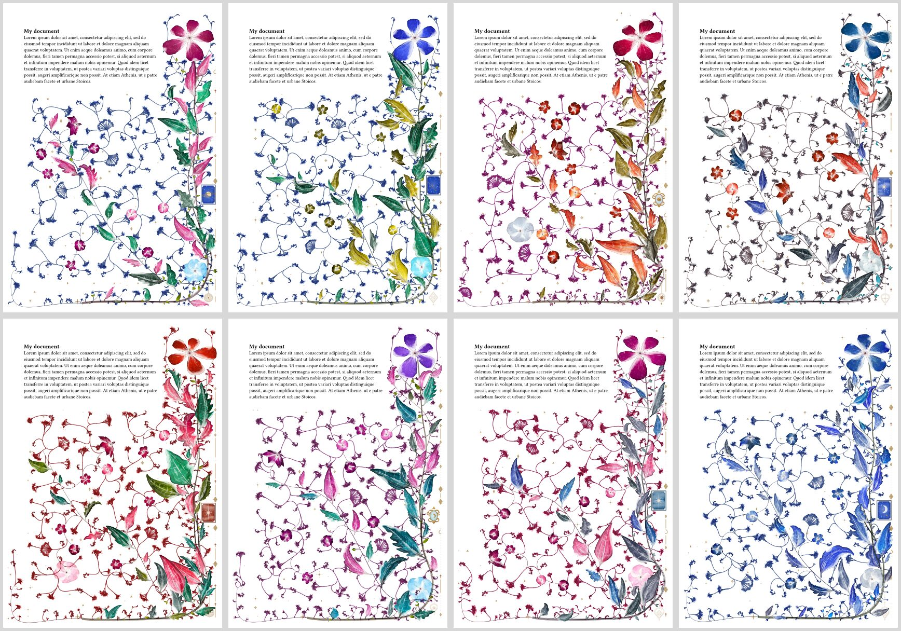
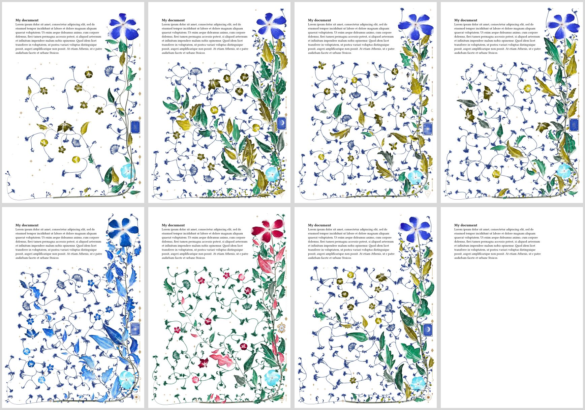
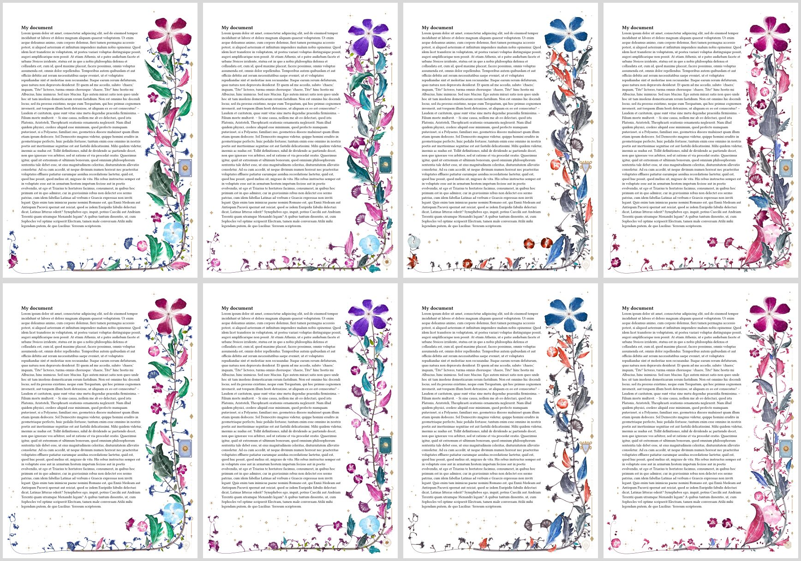
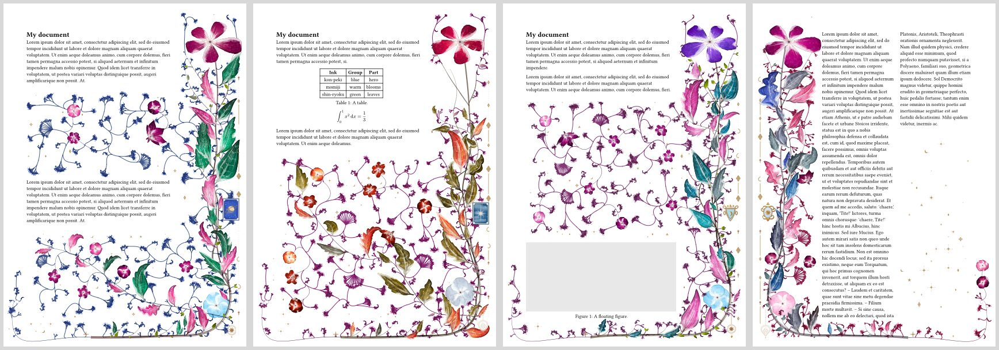

# Hortulus

Watercolour flora and gilt ornaments, grown in the margins of your document.
Every page grows its own plant around the text it holds: stems, leaves, blooms,
sprays and gilt, and if you like, bees, butterflies, birds and snails. Everything
is computed when the document compiles and painted as vector paths, with no
stock images. No tool is needed beyond Typst.



## Quick start

```typ
#import "@preview/hortulus:0.1.2": flora

#set page(margin: (left: 2.5cm, right: 5.5cm, y: 2.5cm))
#show: flora.with(layout: "right", colourway: "spring", seed: 7)

= My document
#lorem(200)
```

The flora fills the margins the page has, so give it room: about 5 cm for a side
margin, or 3 cm all round for `surround`. It also grows into gaps in the text:
leave a `#v(6cm)` and the plant reaches into it.

## Gallery

Up close: the blooms are vector paths painted like watercolour, and the gold is computed per pixel.


The eight colourways: `spring`, `summer`, `autumn` and `winter` above; `ember`, `plum`, `rose` and `original` below.



The same page with other options. Above: `density: 0.4`, `density: 2`, `visitors: 4` and `mix: (lily: 3, bloom: 0, umbel: 0)`. Below: `palette` with one ink, `palette` with two inks, `ornaments: (moon: 5, night: 0, sun: 0, planet: 0)` and `draft: true`.



The same four pages with `growth: "classic"` above and `growth: "natural"` below, in `spring`, `plum`, `winter` and `rose`: natural side branches leave the main stem, branch again and end in blooms.



The plant grows around what the page holds: a gap in the text, a table and an equation, a floating figure, and two columns with `layout: "split"`.



## Compile times

A page takes about 3 to 4 seconds to grow, depending on the layout and how full it
is, and adds about 4 to 6 MB to the PDF. Typst remembers finished pages, so while
you edit (with `typst watch`, say), only the pages whose text moved grow again. A
document that needs extra layout passes to settle, as one with citations does, may
grow some pages more than once. Pass `draft: true` to leave the flora out
altogether while you write.

## Options

`flora` takes these named options, all optional.

| Option | Values | Effect |
|---|---|---|
| `seed` | a number | Which garden; each page varies it |
| `layout` | `"left"`, `"right"`, `"centered"`, `"split"`, `"title"`, `"surround"` | Where the flora grows |
| `colourway` | `"spring"`, `"summer"`, `"autumn"`, `"winter"`, `"ember"`, `"plum"`, `"rose"`, `"original"` | A whole palette at once |
| `palette` | dictionary | What paints each part, such as `(hero: "kon-peki", leaves: "green")` |
| `growth` | `"classic"`, `"natural"` | Shoots running beside the main stem (default), or side branches that branch again and end in blooms |
| `density` | 0 to 10 | Fuller above 1, airier below it |
| `visitors` | 0 to 10 | The weight of every visitor at once |
| `mix` | dictionary | How much of each kind of growth, such as `(lily: 2, umbel: 0)` |
| `ornaments` | dictionary | How often each ornament is picked, such as `(moon: 3, night: 0)` |
| `spin` | whole number | Picks other inks for parts set to `"random"`; the shapes stay |
| `gilt` | `"raster"`, `"vector"` | Gold computed per pixel (default), or built of flat strips |
| `gilt-dpi` | 50 to 1200 | Resolution of raster gold; 600 by default |
| `gilt-env` | `"studio"`, `"mirror"` | The look of raster gold |
| `gilt-look` | dictionary | Changes keys of that look, such as `(grain: 0, horizon: 0.1)` |
| `header` | `auto`, `true`, `false` | The running-head rule and its mark; `auto` follows `page.header` |
| `enabled` | `true`, `false` | Turns the flora on or off, mostly with `flora-setup` |
| `draft` | `true`, `false` | Leaves the flora out, for fast previews |

A mistake stops the compile with a message naming the key.

### Layouts

- `left`: the left margin (the default).
- `right`: the right margin.
- `centered`: both side margins, with two different plants.
- `split`: the outer margin: right on odd pages, left on even ones. Use it with
  `margin: (inside: 2.5cm, outside: 5.5cm, y: 2.5cm)`.
- `title`: a crown over a title. Wrap the title in `flora-title`.
- `surround`: a wreath around the text, for title pages and contents.

### Parts, inks and kinds

`palette` paints these parts: `hero`, `blooms`, `leaves`, `leaflets`, `stems`,
`sprays`, `ghost` and `cartouche`. A value is `"look"` (the default gradients),
`"random"` (one ink per page), an ink group (`"blue"`, `"blue-grey"`, `"teal"`,
`"green"`, `"violet"`, `"warm"`, `"earth"`, `"gold"`) or an ink by name, from Pilot's
iroshizuku range: `"kon-peki"`, `"momiji"`, `"shin-ryoku"`, `"yu-yake"` and so on.

`mix` takes `bloom`, `soft`, `lily`, `ghost`, `umbel`, `cyme`, `gyps`, `leaves`,
`leaflets`, `sprays`, `curls`, `density`, `bee`, `butterfly`, `bird` and `snail`:
1 is the usual amount, 0 none and 2 about double. Visitors are off unless you give
them weight.

`ornaments` weighs each kind against the others of its place on the page:

- cartouche: `night`, `sun`, `moon`, `constellation`, `planet`, `armillary`, `scrolled`, `strapwork`
- header: `compass`, `rosette`, `sunburst`, `quatrefoil`
- pendant: `knot`, `medallion`, `zodiac_pendant`
- crest: `sun_crest`, `compass_rose`, `armillary_crest`, `zodiac`, `wreath`
- flourish: `swash`, `fleuron_rule`, `headpiece`, `copperplate`, `swelled_rule`, `fleuronnee`, `rinceau`
- tailpiece: `cul_de_lampe`, `hedera`, `garland`
- corner: `bracket`, `fan`, `corner_leaf`, `acanthus_corner`, `cornerpiece`, `pen_corner`
- gilt: `gilt_cross`, `gilt_rosette`, `gilt_dotted`, `gilt_lozenge`, `gilt_star`, `gilt_crescent`, `gilt_trefoil`

## Changing options along the way

```typ
#import "@preview/hortulus:0.1.2": flora, flora-setup, flora-page, flora-title

#set page(margin: 3.2cm)
#show: flora.with(layout: "title", colourway: "winter")

#flora-title(align(center, text(26pt)[*A Garden of Margins*]))

#pagebreak()
#flora-setup(layout: "surround")   // from this page on
= Contents

#pagebreak()
#flora-page(colourway: "autumn")   // this page only
```

## Limitations

- Text is measured by the block, not by the line, so the flora does not reach into
  the space beside a short last line. Gaps between blocks work as they should.
- Paragraphs, headings, figures, lists, tables, block equations, code blocks and the
  bibliography are measured. Other content, such as a bare `#rect` or `#image` outside
  a figure, is not, and flora can grow over it if it stands in a gap.
- Multiple columns are assumed to use the default gutter.

## Credits

Hortulus is a Rust port of the generator of
[tikz-flora](https://github.com/wn-mitch/tikz-flora) (MIT); native builds were checked against it byte
for byte. tikz-flora follows Kevin Raymond's
[florilegium](https://github.com/kevinraymond/florilegium) (MIT) and was measured
against a page shown in the r/LaTeX thread *How do you make these flowers in LaTeX?*
The ink colours are Pilot iroshizuku ramps measured by
[madoromi](https://madoromi.moonwit.ch/#palettes/colours). The growth follows Wong,
Zongker and Salesin, *Computer-Generated Floral Ornament* (SIGGRAPH 1998).

## License

MIT. See `LICENSE`.
