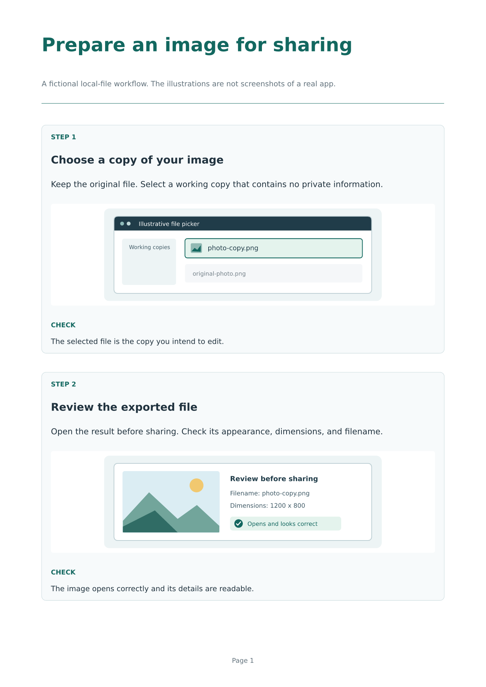

# Idraaak Step Cards

Create short, printable instructions from numbered steps, screenshots, and checks.
Use the same layout in English or Arabic: `lang: "ar"` changes text direction,
interface labels, step numbers, and page numbers. Screenshots retain their own
orientation. This is useful for software handouts, classroom notes, and instructions
that need to remain readable as a PDF.



## Start with the template

```sh
typst init @preview/idraaak-step-cards:0.1.0 my-instructions
cd my-instructions
typst compile main.typ
```

The initialized project includes `main.typ`, a complete Arabic example in
`arabic.typ`, and two original schematic SVG illustrations. The illustrations
describe a fictional file workflow; they are not screenshots of a real app.
Replace them with your own screenshots when explaining an actual interface.

To render the Arabic example:

```sh
typst compile arabic.typ
```

The default font is DejaVu Sans, which supports both languages. It must be available
on the machine or in the Typst web app. You can choose another installed font that
supports the language with the `font` parameter. Font files are not bundled.

## Use in an existing document

```typ
#import "@preview/idraaak-step-cards:0.1.0": step-cards

#show: step-cards.with(
  title: "Check an exported image",
  subtitle: "Keep the original file and review a working copy.",
  lang: "en",
  steps: (
    (
      title: "Open the result",
      instruction: [Open the exported image in an image viewer.],
      check: [The image opens and the important details are readable.],
    ),
    (
      title: "Check the filename",
      instruction: [Use a clear name so you can identify the edited copy.],
    ),
  ),
)
```

Add a `screenshot` field to a step when an image helps. Pass image content rather
than a filename, so the image path is resolved relative to your document:

```typ
screenshot: image(
  "my-screenshot.png",
  width: 100%,
  height: 100%,
  fit: "contain",
  alt: "Describe the screen and the relevant control here.",
),
```

`fit: "contain"` preserves the complete screenshot without cropping. The image
area is 40 mm high with two steps per page, or 105 mm high with one step per page.
For a tall screenshot or a longer explanation, use `per-page: 1`. Keep text concise;
cards do not split across pages, and exceptionally long content can exceed the
available page height. Portrait A4 and US Letter are the tested paper sizes.

## Parameters

| Parameter | Default | Purpose |
| --- | --- | --- |
| `title` | `"Step-by-step notes"` | Document title as a string. |
| `subtitle` | `none` | Optional introductory content on the first page. |
| `steps` | `()` | A non-empty array of step dictionaries. |
| `lang` | `"en"` | `"en"` or `"ar"`; controls direction, labels, and numbering. |
| `paper` | `"a4"` | A paper name supported by `page`, such as `"us-letter"`. |
| `per-page` | `2` | One or two steps per page. |
| `accent` | `rgb("#12675F")` | Heading and rule color. |
| `font` | `"DejaVu Sans"` | A suitable installed font family. |

Each step requires `title` and `instruction` content. `screenshot` and `check` are
optional content fields. Steps are numbered across pages; continuation pages have
a smaller heading. Extra document body content is placed after the final card.

## Arabic example

```typ
#import "@preview/idraaak-step-cards:0.1.0": step-cards

#show: step-cards.with(
  title: "راجع الصورة قبل مشاركتها",
  lang: "ar",
  steps: (
    (
      title: "افتح الصورة",
      instruction: [افتح الملف الناتج وراجع وضوح التفاصيل.],
      check: [تظهر الصورة كاملة دون أجزاء مفقودة.],
    ),
  ),
)
```

`lang` does not translate user-supplied instructions. Write the content in the
chosen language. Mixed-direction phrases may need Typst's normal text direction
controls. For example, use `text(dir: ltr)[photo-copy.png]` for a Latin filename
inside an Arabic instruction.

## Privacy and limits

This package contains Typst layout code and local sample SVGs. It does not upload
screenshots or make network requests. Typst itself may download the package on
first import; projects created in the hosted Typst app are processed by that
service. Remove personal information from screenshots before sharing a project
or its exported document. There is no screenshot capture, OCR, image editing, or
automatic translation.

## License and development

All code, example text, and schematic illustrations are original to this project
and licensed under MIT-0. Users can adapt the template and their resulting
documents without attribution requirements. Screenshots supplied by users remain
subject to their own rights and licenses.

Published by [Idraaak](https://idraaak.com/). AI assistance was used for the initial
implementation, example text, illustrations, documentation, and validation scripts.
The source, test procedure, and checked limitations are available in the
[repository](https://github.com/nedal-dev/idraaak-step-cards).
