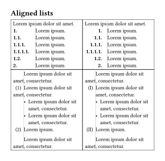
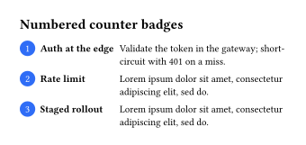
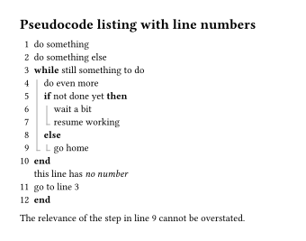
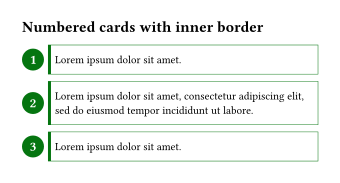
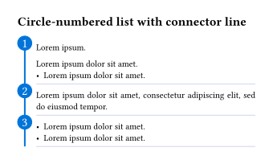
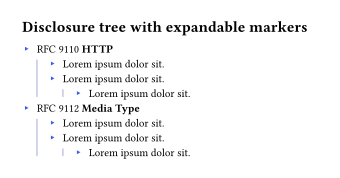
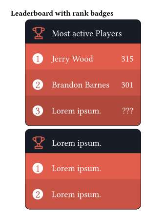
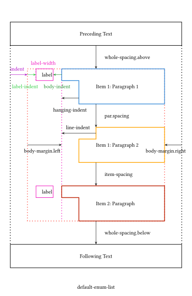

## Overview
The `itemize` package allows users to easily customize `enum` and `list` for Typst. To use this package, include the following at the beginning of your document:

```typst
#import "@preview/itemize:0.3.0" as el
```

Use the method `default-enum-list` to override the native behaviour of `enum` and `list` by adding the following at the beginning of your document:

```typst
#show: el.default-enum-list
```

to apply all `enum` and `list` in your document. Or use
```typst
#el.default-enum-list()[
  /* content */
]
```
to only apply the `enum` and `list` in `/* content */`.

Now you can use `enum` and `list` as usual. `itemize` revises some default behaviors of `enum` and `list` (of Typst 0.15.1):

- Labels on the same line are now aligned with the list;
- If the label has no baseline, bottom alignment is used by default (which better fits common usage).

Below is a comparison.


<details>
<summary>Code:</summary>

```typst
#set page(height: auto, margin: 15pt, width: 12cm)
#import "@preview/itemize:0.3.0" as el
#let test = [
  + + $vec(1, 1, 1)$ #lorem(2)
  #set list(marker: circle(width: 2em))
  - #lorem(2)
]
#table(
  columns: (1fr, 1fr),
  table.header([*Native*], [*Itemize*]),
  [#test],
  [
    #show: el.default-enum-list
    #test
  ],
)
```

</details>

- `itemize` currently does not support exporting to HTML format (see https://github.com/tianyi-smile/itemize/issues/18).
- `itemize:0.3.0` requires at least Typst 0.15.1.
- See [manual.pdf](https://github.com/tianyi-smile/itemize/blob/32bdea794b974e1c66e242dc900af44c88afc245/doc/manual/manual.pdf) and also the source code [manual.typ](https://github.com/tianyi-smile/itemize/blob/32bdea794b974e1c66e242dc900af44c88afc245/doc/manual/manual.typ) for more details. The manual contains the API reference and examples.
- See [changelog.md](https://github.com/tianyi-smile/itemize/blob/32bdea794b974e1c66e242dc900af44c88afc245/changelog/CHANGELOG.md) for the changes and new features for version 0.3.0.
 
### Examples

<table>
<!----->
<tr>
  <td>  
      
  </td>
  <td>
      
  </td>
  <td>
      
  </td>
</tr>
<!----->
<tr>
  <td>  
      
  </td>
  <td>
      
  </td>
  <td>
      
  </td>
<tr>
<!----->
<tr>
  <td>
      
  </td>
  <td>
      
  </td>
  <td>  
      
  </td>
<tr>
<!----->
<tr>
  <td>
      
  </td>
  <td>  
      
  </td>
  <td>  
      
  </td>
<tr>
<!----->
<tr>
  <td>
      
  </td>
  <td>
      
  </td>
  <td>
      
  </td>
</tr>
<!----->
<tr>
  <td>
      
  </td>
  <td>  
      
  </td>
  <td>
      
  </td>
</tr>
<!---->
<tr>
  <td>  
      
  </td>
  <td>
      
  </td>
  <td>
      
  </td>
</tr>
</table>

*Visit the repository [itemize](https://github.com/tianyi-smile/itemize) to get the codes for the above examples.*

## Override `enum` and `list`

The `itemize` package primarily provides the following methods to override the native `enum` and `list`:

- `default`-style (Typst's native style): `default-enum-list`, `default-enum`, `default-list`.
- `paragraph`-style: `paragraph-enum-list`, `paragraph-enum`, `paragraph-list`.
  - This is equivalent to using `default-enum-list.with(hanging-type: "paragraph")`.
- `inline`-style: `inline-enum-list`, `inline-enum`, `inline-list`.
  - Any `block-level` elements appearing in the item body are laid out flush left.
  - Contents at every level of the list span the full width of the parent container.
  - Because of this paragraph behavior, some features of `default-enum-list` (`default-enum`, `default-list`) no longer take effect (`label-baseline`, `border` of `body-format`, `body-margin`, `auto-label-width`, and `auto-resuming`).

By default, the `default-*` methods indent paragraphs after the item label, while the `paragraph-*` methods align paragraphs with the item label.
`inline-*` methods interpret the list content as paragraphs.

See the example below:

<a>

</a>

<details>
<summary>Code:</summary>

```typst
#import "@preview/itemize:0.3.0" as el
#set page(height: auto, margin: 35pt)

#[
  #let test = [
    + #lorem(8)

      #lorem(8)
      + #lorem(8)

        #lorem(8)
      + #lorem(8)
    + #lorem(8)
    - #lorem(8)
      - #lorem(8)
    + - + - #lorem(8)
  ]
  #table(
    columns: (1fr, 1fr),
    [
      default-style
      ```typ
      #set enum(numbering: "(A).(I).(i)")
      #show: el.default-enum-list
      ```
    ],
    [
      paragraph-style
      ```typ
      #set enum(numbering: "(A).(I).(i)")
      #show: el.paragraph-enum-list
      ```
    ],

    [
      #set enum(numbering: "(A).(I).(i)")
      #show: el.default-enum-list
      #test
    ],
    [
      #set enum(numbering: "(A).(I).(i)")
      #show: el.paragraph-enum-list
      #test
    ],
  )
]

#[
  #let test = [
    #set block(stroke: red) // debug
    #lorem(8)
    $
      a^2 + b^2 = c^2
    $
    + #lorem(8)
      $
        a^2 + b^2 = c^2
      $
      #lorem(8)
      + #lorem(8)

        #lorem(8)
      + #lorem(8)
        #block[*Block:* #lorem(8)]
    + #lorem(8)
    - #lorem(8)
      - #lorem(8)
    + - + - #lorem(8)
  ]
  #table(
    columns: (1fr, 1fr),
    [
      default-inline
      ```typ
      #set enum(numbering: "(A).(I).(i)")
      #show: el.inline-enum-list
      ```
    ],
    [
      paragraph-inline
      ```typ
      #set enum(numbering: "(A).(I).(i)")
      #show: el.inline-enum-list.with(hanging-type: "paragraph")
      ```
    ],

    [
      #set enum(numbering: "(A).(I).(i)")
      #show: el.inline-enum-list
      #test
    ],
    [
      #set enum(numbering: "(A).(I).(i)")
      #show: el.inline-enum-list.with(hanging-type: "paragraph")
      #test
    ],
  )
]
```

</details>

## Model

The diagram below illustrates the model for `enum` and `list` in `itemize`.
- `enum` and `list` consist of multiple items.
- Each item is composed of a `label` and a `body`:
  - `label` (`item label`): The enum number or list marker
    - Also, including the spacings: `label-indent`, `body-indent`.
  - `body` (`item body`): The content following the label.
- Level (`level`): Starts from 1, and increments if an item contains nested items.
- Item index (`n`): Starts from 1. The index of items in the same level.

Now (since version 0.3.0), each of the `default-*`, `paragraph-*`, and `inline-*` methods will have a separately maintained level counter. When the method is used, its level will start counting from 1 again. If you want to use the level counting from `itemize 0.2.0` (where a single level counter is maintained throughout the entire document), you need to set the parameter `auto-base-level` to `false`.

<a>

</a>

<details>
<summary>Code Example:</summary>

```typst
#set page(height: auto, margin: 15pt, width: 12cm)
#import "@preview/itemize:0.3.0" as el
#set par(justify: true)
#set align(left)
#show: el.default-enum-list.with(
  indent: 1em,
  label-align: right,
  label-width: 3em,
  label-format: (stroke: red),
  body-indent: 1em,
  hanging-indent: 2em,
  line-indent: 4em,
  body-margin: (right: 1em),
  whole-spacing: 2.5em,
  item-spacing: 2em,
  body-format: (
    whole: (stroke: blue, inset: 5pt),
    inner: (stroke: green, inset: 2pt),
  )
)
Preceding Text. #lorem(10)
1. Item 1: Paragraph 1. #lorem(10)

  Paragraph 2. #lorem(10)

100. Item 2. #lorem(10)
Following Text. #lorem(10)
```

Output:


</details>

## Features

Using `itemize`, you can customize the _labels_ and _bodies_ of `enum` and `list` for each *level* and each *item*.

> *Visit the repository [itemize](https://github.com/tianyi-smile/itemize) for codes and examples.*

### Support for styling by level and item
  - Most parameters support being set per level and per item, which is achieved by passing an `array` or a `function`. In the API Reference, these are marked as `array` (level-property) and `function` (level-property).
  - `array` (level-property): Each element of the `array` sets the style of the item at the corresponding level; that is, the value at array index `l` sets the style of the item at level `l + 1`.
    - If the last element of the array is `LOOP`, the values in the array will be used cyclically;
    - otherwise, the last element's value applies to subsequent levels.
    - If the parameter allows setting the style of an individual item, then an element of the array may itself be an `array`, used to set the style of the items at the current level: for example, if the element at index `l` is an array `arrayItem`, then the element at index `n` of `arrayItem` sets the style of the `(n + 1)`-th item at level `l + 1`. Similarly,
      - If the last element of `arrayItem` is `LOOP`, the values in the array will be used cyclically for other indexes of items;
      - otherwise, the last element's value applies to subsequent indexes of items.
  - `function` (level-property): If it is a `function`, its form is `it => value`, where `value` is one of the values allowed by the parameter (in most cases).
    - You can usually access the relevant values provided by `itemize` through the keys available on `it`, for example:
      - `it.level`: The level of the item, starting from 1.
      - `it.n-last`: The index of the last item in the current level.
      - `it.e`: The field of the current construct element (`enum`, `list`), but excluding the `children`.
      - `it.n`: The index of the item, starting from 1.
      
      ... (For more accessible values, see the API Reference)
### Separating setting of `enum` and `list`
  - Set the styles of `enum` and `list` separately through the parameters `enum-config` and `list-config`.
  - Also, use `*-enum` and `*-list` methods to set the styles of `enum` and `list` separately.

### Individual setting
  - Set the style for the current item separately through the `item` method.
  - Use `item` to set `tag` and `elem-tag` attributes, then format items or lists with these attributes.

It must be placed between the label and the body, for example:
```typst
+ #el.item(/* args */) body
```

### Different styles of description list
  - Checklist: Enable through the parameter `checklist`, and configure through the method `config:checklist`.
    - Using the syntax `- [ ] body`
  - Terms-like description list: Change the item label of the current item (`enum` or `list`) using the `item` method.
    - Using the syntax `- #el.item([..]) body` and `+ #el.item([..]) body`
  - Horizontal description list, hanging description list, stacked description list, plain description list:
    - Using the syntax `+ / term: description` and `- / term: description`
    - Configure through the argument `description-config`.
  - Checklist description list
    - *Note*: In order to enable checklist style, the `checklist` in `default-*` (or `paragraph-*`) must be `true`.

### Item label formatting

  - Setting the _text style_ of item label: `..args`
  - Label alignment: `label-align`
  - Horizontal movement of the label: `label-inset`
  - Vertical movement of the label: `label-baseline`
  - Setting the label width: `label-width`
    - Allow different `enum` and `list` to share the maximum label width: `auto-label-width`
  - Formatting the label in any way: `label-format`
    - Support setting the _border_ of the label.
  - Setting the step size for `enum` numbers: `step`
### Item body formatting
  - Formatting the body in any way (_text style_, `border`, etc): `body-format`

### Horizontal spacing setting
  - The indentation of the item: `indent`
  - The indentation for the label: `label-indent`
  - The indentation between the item label and the item body: `body-indent`
  - The item body margin: `body-margin`

### Vertical spacing setting
  - The above and below spacing of whole `enum` or `list`: `whole-spacing`
    - Different compact modes: `tight-mode`
  - The above and below spacing of each item: `item-spacing`
    - Different compact modes: `tight-item-mode`

### Referencing `enum` number and item label

To enable this feature, use the method `config:ref` like the following at the beginning of the document:

```typst
#show: el.config.ref
```

> Usage: 
> - In the enum item you want to reference, label it with `<some-label>`, and then use `@<some-label>` to reference the enum number of that item.
> - If the enum number cannot be retrieved correctly, use the method `elabel` to label the enum item.

  - Support relative form references
  - Allow using `ref-numbering` and `supplement` to set citation styles for different `enum`s
  - Support referencing item labels for `enum` and `list`.

### Resuming `enum` number
Enable through the parameter `auto-resuming`, and use in conjunction with the methods `resume`, `resume-label`, `resume-list`, `auto-resume-enum`.

- Set `auto-resuming` to `auto`. Then you can use the following methods:
  1. `resume` is to continue using the enum numbers from the previous enum at the same level.
  2. Use the method `resume-label` to label the enum you want to resume, and then use `resume-list` in the desired enum to continue using the labelled enum numbers.
  3. Use the method `auto-resume-enum[..]` and the `enum` numbers in `[..]` will continue from the previous ones.
- If `auto-resuming` is set to `true`, then all enum numbers will continue from the previous ones.

### Body paragraph setting
  - The indentation of the first line for first paragraph in item body: `first-line-inset`
  - The line indentation  for paragraphs in item body: `line-indent`
  - The hanging indentation for paragraphs in item body: `hanging-indent`
      - **Note**: Paragraphs inside `block-level` elements that appear in the item body are not processed.

## Acknowledge

- [@pacaunt](https://github.com/typst/typst/issues/1204#issuecomment-2909417340)
- [@Andrew](https://forum.typst.app/t/can-i-use-show-rule-only-in-content-of-enum-but-not-numbering/4590/2)
- [cheq](https://typst.app/universe/package/cheq)
- [@cady-b](https://github.com/tianyi-smile/itemize/issues/9)

## License

This project is licensed under the MIT License.
