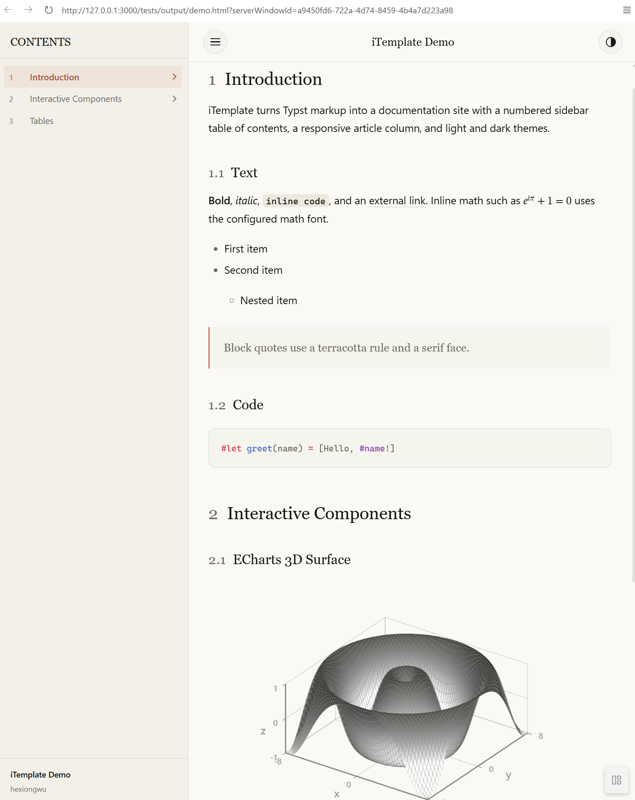

# itemplate

`itemplate` turns Typst markup into a documentation site with a modern academic look: a numbered, collapsible sidebar table of contents, a responsive article column, horizontally scrolling tables with a fullscreen view, default, paper, green, and dark themes, and a built-in import map for `echarts`, `echarts-gl`, and `plotly`. Developed completely by AI tools, can't guarantee stability and reliability, use with caution.

## Usage

````typst
#import "@preview/itemplate:1.0.0": *

#show: itemplate.with(
  doc-title: "iTemplate Demo",
  doc-author: "hexiongwu",
  lang: "en",
)

= Introduction

iTemplate turns Typst markup into a documentation site with a numbered sidebar table of contents, a responsive article column, and default, paper, green, and dark themes.

== Text

*Bold*, _italic_, `inline code`, and an #link("https://typst.app")[external link]. Inline math such as $e^(i pi) + 1 = 0$ uses the configured math font.

- First item
- Second item
  - Nested item

#quote(block: true)[Block quotes use an accent-colored rule and a serif face.]

== Code

```typst
#let greet(name) = [Hello, #name!]
```

= Interactive Components

== ECharts 3D Surface

#context if (target() == "html") {
  html.elem("div", attrs: (
    id: "echarts-surface",
    style: "width: 100%; height: 420px; margin-top: 12px;",
  ))[]

  html.script(
    type: "module",
    ```js
    import * as echarts from "echarts";
    // The UMD build of echarts-gl reads the main library from window.echarts
    window.echarts = echarts;
    await import("echarts-gl");

    const el = document.getElementById("echarts-surface");
    if (el) {
      const range = 8;
      const step = 0.25;
      const data = [];
      for (let x = -range; x <= range + 1e-6; x += step) {
        for (let y = -range; y <= range + 1e-6; y += step) {
          data.push([x, y, Math.sin(Math.sqrt(x * x + y * y))]);
        }
      }

      const ink = "#8a8a86";
      const axis = {
        axisLabel: { color: ink },
        axisLine: { lineStyle: { color: ink } },
        splitLine: { lineStyle: { color: ink, opacity: 0.35 } },
        nameTextStyle: { color: ink },
      };

      const chart = echarts.init(el);
      chart.setOption({
        tooltip: { show: false },
        visualMap: {
          show: false,
          dimension: 2,
          min: -1,
          max: 1,
          inRange: { color: ["#f2f2f2", "#bdbdbd", "#737373", "#3b3b39"] },
        },
        xAxis3D: { type: "value", name: "x", min: -range, max: range, interval: range, ...axis },
        yAxis3D: { type: "value", name: "y", min: -range, max: range, interval: range, ...axis },
        zAxis3D: { type: "value", name: "z", min: -1, max: 1, interval: 1, ...axis },
        grid3D: {
          boxWidth: 100,
          boxDepth: 100,
          boxHeight: 45,
          viewControl: { projection: "orthographic", distance: 190, alpha: 28, beta: 35 },
          light: { main: { intensity: 1.15 }, ambient: { intensity: 0.35 } },
          axisPointer: { show: false },
        },
        series: [{
          type: "surface",
          data,
          wireframe: { show: true, lineStyle: { color: ink, width: 0.5 } },
        }],
      });
      window.addEventListener("resize", () => chart.resize());
    }
    ```.text,
  )
}

= Tables

#table(
  columns: 3,
  [*Feature*], [*Status*], [*Notes*],
  [Sidebar], [Done], [Numbered, collapsible, resizable],
  [Tables], [Done], [Horizontal scroll and fullscreen],
)

Wide tables scroll inside their own container instead of stretching the page.
````

`doc-title` is shown in the top bar and sidebar footer; `doc-author` is optional.

### `heading-numbering`

Numbering pattern applied to headings. Defaults to `"1.1.1"`.

```typst
#show: itemplate.with(
  // "1.1.1" (default), "1.1", or `none` to hide numbers
  heading-numbering: "1.1",
)
```

Pass `none` to hide heading numbers; anchors stay unique and the TOC still lists every section. A `#set heading(numbering: ...)` placed *after* the show rule still takes precedence, so document-level rules win. A `#set` placed *before* the show rule is overwritten by this parameter — use the argument instead.

### `import-map`

Controls the `<script type="importmap">` emitted for client-side modules. Defaults to `auto`, which emits the bundled `default-import-map`:

`three`, `three/addons/`, `cannon-es`, `fundamental-physical-constants`, `plotly`, `echarts`, `echarts-gl`.

Pass a dictionary to replace it, merge your own entries into the defaults with `default-import-map + (...)`, or pass `(:)` to emit no import map:

```typst
// Keep the defaults and add d3
#show: itemplate.with(
  import-map: default-import-map + (
    "d3": "https://cdn.jsdelivr.net/npm/d3@7/+esm",
  ),
)

// Replace the defaults entirely
#show: itemplate.with(
  import-map: ("d3": "https://cdn.jsdelivr.net/npm/d3@7/+esm"),
)

// Disable the import map
#show: itemplate.with(import-map: (:))
```

Client-side interface labels follow `lang`: `zh*` uses the Chinese dictionary, everything else falls back to English.

The ECharts surface needs WebGL. Without JavaScript the container stays blank, so place charts in sections that read fine without them.

## Theme

Override any token; values may be Typst colors or raw CSS color strings. Each theme has its own override parameter, so changing one theme never affects the others. There is no shared `theme` parameter — paper and green have very different color styles, so a single shared palette is hard to tune consistently. The page starts in the default theme, and the theme button cycles default → paper → green → dark.

```typst
#show: itemplate.with(
  // Override only the default theme.
  default-theme: (accent: "#20609f"),
  // Override only the paper theme.
  paper-theme: (bg: "#faf9f5", "sidebar-bg": "#f2f0e9"),
  // Override only the green theme.
  green-theme: (bg: "#f6f9f3", "sidebar-bg": "#eff5ea"),
  // Override only the dark theme.
  dark-theme: (accent: "#d97757"),
)
```

Available tokens: `bg`, `surface`, `surface-strong`, `ink`, `ink-muted`, `ink-faint`, `line`, `line-strong`, `accent`, `accent-soft`, `accent-ink`, `sidebar-bg`, `header-bg`, `code-bg`, `selection`, `overlay`, `font-ui`, `font-serif`, `font-mono`, `font-math` (defaults in `lib.typ`).

## Compile

```powershell
typst compile --root . examples/demo.typ --features html --format html
```



HTML export is under active development, so the emitted markup may change between Typst releases. `bundle` export is unsupported; a PDF target renders the body without the HTML shell.

## Repository layout

| Path | Contents |
| --- | --- |
| `lib.typ` | Package entrypoint: template logic, TOC, and HTML shell |
| `src/` | Stylesheet and client-side interaction modules |
| `examples/` | Compilable demo (`demo.typ`) |
| `tests/` | Smoke tests and their Typst fixtures |
| `docs/` | Maintenance and publishing notes |
| `assets/` | Repository screenshots (excluded from the package) |

## Changelog

### v1.0.0 — 2026-11-18

- **Breaking**: Removed the shared `theme` parameter. Each theme now has its own override parameter (`default-theme`, `paper-theme`, `green-theme`, `dark-theme`), so customizing one theme never affects the others.
- Added `default-theme` parameter for overriding the default theme specifically.
- **Breaking**: The module-level palette constant `default-theme` is now `default-theme-base`, since `default-theme` is the new parameter name.

### v0.9.0 — 2026-11-17

- Fixed heading IDs, theme colors, numbering, default author, deep headings, and the table of contents.
- Improved mobile use, keyboard focus, color contrast.
- Split CSS and client code into smaller files.
- Hide the mobile topbar while scrolling, keeping it visible only at the top of the document.

### v0.8.0 — 2026-11-16

- **Features**:
  - Add green theme and three-state theme switcher (light → green → dark)
  - Add built-in import map for `three`, `echarts`, `echarts-gl`, `plotly`, `cannon-es`, and `fundamental-physical-constants`, with support for custom merging or replacement
  - Add i18n support: client-side labels switch automatically between English and Chinese based on `lang`
  - Recolor theme to the Claudette warm paper palette
  - Add interactive ECharts 3D surface chart example
  - Add plotly.js support
- **UX**: Improve touch-drawer swipe behavior on mobile (`fix(touch drawer)`)
- **Build**: Optimize Google Fonts CDN endpoint for China access; reorder math font loading
- **Docs**: Rewrite README, expand `heading-numbering` and `import-map` parameter documentation

### v0.7.0 — 2026-11-10

- **Features**:
  - Add customizable theme system (CSS variables / theme tokens). `theme` and `dark-theme` parameters can override any semantic token
  - Refactor sidebar / TOC JavaScript code
- **Refactor**: Remove unused heading numbering and "expand all TOC" related code
- **Build**: Update `typst.toml` exclude configuration

### v0.6.0 — 2026-11-09

- **Features**:
  - Add HTML styling and SVG / image display utilities
  - Add mobile touch-swipe sidebar interaction (swipe right to open, swipe left to close)
- **Docs**: Remove empty lines from README, drop unused heading numbering code

### v0.5.0 — 2026-10-11

- **Breaking**: Switch from `bundle` export to `html` export; `bundle` targets now emit an explicit unsupported message
- **Fix**: Remove the extra trailing period in heading numbering

### v0.4.0 — 2026-10-09

- Switch math font family to NewComputerModern
- Rename the entrypoint file
- Initial publishable release
