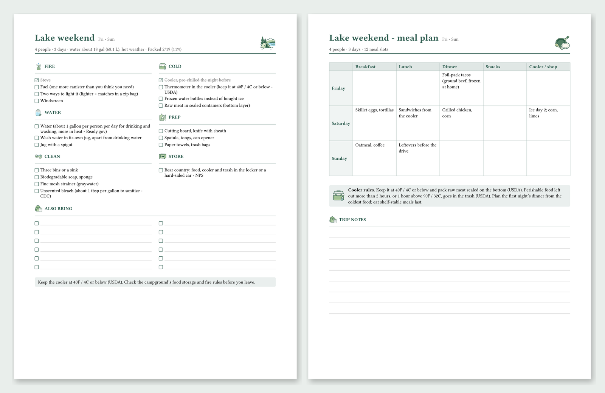
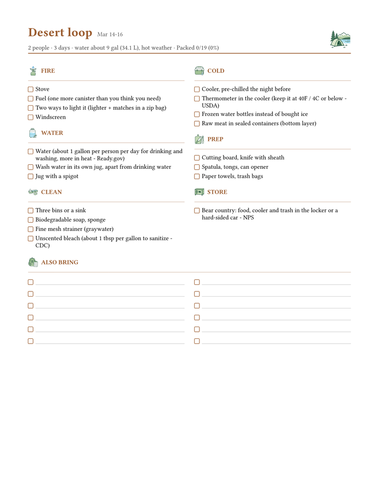

# kindling-packing-list

A two-page camping trip kit for print: a packing list made from a plain-text
`.camp` checklist, and a meal plan for the same trip.

- The packing sheet shows a water estimate for your group and ticks off and
  strikes through packed items. It also leaves blank lines for things you think
  of at the last minute.
- The meal plan has one row per day and one column per meal, plus a
  cooler/shopping column, the cooler rules and lined space for notes.
- Sections such as Fire, Cold, Water, Prep, Clean and Store get small drawn
  icons.
- Five colour themes are included.



## Quick start

Start a new project from the template. In the web app, click *Start from template*
and search for `kindling-packing-list`. With the CLI, run:

```
typst init @preview/kindling-packing-list:0.1.0 my-trip
```

Then edit `trip.camp`:

```text
# Fire
- [x] Stove
- [ ] Fuel (one more canister than you think you need)
# Water
- [ ] Water (about 1 gallon per person per day for drinking and washing, more in heat - Ready.gov)
```

A line that starts with `#` is a section. `- [ ] item` is still to pack, and
`- [x] item` is packed. `*` and `+` bullets work too, and you can indent items.
This is the same `.camp` format the CampChecklist editor packages use, so a list
you keep in VS Code, Sublime Text or Vim prints as it is.

## Use it in your own document

```typ
#import "@preview/kindling-packing-list:0.1.0": packing-sheet, starter-list

#packing-sheet(
  camp: read("trip.camp"), // or starter-list
  trip: "Lake weekend",
  dates: "Fri - Sun",
  people: 4,
  days: 3,
  hot: true,               // adds 50% to the water estimate
  theme: "lake",           // forest, lake, desert, ember, slate
  extra: 6,                // rows of blank lines
  notes: [Check the campground's food storage and fire rules.],
)

#pagebreak()

#meal-plan(
  trip: "Lake weekend",
  people: 4,
  day-names: ("Friday", "Saturday", "Sunday"), // or days: 3
  theme: "lake",
  plan: (
    "Friday": (Dinner: [Foil-pack tacos]),
    "Saturday": (Breakfast: [Skillet eggs], "Cooler / shop": [Ice day 2]),
  ),
)
```

(Import `meal-plan` as well: `#import "@preview/kindling-packing-list:0.1.0": packing-sheet, meal-plan, starter-list`.)

| Parameter | Default | Meaning |
|---|---|---|
| `camp` | `starter-list` | `.camp` text |
| `trip`, `dates` | `"Camping trip"`, `none` | header |
| `people`, `days`, `hot` | `2`, `2`, `false` | water estimate: about 1 US gallon per person per day (Ready.gov), +50% when `hot` |
| `columns` | `2` | Whole sections are kept together and spread so the columns end at similar heights |
| `extra` | `0` | rows of blank checkbox lines under "Also bring" |
| `notes` | `none` | content shown in a box at the bottom |
| `theme` | `"forest"` | `"forest"`, `"lake"`, `"desert"`, `"ember"` or `"slate"` |
| `accent` | `none` | any colour; overrides `theme` |
| `icons` | `true` | draw an icon next to sections it recognises, and the camp picture in the header |

### `meal-plan`

| Parameter | Default | Meaning |
|---|---|---|
| `days` or `day-names` | `2`, `none` | rows: "Day 1", "Day 2", ... or your own names |
| `meals` | Breakfast, Lunch, Dinner, Snacks | columns |
| `plan` | `(:)` | pre-filled cells: `("Day name": (Meal: [dish]))` |
| `shopping` | `true` | add the "Cooler / shop" column |
| `rules` | `true` | the cooler and 2-hour rules box (USDA) |
| `note-lines` | `8` | ruled lines for trip notes |
| `row-height` | `6.5em` | minimum row height for writing by hand |
| `trip`, `dates`, `people`, `theme`, `accent`, `icons` | | as for `packing-sheet` |

### Themes and icons



A section title picks its icon by keyword, for example "Fire" or "Stove", "Cold"
or "Cooler", "Water", "Prep", "Clean" or "Dishes", "Store" or "Bear", "Cook",
"Camp" or "Tent", and "Gear" or "Bring". Titles with no match get no icon.
`icon-key(title)` tells you which icon a title gets, and `icon(key)` draws one.

The building blocks are exported too:

- `parse-camp(text)` gives an array of `(title, items)` sections.
- `progress(sections)` gives `(packed, total)`.
- `status-text(packed, total)` gives a line like "Packed 12/22 (55%)".
- `water-estimate(people:, days:, hot:)` gives gallons and liters.
- `checklist(sections, columns:, icons:)` draws the sections only, without the header.
- `theme-color(theme:, accent:)`, `icon-key(title)`, `icon(key)` and `day-labels(days)` support the themes, icons and meal-plan rows.

## The starter list

`starter-list` is a car-camping kitchen list with 19 items in six sections:
Fire, Cold, Water, Prep, Clean and Store. Each number in it names its source:

- keep the cooler at 40F / 4C or below (USDA);
- about 1 gallon of water per person per day (Ready.gov);
- about 1 tablespoon of unscented bleach per gallon to sanitize (CDC);
- food storage in bear country (NPS).

Rules differ by park, so check your campground's rules before a trip. The list
follows the camp kitchen guides at [Camp Kitchen US](https://campkitchen.us/).

## License

MIT, for the code and for the icons in `icons/`. Made by Camp Kitchen US.

The parser, themes and icon lookup are checked by 29 assertions in
`tests/test.typ`. The template was compiled and checked visually with Typst 0.15.
