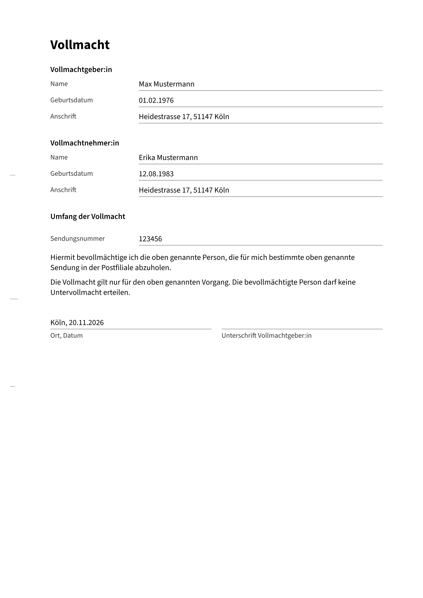

# typst-letter-of-attorney

A template for creating a letter of attorney in German (A4).

## Example



## Code

```typst
#import "@preview/letter-of-attorney:1.0.0": letter-of-attorney

#set text(lang: "de")

#show: letter-of-attorney.with(
  font: "Source Sans 3",
  grantor: (
    name: "Max Mustermann",
    date-of-birth: "01.02.1976",
    address: "Heidestrasse 17, 51147 Köln",
  ),
  grantee: (
    name: "Erika Mustermann",
    date-of-birth: "12.08.1983",
    address: "Heidestrasse 17, 51147 Köln",
  ),
  extra-fields: (
    ([Sendungsnummer], [123456]),
  ),
  location: "Köln",
  date: "20.11.2026",
)

Hiermit bevollmächtige ich die oben genannte Person, die für mich bestimmte
oben genannte Sendung in der Postfiliale abzuholen.

Die Vollmacht gilt nur für den oben genannten Vorgang. Die bevollmächtigte Person darf keine Untervollmacht erteilen.
```

## Usage

```sh
$ typst init @preview/letter-of-attorney
```

## Acknowledgements

This project is inspired by the following projects and resources:

- [typst-letter-pro](https://github.com/Sematre/typst-letter-pro)
- [Postvollmacht zur Abholung in der Filiale](https://www.deutschepost.de/de/p/postvollmacht.html)
- [Vollmacht Vorlage](https://din5008.net/vollmacht-vorlage/)

## License

MIT
