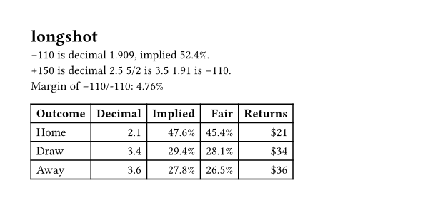

# longshot

Convert between American, decimal and fractional odds, read the implied probability of a price, and remove the bookmaker margin from a full market. Pure Typst, no plugins.



## Usage

```typ
#import "@preview/longshot:0.1.0": *

#let d = american-to-decimal(-110)   // 1.909...
#pct(implied(d))                      // "52.4%"
#fmt-american(decimal-to-american(2.5))  // "+150"
#fractional-to-decimal(5, 2)         // 3.5

// Margin of a two-way market at -110 / -110
#pct(margin((d, d)), digits: 2)      // "4.76%"

// Fair (no-margin) chances of a three-way soccer market
#fair((2.10, 3.40, 3.60))            // (0.454, 0.281, 0.265)

#market-table((2.10, 3.40, 3.60), labels: ("Home", "Draw", "Away"))
```

## Functions

| Function | What it returns |
|---|---|
| `american-to-decimal(a)` | Decimal odds from an American price (`-110`, `150`) |
| `fractional-to-decimal(num, den)` | Decimal odds from a fractional price (`5, 2` for 5/2) |
| `decimal-to-american(d)` | Rounded American price |
| `fmt-american(a)` | American price as text with its sign |
| `implied(d)` | Implied probability, margin included |
| `margin(prices)` | Bookmaker margin (overround) of a full market |
| `fair(prices)` | No-margin probabilities, proportional method |
| `returns(d, stake: 10)` | Total return on a stake, stake included |
| `pct(p, digits: 1)` | Probability as a percentage string |
| `market-table(prices, labels: none, stake: 10)` | A table with decimal, implied, fair and returns columns |

The proportional method divides each implied probability by their sum. It is the simplest margin-removal method and the one most odds converters use.

A worked explanation of each format and of the margin is on the [odds converter page](https://betbetter.world/tools/odds-converter).

## License

MIT
