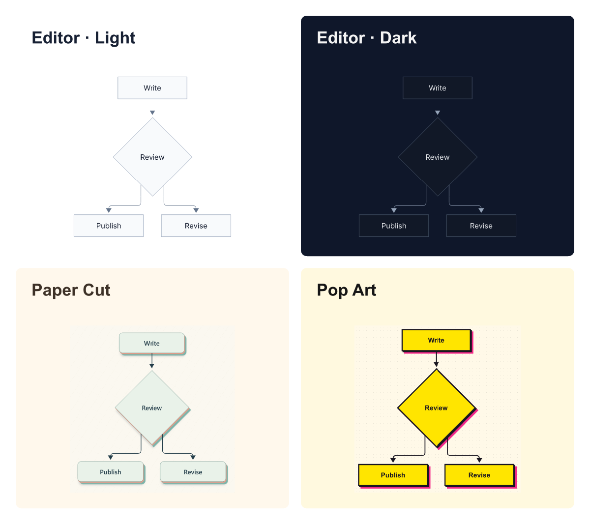
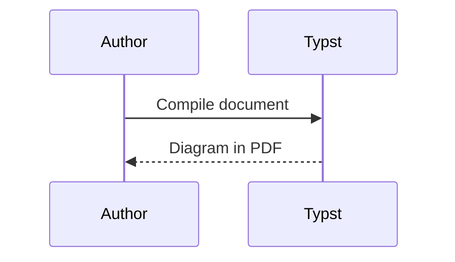
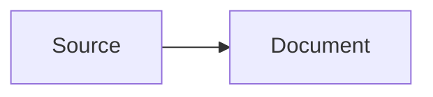

# merman

Render Mermaid diagrams directly in your Typst documents. Write a diagram, choose a theme, and use it as an image, a numbered figure, or a Mermaid code block.

Package **0.6.0** bundles the Merman **0.10.0** Rust renderer as a WebAssembly plugin, targeting Mermaid **12.3.0** behavior. Requires **Typst 0.15.0 or newer**.

## Quick Start

Save this as `document.typ`:

```typst
#import "@preview/merman:0.6.0": mermaid

#mermaid("
flowchart LR
  A[Write Mermaid] --> B[Compile with Typst]
  B --> C[Read your PDF]
")
```

Compile it with `typst compile document.typ document.pdf`, or paste it into the Typst web app.

Next: [choose a theme](#choose-a-theme), [use diagrams in documents](#use-diagrams-in-documents), or [edit a theme recipe](#edit-a-theme-recipe-alpha). For an existing document, see [Upgrading](#upgrading).

## Choose a Theme

The same Mermaid source, rendered by this Typst package in four styles:



[Try and edit themes in the Playground](https://frankorz.com/merman/) · [Runnable gallery source](examples/theme-gallery.typ). The image includes its own backgrounds, so the light and dark samples remain visible on either page appearance.

```typst
#import "@preview/merman:0.6.0": mermaid

#let source = "flowchart TD
  A[Write] --> B{Review}
  B --> C[Publish]
  B --> D[Revise]
"

#mermaid(source, theme-preset: "editor", theme-appearance: "light")
#mermaid(source, theme-preset: "editor", theme-appearance: "dark")
#mermaid(source, theme-preset: "paper-cut")
#mermaid(source, theme-preset: "pop-art")
```

Use `theme-preset` for the Merman designs shown here; `theme-name` and `theme-variables` configure Mermaid's own theme.

Choose from **11 designs with 14 concrete appearances**:

| Preset ID | Available appearances | Default |
| --- | --- | --- |
| `editor`, `gruvbox`, `ayu` | `light`, `dark` | `light` |
| `one-dark`, `cyberpunk` | `dark` | `dark` |
| `brutalist`, `spotless`, `ghibli`, `paper-cut`, `carbon-copy`, `pop-art` | `light` | `light` |

An omitted `theme-appearance` uses the design's default. An unavailable mode fails; Paper Cut, Carbon Copy, and Pop Art are Light-only. Concrete IDs such as `editor-dark` remain supported with their fixed appearance. Automatic modes are not accepted, and the plugin does not detect the viewer's color mode: resolve that preference before selecting `light` or `dark`.

There are three ways to supply a compiled theme:

| Parameter | Use it for |
| --- | --- |
| `theme-preset` | A built-in design by ID. |
| `theme-recipe` | A complete editable `ThemeRecipeV1` dictionary, including a saved Playground export or `export-theme-preset(...)`. |
| `diagram-theme` | One complete, concrete `DiagramThemeSpec` body, wrapped as top-level `theme.spec`. |

Select at most one source in a profile and at most one at the call site. A direct source replaces the profile's source **and its appearance**. With no new source, a direct `theme-appearance` changes the profile's mode. A concrete `diagram-theme` cannot take an appearance selector. These rules apply to images, figures, SVG/results, and raw blocks.

Presets and authoring remain **Alpha**. Use [theme-catalog](#theme-catalog-alpha) to discover the installed plugin's catalog; availability does not qualify every diagram family or effect for Typst output.

## Use Diagrams in Documents

### Raw Blocks

Turn Mermaid fences into diagrams with one show rule:

````typst
#import "@preview/merman:0.6.0": show-mermaid-blocks

#show raw.where(lang: "mermaid"): show-mermaid-blocks(
  theme-preset: "editor",
  document-context: true,
  width: 100%,
)


````

Raw-block handlers default to `error-mode: "placeholder"`: an invalid fence stays visible as a marked block. Use `error-mode: "panic"` to fail the compile on the first rendering error. Avoid a fixed `id` in a document-wide show rule unless it handles only one diagram; otherwise the SVG IDs repeat.

### Set document defaults

As an ordinary Typst function, `mermaid` takes reusable defaults through `.with(...)`. Bind a profile to your own `diagram` function and use that same profile in the raw-block rule:

````typst
#import "@preview/merman:0.6.0": mermaid, mermaid-profile, show-mermaid-blocks

#let diagram-style = mermaid-profile(
  theme-preset: "editor",
  theme-appearance: "light",
)
#let diagram = mermaid.with(
  profile: diagram-style,
  document-context: true,
  width: 100%,
)
#show raw.where(lang: "mermaid"): show-mermaid-blocks(
  profile: diagram-style,
  document-context: true,
  width: 100%,
)

#diagram("flowchart LR\n  Source --> Document")


````

Single calls can still override arguments, for example `diagram("flowchart LR\nA --> B", theme-preset: "paper-cut")`; the [theme source and appearance rules](#choose-a-theme) still apply. For chapters, keep the profile and configured function in a shared `diagrams.typ`, import them where needed, and install the raw-block show rule in the main document.

### Figures and Profiles

Keep common diagram settings in a profile, then reuse them for images, figures, and raw blocks:

```typst
#import "@preview/merman:0.6.0": (
  mermaid, mermaid-figure, mermaid-profile, show-mermaid-blocks,
)

#let source = "flowchart LR\n  Draft --> Review\n  Review --> Publish"
#let diagrams = mermaid-profile(
  theme-preset: "editor",
  background: "#ffffff",
  typography: (font: ("Arial", "sans-serif"), size: "16px"),
  figure: (caption-position: top, gap: 1em, outlined: false),
)

#mermaid(source, profile: diagrams, width: 100%)

#mermaid-figure(
  source,
  profile: diagrams,
  caption: [The publishing workflow.],
  width: 100%,
  alt: "Draft, review, and publish",
) <publishing>

See @publishing for the workflow.

#show raw.where(lang: "mermaid"): show-mermaid-blocks(profile: diagrams)

#raw(source, lang: "mermaid", block: true)
```

Profiles also work with `mermaid-svg`, `mermaid-result`, and `analyze-mermaid`. The optional `figure` dictionary is consumed only by `mermaid-figure`; it does not change SVG exports or ordinary images. Direct figure parameters override `profile.figure`. See [option precedence](#option-precedence) before mixing full configuration objects and shorthands.

### Document Fonts

Rendering is explicit by default. Set `document-context: true` to forward the current Typst font, text size, and finite available width, or supply font intent yourself:

```typst
#import "@preview/merman:0.6.0": mermaid

#set text(font: "Arial", size: 12pt)
#let source = "flowchart LR\n  Document --> Diagram"

#mermaid(source, document-context: true, width: 100%)

#mermaid(
  source,
  theme-preset: "editor",
  typography: (font: ("Arial", "sans-serif"), size: "16px"),
  width: 100%,
)
```

`typography.size` accepts CSS `px` strings, absolute Typst lengths, or numeric CSS pixels. Lengths use SVG's 96-DPI coordinates (`72pt == 96px`), producing the same numeric `font_size_px` for layout and SVG. Font descriptors become ordered family names in `theme.spec.typography.default.font_stack`; their `covers` constraints have no CSS or deterministic-measurer equivalent and are not preserved. Font names do not embed or install fonts.

**Font measurement:** typography and document context forward style intent; the plugin uses its built-in `deterministic` measurer, not the exact glyphs in Typst's font files. This transport has neither Typst font-asset measurement nor browser-style host callbacks. Other transports may install a host callback when their final display stack is authoritative. Check wrapping in the final document when font metrics matter.

Presets and recipes compose with `typography` and document context through the shared public materializer when needed. The overlay changes only `typography.default`; authored family fonts and role sizes or weights still win. The three art designs retain their family fonts: edit their shared font tokens to change those fonts throughout a recipe. On an auto-width page the outer width is infinite, so the context bridge keeps the renderer default instead of serializing infinity.

## Edit a Theme Recipe (Alpha)

For a visual workflow, open the [Playground](https://frankorz.com/merman/), preview and edit a design, then export its portable theme recipe JSON as `custom.theme.json`. Keep the file beside your document and load it with `theme-recipe`:

```typst
#import "@preview/merman:0.6.0": mermaid

#let source = "flowchart LR\n  SavedRecipe --> Diagram"
#mermaid(source, theme-recipe: json("custom.theme.json"), width: 100%)
```

The Playground offers designs beyond the 11 bundled presets, and browser previews can differ from Typst in effect support.

You can also edit a built-in preset directly in Typst. This example changes Paper Cut's paper color and the font token used by both its default and family typography:

```typst
#import "@preview/merman:0.6.0": export-theme-preset, mermaid

#let source = "flowchart LR\n  Recipe --> YourDocument"
#let recipe = export-theme-preset("paper-cut")
#let tokens = recipe.design.tokens

#let paper = tokens.at("paper")
#paper.insert("value", "#fff4df")
#tokens.insert("paper", paper)

#let body-font = tokens.at("body-font")
#body-font.insert("value", ("Arial", "sans-serif"))
#tokens.insert("body-font", body-font)

#let design = recipe.design
#design.insert("tokens", tokens)
#recipe.insert("design", design)

#mermaid(source, theme-recipe: recipe, width: 100%)

#raw(json.encode(recipe, pretty: true), lang: "json", block: true)
```

The JSON block shows **every setting**, not a private subset. `json.encode` returns text; it does not write a file. Copy the complete JSON into `custom.theme.json` to keep an editable configuration, then load it as above.

For a paired design such as `editor`, the exported recipe retains shared values plus `design.appearances` and `design.default_appearance`; use `theme-appearance: "dark"` when rendering it. Saving a materialized `spec` retains only one concrete appearance. Carbon Copy's shared font tokens are `record-font` and `chart-font`; Pop Art's are `typeface` and `display-typeface`. Edit both tokens when you want one font throughout those designs.

See [theme-authoring.typ](examples/theme-authoring.typ) for the full JSON round trip and a switch to display the exported configuration. For original downloaded JSON admission, see [theme operations](#theme-operations-alpha).

## Examples

Each file is a runnable document:

| Example | What it shows |
| --- | --- |
| [basic.typ](examples/basic.typ) | A minimal `mermaid` call. |
| [theme-gallery.typ](examples/theme-gallery.typ) | The four theme samples pictured above. |
| [theme-authoring.typ](examples/theme-authoring.typ) | Materialization, support queries, and an editable recipe round trip. |
| [raw-block.typ](examples/raw-block.typ) | Document-wide Mermaid fences. |
| [figure.typ](examples/figure.typ) | Typst figures and reusable figure defaults. |
| [profile.typ](examples/profile.typ) | Shared settings for direct calls and raw blocks. |
| [document-context.typ](examples/document-context.typ) | Opt-in document typography and width bridging. |
| [dagre.typ](examples/dagre.typ), [elk.typ](examples/elk.typ) | Explicit layout selection. |
| [print.typ](examples/print.typ), [presentation.typ](examples/presentation.typ) | White-background print output and a dark slide. |
| [options.typ](examples/options.typ) | Themes, stable IDs, result handling, and placeholder errors. |
| [svg-export.typ](examples/svg-export.typ) | SVG strings and structured render payloads. |

The relative image and example links are intended for both the repository and Typst Universe. Examples and gallery assets are included in the package submission for documentation, but `examples/**` is excluded from the runtime download. To run a linked example, copy or download its source into your project.

## API

| Task | Entry point |
| --- | --- |
| Insert a diagram image | [`mermaid`](#mermaidsource-) |
| Number, caption, or reference a diagram | [`mermaid-figure`](#mermaid-figuresource-) |
| Reuse settings | [`mermaid-profile`](#mermaid-profile) |
| Render Mermaid fences | [`show-mermaid-blocks`](#show-mermaid-blocks) |
| Export SVG text | [`mermaid-svg`](#mermaid-svgsource-) |
| Handle render errors in code | [`mermaid-result`](#mermaid-resultsource-) |
| Check Mermaid source | [`analyze-mermaid`](#analyze-mermaidsource-) |
| Discover installed themes | [`theme-catalog`](#theme-catalog-alpha) |
| Export an editable preset | [`export-theme-preset`](#export-theme-presetpreset-id-options-none-alpha) |
| Compile a shared design or recipe | [`materialize-theme`](#materialize-themedefinition-options-none-alpha) |
| Materialize and render in one call | [`mermaid-theme-definition`](#mermaid-theme-definitionsource-definition--alpha) |
| Query theme support | [`describe-theme-support`](#describe-theme-supportquery-options-none-alpha) |
| Inspect compiled capabilities | [`merman-capabilities`](#merman-capabilities) |

### `mermaid(source, ..)`

Renders a Mermaid string or raw block as an SVG image through Typst `image`.

| Parameter | Meaning |
| --- | --- |
| `width`, `height`, `fit`, `alt` | Forwarded to Typst `image`. |
| `scale` | Wraps the image in Typst `scale`; accepts ratios such as `120%` or numbers such as `1.2`. |
| `document-context` | `false` by default; `true` opts into document font, text size, and available-width bridging. |
| `profile` | Reusable settings from `mermaid-profile`. |
| `typography` | Font and size intent for `theme.spec.typography.default`. |
| `theme-preset`, `theme-recipe`, `diagram-theme` | Alternative compiled theme sources; see [selection rules](#choose-a-theme). |
| `theme-appearance` | Optional `"light"` or `"dark"` for a preset or recipe. |
| `id`, `diagram-id` | Stable SVG root ID. Priority: direct `diagram-id`, direct `id`, profile `diagram-id`, profile `id`. |
| `background` | SVG root background color, mapped to `svg.root_background_color`. |
| `theme-name`, `theme-variables` | Mermaid's own `theme` and `themeVariables`; neither selects a compiled Merman preset. |
| `error-mode` | `"panic"` by default, or `"placeholder"` / `"text"` to display structured renderer errors. |

Error modes handle errors returned by Merman. Missing WASM files, plugin loading failures, invalid `error-mode` values, and SVG image decoding failures still fail the Typst compile. [Advanced controls](#renderer-controls) cover layout, environments, SVG pipelines, and raw options.

### `mermaid-profile(..)`

Returns a reusable settings dictionary, normalized into the same binding options as direct parameters. It does not create a second rendering path. See [Figures and Profiles](#figures-and-profiles) and [option precedence](#option-precedence).

### `mermaid-figure(source, ..)`

Wraps a rendered diagram in a native Typst `figure`. Forwards `placement`, `scope`, `supplement`, `numbering`, `gap`, and `outlined`. `caption-position` and `caption-separator` customize the caption. Direct figure parameters override `profile.figure`. Set `document-context: true` to use the same context bridge as `mermaid`.

### `show-mermaid-blocks(..)`

Returns a raw-block show handler for `raw.where(lang: "mermaid")`. It accepts the image/theme/profile controls above, defaults to `width: 100%` and `error-mode: "placeholder"`, and supports `document-context: true`. See [Raw Blocks](#raw-blocks).

### `mermaid-svg(source, ..)`

Returns the SVG as a string. This value-returning API does not enter Typst `context`: pass `typography`, a theme source and optional appearance, `layout`, or `container-width` explicitly. Render failures panic; use `mermaid-result` for programmatic handling.

### `mermaid-result(source, ..)`

Returns a structured render payload, including `ok`, `svg`, `message`, `operation`, `kind`, and `capability_id`. The latter fields distinguish missing capabilities, invalid input, and general errors without parsing the message. Resource failures expose `details.resource` with the stable limit ID, profile, and actual/max values.

```typst
#import "@preview/merman:0.6.0": mermaid-result

#let source = "flowchart LR\n  Input --> Output"
#let result = mermaid-result(source)
#if result.ok {
  image(bytes(result.svg), format: "svg", width: 100%)
} else {
  [Diagram error: #result.message]
}
```

### `analyze-mermaid(source, ..)`

Returns canonical diagnostic analysis schema 1. Invalid Mermaid stays in this payload with `valid: false`; transport, options, and missing-capability errors instead use the structured operation envelope.

```typst
#import "@preview/merman:0.6.0": analyze-mermaid

#let source = "flowchart LR\n  Input --> Output"
#let analysis = analyze-mermaid(source)
#analysis.version
#analysis.valid
#analysis.summary.errors
#analysis.diagnostics
```

### `theme-catalog()` (Alpha)

Discovers the installed plugin's preset IDs, semantic selectors, outputs, availability, and effective constrained theme resource limits. Each design groups `supported_appearances`, `default_appearance`, and `appearances`. Each appearance carries family guidance, swatches, `qualified_cells`, and `concrete_preset_id`. Availability admits the whole design, including inactive modes; an available appearance with empty qualification cells has no qualified artifact scope.

```typst
#import "@preview/merman:0.6.0": theme-catalog, export-theme-preset

#let catalog = theme-catalog()
#let recipe = export-theme-preset(catalog.presets.at(0).id)
```

Success returns catalog schema 1; failure uses the structured operation envelope with operation `theme-catalog`. This function takes no options and describes the plugin's fixed default ceiling. Individual authoring calls may tighten it. Catalog presence and support queries do not prove that every effect rendered in a particular Typst PDF.

### `export-theme-preset(preset-id, options: none)` (Alpha)

Returns one complete editable `ThemeRecipeV1` on success. See [Edit a Theme Recipe](#edit-a-theme-recipe-alpha) for export, editing, saving, and loading.

### `materialize-theme(definition, options: none)` (Alpha)

Accepts a raw design or a schema-1 action request as a dictionary or JSON string, then returns the canonical materialization/inspection result. A portable recipe goes through `theme-recipe` for ordinary rendering, or inside an explicit action request. See [Theme Operations](#theme-operations-alpha).

### `mermaid-theme-definition(source, definition, ..)` (Alpha)

Materializes a shared design or action request and renders it in one call, without requiring an intermediate spec. Supports the image controls and `document-context: true`.

### `describe-theme-support(query, options: none)` (Alpha)

Returns the canonical support result for a schema-1 query, passed as a dictionary or JSON string. The shared Rust operation owns support decisions; the wrapper does not infer them locally. See the [theme operation example](#theme-operations-alpha).

### `merman-capabilities()`

Returns the compiled capability payload, including capability, output, operation, registry, and resource sets:

```typst
#import "@preview/merman:0.6.0": merman-capabilities

#let capabilities = merman-capabilities()
#capabilities.capabilities.text_measurement.provider_ids
```

Shared profile capacities are unchanged: `constrained` still reports 125,000 layout work units. Typst's effective SVG default combines that base profile with the `interactive` layout allowance described below; all other ceilings remain enforced.

## Advanced Configuration

### Option Precedence

Raw `options` always wins. A profile containing `options` is an opaque bundle that bypasses profile and call-site shorthands; direct `options` replaces it. Include theme and SVG settings in that same bundle, or use structured profile fields for field-level overrides.

Without raw options, precedence is field-specific:

- **Site config:** profile full object, profile `theme-name` / `theme-variables`, direct full object, direct theme shorthands. A direct `site-config` replaces the entire profile object.
- **Environment:** profile full object, profile measurement/math shorthands, direct full object, direct measurement/math shorthands.
- **Compiled theme:** a direct source replaces the profile source and its appearance; with no new source, direct `theme-appearance` overrides the profile mode.
- **Typography:** document context, profile typography, then direct typography merge into `theme.spec.typography.default`, preserving authored family and role overrides.
- **Layout:** profile layout followed by container shorthands, unless a direct full `layout` replaces them. Context width is used only when no direct full layout, effective container-width shorthand, profile layout width, or raw options supplies an explicit choice.
- **Scalars:** direct value, profile value, then package or renderer default.

`theme-name` and `theme-variables` replace the Mermaid `theme` and `themeVariables` fields at their layer, without deep-merging individual variable keys. They select Mermaid configuration, independently of a compiled Merman theme. `base-theme` remains a lower-priority compatibility alias for `theme-name`; use `theme-name` in new documents.

### Renderer Controls

| Parameter | Meaning |
| --- | --- |
| `pipeline` | `"resvg-safe"` by default for Typst images; `"parity"` for Mermaid-like SVG DOM, or `"readable"` for inspection. The latter two can emit SVG structures that Typst warns about. |
| `site-config` | Bounded Mermaid site configuration, including algorithm selection. |
| `layout` | Full binding layout object for container geometry; overrides container shorthands. |
| `container-width`, `container-height` | `layout.container_width` / `layout.container_height` shorthands. |
| `environment` | Full render-environment object, including `text_measurement` and `math_renderer`. |
| `text-measurement`, `math-renderer` | Environment shorthands; direct values override direct environment fields, which override profile values. |
| `drop-native-duplicate-fallbacks` | Removes duplicate native fallback text in SVG post-processing. |
| `fixed-today`, `fixed-local-offset-minutes` | Deterministic date controls for date-sensitive diagrams. |
| `options` | Raw Rust binding options; bypasses shorthand generation but retains general binding validation and resource policy. |

General bindings reject host-owned `site-config.themeCSS` and `site-config.secure`, plus raw `svg.scoped_css`, `svg.scopedCss`, `svg.css_override_policy`, and `svg.cssOverridePolicy`. Raw CSS and cascade policy are reserved for trusted Rust or native CLI hosts. Typst exposes neither the removed `scoped-css` nor `css-override-policy` controls; use typed theme inputs, `theme-variables`, or `background`.

A concrete theme and explicit render environment can be supplied without a preset:

```typst
#import "@preview/merman:0.6.0": mermaid

#let source = "flowchart LR\n  Explicit --> Theme"
#mermaid(
  source,
  diagram-theme: (
    typography: (default: (font_stack: ("Arial",), font_size_px: 16)),
  ),
  environment: (text_measurement: "deterministic", math_renderer: "none"),
)
```

The equivalent environment shorthands are `text-measurement: "deterministic", math-renderer: "none"`. Removed measurement/math layout fields are rejected, not translated. The old `theme` shorthand for Mermaid variables is now `theme-variables`.

### Resource Limits

SVG rendering defaults to **14,100,000 layout work units**, using the shared `interactive` allowance while retaining `constrained` as its base profile. Analysis and theme operations retain ordinary constrained defaults.

An omitted or null `resources.profile` inherits the Typst SVG default. Explicit `resources.profile: "constrained"` keeps **125,000** layout work units unless overridden. In either case, a finite positive integer `resources.limits.max_layout_work_units` can lower **or raise** the allowance:

```typst
#import "@preview/merman:0.6.0": mermaid, mermaid-profile

#let source = "flowchart LR\n  Source --> Diagram"
#let layout-options = (
  version: 3,
  resources: (limits: (max_layout_work_units: 20000000)),
  svg: (pipeline: "resvg-safe"),
)
#mermaid(source, options: layout-options)

#let diagrams = mermaid-profile(options: layout-options)
#mermaid(source, profile: diagrams)
```

The 20,000,000-unit override illustrates raising the allowance; it is not a measured cost or required value. Work accumulates across iterations, including Mindmap's COSE layout. A failure's `actual` is the first rejected charge, not the diagram's total cost. Zero, negative, fractional, null, and overflowing limit values are rejected.

**Other limits may only be tightened.** Looser profiles, unknown IDs, and hard-cap overrides remain rejected. Resources may appear directly or inside one `analysis` or `merman` object wrapper; the options root and wrapper must be objects, and malformed or mixed wrappers return structured options errors. Theme preflight and options-byte admission remain constrained, including theme-authoring calls that precede rendering. [Issue #300](https://github.com/Latias94/merman/issues/300)

### Choose a Layout

Both Dagre and ELK are bundled. Since Mermaid 12.0, Flowchart, State, Class, ER, Requirement, Usecase, and Agentflow default to ELK when available. Other families keep their own layout behavior. `flowchart LR` chooses a direction, not an algorithm.

Select Dagre with Mermaid site configuration, or explicitly select ELK through frontmatter:

```typst
#import "@preview/merman:0.6.0": mermaid, mermaid-profile

#let source = "flowchart LR\n  Source --> Layout\n  Layout --> SVG"
#mermaid(source, site-config: (layout: "dagre"))

#let diagrams = mermaid-profile(site-config: (layout: "dagre"))
#mermaid(source, profile: diagrams)

#mermaid("---\nconfig:\n  layout: elk\n---\n" + source)
```

Use the same profile in a raw-block handler for a document-wide Dagre choice. A direct `site-config` replaces the profile's entire dictionary, so include `layout: "dagre"` there to retain it. To request the earlier theme and look too, use `site-config: (layout: "dagre", theme: "default", look: "classic")`; this does not promise identical historical output.

The wrapper's top-level `layout` controls container geometry; use `site-config.layout` to select Dagre or ELK. Runtime Dagre selection requires no custom build and does not remove ELK from the WASM. ELK is an embedded, modified Rust translation of Eclipse ELK with a separate [component license](#license).

### Theme Operations (Alpha)

Authoring helpers are thin projections of shared Rust-owned operations. The wrapper encodes inputs and unwraps successful results; it does not expand tokens or infer support. ABI 3 makes the callable transport explicit without promising stability for Alpha payloads.

A shared design, a support query, and an explicit paired-recipe request:

```typst
#import "@preview/merman:0.6.0": (
  describe-theme-support, export-theme-preset, materialize-theme,
  mermaid-theme-definition,
)

#let source = "flowchart LR\n  Design --> Diagram"
#let definition = (
  tokens: (
    canvas: (type: "color", value: "#0f172a"),
    text: (type: "color", value: "#e5e7eb"),
    accent: (type: "color", value: "#38bdf8"),
  ),
  canvas: (base: (kind: "solid", color: (ref: "canvas"))),
  styles: (
    text: (fill: (kind: "solid", color: (ref: "text"))),
    node: (
      fill: (kind: "solid", color: (ref: "canvas")),
      stroke: (paint: (kind: "solid", color: (ref: "accent"))),
    ),
    edge: (stroke: (paint: (kind: "solid", color: (ref: "accent")))),
  ),
)
#let materialized = materialize-theme(definition)
#mermaid-theme-definition(source, definition, document-context: true, width: 80%)

#let support = describe-theme-support((
  schema_version: 1,
  family: "sequence",
  output: "standalone-svg",
  subject: (kind: "base-typography", property: "font-stack"),
))

#let recipe = export-theme-preset("editor")
#let inspection = materialize-theme((schema_version: 1, action: "inspect", recipe: recipe))
#let dark-request = (
  schema_version: 1, action: "materialize", recipe: recipe, appearance: "dark",
)
#mermaid-theme-definition(source, dark-request, width: 80%)
```

For original downloaded JSON admission, preserve its text in the request instead of parsing it first. This document requires the saved recipe file described above:

```typst
#import "@preview/merman:0.6.0": mermaid-theme-definition

#let source = "flowchart LR\n  SavedRecipe --> Diagram"
#let saved-json = read("custom.theme.json")
#let request-json = "{\"schema_version\":1,\"action\":\"materialize\",\"recipe\":" + saved-json + "}"
#mermaid-theme-definition(source, request-json, document-context: true)
```

Each authoring helper returns its canonical result dictionary on success; failures use the structured operation envelope, including `ok`, `code_name`, `kind`, `message`, and optional `capability_id`. Authoring retains constrained limits, which caller options may tighten. During ordinary rendering, materialization errors retain their operation and full `details` in `mermaid-result`, with `svg: none`; content calls honor their selected error mode. Argument/theme-selection validation can still panic before a plugin call. A successful render contains SVG, not a per-render theme execution report.

## Upgrading

### Upgrading from 0.5.0

Update imports to `@preview/merman:0.6.0`. Use the wrapper and WASM from the same package, including local builds. Merman moves to `0.10.0`, plugin ABI to `3`, and binding options schema to `3`; the minimum Typst remains `0.15.0`.

| Old input | 0.6.0 action |
| --- | --- |
| `presentation-profile`, including `"merman-modern"` | Choose `theme-preset`, an editable `theme-recipe`, or a concrete `diagram-theme`. |
| `host-theme` | Use `typography` for font intent and a compiled theme for colors and roles. |
| `theme` shorthand for Mermaid variables | Rename to `theme-variables`; `theme-name` still selects Mermaid's own theme. |
| `scoped-css`, `css-override-policy`, or their raw SVG fields | Use typed theme inputs, `theme-variables`, or `background`. Raw CSS/cascade policy is rejected by general bindings. |
| Raw options `version: 2` with `presentation` | Use `version: 3` and top-level `theme: (preset: "editor", appearance: "dark")`, `theme: (recipe: recipe)`, or `theme: (spec: spec)`. |
| `mermaid-context(source, ..)` | Use `mermaid(source, document-context: true, ..)`. |
| `show-mermaid-blocks-context(..)` | Use `show-mermaid-blocks(document-context: true, ..)`. |

Removed presentation and CSS inputs are not compatibility aliases: handwritten profiles using them fail with a migration diagnostic. The public parameter is `document-context` because `context` is a Typst keyword.

Mermaid advances from `12.1.0` to `12.3.0`, and ELK to `0.12.1`. Review geometry, wrapping, typography, and document snapshots. Flowchart Step groups and badges render statically. ELK defaults and Dagre selection already shipped in `0.4.0`. SVG rendering now has the [larger layout allowance](#resource-limits); explicit `constrained` selections retain their shared default. See the [package changelog](CHANGELOG.md) for rendering changes.

### Upgrading from 0.4.0

Package `0.5.0` bundled Merman `0.9.0`, keeping ABI 2, options schema 2, and Typst `0.15.0`. It improved Unicode line breaking, Markdown code/escaped markup, hollow relationship markers, and Block metadata. SVG backgrounds are transparent; pass `background: "white"` for opaque artwork. See the [0.5.0 changelog](CHANGELOG.md#050---2026-10-13). A direct jump to `0.6.0` also requires the migration above.

### Earlier 0.3.0 to 0.4.0 Migration

- Merman moved from `0.8.0-alpha.6` to stable `0.8.0`, targeting Mermaid `12.1.0`; Agentflow and Usecase joined the supported families.
- Mermaid 12.0 changed layout and appearance defaults. The package targets 12.1 behavior, including ELK defaults and Redux/Neo presentation for supported families. Review geometry, colors, and spacing; [Choose a Layout](#choose-a-layout) explains explicit Dagre and classic appearance.
- Replace family-local `defaultRenderer` with top-level Mermaid `layout`. Typst diagnostic analysis stays at schema 1; analysis facts elsewhere in Merman use schema 2. Operation envelopes, binding options, and plugin ABI have separate versions.
- Existing wrapper entry points remained in `0.4.0`. Embedded images still default to `resvg-safe`; math remains unavailable. See the [Merman 0.8.0 upgrade guide](https://github.com/Latias94/merman/blob/v0.8.0/docs/release/V070_TO_V080_UPGRADE_GUIDE.md).

## Version Mapping

| Typst package | Merman source | Typst plugin ABI | Notes |
| --- | --- | --- | --- |
| `0.6.0` | `0.10.0` | `3` | Options 3, compiled themes, editable recipes, and catalog discovery. |
| `0.5.0` | `0.9.0` | `2` | Options 2 and Mermaid 12.1 rendering. |
| `0.4.0` | `0.8.0` | `2` | Mermaid 12.1; requires Typst `0.15.0` or newer. |
| `0.3.0` | `0.8.0-alpha.6` | `2` | Previous size-optimized WASM package. |
| `0.2.0` | Previously published source revision | `2` | Registry channel; do not infer alpha.6 source provenance from this version. |
| `0.1.0` | `0.8.0-alpha.1` | `1` | Previous package API. |

The package version tracks the `@preview/merman` wrapper API; the source version identifies the Rust workspace build. Plugin ABI tracks WASM exports and byte payloads. Wrapper-only breaks do not require an ABI bump when that plugin surface stays stable.

Binding options schema 3 has top-level `theme`, `site_config`, `layout`, and `environment`. It is independent of Typst plugin ABI 3 and native ABI 3. Theme spec, authoring, recipe, materialization, support, and catalog schemas remain at version 1, as do preset revisions; operation envelopes also use schema 1. These versions are independent of one another and of package versions.

## Current Limits

- Diagrams are SVG images embedded through Typst `image`, rather than Typst-native vector elements.
- RaTeX math rendering is unavailable: the package does not compile `math`, and `math-renderer: "ratex"` reports a missing capability. Its upstream closure currently depends on browser system-font discovery; admission requires a zero-browser-import implementation.
- Browser-only Mermaid interactions such as script callbacks and popups do not work in static output.
- Typst 0.15 HTML export remains experimental and is not a package promise. The supported document path is SVG embedded in Typst/PDF.
- Theme authoring/presets remain Alpha, with family and effect support bounded by the installed catalog and artifact. See [Document Fonts](#document-fonts) for the font measurement boundary and [Renderer Controls](#renderer-controls) for SVG pipeline choices.

## Development

Build the publish package locally:

```sh
cargo run --locked -p xtask -- build-typst-package --profile publish
```

Output: `dist/typst/merman/0.6.0`. The build requires `wasm-tools` and Binaryen `wasm-opt version 133`; the builder applies pinned `wasm-opt -Oz` before stripping custom sections and records both tool versions in the artifact manifest.

For a manual local install, copy that directory to a preview package path:

```text
<package-root>/preview/merman/0.6.0/typst.toml
<package-root>/preview/merman/0.6.0/lib.typ
<package-root>/preview/merman/0.6.0/merman_typst_plugin.wasm
```

Compile with `typst compile --package-path <package-root> document.typ`. The package smoke command creates this layout automatically:

```sh
cargo run --locked -p xtask -- typst-package-smoke --profile publish --skip-wasm-build
```

Append `--typst /path/to/typst` when the CLI is outside `PATH`. Each run owns an independent temporary directory under `target/typst-package-smoke/`. Positive fixtures preserve nested output paths; `tests/compile-fail/` fixtures must fail with their adjacent `.error.txt` diagnostic. Successful runs remove artifacts unless `--keep-artifacts` is passed.

[Source fixtures](https://github.com/Latias94/merman/tree/main/distribution/typst/merman/tests) cover API, options, environments, context, errors, figures, raw blocks, README examples, historical issues, and visual smoke behavior. Tests are not bundled; documentation examples remain in the submission but are excluded from the runtime download.

The builder verifies artifact-recipe provenance in its private build directory, stages only the runtime wrapper, WASM, examples, and legal materials, then snapshots and verifies their complete file shape and contents. It rechecks live source identity before atomically replacing the version directory. Build receipts are not published.

The sole package profile, `publish`, includes SVG rendering, analysis, the complete Mermaid language catalog, and Cytoscape and ELK layouts. There are no alternate bridge-only or SVG-only profiles. ASCII, PNG, JPEG, and PDF operations are not compiled because this wrapper exposes none of them. Maintainer experiments use direct Cargo features without creating another package identity or release recipe.

## License

The wrapper and Merman-authored code are available under **MIT OR Apache-2.0**. The embedded ELK-derived implementation is a separate component under **EPL-2.0**; this does not relicense the rest of the package. Preserve `THIRD_PARTY_NOTICES.md` and the matching `THIRD_PARTY_LICENSES/` files when redistributing the package or a derivative artifact. They record exact source revisions, relationships, scopes, and applicable legal texts for embedded or translated components.

The machine-readable Cargo dependency report lives in the source repository's release evidence instead of being duplicated in the downloaded package.
