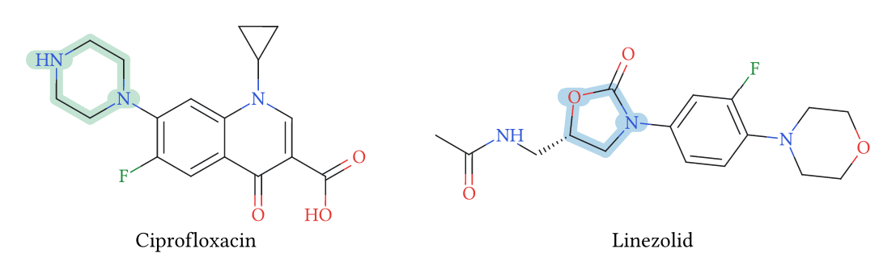
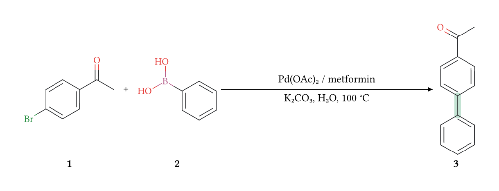
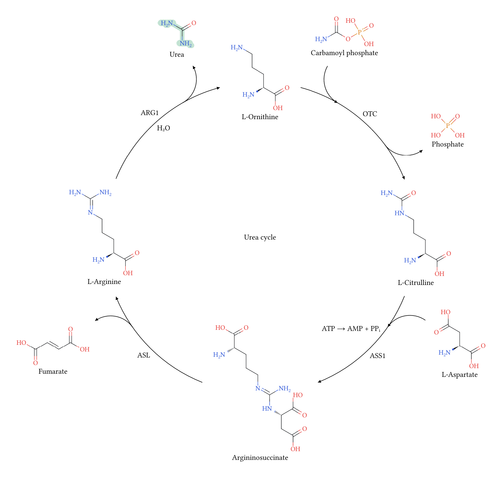
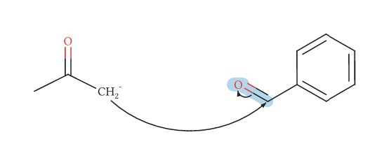
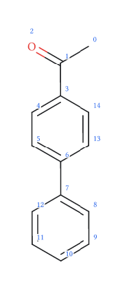

# Michem

Draw chemical structures from SMILES or authored molecular graphs, compose
automatic reaction routes, and annotate electron flow. Michem uses Chitin through
a precompiled WebAssembly plugin, with an optional CeTZ canvas adapter.

## Molecular structures

Ciprofloxacin and linezolid illustrate fused rings, heterocycles and
stereochemistry at a shared physical drawing scale. The tinted bonds identify
the piperazine and oxazolidinone rings.

```typst
#import "@preview/michem:0.1.0" as michem

#michem.compound-grid(
  michem.compound(
    "C1CC1N2C=C(C(=O)C3=CC(=C(C=C32)N4CCNCC4)F)C(=O)O",
    name: [Ciprofloxacin],
    highlights: ((bonds: ((14, 15), (15, 16), (16, 17),
      (17, 18), (18, 19), (19, 14)), color: rgb("#88c7a880")),),
  ),
  michem.compound(
    "CC(=O)NC[C@H]1CN(C(=O)O1)C2=CC(=C(C=C2)N3CCOCC3)F",
    name: [Linezolid],
    highlights: ((bonds: ((5, 6), (6, 7), (7, 8),
      (8, 10), (10, 5)), color: rgb("#6aaed680")),),
  ),
  columns: 2, gutter: 32pt,
)
```

<p align="center">
  
</p>

Molecular structures: [PubChem ciprofloxacin](https://pubchem.ncbi.nlm.nih.gov/compound/2764)
and [PubChem linezolid](https://pubchem.ncbi.nlm.nih.gov/compound/441401).

## Automatic reaction routes

Stages group participants. The template inserts plus signs, reaction arrows,
conditions and names, and arranges chains, branches and joins. All participants
share physical atom sizes and bond lengths; structures are not independently
scaled to fit cell widths.

```typst
#import "@preview/michem:0.1.0" as michem

#michem.reaction-route(
  michem.reaction-stage("substrates",
    michem.compound("CC(=O)c1ccc(Br)cc1", name: [*1*]),
    michem.compound("OB(O)c1ccccc1", name: [*2*]),
  ),
  michem.reaction-stage("biaryl",
    michem.compound("CC(=O)c1ccc(-c2ccccc2)cc1",
      name: [*3*],
      highlights: ((bonds: ((6, 7),), color: rgb("#88c7a880")),),
    ),
  ),
  steps: (michem.reaction-step("substrates", "biaryl",
    above: [Pd(OAc)₂ / metformin],
    below: [K₂CO₃, H₂O, 100 °C],
  ),),
)
```

<p align="center">
  
</p>

4-Bromoacetophenone (_1_) and phenylboronic acid (*2*) give
4-acetylbiphenyl (*3*). The coupling substrates and conditions follow the
[palladium/metformin Suzuki–Miyaura study](https://doi.org/10.1039/C7RA01197K).
Green marks the newly formed biaryl C–C bond; this figure does not assert a yield.

Add `highlights: ((bonds: ((6, 7),), color: rgb("#88c7a880")),)` to a
`compound` to highlight a bond in any route, including a peripheral product.
Region dictionaries also accept `atoms` and `radius`. Atom references are
zero-based SMILES parse indices, or explicit names for authored graphs.
Highlighter bounds are measured before layout, and the color is painted beneath
bonds and labels. Each compound's regions remain local to that occurrence.

Use `layout: "circular"` for a cycle. Omitted steps close the last stage back to
the first. `clockwise`, `start-angle`, `radius` and `center` control the layout.
Additional step `reactants` and `products` enter and leave through peripheral
branches. `branch-curve: "tangent-circle"` is the default; `"bezier"` selects
cubic branches. A step can override the route's curve setting.

This larger cycle is exported on a cropped standalone page, ready to place as
a figure in a manuscript.

```typst
#import "@preview/michem:0.1.0" as michem

#set page(width: auto, height: auto, margin: 12pt)

#michem.reaction-route(
  michem.reaction-stage("orn", michem.compound(
    "C(C[C@@H](C(=O)O)N)CN", name: [L-Ornithine])),
  michem.reaction-stage("cit", michem.compound(
    "C(C[C@@H](C(=O)O)N)CNC(=O)N", name: [L-Citrulline])),
  michem.reaction-stage("asu", michem.compound(
    "C(C[C@@H](C(=O)O)N)CN=C(N)N[C@@H](CC(=O)O)C(=O)O",
    name: [Argininosuccinate])),
  michem.reaction-stage("arg", michem.compound(
    "C(C[C@@H](C(=O)O)N)CN=C(N)N", name: [L-Arginine])),
  layout: "circular", center: [Urea cycle],
  steps: (
    michem.reaction-step("orn", "cit", above: [OTC],
      reactants: (michem.compound("NC(=O)OP(=O)(O)O",
        name: [Carbamoyl phosphate]),),
      products: (michem.compound("OP(=O)(O)O", name: [Phosphate]),),
    ),
    michem.reaction-step("cit", "asu", above: [ASS1],
      below: [ATP → AMP + PPᵢ],
      reactants: (michem.compound("N[C@@H](CC(=O)O)C(=O)O",
        name: [L-Aspartate]),),
    ),
    michem.reaction-step("asu", "arg", above: [ASL],
      products: (michem.compound("O=C(O)/C=C/C(=O)O",
        name: [Fumarate]),),
    ),
    michem.reaction-step("arg", "orn", above: [ARG1],
      below: [H₂O],
      products: (michem.compound("NC(=O)N", name: [Urea],
        highlights: ((bonds: ((0, 1), (1, 3)),
          color: rgb("#88c7a880")),),
      ),),
    ),
  ),
)
```

<p align="center">
  
</p>

The four enzymatic steps follow the [Reactome urea cycle](https://reactome.org/content/detail/R-HSA-70635).
Structures use neutral molecular forms for depiction; ATP/AMP/PPᵢ are shown as
condition text. Transport and upstream carbamoyl-phosphate synthesis are outside
this diagram.

## Electron flow

Use `mechanism` for atom-level annotations and local electron-flow panels.
Arrow endpoints, lone pairs, structures and products are authored explicitly.
This local panel shows an acetone enolate attacking benzaldehyde; the second
arrow moves the carbonyl π electrons onto oxygen. Optional routing searches
for clear curves between the supplied endpoints.

```typst
#import "@preview/michem:0.1.0" as michem

#let enolate = michem.smiles-input("[CH2-]C(=O)C",
  positions: ((1, -0.5), (0, 0), (0, 1), (-1, -0.5)))
#michem.mechanism(
  michem.mol("enolate", enolate),
  michem.mol("aldehyde", "O=Cc1ccccc1",
    at: michem.near("enolate", side: "east", gap: 60pt)),
  michem.highlight("aldehyde", bonds: ((0, 1),),
    color: rgb("#6aaed680")),
  michem.electron-arrow(
    michem.atom-ref("enolate", 0), michem.atom-ref("aldehyde", 1),
    arc-angle: -90deg, route: "auto",
  ),
  michem.electron-arrow(
    michem.bond-ref("aldehyde", 0, 1), michem.atom-ref("aldehyde", 0),
    arc-angle: 90deg, route: "auto",
  ),
  font: "Libertinus Serif",
)
```

<p align="center">
  
</p>

## Inspecting atom indices

Enable `debug` to display the atom IDs used by highlights and electron-arrow
references. This numbers every atom, including unlabeled skeletal carbons.
For example, inspect the Suzuki product before selecting its new biaryl bond:

```typst
#import "@preview/michem:0.1.0" as michem

#michem.smiles("CC(=O)c1ccc(-c2ccccc2)cc1", style: michem.style(
  font: "Libertinus Serif",
  debug: true,
))
```

<p align="center">
  
</p>

The new bond connects atoms `6` and `7`, so its highlight uses
`bonds: ((6, 7),)`. These are two **atom IDs**, not a bond index. SMILES IDs
start at zero in parse order; branches contribute atoms, while ring closure
digits and implicit hydrogens do not. Authored molecular graphs display their
atom names instead of numeric indices. Each molecular occurrence has its own IDs.

To inspect a complete `reaction-route`, including circular stages and peripheral
participants, pass `molecular-style: michem.style(debug: true)`. The same option
works with `compound-grid`. In a mechanism, pass `style: michem.style(debug: true)`
to each `mol` that needs inspection.

Debug is off by default. Blue ID labels follow the molecular font at 65% of its
size and participate in measured bounds without changing atom positions or IDs.
Dense structures may need a larger bond length for readability. Turn debug off
after choosing references for the final figure.

## Public interfaces

See the [user guide source](https://github.com/chitin-dev/michem/blob/f05ae99e167f8773694b1d9208311bc10d6d351c/docs/manual.typ) for signatures, coordinate systems,
parameter defaults and routing limits.

## Fonts and scope

Route templates default to Libertinus Serif. For individual structures, choose
`style: michem.style(font: "Libertinus Serif")`; document `set text` rules do not
change molecular fonts. Any selected family must be available to Typst through
system fonts, the web project, or the CLI's `--font-path`. Documentation code
uses Cascadia Code. No separate font files are bundled in the package.

Without a selected molecular font, the plugin uses bundled Noto Sans outlines.
Named-font SVG exports reference the selected family, so standalone SVG viewers
need that font too.

Michem does not predict reactions, infer lone-pair counts, or balance equations.
Circular routes support one ring with neighboring stages. Automatic routing is
bounded and can fail when no clear candidate is found. Enlarge the layout or
adjust the authored geometry when necessary.

## License

Michem's original code is [Apache-2.0](LICENSE).

Copyright 2026 AshGrey.
