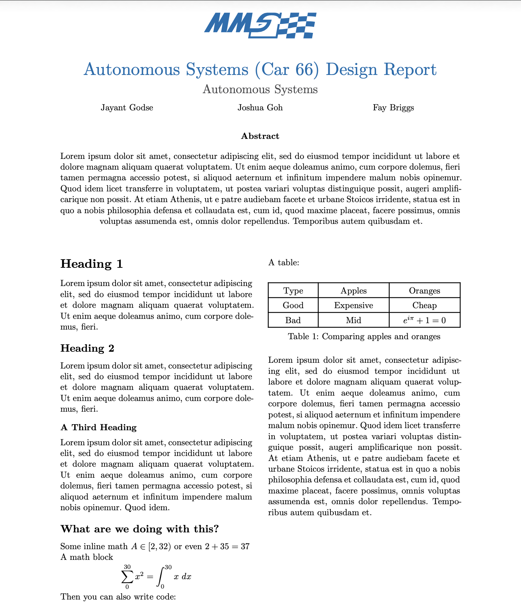
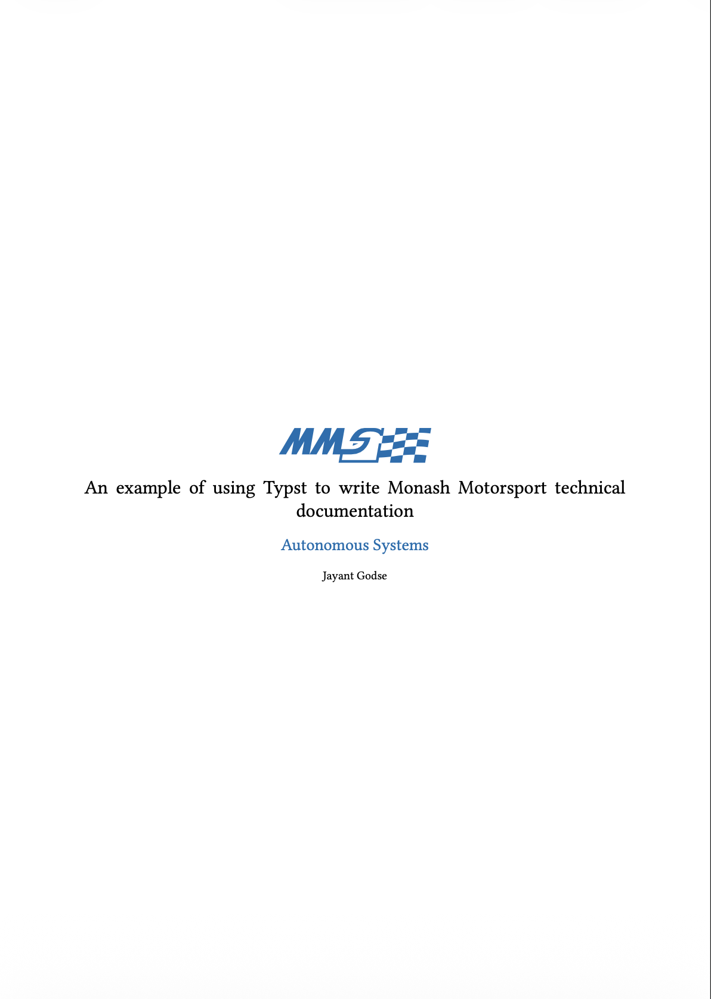
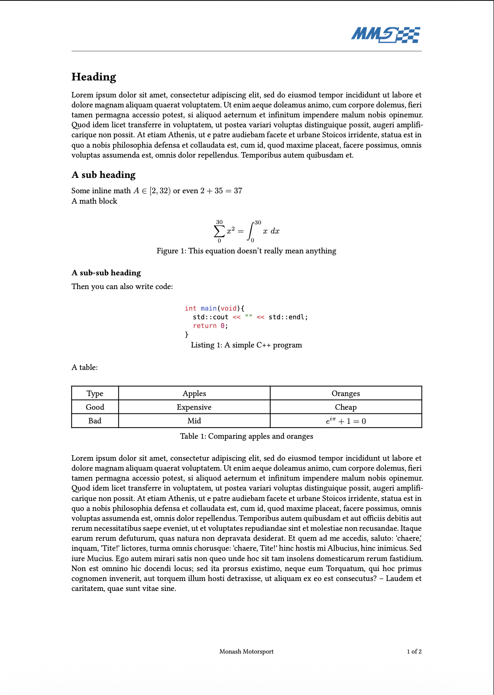

# A Typst Template for Monash Motorsport

This is a repository containing Typst templates for technical documents
following the Monash Motorsport brand guidelines.

[Typst](https://typst.app/) is a _typesetting_ language similar to LaTeX. It
allows people to write and format beautiful technical documents.

Typst has some clear benefits over LaTeX:

- Instant compile times
- Single binary installation
- Simpler syntax.

## Getting Started

1. First make sure you have Typst installed. Follow the instructions
   [here](https://typst.app/open-source/) to install Typst.
1. Clone this repository.
1. Create a new file ending in `.typ`.

From here you can choose whether you want to write a Report or an Article.

## Reports

The report template is designed for shorter more dense documents. Specifically
following the conventions of FSAEA design submissions that we have done in the
past.



To start writing a report, simply import the template.

```typ
#import "@preview/mms-templates:0.1.0": report, mms

#show: doc => report(
  doc,
  title: [Example Of a Typst Report],
  department: [Autonomous Systems],
  authors: "Jayant Godse",
)
```

## Articles

The article template is designed for longer form technical documentation. Mainly
for internal use, it lets users draft up longer documents such as manuals,
thesis' etc.




- You can work out of an editor of your choice, VSCODE had a nice
  [Typst Extension](https://marketplace.visualstudio.com/items?itemName=myriad-dreamin.tinymist)
  or you can use any other editor of your choice.

```typ
#import "@preview/mms-templates:0.1.0": article, mms

#show: doc => article(
  doc,
  title: [An example of using Typst to write #mms technical documentation ],
  authors: "Jayant Godse",
  department: "Autonomous Systems",
  toc: true, // Table of contents
)
```

## Contributing

Feel free to make any Pull Requests on this template if you feel like something
should be changed or improved.
