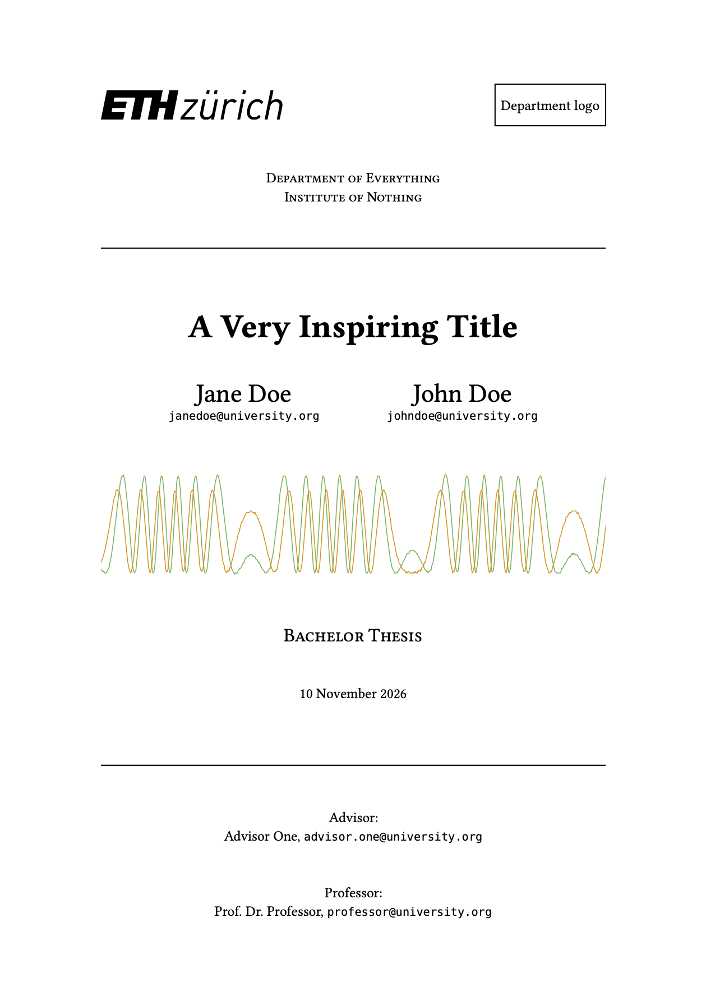

# MTT – Modular Thesis Template

MTT is a modular thesis layout for Typst. It provides a configurable cover page and reusable pages for abstracts, contents, figures, tables, code samples, todos, acronyms, bibliographies, and appendices.

## Usage

Import the package and apply `mtt-thesis` as a show rule:

```typ
#import "@preview/mtt-thesis:0.1.0": *

#show: mtt-thesis.with(
  coverpage: mtt-coverpage(
    org-units: ("Department of Everything",),
    title: [A Very Inspiring Title],
    project-type: "Bachelor Thesis",
    authors: ((name: "Jane Doe", email: "janedoe@university.org"),),
  ),
  before: (
    mtt-abstract[This is the abstract.],
    mtt-toc(),
  ),
  after: (
    mtt-figures(),
    mtt-tables(),
    mtt-bibliography(
      bibliography("references.bib"), // requires this file existing
    ),
  ),
)

= Introduction

Your thesis starts here.
```

A complete example is available in [`example.typ`](example.typ). It demonstrates all modules and can be copied as a starting point for a thesis. Its bibliography data is in [`references.bib`](references.bib) (using a standard BibTeX file).

## Modules

- `mtt-thesis`: Apply the thesis layout, configure margins and localization,
  and insert content before and after the main body.
- `mtt-coverpage`: Create a cover page with logos, organizational units, title, authors, advisors, professors, project type, date, and cover image.
- `mtt-abstract`: Add an abstract page.
- `mtt-toc`: Add a table of contents.
- `mtt-figures`: Add a list of figures for a figure kind.
- `mtt-tables`: Add a list of tables.
- `mtt-codes`: Add a list of code samples.
- `mtt-todos`: Add a list of todos.
- `mtt-acronyms`: Add an acronym index. This requires [`acrostiche`](https://typst.app/universe/package/acrostiche/).
- `mtt-bibliography`: Add a bibliography page.
- `mtt-content-frame`: Add a framed appendix page.
- `mtt-typst-guide`: Add the included Typst guide.
- `mtt-placeholder`: Display a task-style placeholder with an optional explanation and usage snippet.
- `mtt-breakable-figure`: Display a figure or table in a breakable block.
- `mtt-code-sample`: Display a breakable code listing with a code-sample caption.

`mtt-figures`, `mtt-tables`, `mtt-codes`, and `mtt-todos` accept an optional `title` argument. `mtt-figures` also accepts a `kind` argument when a custom figure kind is needed.

## Example

See the file [example.typ](example.typ) and the [PDF](example.pdf) compiled from it.



## Dependencies

The package uses these Typst Universe packages:

- [`dashy-todo`](https://typst.app/universe/package/dashy-todo/) for todo markers and the todo list.
- [`acrostiche`](https://typst.app/universe/package/acrostiche/) for acronym indexes.
- [`gentle-clues`](https://typst.app/universe/package/gentle-clues/) for instructional placeholders and code blocks.

## License

Apache-2.0. See [`LICENSE`](LICENSE).

The ETH Zürich logo (`template/eth_logo_kurz_cropped.svg`) is a trademark of ETH Zürich and is not covered by the Apache-2.0 license. It is reproduced as publicly available on [Wikimedia Commons](https://commons.wikimedia.org/wiki/File:ETH_Z%C3%BCrich_Logo_black.svg).
Users must comply with [ETH Zürich's branding guidelines](https://ethz.ch/staffnet/en/service/communication/corporate-design/eth-logo.html).
