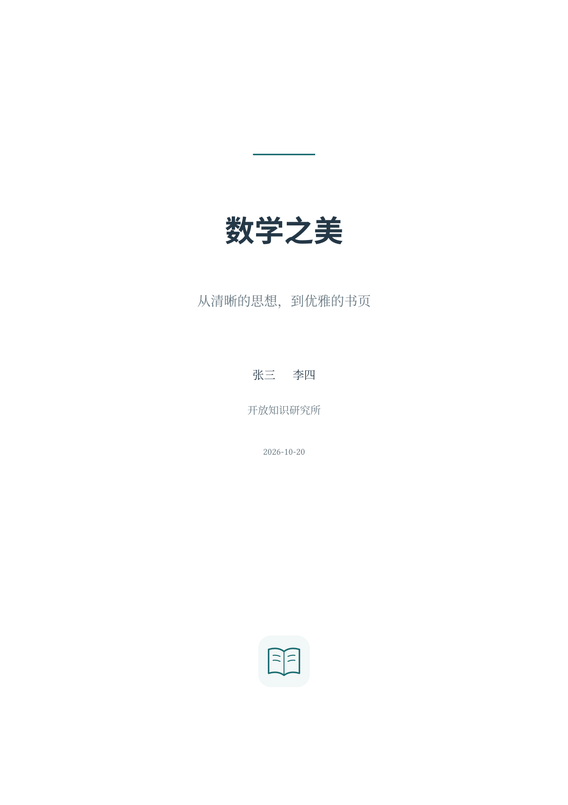

# Neat Book

Elegant multilingual books with framed theorems, algorithms and annotated code.
Inspired by the visual language of LaTeX ElegantBook; independently implemented in Typst.

Source repository: [xiong-ZH-zq/neat-book](https://github.com/xiong-ZH-zq/neat-book).

面向中文教材、数学讲义和技术书籍的 Typst 模板。默认使用开放字体，支持中、英、日、韩文，
集成 Theorion 定理环境、按章编号、三级目录、Chicago author-date 参考文献和后置附录。



## 在本仓库使用

需要 **Typst 0.15.0+**、**Python 3.11+**。测试另需 Poppler 的 `pdftotext`。
安装下面列出的字体后，在项目根目录运行：

```sh
make build       # build/neat-book.pdf，完整示例书
make preview     # 监听书稿并自动重新编译
make test        # 编译与语义回归检查
make thumbnail   # 重新生成 Universe 封面缩略图
make package     # 检查、生成缩略图、打包到 dist/
```

`scripts/build.py` 把本项目放入 `build/packages/preview/neat-book/0.1.0/`，
借助 `--package-path build/packages` 测试真实的包导入。首次构建时 Typst 会下载已固定版本的依赖。
依赖命中本机缓存后可以离线编译。此过程无需把本项目安装到用户的全局包目录。

书稿入口为 `template/main.typ`；正文和附录在 `template/chapters/`；
自定义标志在 `template/assets/`；文献库是 `template/references.bib`。
无须 Python 的本地最小示例可以直接运行：

```sh
typst compile --root . examples/minimal.typ build/minimal.pdf
```

先确保 `build/` 存在。模板排版代码位于 `src/`，公共入口为 `lib.typ`。

## 新建书稿

本项目尚未发布到 Universe。**发布后**可以使用：

```sh
typst init @preview/neat-book:0.1.0 my-book
typst compile my-book/main.typ my-book.pdf
```

在本地测试相同的初始化流程：

```sh
make build
typst init --package-path build/packages @preview/neat-book:0.1.0 build/my-book
typst compile --root build/my-book --package-path build/packages build/my-book/main.typ build/my-book.pdf
```

一份书稿的导言区可以写成：

```typst
#import "@preview/neat-book:0.1.0": *
#show: neat-book.with(
  title: "我的数学书",
  subtitle: "概念、证明与计算",
  author: ("张三", "李四"),
  institution: "开放知识研究所",
  date: datetime(year: 2026, month: 10, day: 20),
  logo: image("assets/logo.svg", width: 22mm),
  references: bibliography("references.bib", title: [参考文献]),
  appendix: include "chapters/appendix.typ",
)

= 第一章
#introduction[
  - 本章的第一个目标。
  - 本章的第二个目标。
]

== 第一节
=== 第一个小节

#theorem(title: "交换律")[对实数 $a,b$，有 $a+b=b+a$。] <commutative>
#proof[由实数加法的定义可得。]
参见 @commutative。
```

`logo` 接受 **content**，请在书稿中调用 `image(...)`，不要仅传路径字符串。
这样路径相对于书稿解析，也可以传入多个图形组成的标志。`references` 和 `appendix` 同样接受 content，
书稿自己的图片、文献和 `include` 路径不受包隔离影响。
封面依次为标题、副标题、作者、机构、日期、logo；省略可选项时不输出占位内容。

## 字体与语言

| 参数 `fonts` 的键 | 默认字体 | 用途 |
| --- | --- | --- |
| `english` | Libertinus Serif | 西文正文，原生粗体、斜体与粗斜体 |
| `chinese` | Noto Serif CJK SC | 简体中文正文 |
| `japanese` | Noto Serif CJK JP | 日文正文与日文汉字字形 |
| `korean` | Noto Serif CJK KR | 韩文正文 |
| `mono` | DejaVu Sans Mono | 代码、行内等宽文本 |
| `sans` | Noto Sans CJK SC | 章节标题与封面标题 |
| `math` | New Computer Modern Math | 数学公式 |

上述字体均为开放字体。Typst CLI 自带 Libertinus Serif、DejaVu Sans Mono 和 New Computer Modern Math；
CJK 字体请从 [Noto CJK 官方项目](https://github.com/notofonts/noto-cjk) 安装或上传到网页项目。
Ubuntu/Debian 可安装 `fonts-noto-cjk`；运行本仓库全部测试另需 `fonts-noto-core`。
2026-10-20 已直接核对 Typst 官方网页字体索引：上述 7 个默认字体家族均在线可用，
含所需常规、粗体，以及西文/等宽字体的斜体和粗斜体。默认配置在网页端无需另传字体。
核对范围与可复查证据见 [发布检查记录](docs/PUBLISHING_AUDIT.md)。
字体文件不随包分发。可用 `typst fonts` 检查实际字体名称，或 `typst compile --font-path ./fonts ...`
指定字体目录。自定义字体仍应确认网页环境中可用。

只覆盖需要更换的项，其余保留默认值。每项可使用字体名或字体名数组：

```typst
#show: neat-book.with(
  fonts: (
    chinese: ("Source Han Serif SC", "Noto Serif CJK SC"),
    english: "Noto Serif",
    japanese: "Noto Serif CJK JP",
    mono: "Noto Sans Mono",
    sans: "Noto Sans CJK SC",
  ),
)
```

正文可直接混排中文与西文。对于汉字共享但地区字形不同的文本，用显式语言片段选择字形：

```typst
#zh[中文 *粗体*、_斜体_、*_粗斜体_*。]
#en[English *bold*, _italic_, *_bold italic_*.]
#ja[日本語の漢字・*太字*・_斜体_。]
#ko[한국어와 *굵은 글꼴*。]
```

多数 CJK 字体不提供原生 italic，Typst 不会自动为这些字体合成斜体。
本模板默认对斜体中的 CJK 字符逐字应用 12° 倾斜，保留粗体字重与逐字换行，西文使用原生 italic。
用 `cjk-oblique: 15deg` 可调整倾斜角度；若选择了带原生斜体的 CJK 字体，设置 `cjk-oblique: none` 关闭合成。
全书日文可设置 `lang: "ja"`，
同时将 `fonts.sans` 改成 `"Noto Sans CJK JP"`；全书韩文同理。

## 定理、证明与解答

基于 [Theorion 0.6.0](https://typst.app/universe/package/theorion/)，使用其 Fancy 样式和原生引用机制。
以下所有编号环境均支持 `title:` 可选参数，省略即为无标题环境：

```typst
#theorem(title: "定理名")[内容。] <thm-name>
#theorem[无名定理内容。]
#definition(title: "定义名")[内容。]
#example[例题。]
#lemma[引理。]
#proposition[命题。]
#corollary[推论。]
#axiom[公理。]
#postulate[公设。]
#assumption[假设。]
#property[性质。]
#conjecture[猜想。]
#remark[注解。]
#note[注意。]
#exercise[练习。]
#problem[问题。]

#proof[证明正文。]
#solution[解答正文。]
#conclusion[结论正文。]
```

`proof` 与 `solution` 无需标题参数、不编号，且**均以空心方框 □ 结束**。
证明末尾为公式或列表时仍支持 Theorion 的 QED 定位；可在需要的位置放置 `#qedhere`。
常规编号环境共享章内计数器；推论沿用 Theorion 的下级编号，如定理 1.3 后的推论 1.3.1。
章切换时自动重新计数。附录使用 A.1 等编号。

短定理框默认不跨页，避免标题与正文分离；长定理可使用：

```typst
#theorem(title: "很长的定理", breakable: true)[很长的正文……]
```

编号环境同时保留 Theorion 的 `number`、`numbering`、`supplement`、`full-title`、`outlined` 等参数。
无编号定理可用 `#theorem(numbering: none)[内容]`。
轻量提示框 `note-block`、`tip-block`、`important-block`、`warning-block`、`caution-block`、
`remark-block`、`quote-block`、`emph-block` 也可直接导入。
高级功能可通过导出的 `theorion` 模块访问，例如定理重述：

```typst
#theorion.theorion-restate(filter: <thm-name>)
```

## 算法环境

基于 MIT 许可的 [algorithmic 1.0.7](https://typst.app/universe/package/algorithmic/)，
提供类似 algorithm2e 的三线标题、输入输出、行号、嵌套控制流与缩进竖线。
这是 Typst 原生 API，伪代码语法遵循 algorithmic，**不解析 LaTeX 宏**。

```typst
#algorithm(
  title: "欧几里得算法",
  input: [非负整数 $a,b$],
  output: [$gcd(a,b)$],
  {
    import algorithmic: *
    While($b != 0$, {
      Assign[$r$][$a mod b$]
      Assign[$a$][$b$]
      Assign[$b$][$r$]
    })
    Return[$a$]
  },
) <alg-gcd>
参见 @alg-gcd。
```

支持 `If`、`IfElseChain`、`For`、`While`、`Procedure`、`Return`、`Comment`、`Line` 等原始构造。
`line-numbers: false` 关闭行号。算法可以跨页，按章编号，也可生成算法目录：

```typst
#outline(target: figure.where(kind: "algorithm"), title: [算法目录])
```

## 代码框

普通三反引号代码块自动使用 [Codly 2.0.0](https://typst.app/universe/package/codly/)
与 codly-languages 0.1.10：浅色主题、语法高亮、行号，右上角显示语言图标与名称。
也可以通过字符串创建：

```typst
#codeblock("print('Hello, world!')", lang: "python")
```

未知语言显示原始名称；仅当语言库提供图标时显示对应图标。
短代码框默认保持完整，长代码块可以显式开启跨页：

```typst
#show: codly.set_(breakable: true)
```

Codly 2 配置使用作用域内的 show 规则，自定义语言图标与名称的例子：

```typst
#show: codly.lang-set_(languages: codly-languages + (
  mylang: (name: "My Language", icon: image("assets/my-language.svg", height: 10pt), color: blue),
))
```

## 参考文献、编号与附录

`bibliography-style` 默认为 `"chicago-author-date"`，可换为 Typst 内置样式或自定义 CSL。
正文使用 `@文献键` 引用。模板保证输出顺序为：封面 → 三级目录 → 正文 → 参考文献 → 附录。
参考文献标题不编号，但进入目录。附录文件用普通 `= 附录章标题` 开始，多个一级标题依次为 A、B、C。

公式默认编号 `(1.1)`、`(1.2)`，按章重置；附录为 `(A.1)`、`(B.1)`。
原生图、表和算法也按章独立编号。跨章、前向、从附录返回正文的引用均按被引用对象的位置生成章号。
单个不编号公式可在局部使用 `#set math.equation(numbering: none)`。

## `neat-book` 参数

| 参数 | 默认值 | 含义 |
| --- | --- | --- |
| `title` | `"Neat Book"` | 书名字符串，同时写入 PDF 元数据 |
| `subtitle` | `none` | 副标题内容 |
| `author` | `()` | 单个作者字符串或作者字符串数组 |
| `institution` | `none` | 机构内容 |
| `date` | `none` | `datetime` 或文字；省略则不显示 |
| `logo` | `none` | 调用方解析的图片或其他 content |
| `lang` | `"zh"` | 文档语言，控制断行与环境名称 |
| `fonts` | `(:)` | 合并覆盖上表的字体配置 |
| `font-size` | `10.5pt` | 正文字号 |
| `cjk-oblique` | `12deg` | CJK 合成斜体角度；`none` 关闭合成 |
| `accent` | `rgb("176B70")` | 标题、链接、提要和定义框的主色 |
| `paper` | `"a4"` | 纸张规格 |
| `margin` | `(x: 26mm, top: 25mm, bottom: 24mm)` | 页边距 |
| `cover` | `true` | 是否输出封面 |
| `toc` | `true` | 是否输出目录 |
| `toc-title` | `auto` | 目录标题，默认随语言切换 |
| `toc-depth` | `3` | 目录深度 |
| `references` | `none` | 文献表内容，通常为 `bibliography(...)` |
| `bibliography-style` | `"chicago-author-date"` | 默认文献样式 |
| `appendix` | `none` | 参考文献后面的附录内容 |

正文从页码 1 开始，目录使用罗马页码，封面不显示页码。页眉显示书名与当前章名。
每章从新页开始。`introduction(title: auto)[...]` 可放在每章开头，支持列表、公式及自定义标题。

## 开发与发布

本项目采用 MIT 许可；依赖保留各自许可证，通过 Universe 导入，不在仓库内复制源代码。
素材来源、图标许可及商标说明见 [第三方声明](THIRD_PARTY_NOTICES.md)。封面书本图形是本项目原创，
示例中 Python/Rust 标志仅用于标识代码语言，不表示项目得到相应组织的认可。
`make test` 检查全部环境、公式重置、跨章引用、两章附录、五种 QED 结尾、
中英日混排、长内容跨页，以及真实 `typst init` 后独立项目的编译。
GitHub Actions 的编译配置在 `.github/workflows/check.yml`。

项目已提供 Universe manifest、可初始化模板、缩略图和最小发布包脚本。
源码仓库和作者信息已配置，正式提交前仍应重新运行官方检查工具；详见 [发布说明](docs/RELEASING.md)。
包格式和提交要求参见 [本次核对的 Typst 官方提交指南](https://github.com/typst/packages/tree/93b1568595dcf028559b5e68600c35f45c7e302e/docs)。

ElegantBook 为设计参考，本项目并非其官方移植版。
