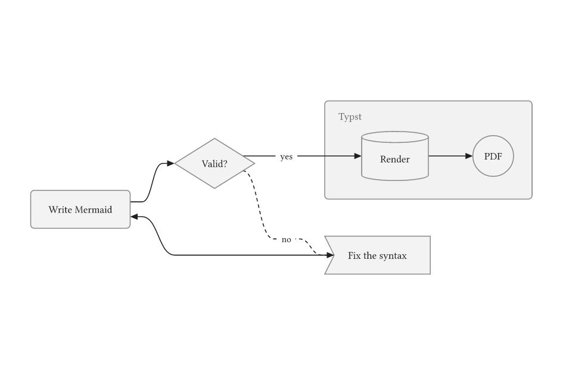
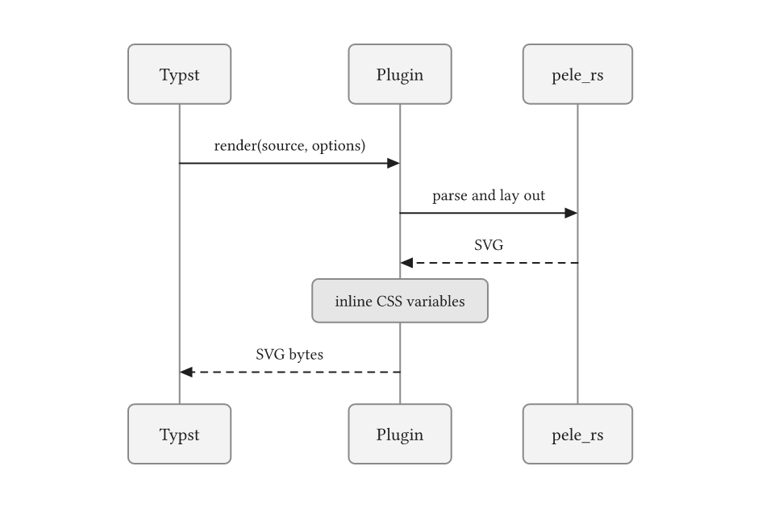
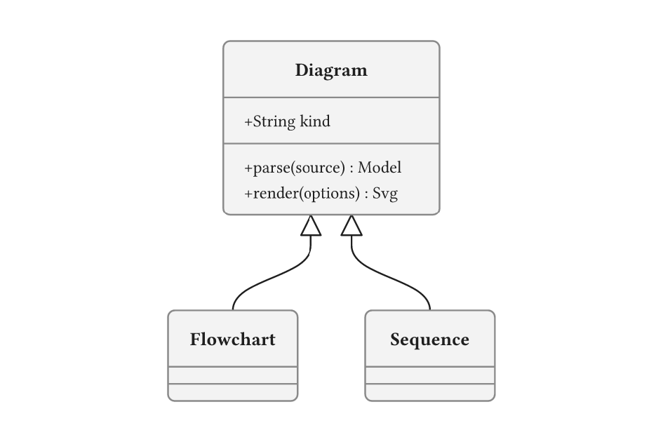
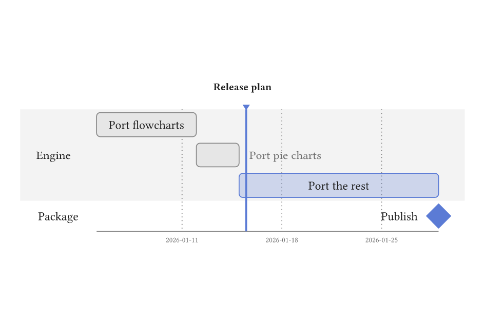
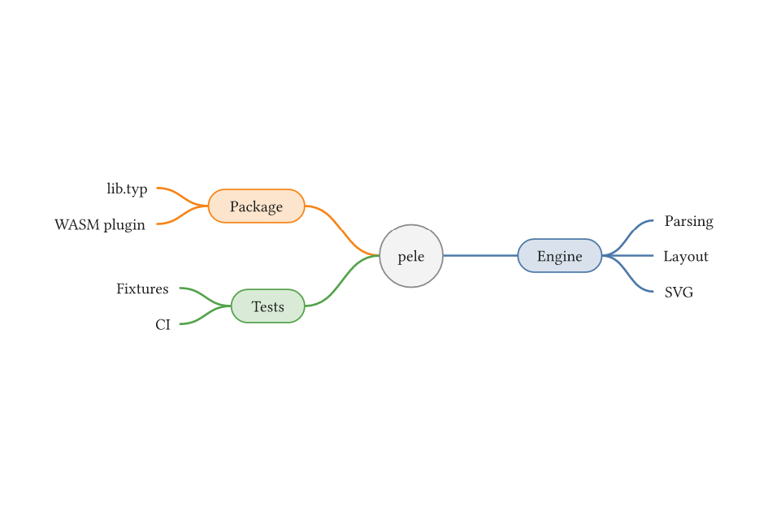
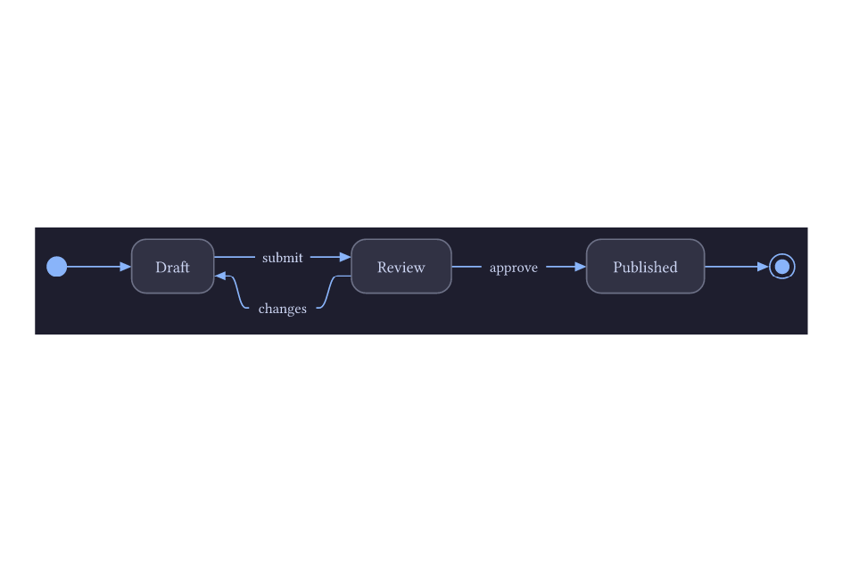
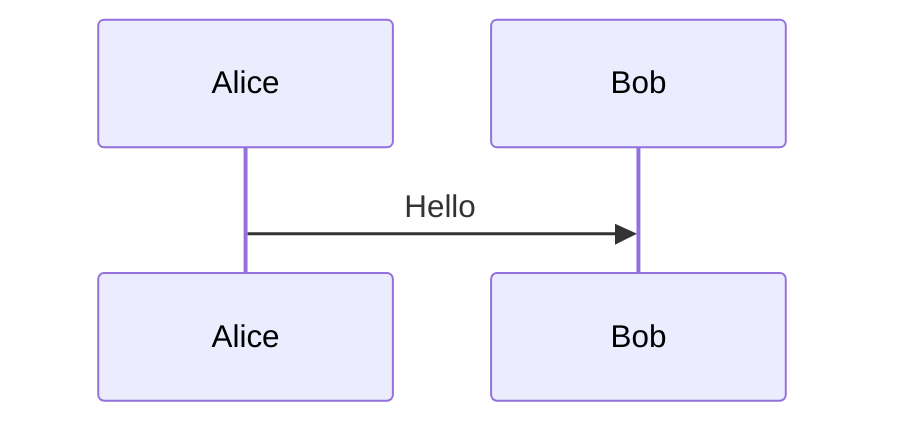

# pele-rs

Draw [Mermaid](https://mermaid.js.org) diagrams in Typst. This package runs `pele_rs`, a Rust
port of [pele](https://github.com/obsidianmd/pele), Obsidian's fast Mermaid renderer, as a
WebAssembly plugin: no browser or Node.js needed, in the CLI and the web app alike.

pele-rs is an independent port, not an official Obsidian or Mermaid project.

## Examples

<!-- img width is set so the table gets evenly spaced by GitHub's css -->
<table>
<tr>
  <td><a href="gallery/flowchart.typ"></a></td>
  <td><a href="gallery/sequence.typ"></a></td>
  <td><a href="gallery/class.typ"></a></td>
</tr>
<tr>
  <td>Flowchart</td>
  <td>Sequence diagram</td>
  <td>Class diagram</td>
</tr>
<tr>
  <td><a href="gallery/gantt.typ"></a></td>
  <td><a href="gallery/mindmap.typ"></a></td>
  <td><a href="gallery/state.typ"></a></td>
</tr>
<tr>
  <td>Gantt chart</td>
  <td>Mind map</td>
  <td>State diagram, dark theme</td>
</tr>
</table>

_Click on an image to see its code._

## Usage

For the full documentation, see the [manual (PDF)](manual.pdf).

```typ
#import "@preview/pele-rs:0.3.0": mermaid

#mermaid("
flowchart LR
  A[Write Mermaid] --> B[Render with pele] --> C[Embed in Typst]
")
```

To turn every `mermaid` code block into a diagram, use a show rule. Code blocks are set in a
monospace font, so name the font for labels:

````typ
#show raw.where(lang: "mermaid"): it => mermaid(it, font: "Libertinus Serif")


````

`mermaid` returns an image and takes `width`, `height` and `alt` like one. Other options set
the font, colors, Mermaid configuration and more:

```typ
#mermaid(
  "graph TD\n  A --> B",
  width: 50%,
  font: "Libertinus Serif",
  theme: (bg: rgb("#1e1e2e"), fg: white, line: rgb("#89b4fa"), radius: 6pt),
  config: (flowchart: (curve: "linear")),
)
```

Gantt charts require `now`, the current time as a Unix timestamp in milliseconds, so that
every build draws the same chart:

```typ
#mermaid(now: 1768478400000, "gantt\n  dateFormat YYYY-MM-DD\n  Build :2026-01-15, 3d")
```

## Diagram types

All 33 diagram types of pele 1.12.0 are supported, with output identical to the original:

- **Flow and charts**: flowchart, pie, info, packet, quadrant chart, radar, XY chart, Cynefin
- **Structured layouts**: mind map, kanban, treemap, tree view, timeline, user journey,
  Ishikawa, event modeling, Wardley map
- **Graphs**: entity relationship, class, state, requirement, use case, architecture, C4,
  block, agent flow, swimlane
- **Specialized engines**: sequence, Gantt, Git graph, Sankey, Venn, railroad

Front matter and `%%{init}%%` directives work as in Mermaid. See the
[compatibility notes](COMPATIBILITY.md) for details.

## Limitations

- Labels are measured with the character widths of Arial, as pele does outside a browser. A
  font much wider than Arial can overflow its boxes.
- Icons and math are drawn from SVG you supply; no icon set or math typesetter is bundled.
- Click handlers, links and other browser-only features have no effect.

## Building from source

The plugin is built from the Rust crates in this repository: `pele_rs`, the port of pele, and
`plugin`, which wraps it for Typst. With [Rust](https://rustup.rs) installed:

```sh
rustup target add wasm32-unknown-unknown
./build.sh      # builds pele.wasm
./docs.sh       # builds manual.pdf and the gallery
./package.sh    # installs the package as @local/pele-rs:0.3.0
cargo test --workspace
```

## License

MIT. pele is MIT licensed by kepano; see [LICENSE](LICENSE).
