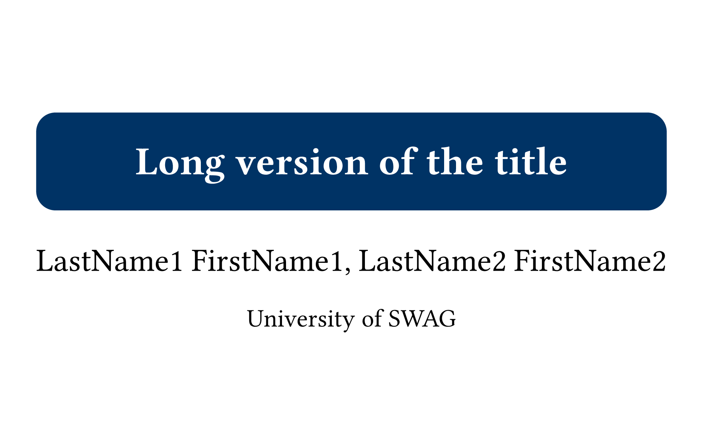
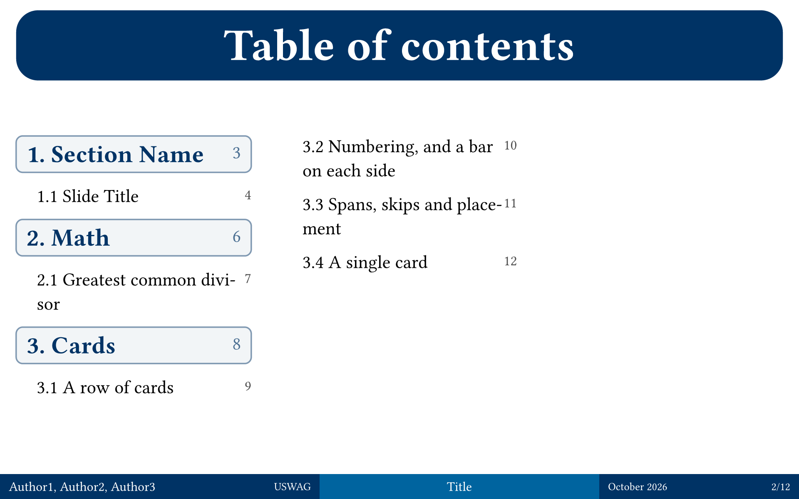
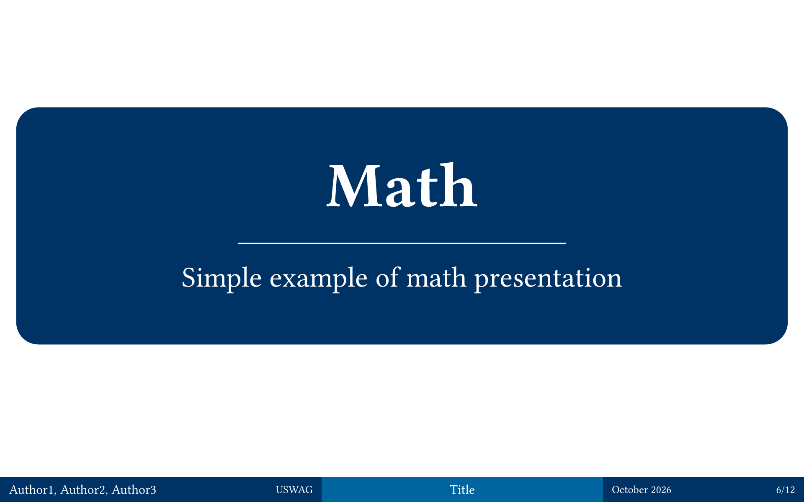
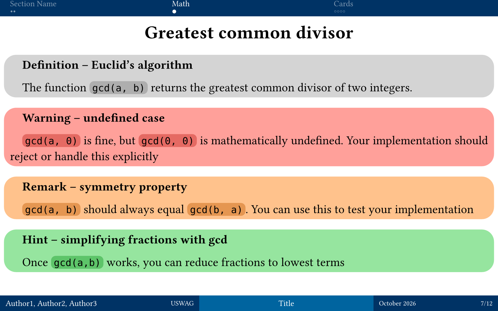
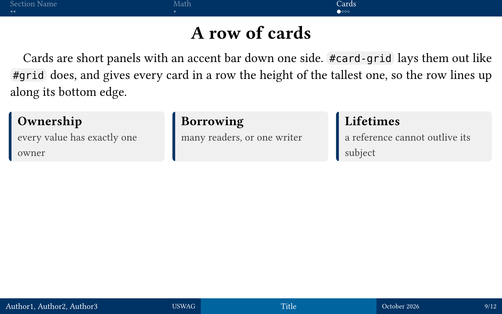

# Pepentation

*Simple slides for your university presentations*

Pepentation is a Typst template for clean, academic presentations.

| Title Slide | Table of Contents | Section Slide |
| - | - | - |
|  |  |  |

| Content Blocks | Cards |
| - | - |
|  |  |

- Theming with presets and full color overrides.
- Navigation header with a progress tracker and an interactive table of contents.
- Automatic 3-column footer: authors, title, date/page.
- Nine styled content blocks and grid-based cards.

## Setup

Import the published package:

```typst
#import "@preview/pepentation:0.4.0": *
```

For local development, place the repository in your Typst package directory at
`{data-dir}/typst/packages/local/pepentation/0.4.0` and import it with
`#import "@local/pepentation:0.4.0": *`. `{data-dir}` is `$XDG_DATA_HOME` (or
`~/.local/share`) on Linux, `~/Library/Application Support` on macOS, and
`%APPDATA%` on Windows.

## Quick Start

`template/main.typ` is a fully configured example deck. Copy it into your
project and start editing.

## Usage

Configure the deck once at the top of the file:

```typst
#import "@preview/pepentation:0.4.0": *

#show: setup-presentation.with(
  title-slide: (
    enable: true,
    title: "Presentation Title",
    authors: ("Author One", "Author Two"),
    institute: "University of Typst",
  ),
  footer: (
    enable: true,
    title: "Short Title",
    institute: "Short Inst.",
    authors: ("A. One", "A. Two"),
  ),
  table-of-contents: "detailed",
  header: true,
  locale: "EN",
)

// Your content here...
```

### Slide structure

Structure the deck with headings:

- `= Section` — a dedicated section title slide.
- `== Slide Title` — a new slide.
- `== ` (empty) — a slide without a title.
- `=== Subsection` — a titled slide excluded from the table of contents.

```typst
= Introduction

== Motivation
First slide of the introduction.

==
A slide without a title.

=== Detail View
Titled, but not in the outline.
```

A heading can carry metadata that never shows as text: `metadata("subtitle")`
sets the section subtitle, and `metadata((header: "Label", subtitle: "Subtitle"))`
also sets a shorter header label. A section can appear in the header and ToC
without its own slide with `section-slide: false`. For the programmatic form,
use `#section-slide(title: "Title", subtitle: "Subtitle")`.

### Table of contents

- `"detailed"` (default): section titles and their subsections.
- `"simple"`: only section titles, in styled boxes.
- `"none"`: no table of contents.

## Content Blocks

Nine styled blocks highlight common kinds of content:

- `#definition[..]` (gray) — definitions, theorems
- `#warning[..]` (red) — warnings, cautions
- `#remark[..]` (orange) — remarks, notes
- `#hint[..]` (green) — hints, tips
- `#info[..]` (blue) — facts, details
- `#example[..]` (purple) — examples, demonstrations
- `#quote[..]` (neutral gray) — quotations, citations
- `#success[..]` (green) — achievements, positive results
- `#failure[..]` (red) — errors, issues

## Cards

A card is a small panel with an accent bar on one edge, for laying a slide out
in pieces. `#card(title, body)` draws one; `#card-grid(..)` lays cells out the
way `#grid` does, drawing each as a card and giving every card in a row the
height of the tallest. Cards also support numbering, per-cell options,
`colspan`/`rowspan`, `x`/`y` placement and `grid` passthrough — see
`template/main.typ` and the `#card` / `#card-grid` docstrings for the full set.

```typst
#card-grid(
  columns: 3,
  numbered: true,
  ("Ownership", [every value has exactly one owner]),
  ("Borrowing", [many readers, or one writer]),
  ("Lifetimes", [a reference cannot outlive its subject]),
)
```

## Themes

Pepentation resolves a theme dictionary over its defaults. Presets (each with a
`-dark` variant): `theme-azure-breeze`, `theme-crimson-dawn`,
`theme-forest-canopy`, `theme-deep-ocean`, `theme-twilight-violet`,
`theme-golden-hour`, `theme-emerald-glow`. Customize by merging over a preset:

```typst
#show: setup-presentation.with(
  theme: (
    ..themes.theme-azure-breeze,
    primary: rgb("#FF0000"),
  ),
)
```

A theme has the keys `primary`, `secondary`, `background`, `main-text`,
`sub-text`, `sub-text-dimmed`, `code-background`, `code-text`, `card-background`,
`section-subtitle-size`, `section-subtitle-position`, and a `blocks` dictionary
with `definition-color`, `warning-color`, `remark-color`, `hint-color`,
`info-color`, `example-color`, `quote-color`, `success-color`,
`failure-color`.

To color your own content, resolve the theme once and read plain values from it:

```typst
#let my-theme = resolve-theme(themes.theme-azure-breeze)
#show: setup-presentation.with(theme: my-theme)

#rect(fill: my-theme.primary, width: 2em)
```

| Function | Description |
| :--- | :--- |
| `resolve-theme(theme)` | The full theme as plain values; no `context` needed. |
| `active-theme()` | The resolved theme; requires `context`. |
| `theme-color(key, fallback: none)` | One color by dotted key; requires `context`. |
| `theme-text(key)[..]` | Text in a theme color. |
| `theme-box(key)[..]` | Box filled with a theme color. |
| `with-theme(t => ..)` | Runs a function with the theme, supplying `context`. |
| `theme-block-code-background(type)` | Inline-code background a block uses; `context`. |
| `theme-card-code-background()` | Inline-code background a card uses; `context`. |
| `theme-header-dim-color()` | Dimmed color of inactive header entries; `context`. |

## Header and Footer

The header is a fixed-height navigation aid: one left-aligned column per
section, the current section highlighted and the rest dimmed, with dots tracking
position within a section. Titles are typeset at a fixed size, wrap to at most
two lines and are truncated after that; shorten one with a header label via
`metadata((header: ".."))`. Clicking a section name jumps to that section's first
slide, and clicking a dot jumps to the slide it marks; the collapsed glyphs of
an overlong tracker (a trailing ellipsis or a run marker) are not clickable.
Disable the header with `header: false`, or just the dots with `tracker: false`.

The footer is a band of three blocks — authors and institute (left, widest),
title (center), date and page (right). It shrinks text before wrapping and grows
to fit rather than clipping; if it cannot fit within `max-lines`, the build fails
instead of dropping information.

## Configuration Options

| Keyword | Description | Default |
| :--- | :--- | :--- |
| `title-slide` | Title-slide dictionary | `(enable: false)` |
| `title-slide.enable` | Show the title slide | `false` |
| `title-slide.title` | Full title | `none` |
| `title-slide.authors` | Author names | `()` |
| `title-slide.institute` | Institute name | `none` |
| `footer` | Footer dictionary | `(enable: false)` |
| `footer.enable` | Show the footer | `false` |
| `footer.title` | Short title (center) | `none` |
| `footer.authors` | Short author names (left) | `()` |
| `footer.institute` | Short institute (left) | `none` |
| `footer.date` | Date (right) | `Today` |
| `footer.text-size` | Font size of the names and title | `9pt` |
| `footer.secondary-size` | Font size of institute, date, page | `7.5pt` |
| `footer.min-text-size` | Smallest size before text may wrap | `7pt` |
| `footer.line-height` | Height of one footer row | `13pt` |
| `footer.max-lines` | Rows allowed before the build fails (also reserved) | `2` |
| `theme` | Color dictionary (see Themes) | defaults |
| `table-of-contents` | `"none"`, `"detailed"`, `"simple"` | `"detailed"` |
| `header` | Show the navigation header | `true` |
| `tracker` | Show progress dots in the header | `true` |
| `locale` | Language, `"EN"` or `"RU"` | `"EN"` |
| `height` | Slide height (aspect ratio fixed at 16:10) | `12cm` |

Configuration dictionaries are checked strictly: a key that the package does not
define — usually a typo — fails the build with a message naming the key and
listing the valid ones, instead of being ignored.

## License

MIT — see [LICENSE](LICENSE).
