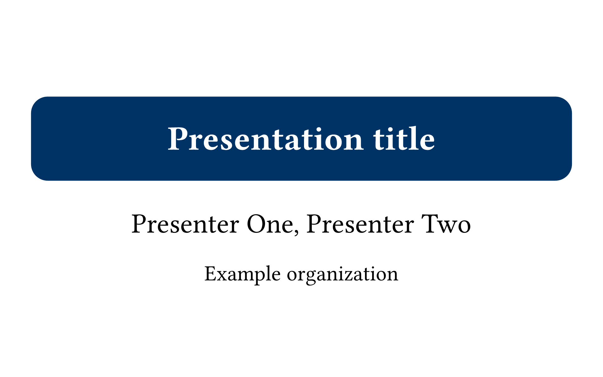
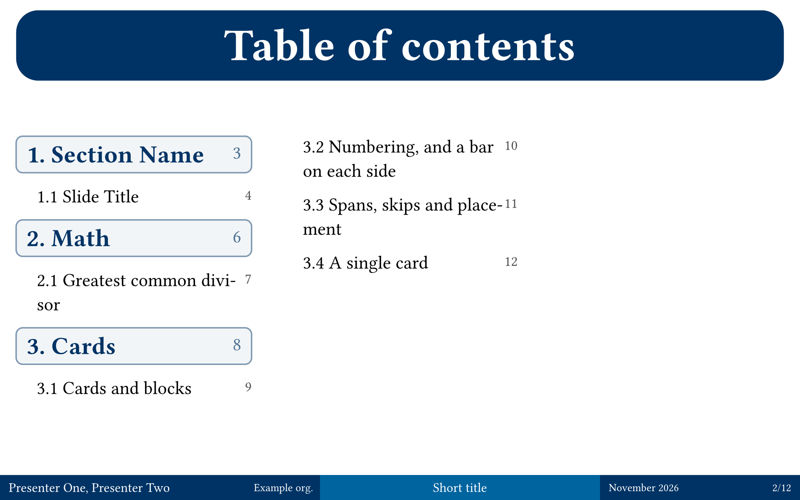
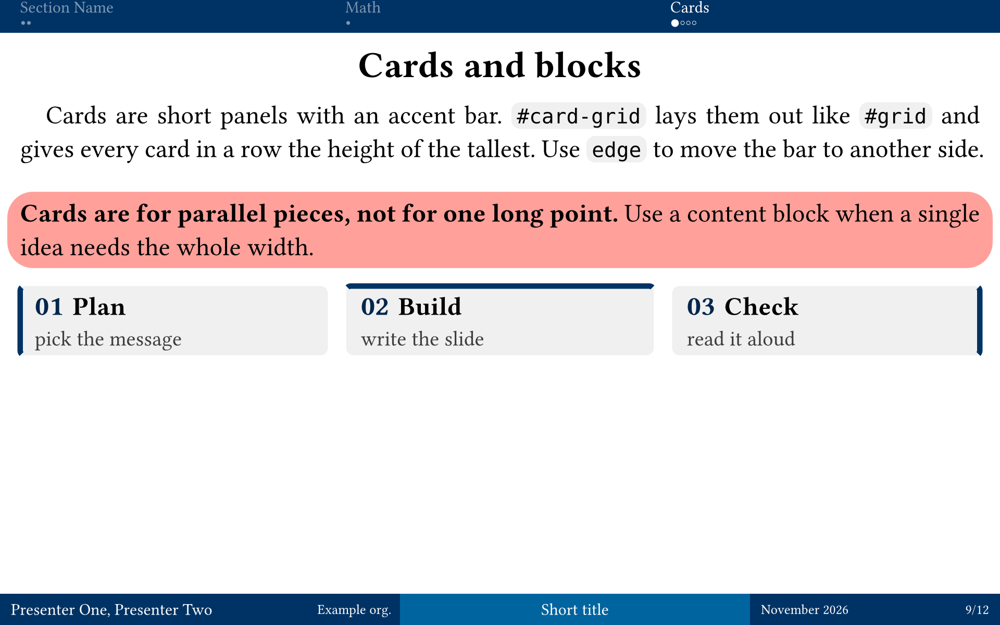

# Pepentation

*Clean slides for presentations.*

Pepentation is a Typst template for talks and technical presentations. It
provides a navigation header, a table of contents, themed content blocks,
grid-based cards, and speaker notes.

| Title slide | Table of contents | Cards and blocks |
| - | - | - |
|  |  |  |

## Features

- Theme presets with light and dark variants, plus per-key overrides.
- Navigation header with a progress tracker and a clickable table of contents.
- Automatic three-column footer: presenters, short title, and date/page.
- Nine styled content blocks and grid-based cards.
- Speaker notes exported to a `.pdfpc` sidecar for presenter consoles.

## Installation

Pepentation requires Typst 0.15 or newer. Import the published package:

```typst
#import "@preview/pepentation:0.4.0": *
```

Or start a new project from the template:

```sh
typst init @preview/pepentation:0.4.0
```

## Quick start

Configure the deck once at the top of the file:

```typst
#import "@preview/pepentation:0.4.0": *

#show: setup-presentation.with(
  title-slide: (
    enable: true,
    title: "Presentation title",
    authors: ("Presenter One", "Presenter Two"),
    institute: "Example organization",
  ),
  table-of-contents: "detailed",
)

= Introduction

== First slide
Your content here.
```

`template/main.typ` is a fully configured example deck. Copy it into your
project and start editing.

## Documentation

- [Documentation index](https://github.com/Pepengu/pepentation/blob/v0.4.0/docs/README.md)
  — installation, a first deck, and every guide.
- [Configuration](https://github.com/Pepengu/pepentation/blob/v0.4.0/docs/reference/configuration.md)
  — every option and its default.
- [API reference](https://github.com/Pepengu/pepentation/blob/v0.4.0/docs/reference/api.md)
  — the public functions.
- [Development](https://github.com/Pepengu/pepentation/blob/v0.4.0/docs/development.md)
  — local setup, tests, and releases.
- [Changelog](CHANGELOG.md)

## License

MIT — see [LICENSE](LICENSE).
