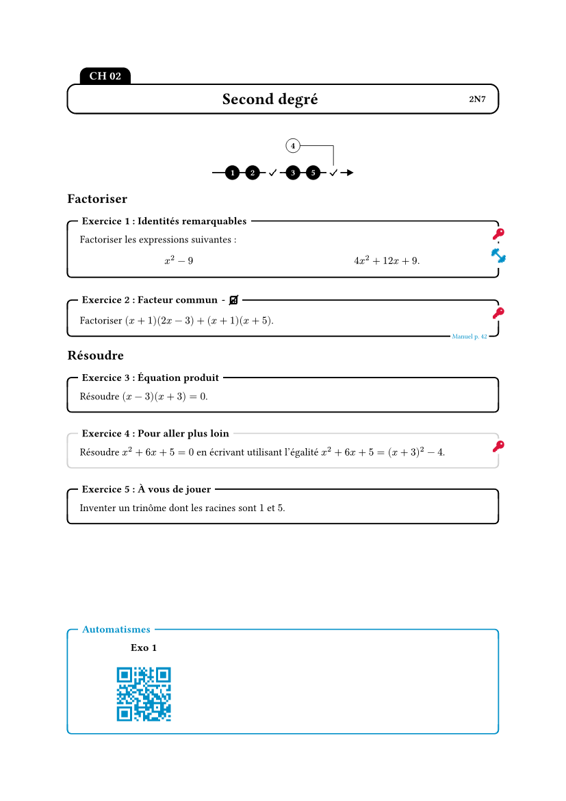
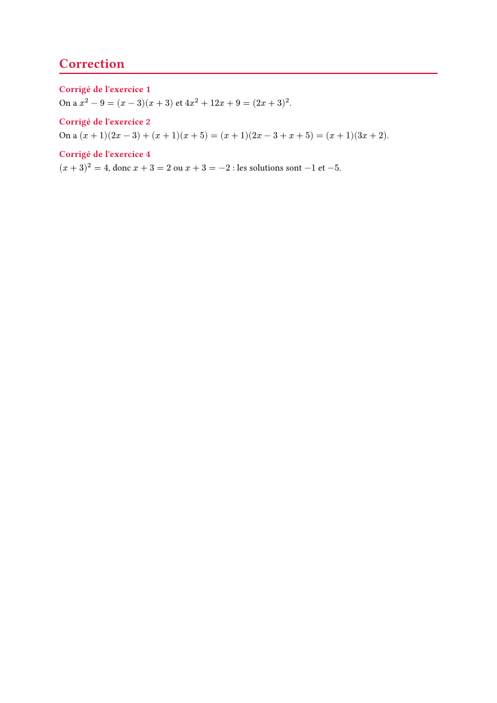

# profmaquette-minimal

Exercise sheets and written tests for maths teachers, inspired by Christophe
Poulain's LaTeX package [ProfMaquette](https://ctan.org/pkg/profmaquette):
exercises with solutions gathered where you want them, an exercise roadmap,
and tests where students answer directly on the sheet. The interface, the
documentation and this README are in French.

Ce paquet permet la création de fiches d'exercices à la manière du package LaTeX
[ProfMaquette](https://ctan.org/pkg/profmaquette) de **Christophe Poulain**, ainsi que la création d'interrogations écrites sur laquelle l'élève répond directement aux questions. Le paquet est pensé, pour le moment, pour ces deux usages.

📖 **[Documentation complète](https://amjmeyer.github.io/profmaquette-minimal/)**

> **Note :** une petite partie seulement de ProfMaquette (version LaTeX) est implémentée. Pour le moment, seule la feuille de route et "le mode interrogation écrite" sont implémentés. Écrit d'abord pour mon usage personnel, le paquet pourra évoluer
> de façon incompatible jusqu'à une version 1.x.x

<p align="center">
  
  
</p>

## Démarrage rapide

Le code ci-dessous donne exactement les deux pages ci-dessus.

```typ
#import "@preview/profmaquette-minimal:0.3.0": *

#show: maquette.with(
  position-corriges: "fin",
  titre-maquette: (gauche: "CH 02", centre: "Second degré", droite: "2N7"),
)

#align(center, afficher-fdr)

#thematique[Factoriser]
#exercice(titre: "Identités remarquables", entrainement: "https://exemple.fr")[
  Factoriser les expressions suivantes :
  #grid(
    columns: (1fr,)*2,
    column-gutter: 1em, 
    $
      x^2 - 9
    $,
    $
      4x^2 + 12x + 9.
    $
  )
]
#corrige[
  On a $x^2 - 9 = (x - 3)(x + 3)$ et $4x^2 + 12x + 9 = (2x + 3)^2$.
]

#exercice(
  titre: "Facteur commun", 
  source: "Manuel p. 42", 
  calculatrice: false
)[
  Factoriser $(x + 1)(2x - 3) + (x + 1)(x + 5)$.
]
#corrige[
  On a $(x + 1)(2x - 3) + (x + 1)(x + 5) = (x + 1)(2x - 3 + x + 5) = (x + 1)(3x + 2)$.
]

#thematique[Résoudre]
#exercice(
  titre: "Équation produit"
)[
  Résoudre $(x - 3)(x + 3) = 0$.
]

#exercice(
  titre: "Pour aller plus loin", 
  route: false
)[
  Résoudre $x^2 + 6x + 5 = 0$ en écrivant utilisant l'égalité $x^2 + 6x + 5 = (x + 3)^2 - 4$.
]
#corrige[
  $(x + 3)^2 = 4$, donc $x + 3 = 2$ ou $x + 3 = -2$ : les solutions sont $-1$ et $-5$.
]

#exercice(
  titre: "À vous de jouer", 
  pas-corrige: true
)[
  Inventer un trinôme dont les racines sont $1$ et $5$.
]
```

## Remerciements

Merci à **Christophe Poulain** : les idées et une partie du vocabulaire viennent
de [ProfMaquette](https://ctan.org/pkg/profmaquette), les limites de cette
adaptation sont les miennes. 

## Licence

[LPPL 1.3c](LICENSE) ou ultérieure, comme ProfMaquette.
