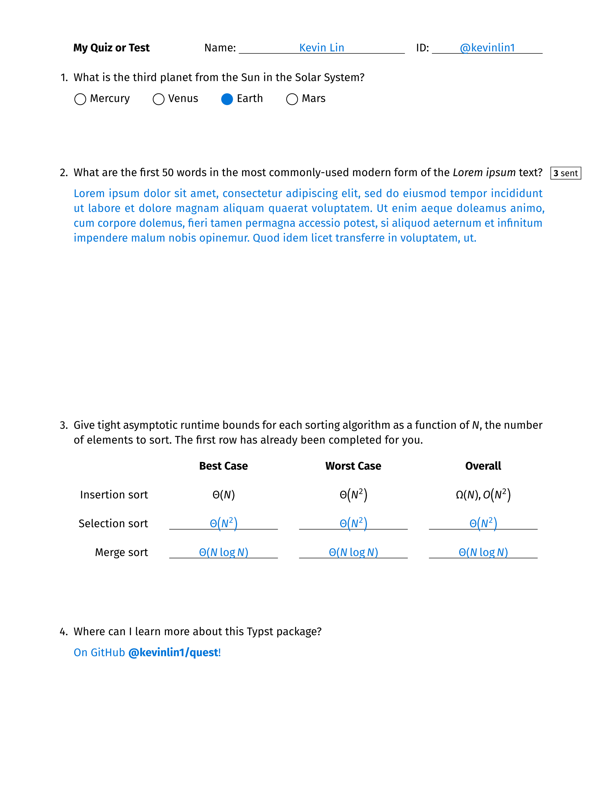

# quest

Write compact **qu**izzes and t**ests** (quests) with Typst! To get started, see the [template/main.typ](template/main.typ) file:

```typst
#import "@preview/quest:0.3.0": *

#let display = true
#let solution = solution.with(display)
#let sentences = sentences.with(display)
#let blank = blank.with(display)
#let correct-choice = correct-choice(display)
#let correct-option = correct-option(display)
#show: quest.with(
  "My Quiz or Test",
  "Kevin Lin",

  // Automatically generate customized PDFs: https://typst.app/blog/2025/automated-generation
  ..if "name" in sys.inputs { (identity: sys.inputs) },
  // Or specify an identity that will only appear when display = true (for solution guides)
  ..if display { (identity: (name: "Kevin Lin", id: "@kevinlin1")) },
  // An alternative to specifying id is email, as in (name: "Kevin Lin", email: "hello@kevinl.info")
  // Customize the header fields by mapping each identity key to a label (or a dictionary with label and width)
  // fields: (name: "Name", id: "Student ID"),

  // Customize default settings (or remove these to accept defaults)
  paper: "us-letter",
  lang: "en",
  region: "US",
  dedent: 1.25em, // Or 1.75em for 2-digit numbering
  spacing: 6em,
)

+ What is the third planet from the Sun in the Solar System?
  #grid(
    columns: 4,
    gutter: 2em,
    [#choice Mercury],
    [#choice Venus],
    [#correct-choice Earth],
    [#choice Mars],
  )

+ What are the first 50 words in the most commonly-used modern form of the _Lorem ipsum_ text?
  // Vertical space is automatically allocated based on the given number of sentences
  #sentences(3)[#lorem(50)]

+ Give tight asymptotic runtime bounds for each sorting algorithm as a function of $N$, the number of elements to sort. The first row has already been completed for you.
  #table(
    align: (right,) + (center,) * 3,
    columns: (auto,) + (1fr,) * 3,
    stroke: none, // Or (x, y) => if x > 0 and y == 0 { (bottom: 0.5pt) } to selectively add bottom stroke
    gutter: 1em,
    table.header([], [*Best Case*], [*Worst Case*], [*Overall*]),
    [Insertion sort], $Theta(N)$, $Theta(N^2)$, $Omega(N), O(N^2)$,
    [Selection sort], blank(1fr, $Theta(N^2)$), blank(1fr, $Theta(N^2)$), blank(1fr, $Theta(N^2)$),
    [Merge sort], blank(1fr, $Theta(N log N)$), blank(1fr, $Theta(N log N)$), blank(1fr, $Theta(N log N)$),
  )

+ Where can I learn more about this Typst package?
  #solution[On GitHub #link("https://github.com/kevinlin1/quest")[*\@kevinlin1/quest*]!]
```

The contents of this file compiles to the following preview.



## Usage

The simplest way to use this package is to adapt the [template/main.typ](template/main.typ) file. This template file walks through the necessary frontmatter to write a compact quiz or test. However, the simplest frontmatter only requires specifying the name and author of the document:

```typst
#import "@preview/quest:0.3.0": *

#let display = true
#let solution = solution.with(display)
#let sentences = sentences.with(display)
#let blank = blank.with(display)
#let correct-choice = correct-choice(display)
#let correct-option = correct-option(display)
#show: quest.with(
  "My Quiz or Test",
  "Kevin Lin",
)
```

This produces an empty quiz or test with blank "Name" and "ID" fields.

To change the header fields, pass `fields` as a dictionary that maps each `identity` key to its label. Each value can be either a label string or a dictionary with `label` and an optional `width` (by default, `name` is `15em` and every other field is `10em`). The header shows the fields in the order you list them.

```typst
#show: quest.with(
  "My Quiz or Test",
  "Kevin Lin",
  fields: (name: "Name", username: (label: "Username", width: 8em)),
  // Optionally fill in the fields, e.g. for solution guides
  identity: (name: "Kevin Lin", username: "kevinlin1"),
)
```
