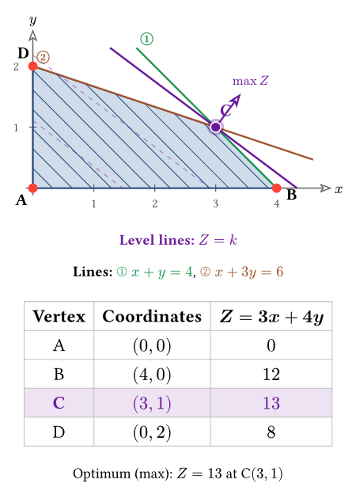
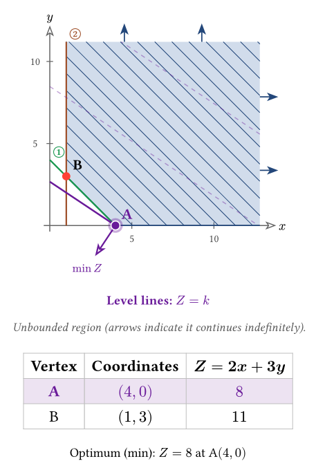
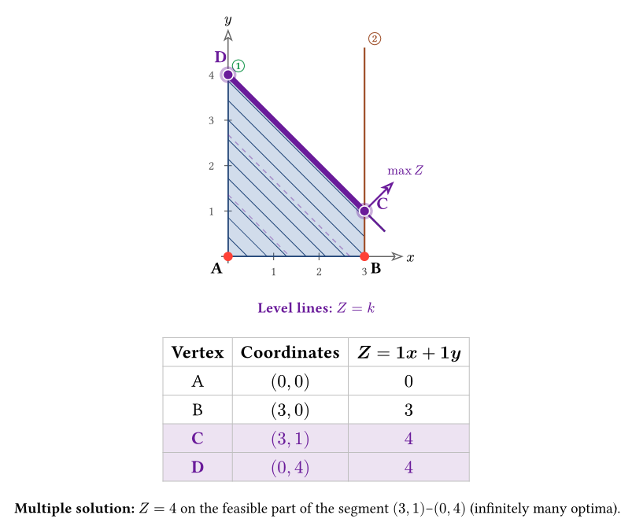
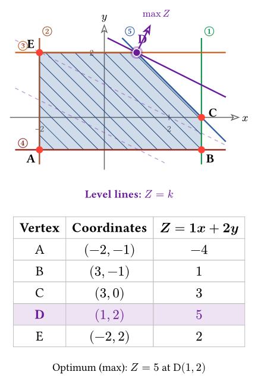
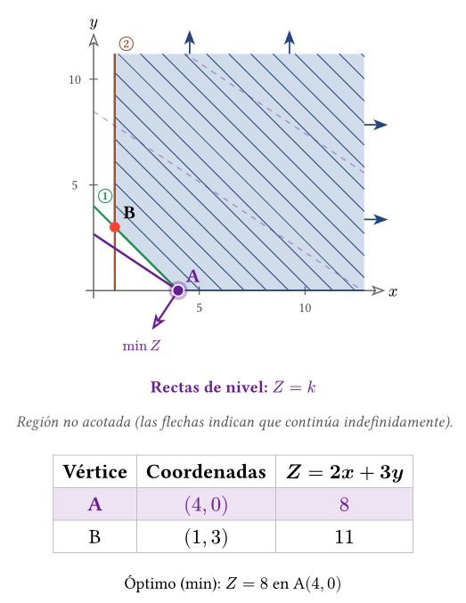

# quick-vertex

Plot **feasible regions of two-variable linear programs** in [Typst](https://typst.app),
drawn with [CeTZ](https://github.com/cetz-package/cetz). One call gives you the
shaded region, the boundary lines, the vertices, the objective's level lines and
optimization direction, and a vertex table with the optimum highlighted.

It is built for teaching (secondary school / early undergraduate), and it handles
the cases a synthetic example set usually forgets: **unbounded regions, multiple
optima, unbounded objectives, empty regions, strict inequalities and any quadrant**.
The objective's **level lines** are named explicitly ("Rectas de nivel" in
Spanish); the direction arrow says `min Z` or `max Z`.

<p align="center">
  
  
</p>
<p align="center">
  
  
</p>

## Usage

```typ
#import "@preview/quick-vertex:0.2.0": feasible-region

#feasible-region(
  ((1, 1, 4, "<="), (1, 3, 6, "<=")),
  objective: (3, 4),
  sense: "max",
  labels: ($x + y = 4$, $x + 3y = 6$),
)
// → Optimum (max): Z = 13 at C(3, 1)
```

This is exactly the first image in the gallery above.

Each constraint is a 4-tuple `(a, b, c, op)` meaning `a·x + b·y op c`, where
`op` is one of `"<="`, `">="`, `"<"`, `">"`. The objective is `Z = c1·x + c2·y`,
given as `(c1, c2)`.

When working from a local checkout, import `"lib.typ"` instead of the registry
package. Imports of `0.2.0` become available once its Typst Universe submission
is accepted.

## Examples

### Minimize with Spanish labels

```typ
#import "@preview/quick-vertex:0.2.0": feasible-region
#feasible-region(
  ((1, 1, 4, ">="), (1, 0, 1, ">=")),
  objective: (2, 3), sense: "min", lang: "es",
)
// → Óptimo (min): Z = 8 en A(4, 0)
```



The purple **rectas de nivel** represent `Z = k`. The arrow labeled `min Z`
points toward decreasing objective values. With `sense: "max"`, it points
toward increasing values and is labeled `max Z`.

### Level lines without the direction arrow

```typ
#import "@preview/quick-vertex:0.2.0": feasible-region
#feasible-region(
  ((1, 1, 4, "<="), (1, 3, 6, "<=")),
  objective: (3, 4), gradient: false,
)
```

### Strict inequality: an unattained supremum

```typ
#import "@preview/quick-vertex:0.2.0": feasible-region
#feasible-region(
  ((1, 1, 4, "<"),),
  objective: (1, 1), sense: "max", lang: "es",
)
// → Supremo: Z = 4, no alcanzado
```

The excluded boundary is dashed and its vertices are hollow. No point is
marked as an attained optimum. The same conclusion is shown with `table: false`.

Example sources: [gallery](gallery/examples.typ),
[Spanish minimum](gallery/g2-es.typ), and
[additional cases](gallery/additional.typ).

## Parameters

| Parameter        | Default      | Meaning |
|------------------|--------------|---------|
| `constraints`    | *(required)* | Array of `(a, b, c, op)`. `op ∈ "<=", ">=", "<", ">"`. An optional 5th element sets that line's color: `(a, b, c, op, color)`. |
| `objective`      | `none`       | `(c1, c2)` of `Z = c1·x + c2·y`. Omit to just draw the region. An optional 3rd element sets the objective color: `(c1, c2, color)`. |
| `sense`          | `"max"`      | Optimization sense: `"max"` or `"min"`. |
| `gradient`       | `true`       | Draw the optimization direction arrow, labeled `max Z` or `min Z`. For an unattained bound, draw it on the limiting face. |
| `table`          | `true`       | Show the vertex table; if `false`, a compact vertex legend. Objective diagnostics are shown in either mode. |
| `first-quadrant` | `true`       | Add `x ≥ 0, y ≥ 0` implicitly. See the note below. |
| `labels`         | `none`       | Array of line equations (content), one per constraint, in the same order. |
| `lang`           | `"en"`       | Language of the rendered labels: `"en"` or `"es"`. |
| `region-color`   | blue         | Fill / hatch / border color of the feasible region. |
| `size`           | `(6, 4.5)`   | Canvas size, in CeTZ units — with `equal-aspect: true`, an **upper bound**: the drawn extent shrinks in whichever dimension isn't the tightest fit. |
| `margin`         | `1.15`       | Finite padding factor around the region, at least `1`. |
| `equal-aspect`   | `true`       | Both axes use the same units-per-length scale (textbook square-grid convention; both axes also share one tick step). `false` stretches each axis independently to fill `size` exactly, with its own tick step — the optimization arrow stays perpendicular to the level lines either way. |

> **⚠️ `first-quadrant` is `true` by default**, so **`x ≥ 0` and `y ≥ 0` are added
> automatically** (the usual assumption in school problems). Pass
> `first-quadrant: false` to draw only the constraints you write — for example
> when the region lives in another quadrant.

> **Note on two "senses".** The 4th tuple element is the inequality *operator*
> (`"<="`, …). The `sense` parameter is the *optimization* sense (`"max"`/`"min"`).
> They are unrelated.

`gradient` is the historical name of the arrow flag. Set `gradient: false`
to hide the arrow while keeping the objective's level lines.

## Colors

Every boundary line gets a **distinct color automatically** — a curated palette
first, then generated hues — so colors never repeat, no matter how many
constraints you add. Override any of them explicitly:

```typ
#feasible-region(
  (
    (1, 1, 4, "<=", red),          // this line in red
    (1, 3, 6, "<="),               // auto color
  ),
  objective: (3, 4, olive),        // objective, optimum and direction arrow in olive
  region-color: rgb("#2b8a3e"),    // the feasible region in green
)
```

## What it handles

| Case | Behavior |
|---|---|
| Bounded region | Filled + hatched polygon. |
| **Unbounded region** | Filled correctly; arrows on the open sides + an "unbounded" note. |
| Unique optimum | Highlighted vertex, optimal level line, direction arrow, table with the optimal row marked. |
| **Multiple optima** | Highlights the feasible optimal segment, ray or line. Excluded endpoints remain hollow. |
| **Zero objective** `(0, 0)` | Every feasible point is optimal; highlights the whole region. |
| **No vertices** | Handles half-planes, strips, lines and the whole plane without confusing them with an empty region. |
| **Unbounded objective** | Detects that no finite max/min exists and says so, instead of inventing a vertex. |
| Empty region | Labels "Infeasible region". |
| **Strict inequalities** (`<`, `>`) | Dashed boundary and hollow excluded vertices; reports an unattained supremum/infimum when appropriate. |
| **Any quadrant** | `first-quadrant: false` works (frame, axes and ticks with negatives). |

## Localization

Rendered labels default to English. Pass `lang: "es"` for Spanish. Adding a
language is a matter of copying one block in the `_i18n` dictionary in `lib.typ`
and translating it — contributions welcome.

## How it works

The analysis is independent of drawing. Constraint normals and the objective
are normalized before geometric comparisons. The recession cone is analyzed
using constraint tangents and inward normals, without angular sampling.
Feasibility is tested independently of the visible frame, including strict
systems and regions without vertices. Strict optimal faces are checked for an
included point before claiming that a maximum or minimum is attained.

The shading clips the visible frame against each half-plane
(Sutherland–Hodgman). Tables list vertices of the **closure**: a row marked `○`
and a hollow plotted point identify an excluded boundary point, which is never
marked as an attained optimum. The arrow is perpendicular to the level lines
and shows the optimization direction: toward increasing `Z`, labeled `max Z`,
for maximization; toward decreasing `Z`, labeled `min Z`, for minimization.
For a linear objective in two variables, these level curves are straight lines.
The matching-color legend names them "Level lines: Z = k", or
"Rectas de nivel: Z = k" with `lang: "es"`.

Inputs are validated: coefficients must be finite numbers, operators and
optimization sense must be supported, colors must be colors, dimensions must
be positive, and labels must match the number of constraints. Constant
constraints such as `(0, 0, 5, "<=")` are allowed and checked normally.

### Pure analysis

`analyze` takes `constraints`, `objective`, `sense` and `first-quadrant`, with the
same defaults as `feasible-region`, and returns data without drawing:

```typ
#import "@preview/quick-vertex:0.2.0": analyze
#let result = analyze(
  ((1, 1, 4, "<"),),
  objective: (1, 1),
)
#assert.eq(result.status, "unattained")
#assert(calc.abs(result.value - 4) < 1e-8)
```

Its fields include `feasible`, `bounded`, `vertices` (closure vertices),
`recession` (feasible directions), `witness` (a feasible point), `status`,
`value`, `optimum`, `optimal-indices` and `closure-indices`.
Empty regions have `witness: none`, no recession directions and `bounded: true`.

`status` is `none` (no objective), `infeasible`, `unbounded` (objective),
`unattained`, `unique`, `segment`, `ray`, `line` or `all` (zero objective).
For a finite objective, `value` is its optimal value or limiting bound;
`optimum` is a point on that face and belongs to the actual region unless the
status is `unattained`. It is `none` when the objective is absent, the region
is empty, or the objective is unbounded. `optimal-indices` only includes
vertices that are actual attained optima. No optimal point is asserted for an
empty region, even if its closure has vertices.

## Compatibility

- Typst `>= 0.14.0`
- CeTZ `0.5.2`

Verified with Typst 0.14.0 and 0.15.1. Mathematical assertions, an independent
exact projection oracle and text/SVG regressions are described in
[TESTING.md](TESTING.md). See [CHANGELOG.md](CHANGELOG.md) for the 0.2.0 changes.

## Known limitations

Calculations use floating-point arithmetic with normalized geometric
tolerances (`1e-10`, plus a roundoff allowance for large coordinates).
Positive coefficient scaling preserves classification
within floating-point accuracy, but near-coincident boundaries and nearly
parallel constraints can still be numerically ill-conditioned. Inputs whose
normalization overflows are rejected. This is not an exact rational solver.
Values are displayed to two decimal places, except small nonzero values which
retain their numeric representation.

See [`ROADMAP.md`](ROADMAP.md) for remaining presentation limitations and
[`TESTING.md`](TESTING.md) for the mathematical and rendering checks.

## License

[MIT](LICENSE).
