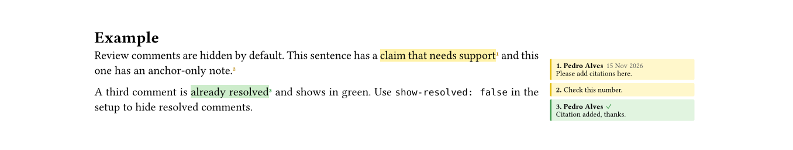

# review-comments

Word-style review comments for [Typst](https://typst.app). Attach a note to a
passage of text; comments are **hidden by default** and can be switched on to
review the document: the commented text is highlighted and the notes appear in
an extra right-hand margin.



## Quick start

```typ
#import "@preview/review-comments:0.3.0": *

// enabled: true shows the comments, false (default) hides them.
#show: review-comments.with(enabled: true)

This sentence has a
#comment(author: "Pedro Alves", date: "15 Nov 2026")[Please add citations.][claim that needs support]
and this one an anchor-only note.#comment[Check this number.]
```

Switch `enabled` to `false` (or remove the `#show` line) and the document is
exactly as if the comments were not there.

## Writing comments

| Call                                | Result                                           |
| ----------------------------------- | ------------------------------------------------ |
| `#comment[note][text]`              | Highlights `text` and attaches `note`            |
| `#comment[note]`                    | Numbered marker only, no highlighted text        |
| `#comment(author: "..", date: "..")[note][text]` | Adds author and date to the card    |
| `#comment(resolved: true)[note][text]` | Marks the comment as resolved (green, with ✓) |

Comments are numbered automatically in document order.

### Resolved comments

A comment with `resolved: true` is shown in green. To remove resolved
comments from the output altogether, set `show-resolved: false` in the setup.
Hidden comments take no space and do not use up a number, so the remaining
ones stay numbered 1, 2, 3, ...

```typ
#show: review-comments.with(enabled: true, show-resolved: false)

#comment(author: "Pedro Alves", resolved: true)[Citation added.][done]
```

## Setup options

`review-comments` is applied with `#show: review-comments.with(...)`:

| Option          | Default   | Description                                                  |
| --------------- | --------- | ------------------------------------------------------------ |
| `enabled`       | `false`   | Show the comments                                            |
| `show-resolved` | `true`    | Show comments marked `resolved: true`                        |
| `paper`         | `"a4"`    | Paper size of the document (`"a5"`, `"us-letter"`, ...)      |
| `paper-width`   | `auto`    | Explicit page width, for sizes not covered by `paper`        |
| `margin-right`  | `3cm`     | The document's normal right page margin                      |
| `margin-width`  | `5.5cm`   | Width of the extra comment margin                            |
| `fill`          | yellow    | Highlight and card colour                                    |
| `accent`        | amber     | Colour of the card's left border                             |
| `resolved-fill`, `resolved-accent` | green | The same, for resolved comments               |

Supported `paper` values: `a3`, `a4`, `a5`, `a6`, `b4`, `b5`, `b6`, `iso-b5`,
`us-letter`, `us-legal`, `us-executive`, `us-tabloid`. For any other size pass
`paper-width` (the page width *without* the comment margin).

## How it works

When enabled, the page is widened on the right only, by `margin-width`. The
text area keeps its size, so line breaks and page breaks are identical to the
version without comments. The package needs to know the page width and right
margin to place the notes, which is why you set `paper` and `margin-right` if
your document is not A4 with a 3cm right margin.

Notes are placed next to the line they are anchored to. A note that would
overlap the previous one on the same page is pushed down below it; with very
many comments on one page the stack may run past the bottom of the page.

## Using it with a template

Apply `review-comments` **after** the template (and after any `#set page`
rules): the later rule wins, so the widened page and margin are not
overwritten.

```typ
#import "@preview/some-template:1.0.0": *
#import "@preview/review-comments:0.3.0": *

#show: some-template.with(title: "My thesis")
#show: review-comments.with(enabled: true, paper: "a4", margin-right: 3cm)
```

Import the package in every chapter file where you use `#comment`.

## VS Code extension

A companion VS Code extension is available for working with these comments:
[p8094/typst-review-comments-vscode](https://github.com/p8094/typst-review-comments-vscode).

## License

MIT
