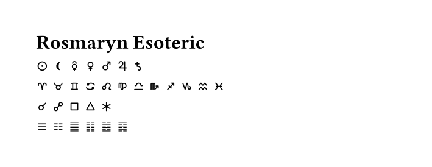

# rosmaryn-esoteric

Named Typst commands for astrological and Yijing symbols, set in the open [Rosmaryn Esoteric](https://github.com/Rosmaryn-Dev/rosmaryn-esoteric-font) font.



## Setup

Typst packages cannot ship fonts, so install the font first: download the TTF files from the font repository and either install them on your system or pass their folder with `--font-path`.

## Use

```typ
#import "@preview/rosmaryn-esoteric:0.1.0": *

#sun in #aries, #moon in #cancer. #mars #trine #jupiter.

#trigram-heaven #hexagram(1) #hexagram(64)
```

Available names: the twelve signs (`aries` to `pisces`, `scorpius` for Scorpio), `sun`, `moon`, `mercury`, `venus`, `earth`, `mars`, `jupiter`, `saturn`, `uranus`, `neptune`, `pluto`, `ascending-node`, `descending-node`, `chiron`, `ceres`, `pallas`, `juno`, `vesta`, `black-moon-lilith`, `lot-of-fortune`, `vertex`, the aspects `conjunction`, `opposition`, `square`, `trine`, `sextile`, `semisextile`, `quincunx`, `semisquare`, `sesquiquadrate`, the monograms and digrams `yang`, `yin`, `greater-yang`, `lesser-yin`, `lesser-yang`, `greater-yin`, the trigrams `trigram-heaven` to `trigram-earth`, and `hexagram(n)` for n from 1 to 64. `esoteric(body)` sets any text in the font.

Every symbol is its standard Unicode character, so the text stays searchable and copyable.

## Licence

Code: MIT-0. Font: SIL Open Font License 1.1.
