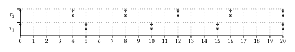
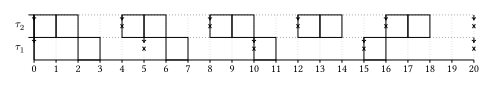
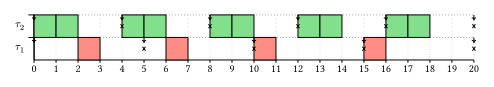

# RT-Sched -- plot real-time schedulers

Short package for plotting real-time scheduling of tasksets.

## Features

- Plot a taskset with the informations about releases and deadlines
- Plot the scheduling of a taskset;
  - Execution and deadlines are diplayed and,
  - A different scheduler's implementation can be given to the plotting function.
- Implicit, constrained and arbitrary deadlines are supported, as well as synchronous and asynchronous systems.
- Configure the layout of the plot (width of steps, height of task, colors of the tasks).

## Getting started

```typst
#import "@preview/rt-sched:0.0.1": print-taskset, scheduler, plot

// Declare a taskset
// o: offset (optionnal, default=0)
// c: worst-case execution time
// d: deadline
// t: period
#let taskset = (
  (c: 7, d: 10, t: 10),
  (c: 1, d: 16, t: 16),
  (o: 4, c: 3, d: 15, t: 15),
)

#print-taskset(taskset)

// Plot the interval [0, 20) of the taskset with RM
#plot(
    from: 0,
    to: 20,
    tasks: taskset,
    scheduler: scheduler.rm,
)
```

## API Reference

### Configuration

The configuration is represented as an array of three values:

- the width of a task (`step-width`: length)
- the height of a task (`task-height`: length)
- the color set from which the task choose a color (`colors`: array of colors)

```typst
#let config = (
  task-height: 0.8cm,
  step-width: 2em,
  colors: none,
)
```

If you want the scheduler some colors you could do:

```typst
#import "@preview/rt-sched:0.0.1": config, plot
config.colors = (red, blue, green)
```

and pass the config to the plot function.

### Plot

```typst
plot(
  // start of the interval
  from: int,
  // end of the interval (included)
  to: int,
  // number of step used on the x-axis (default: 1)
  step: 1,
  // the taskset display on the plot, the order of the tasks depend on their
  // order in the array (element at index i has index i + 1)
  // each task contains at least the following fields:
  // - o: int, the offset (optional)
  // - c: int, the wcet (mandatory)
  // - d: int, the deadline (mandatory)
  // - t: int, the period (mandatory)
  tasks: array,
  // the configuration of the plot (array)
  // contains the following fields
  // - config.task-height (mandatory)
  //   the height of the tasks
  // - config.step-width (mandatory)
  //   the width of the tasks
  // - config.colors (optional)
  //   the colors from which each task get their color (by index modulo
  //   the number of colors)
  config: (
    task-height: 0.8cm,
    step-width: 2em,
    colors: none,
  ),
  // the scheduling function, if none only the plot is displayed
  // the function take the array of running_jobs and the instant t
  // and return the array sorted with the highest priority task in first
  // position
  scheduler: none,
  // display a mark to indicate an idle unit (default: false)
  display-idle: false,
  // try to find a step-width that enable the plot to be printed on a a4 page
  auto-width: true,
)
```

### Scheduling functions

A scheduling function must take array of running jobs as parameter and the instant `t` at which it's called and return a sorted array where the highest priority job is put at the first position.

The `scheduler` namespace contains the implementation of the following scheduling algorithm:

- `rm`: Rate Monotonic
- `dm`: Deadline Monotonic
- `edf`: Earliest Deadline First
- `llf`: Least Laxity First
- `priority_assignment`: Priority based on the task index (lower the index, higher the priority) $\tau_1 \succ \tau_2 \succ ... \succ \tau_n$.
- `reversed_priority_assignement`: Priority based on the task index (lower the index, lower the priority) $\tau_n \succ \tau_{n-1} \succ ... \succ \tau_1$.

The scheduling function is then passed as a parameter of the `plot` function.

## Examples

1. Plot a tasket without scheduling it.

```typst
#import "@preview/rt-sched:0.0.1": *
#let taskset = (
  (c: 1, d: 5, t: 5),
  (c: 2, d: 4, t: 4),
)

#plot(from: 0, to: 20, tasks: taskset)
```



2. Plot a tasket and scheduling it (with RM).

```typst
#import "@preview/rt-sched:0.0.1": *
#let taskset = (
  (c: 1, d: 5, t: 5),
  (c: 2, d: 4, t: 4),
)

#plot(from: 0, to: 20, tasks: taskset, scheduler: scheduler.rm)
```



3. Use colors for plotting

```typst
#import "@preview/rt-sched:0.0.1": *
#let taskset = (
  (c: 1, d: 5, t: 5),
  (c: 2, d: 4, t: 4),
)

#{config.colors = (red.lighten(40%), green.lighten(40%))}

#plot(from: 0, to: 20, tasks: taskset, scheduler: scheduler.rm, config:config)
```


