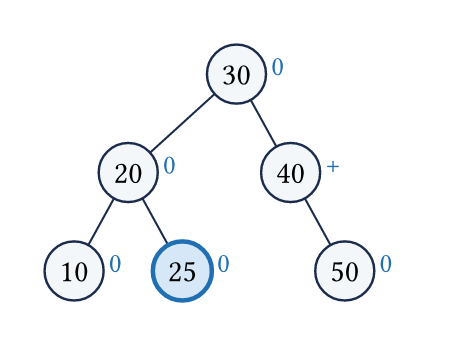
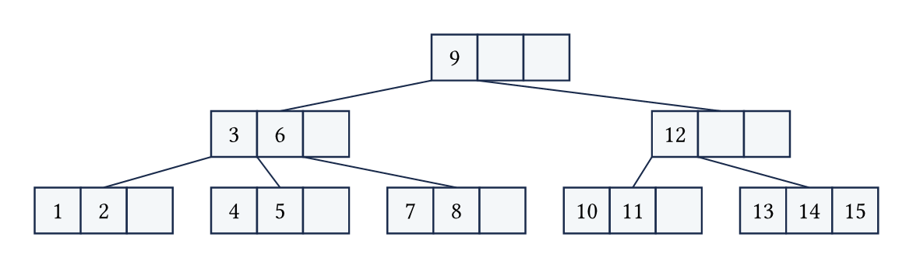
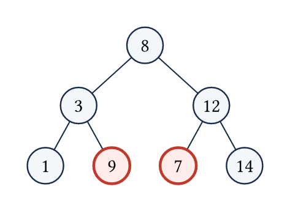
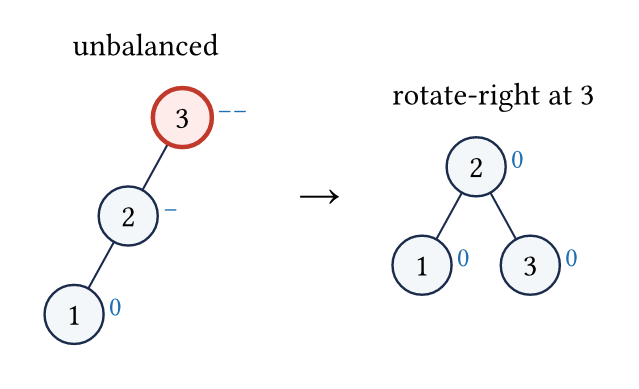

[](https://github.com/revo2123/sapling)
[](LICENSE)

# sapling
A small and simple Typst library for creating **computer science trees**: binary trees, binary search trees, AVL trees, heaps, treaps and B-trees.

```typ
#import "@preview/sapling:0.1.0": *
```

## Build a tree from keys
Every tree type has a `-from` function that inserts the keys one after another and draws the result. AVL trees show their balance factors, and `marked` highlights keys, such as the one you just inserted.
```typ
#avl-tree-from((10, 20, 30, 40, 50, 25), marked: (25,))
```


B-trees take their order (the maximum number of children per page) as well:
```typ
#b-tree-from(range(1, 16), 4)
```


The same works for `binary-tree-from`, `bst-from`, `heap-from` and `treap-from`.

## Draw a tree you specify
Without `-from`, the tree is drawn exactly as you write it. A node is `(key, left, right)`, a leaf can be just its key, and `none` is an empty subtree. Nodes that break the rules of their tree type are marked in red, so you can show *wrong* trees in exercises too.
```typ
#bst((8, (3, 1, 9), (12, 7, 14)))
```


## Algorithms and walkthroughs
Rotations (`rotate-left`, `rotate-right`, `rotate-left-right`, `rotate-right-left`) and heap algorithms (`up-heap`, `down-heap`) return a new tree that you can draw. `walkthrough` puts several pictures next to each other to show how a tree changes, step by step.
```typ
#let t = (3, (2, 1, none), none)
#walkthrough(
  step("unbalanced", avl-tree(t)),
  step("rotate-right at 3", avl-tree(rotate-right(t, 3))),
  arrows: true,
)
```


## Change the colors
`set-colors` changes the colors of the trees inside a content block, or, as a show rule, for the rest of the document:
```typ
#show: set-colors.with(marked: green, error: orange)
```

## More
All functions, arguments and edge cases are described in [SPECIFICATION.md](SPECIFICATION.md).

## License
MIT, see [LICENSE](LICENSE).
