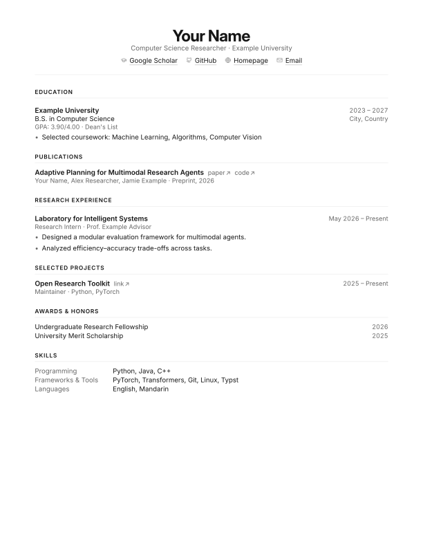
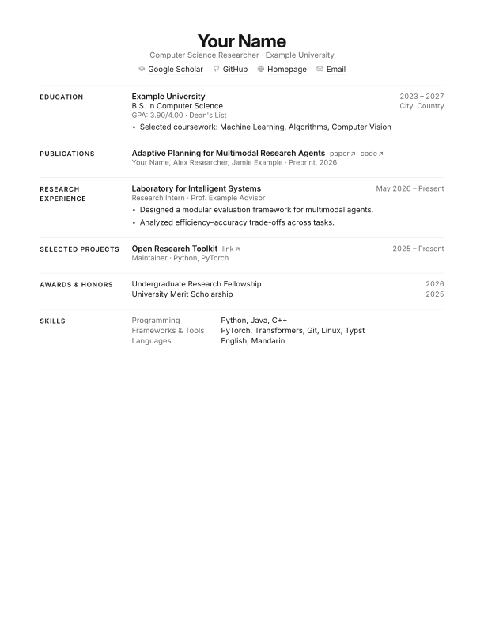
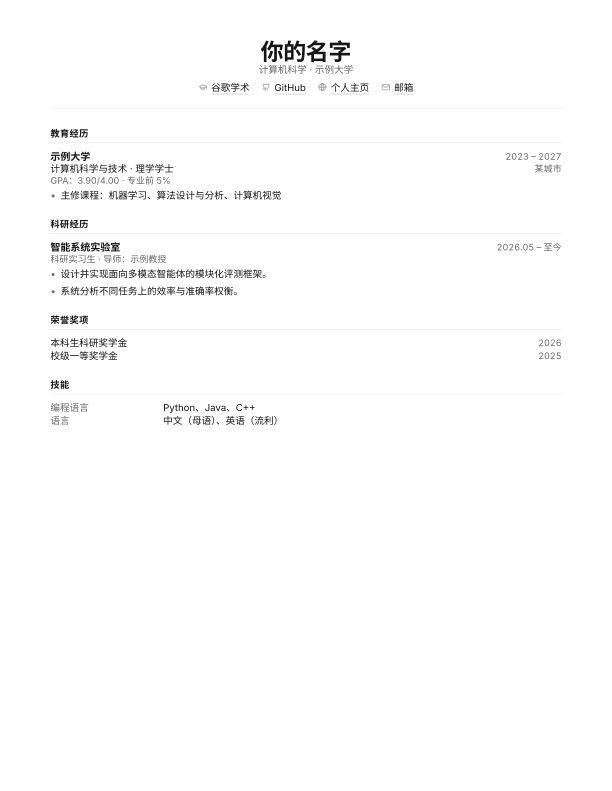

# Scholarline CV

A minimal, customizable academic CV template for [Typst](https://typst.app/).

Monochrome, typography-led, and quiet: Inter, a grayscale palette, small uppercase section labels over hairlines, and a left-content / right-date grid. Everything beyond a tiny core is a plugin: the header, sections, section headings, entry links, icons, and every component can be replaced or extended with the same primitives the built-ins use.

**Status:** v0.1.0. All examples are anonymous placeholders.

| Default | `margin-section` plugin | Chinese |
|---|---|---|
|  |  |  |

More combinations are shown in the [plugin guide](docs/PLUGINS.md#gallery).

## Quick start

**Typst web app:** choose *Start from template* and search for `scholarline-cv`.

**Command line** (Typst 0.13 or newer):

```sh
typst init @preview/scholarline-cv:0.1.0 my-cv
cd my-cv && typst compile main.typ
```

**Existing document:** `#import "@preview/scholarline-cv:0.1.0": *`

### Fonts

The design uses two free fonts: [Inter](https://rsms.me/inter/) and [Noto Sans CJK SC](https://github.com/notofonts/noto-cjk). Typst packages cannot ship fonts, so the repository's [`fonts/`](https://github.com/KevinHuge/scholarline-cv/tree/v0.1.0/fonts) folder includes the five Inter files the template needs.

- **Web app:** upload the files from [`fonts/`](https://github.com/KevinHuge/scholarline-cv/tree/v0.1.0/fonts) to your project. Noto Sans CJK SC is already built in.
- **Command line:** install the fonts, or keep them in a `fonts/` folder and compile with `--font-path fonts`.
- **Chinese:** install Noto Sans CJK SC (for example `fonts-noto-cjk` on Linux). Its Latin glyphs also stand in if Inter is missing.
- **System fonts instead:** `theme: (font: "Helvetica Neue", cjk-font: "PingFang SC")`.

### From this repository

```sh
typst compile --font-path fonts main.typ
typst compile --font-path fonts --root . examples/zh.typ
typst compile --font-path fonts --root . examples/custom-links.typ
```

## Customize

```typst
#import "@preview/scholarline-cv:0.1.0": *

#show: cv.with(
  name: "Your Name",
  subtitle: "Computer Science Researcher · Example University",
  contacts: (
    contact("GitHub", "https://github.com", icon: "github"),
    contact("Email", "mailto:you@example.com", icon: "email"),
  ),
  theme: (paper: "a4", spacing: 1.1),                     // tokens: colours, fonts, size, spacing, paper
  plugins: (section: margin-section),                     // swap or wrap any built-in part
)
```

- `lang: "zh"` for a Chinese CV; bilingual CVs keep `lang: "en"` and write `section("教育经历 Education")`.
- Built-in plugin presets: `margin-section` (section labels in a left column) and `underline-links` (underlined entry links instead of `paper ↗`).
- Write your own components with `entry`, `entry-title`, `entry-meta`, `entry-links`, `dot-join`, and `cv-icon`.

See [docs/PLUGINS.md](docs/PLUGINS.md) for plugins and recipes, and [docs/API.md](docs/API.md) for the full API.

## Development

```sh
tests/run.sh --font-path fonts   # compile-based tests
assets/gallery/build.sh            # re-render assets/images for every plugin combination
```

`tests/pass/*.typ` must compile (they use `#assert`); `tests/fail/*.typ` must fail with the message on their `// expect:` line.

## License

- `template/` (the files `typst init` copies into your project) is licensed under [MIT-0](https://spdx.org/licenses/MIT-0.html), so your CV needs no attribution.
- `icons/` is derived from [Lucide](https://lucide.dev) and licensed under ISC, except `orcid.svg`; see `icons/LICENSE`.
- [`fonts/`](https://github.com/KevinHuge/scholarline-cv/tree/v0.1.0/fonts) contains Inter, licensed under the SIL Open Font License 1.1 (`fonts/OFL.txt`). It is not part of the Typst package.
- Everything else is licensed under MIT; see `LICENSE`.
