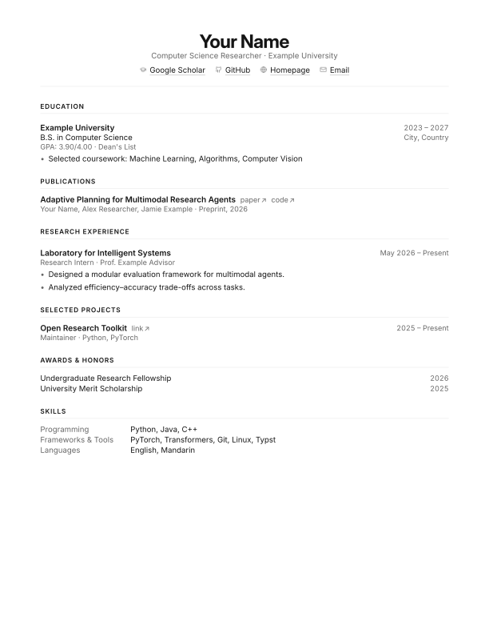
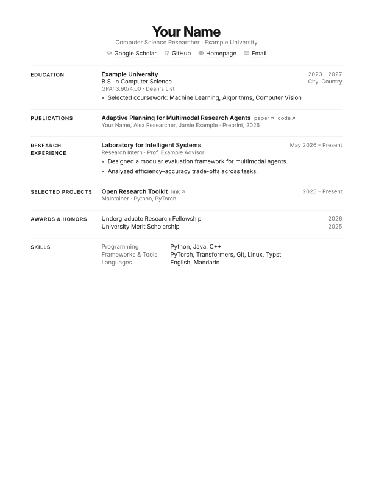
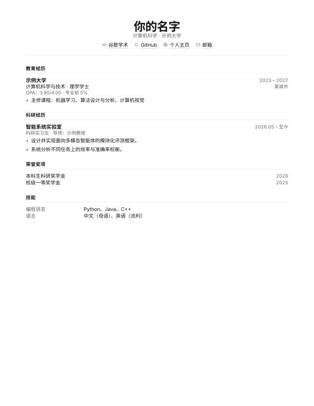

# Scholarline CV

A minimal, customizable academic CV template for Typst —— 一个极简、可定制的 Typst 学术简历模板。适合研究生申请、博士申请、科研实习和学术 CV。

单色、以排版为核心：Inter 字体、灰阶配色、小号大写章节标签加发丝线、左内容右时间的网格。核心极小，其余一切都是插件（Everything is a plugin）：页眉、章节、章节标题、条目链接、图标和所有组件都能替换或扩展，并且使用与内置组件相同的公开原语。

> v0.1.0。所有公开示例均为匿名占位信息。

| 默认 | `margin-section` 插件 | 中文 |
|---|---|---|
|  |  |  |

更多组合见[插件说明](docs/PLUGINS.zh-CN.md#效果图)。

## 快速开始

**Typst 网页版**：选择 *Start from template*，搜索 `scholarline-cv`。

**命令行**（Typst 0.13 或更新版本）：

```sh
typst init @preview/scholarline-cv:0.1.0 my-cv
cd my-cv && typst compile main.typ
```

**已有文档**：`#import "@preview/scholarline-cv:0.1.0": *`

### 字体

设计使用两款免费字体：[Inter](https://rsms.me/inter/) 和 [Noto Sans CJK SC](https://github.com/notofonts/noto-cjk)。Typst 包不能自带字体，所以仓库的 [`fonts/`](https://github.com/KevinHuge/scholarline-cv/tree/main/fonts) 文件夹附带了模板需要的 5 个 Inter 文件。

- **网页版**：把 [`fonts/`](https://github.com/KevinHuge/scholarline-cv/tree/main/fonts) 里的文件上传到项目即可，网页版已内置 Noto Sans CJK SC。
- **命令行**：安装这些字体，或者把它们放在 `fonts/` 文件夹里，编译时加 `--font-path fonts`。
- **中文**：安装 Noto Sans CJK SC（Linux 可安装 `fonts-noto-cjk`）。没有 Inter 时，它自带的拉丁字形也能顶上。
- **改用系统字体**：`theme: (font: "Helvetica Neue", cjk-font: "PingFang SC")`。

### 从本仓库编译

```sh
typst compile --font-path fonts main.typ
typst compile --font-path fonts --root . examples/zh.typ
typst compile --font-path fonts --root . examples/custom-links.typ
```

入口文件位于 `examples/` 等子目录时，请指定 `--root .`。

## 自定义

```typst
#import "@preview/scholarline-cv:0.1.0": *

#show: cv.with(
  name: "你的名字",
  subtitle: "计算机科学 · 示例大学",
  lang: "zh",
  contacts: (
    contact("GitHub", "https://github.com", icon: "github"),
    contact("邮箱", "mailto:you@example.com", icon: "email"),
  ),
  theme: (paper: "a4", spacing: 1.1),       // 主题令牌：颜色、字体、字号、间距、纸张
  plugins: (section: margin-section),        // 插件：替换或包装页眉、章节、链接、图标
)
```

- 每条联系信息的显示名称、URL、图标、顺序互相独立，也可传入任意 Typst 内容作为图标。
- 中文简历使用 `lang: "zh"`；中英双语简历保持默认 `lang: "en"`，直接写 `section("教育经历 Education")` 即可。
- 内置组件：`section`、`education`、`experience`、`publication`、`project`、`award`、`skill-line`。
- 内置插件预设：`margin-section`（章节名在左侧栏）和 `underline-links`（条目链接用下划线代替 `paper ↗`）。
- 自定义组件：用 `entry`、`entry-title`、`entry-meta`、`entry-links`、`dot-join`、`cv-icon` 编写，效果与内置组件一致，示例见 `examples/custom-links.typ`。

插件用法和示例见[插件说明](docs/PLUGINS.zh-CN.md)，完整参数见 [API 文档](docs/API.md)。

## 开发

```sh
tests/run.sh --font-path fonts   # 编译式测试
assets/gallery/build.sh            # 重新生成 assets/images 中所有插件组合的截图
```

## 隐私

公开示例只包含虚构、占位信息，不含维护者的真实 CV 或个人联系方式；请勿在 Pull Request 中提交他人的私人履历。

## 许可证

- `template/`（`typst init` 复制到你项目里的文件）采用 [MIT-0](https://spdx.org/licenses/MIT-0.html)，用它写出的简历无需署名。
- `icons/` 基于 [Lucide](https://lucide.dev)，采用 ISC 许可（`orcid.svg` 除外），见 `icons/LICENSE`。
- [`fonts/`](https://github.com/KevinHuge/scholarline-cv/tree/main/fonts) 中的 Inter 采用 SIL Open Font License 1.1（见 `fonts/OFL.txt`），不属于 Typst 包的一部分。
- 其余文件采用 MIT 许可，见 `LICENSE`。
